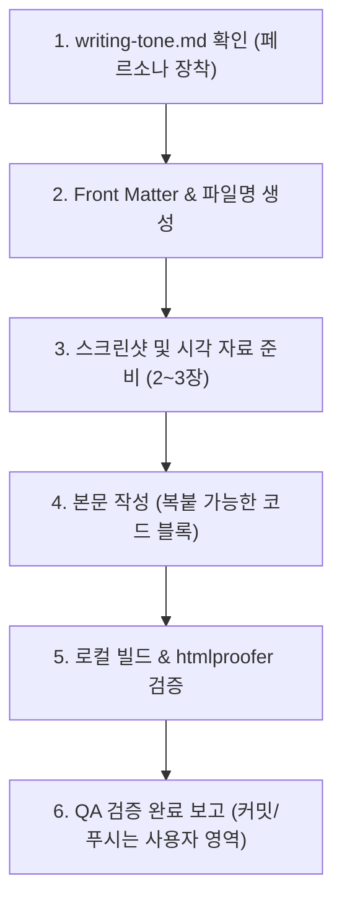

# AI 에이전트 지침서 (agent.md)

이 문서는 AI 어시스턴트(Antigravity, Claude, Copilot 등)가 **남주의 커밋로그([https://namju.kim](https://namju.kim))** 저장소에서 작업할 때 준수해야 하는 **아키텍처 규칙, 글 작성 프로세스, 품질 검증 절차**를 정의합니다.

> ⚠️ **필수 확인 사항**
> 블로그 포스트를 작성하거나 수정할 때는 반드시 [writing-tone.md](file:///Users/kimnamju/Documents/GitHub/blog/writing-tone.md)를 먼저 확인하고 작성자(김남주)의 페르소나와 톤앤매너를 100% 준수해야 합니다.

---

## 1. 블로그 아키텍처 개요

- **엔진**: Jekyll v4.3.x + `jekyll-theme-chirpy` v7.6.0 (Gem 기반 배포)
- **런타임**: Ruby 3.4 (GitHub Actions 및 Dev Container 표준)
- **배포 환경**: GitHub Pages (`.github/workflows/pages-deploy.yml`)
- **개발 환경**: VS Code Dev Container (`.devcontainer/devcontainer.json`)

| 경로                               | 용도 및 주의사항                                                                                                                         |
| :--------------------------------- | :--------------------------------------------------------------------------------------------------------------------------------------- |
| `_posts/{대분류}/{중분류}/`        | 계층형 카테고리 디렉토리 구조 및 블로그 포스트 마크다운 파일 (`YYYY-MM-DD-title.md`)                                                     |
| `assets/images/YYYY-MM-DD/`        | 각 포스트에 사용되는 스크린샷 및 이미지 자산 저장소                                                                                      |
| `_includes/metadata-hook.html`     | **Chirpy 공식 확장 훅** (네이버 서치어드바이저, 애드센스 등 커스텀 태그 주입용). **절대 `_includes/head.html`을 통째로 덮어쓰지 말 것!** |
| `_includes/linkpreview.html`       | `jekyll-linkpreview` OG 지원 사이트용 미리보기 카드 템플릿                                                                               |
| `_includes/linkpreview_nog.html`   | OpenGraph가 없는 사이트용 fallback 템플릿 (프로토콜 상대 URL 에러 방지 필수)                                                             |
| `_plugins/category-folder-hook.rb` | `_posts/{대분류}/{중분류}/` 폴더 경로 기반 2계층 카테고리 자동 주입 훅                                                                   |
| `_plugins/posts-lastmod-hook.rb`   | Git 커밋 히스토리 기반 `last_modified_at` 자동 주입 훅                                                                                   |

---

## 2. 블로그 포스트 작성 워크플로우

AI 에이전트가 새 글을 작성할 때는 아래 순서를 엄격히 따릅니다.



### Step 1. 파일명 및 Front Matter 규격
- **파일명 및 저장 경로**: `_posts/{카테고리폴더}/YYYY-MM-DD-kebab-case-title.md` (예: `_posts/spring-boot/2026-05-01-spring-security-...md`, `_posts/blog/jekyll/2025-03-01-...md`)
- **발행 날짜 규칙**: 시리즈 연재 시 이전 글로부터 **매주 1개씩(7일 간격)** 또는 일일 연재 규칙에 맞추어 날짜(`date:`)를 설정합니다.
- **분량 기준**: 1개 포스트는 **5분 읽기 분량 (1,500 ~ 2,500자 내외)**으로, 문제/이유 ➔ 설정/코드 ➔ 검증의 완결성을 갖춥니다.
- **공식 문서 기반**: 추측성 작성 금지. 해당 기술(Chirpy Wiki, Jekyll docs, Google/Naver Console, GitHub Docs)의 **공식 페이지 내용을 철저히 확인**하고 반영합니다.
- **카테고리(Category)와 태그(Tag)의 분리 원칙**:
  - **카테고리 (Category)**:
    - **역할**: 대주제와 주제별 분류 (1계층 또는 2계층 수직 구조).
    - **자동 매핑**: `_plugins/category-folder-hook.rb`에 의해 `_posts/{폴더}/` 경로에 글을 넣으면 `categories`가 폴더명을 기반으로 자동 생성 및 주입됩니다 (Front Matter에 생략해도 폴더 기준 자동 생성).
    - **탐색 화면**: 좌측 사이드바의 **Categories 탭(`/categories/`)**에서 탐색.
    - **원칙**: 1개 포스트는 단 하나의 명확한 분류 체계에 귀속됩니다.
  - **태그 (Tag)**:
    - **역할**: 사용된 세부 기술 스택, 라이브러리, 특정 키워드의 수평적 모음 (`tags: [spring-boot, kotlin, jwt, redis, security]`).
    - **탐색 화면**: 좌측 사이드바의 **Tags 탭(`/tags/`)**에서 알파벳순/건수별 뱃지 및 데스크톱 우측 사이드바의 **Trending Tags** 위젯에 노출.
    - **원칙**: 여러 기술 키워드를 자유롭게 N개 부여하여 독자의 교차 검색과 필터링을 지원합니다.
- **표준 카테고리 및 폴더 규격 (폴더명이 곧 카테고리명이 됨)**:
  - `Spring > Feature`: `_posts/Spring/Feature/` (19편) -> `categories: ["Spring", "Feature"]`
  - `Spring > AI`: `_posts/Spring/AI/` (4편) -> `categories: ["Spring", "AI"]`
  - `Spring > Wanted-Challenge`: `_posts/Spring/Wanted-Challenge/` (11편) -> `categories: ["Spring", "Wanted-Challenge"]`
  - `Dev`: `_posts/Dev/` (3편) -> `categories: ["Dev"]`
  - `Dev > Book`: `_posts/Dev/Book/` (1편) -> `categories: ["Dev", "Book"]`
  - `Java > Swing`: `_posts/Java/Swing/` (4편) -> `categories: ["Java", "Swing"]`
  - `Blog > Jekyll`: `_posts/Blog/Jekyll/` (9편) -> `categories: ["Blog", "Jekyll"]`
- **Front Matter 표준 형식 (categories 완전 생략, tags만 작성)**:
  ```yaml
  ---
  title: 글 제목 (직관적이고 명확한 기술 키워드 포함)
  description: 검색엔진 및 SNS 카드용 1~2문장 요약
  date: YYYY-MM-DD HH:MM:SS +0900
  tags: [태그1, 태그2, 태그3] # 검색 및 교차 필터링용 기술 키워드 N개 명시
  mermaid: true # 다이어그램 사용 시 true
  image:
    path: https://... 또는 /assets/images/YYYY-MM-DD/thumbnail.png
    alt: 대표 썸네일 설명
  ---
  ```
  > 💡 **담백하고 정제된 제목(Title) 원칙**:
  > - 의문형(`~할 때?`, `~죽는 이유`, `~없다?`)이나 과장된 광고성 어그로 문구(`완벽 해결`, `초고속`, `원클릭`, `~의 모든 것`, `치명적 위험`, `~할 필요는 없다`)를 엄격히 금지합니다.
  > - 기술 키워드와 적용 대상/목적을 명확히 명시하는 담백하고 깔끔한 엔지니어링 스타일로 작성합니다 (예: `Docker 멀티스테이지 빌드를 활용한 Spring Boot 이미지 최적화`, `Docker Compose Profiles와 Override를 활용한 로컬 개발 환경 분리`).

### Step 2. 이미지 및 스크린샷 배치 (필수 2~3장)
- 시각적 증거(브라우저 렌더링 화면, 콘솔 관리자 대시보드, 모바일 반응형 뷰 등)를 **반드시 2~3장 이상** 배치합니다.
- **✂️ 불필요한 여백 제거 및 확대·타이트 크롭 (Tight Crop 원칙)**:
  - 브라우저 전체 창이나 사이드바, 무의미한 빈 배경 여백을 그대로 캡처하지 않습니다.
  - 독자가 모바일이나 태블릿에서도 확대 없이 내용을 선명하게 읽을 수 있도록, **확대(Zoom) 및 영역 크롭을 통해 핵심 정보가 담긴 특정 UI 카드, 테이블, 입력 폼 영역만 불필요한 여백 없이 타이트하게 크롭**하여 첨부합니다.
- **🔒 API 키 및 민감 정보 모자이크/블러 마스킹 필수 (Security Masking)**:
  - **API 키로 추정되는 모든 텍스트(`AIza...`, `sk-...`, 비밀 토큰, 인증키 등)** 및 개인 식별 정보(전화번호, 계정 비밀번호, 민감한 프로젝트 ID 등)는 이미지 상에서 **반드시 모자이크(Mosaic), 블러(Blur), 또는 블랙박스 마스킹 처리**를 진행합니다.
  - 실제 API 키가 이미지나 코드 블록에 날것(Raw Text)으로 노출되는 것을 엄격히 금지하며, 코드에서도 환경 변수(`${GEMINI_API_KEY}`)나 마스킹(`AIzaSyD...xxxx`) 형태로 표기해야 합니다.
- **🚫 코드 캡처 절대 금지 (No Code Screenshots)**:
  - 에디터 화면(VS Code 등)이나 코드/설정 텍스트를 이미지로 캡처하여 첨부하는 행위를 엄격히 금지합니다.
  - 모든 코드, YAML, JSON, 쉘 명령어는 독자가 손쉽게 복사/붙여넣기할 수 있도록 **반드시 마크다운 백틱(```) 코드 블록**으로 작성해야 합니다.
  - 이미지는 텍스트 복사가 불가능하므로 코드 설명용 이미지 대신, **브라우저 실제 실행 결과**나 **UI 대시보드**만 캡처하여 첨부합니다.
- 이미지는 `assets/images/YYYY-MM-DD/` 경로에 저장하고 마크다운에 상대/절대경로로 링크합니다.
- **🌐 Aside 브라우저(`aside` MCP)를 활용한 캡처 및 인터넷 서치 원칙**:
  - **화면 캡처 (Screen Capture)**:
    - 기술 블로그에 필요한 모든 화면 캡처는 **`aside` MCP (`aside.repl`)**를 최우선으로 활용합니다.
    - 사용자의 실제 로그인 쿠키 및 세션(Google Cloud, Google AI Studio, GitHub, AWS 등)이 유지되는 Aside 브라우저의 탭을 탐색(`listBrowserTabs()`, `attachBrowserTab()`)하거나 직접 접속(`openTab()`)하여 실제 동작 화면을 캡처합니다.
    - 불필요한 브라우저 여백은 제거하고 특정 요소나 핵심 카드 영역을 확대 크롭(`locator.screenshot()`)하며, API 키 및 개인 식별 정보는 반드시 모자이크 마스킹 처리합니다.
  - **인터넷 서치 및 기술 리서치 (Web Search & Research)**:
    - 공식 기술 문서 검증, 최신 프레임워크 릴리즈 노트, 실시간 웹 검색이 필요할 때 **`aside` MCP 브라우저**를 적극 활용하여 최신 레퍼런스를 직접 방문하고 확인합니다.
    - 추측성 작성이나 오래된 정보를 배제하고, Aside 브라우저를 통한 실시간 공식 문서(docs.spring.io, ai.google.dev 등) 확인을 거쳐 정확한 스펙을 작성합니다.
- 외부 링크는 노션 스타일 북마크인 `` 문법을 적극 사용합니다.

### Step 3. 본문 작성 (2대 표준 스타일 준수)
- [writing-tone.md](file:///Users/kimnamju/Documents/GitHub/blog/writing-tone.md)에 정의된 **스타일 1 (문제 해결/트러블슈팅형)** 또는 **스타일 2 (Quick Start/튜토리얼형)** 구조를 따릅니다.
- 코드는 독자가 그대로 복사/붙여넣기하여 실행할 수 있도록 의존성, 어노테이션, 파일 경로 주석을 명시합니다.
- 말투는 단정한 **경어체(~합니다/~습니다)**, 1인칭은 **'저'** 또는 주어 생략을 유지합니다.

---

## 3. 품질 및 빌드 검증 (Quality Assurance)

글 작성이 끝나면 커밋 전 반드시 컨테이너 안에서 빌드와 유효성 검사를 수행해야 합니다.

```bash
# 1. 사이트 빌드 검증
bundle exec jekyll build -d /tmp/_site

# 2. 내부 링크, 이미지 깨짐, 프로토콜 검사 (htmlproofer)
bundle exec htmlproofer /tmp/_site \
  --disable-external \
  --ignore-urls "/^http:\/\/127.0.0.1/,/^http:\/\/0.0.0.0/,/^http:\/\/localhost/"
```
- `HTML-Proofer finished successfully (0 failures)` 결과를 확인한 후에만 보고를 진행합니다.

---

## 4. Git 및 작업 수칙

- **작업 브랜치**: 사용자의 요청에 따라 별도의 feature 브랜치 없이 **`main` 브랜치에서 직접 작업**합니다.
- **⚠️ 커밋(Commit) 및 업로드(Push) 권한 원칙**:
  - **AI 에이전트는 절대 직접 `git commit` 또는 `git push`를 실행하지 않습니다.**
  - 코드/글 작성 및 QA 검증 완료 후, 변경 사항을 최종 커밋하고 원격 저장소에 푸시하는 것은 **전적으로 사용자(김남주)의 고유 권한 영역**입니다.
  - AI 에이전트는 작업이 끝나면 변경된 파일 내역을 투명하게 안내하고, 사용자가 직접 복사해서 실행할 수 있는 추천 커밋 명령어만 텍스트로 제시해야 합니다:
    ```bash
    git add -A
    git commit -m "문서: [작업 요약]"
    git push origin main
    ```
- **커밋 메시지 추천 원칙 (100% 한글 작성)**:
  - 사용자의 요청에 따라, 추천 커밋 메시지는 영문 접두사(`docs:`, `fix:`, `feat:` 등) 대신 **순수 한글로만 작성**하여 추천합니다.
  - 예시:
    - `"글 작성: Chirpy 테마 깃허브 페이지스 시작하기"` (새 글 작성)
    - `"수정: 목차 접힘 현상 SCSS 오버라이드로 해결"` (버그 또는 스타일 수정)
    - `"문서: 깃허브 페이지스 1~4편 포스트 리팩토링 및 중복 제거"` (문서 개정)
    - `"기능: 노션 스타일 링크 미리보기 카드 및 커스텀 템플릿 추가"` (기능 추가)

