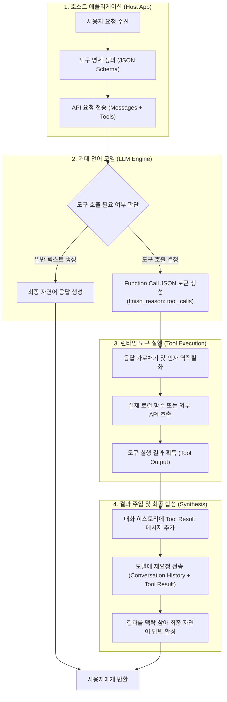

> LLM(거대 언어 모델)은 본질적으로 이전 토큰들의 맥락을 바탕으로 다음 토큰의 확률을 계산하는 텍스트 완성기(Autoregressive Model)일 뿐, 스스로 데이터베이스를 쿼리하거나 외부 API를 호출하는 런타임 실행 능력이 없습니다. 그럼에도 불구하고 최신 모델들이 계산기를 두드리고, 실시간 주가를 조회하며, 사내 업무 시스템과 연동되는 비결은 무엇일까요?  
> 이 글에서는 **"LLM이 어떻게 직접적인 연산 능력 없이도 외부 도구를 사용하는가?"**라는 질문을 출발점으로 삼아, JSON Schema 기반 도구 명세 주입, 모델의 구조화된 Function Call 토큰 생성, 그리고 호스트 런타임의 실행 결과 재주입(Tool Result Injection)까지 이어지는 전체 피드백 루프의 내부 동작 원리를 엔지니어링 관점에서 상세히 분석합니다.

---

## 1. LLM의 근본적 한계와 도구 사용(Tool Use)의 필요성

최신 LLM은 방대한 지식을 학습했지만 태생적으로 세 가지 결정적인 한계를 지닙니다:

1. **지식 단절(Knowledge Cutoff)**: 모델 가중치에 고정된 지식은 학습 시점 이후의 최신 정보를 반영하지 못합니다.
2. **연산 및 논리 실행 불가(No Native Computation)**: LLM은 수학 계산이나 문자열 조작을 확률적으로 모사할 뿐, 정확한 산술 연산이나 결정론적 규칙을 실행하는 CPU를 갖추고 있지 않습니다.
3. **외부 환경 변경 불가(No Side-Effects)**: 모델 단독으로는 메일을 발송하거나, 데이터베이스 레코드를 갱신하거나, 결제 트랜잭션을 처리할 수 없습니다.

초기에는 이러한 문제를 해결하기 위해 시스템 프롬프트에 규약을 명시하고 특정 포맷(예: `Action: search[query]`)을 출력하도록 유도하는 프롬프트 엔지니어링 기법을 사용했습니다. 하지만 모델이 자유 형식 텍스트를 출력하다 보니 따옴표 누락, 유효하지 않은 JSON 구조, 문법 오류 등으로 인해 애플리케이션 파서가 깨지는 일이 빈번했습니다.

이 문제를 해결하기 위해 OpenAI를 필두로 모델 아키텍처 수준에서 도입된 기능이 바로 **Function Calling(Tool Use)**입니다.

```
[흔한 오해]
"LLM이 직접 데이터베이스에 접속해서 SQL을 날린다." (X)

[실제 동작]
"LLM은 도구 명세를 읽고, '이 함수를 이런 인자로 실행해줘'라는 구조화된 JSON 토큰을 출력하며,
실제 실행과 네트워크 통신은 LLM을 감싸고 있는 애플리케이션(호스트)이 전담한다." (O)
```

---

## 2. Tool Calling 전체 라이프사이클 (The Feedback Loop)

도구 사용은 모델 단독 작업이 아니라 **"클라이언트(호스트 애플리케이션)와 모델 간의 4단계 핑퐁(Ping-Pong) 피드백 루프"**로 동작합니다.



이 흐름에서 핵심은 **도구 실행 권한이 전적으로 호스트 애플리케이션에 있다는 점**입니다. 모델은 오직 "의사 결정자"이자 "인자 추출기"로 기능합니다.

---

## 3. 1단계: JSON Schema 기반 도구 명세(Tool Specification) 주입

호스트는 LLM에 질문을 보낼 때, 모델이 사용할 수 있는 도구 목록을 함께 전달합니다. 이때 도구의 규격은 **JSON Schema(Draft 7 또는 2020-12)** 형식을 따릅니다.

모델은 이 스키마를 보고 다음 세 가지를 파악합니다:
1. 어떤 기능의 도구들이 존재하는가? (`name`)
2. 언제 어떤 목적으로 이 도구를 호출해야 하는가? (`description`)
3. 도구를 호출할 때 넘겨야 하는 파라미터의 타입과 필수값은 무엇인가? (`parameters`)

### 완성형 도구 명세 JSON 예제

다음은 주문 조회 및 배송 상태를 확인하는 도구 명세 예시입니다.

```json
{
  "type": "function",
  "function": {
    "name": "lookup_customer_order",
    "description": "고객의 주문 번호(orderId)를 조회하여 결제 상태, 주문 상품 목록, 배송 추적 번호를 반환합니다. 고객이 주문 상태나 배송 현황을 문의할 때 사용합니다.",
    "parameters": {
      "type": "object",
      "properties": {
        "orderId": {
          "type": "string",
          "description": "ORD-로 시작하는 10자리 주문 고유 식별자 (예: ORD-20251110-01)"
        },
        "includeTrackingDetails": {
          "type": "boolean",
          "description": "실시간 배송 기사 위치 및 택배사 이동 상세 정보를 포함할지 여부",
          "default": false
        }
      },
      "required": ["orderId"],
      "additionalProperties": false
    }
  }
}
```

> **엔지니어링 팁: `description`은 또 하나의 프롬프트입니다.**  
> 모델은 함수의 내부 구현을 전혀 모릅니다. 따라서 `description`에 "어떤 조건에서 이 함수를 호출해야 하는지"와 "인자의 포맷 예시"를 구체적으로 작성해야 모델의 엉뚱한 호출(False Positive)을 막을 수 있습니다.
{: .prompt-info }

---

## 4. 2단계: 모델의 판단과 구조화된 Function Call 토큰 생성

사용자가 `"ORD-20251110-01 주문 배송 어디쯤 왔는지 확인해줘"`라고 질의하면, 모델은 질문의 맥락과 주입된 도구 명세를 비교합니다.

모델 내부에서는 다음과 같은 판단이 일어납니다:
- 질문에 명시된 `ORD-20251110-01`은 `lookup_customer_order`의 `orderId` 파라미터와 정확히 매칭된다.
- 실시간 배송 위치를 묻고 있으므로 `includeTrackingDetails`는 `true`가 적합하다.
- 따라서 일반 텍스트 대신 `tool_calls` 형식의 토큰을 생성한다.

### 모델의 실제 반환 응답 (Raw HTTP Response)

모델은 일반 텍스트를 담는 `content`를 `null`로 비우고, 대신 `tool_calls` 배열을 채워 응답합니다. `finish_reason`은 `"stop"`이 아니라 `"tool_calls"`로 반환됩니다.

```json
{
  "id": "chatcmpl-A1B2C3D4E5",
  "object": "chat.completion",
  "created": 1762743600,
  "model": "gpt-4o",
  "choices": [
    {
      "index": 0,
      "message": {
        "role": "assistant",
        "content": null,
        "tool_calls": [
          {
            "id": "call_9x8w7v6u5t4s",
            "type": "function",
            "function": {
              "name": "lookup_customer_order",
              "arguments": "{\"orderId\":\"ORD-20251110-01\",\"includeTrackingDetails\":true}"
            }
          }
        ]
      },
      "finish_reason": "tool_calls"
    }
  ]
}
```

여기서 주의할 점은 `arguments` 필드가 객체가 아니라 **JSON 형식의 문자열(Stringified JSON)**이라는 점입니다. 모델은 텍스트 생성기이기 때문에 바이트 단위로 JSON 문법에 맞게 인코딩된 문자열을 토큰 단위로 출력한 것입니다.

---

## 5. 3단계: 호스트 런타임의 가로채기와 함수 디스패치 (Execution)

호스트 애플리케이션은 응답의 `finish_reason`이 `tool_calls`임을 감지하면, 사용자에게 곧바로 응답을 노출하지 않고 제어 흐름을 가로챕니다.

호스트는 다음 단계를 수행합니다:
1. `call.function.name`을 조회하여 등록된 핸들러 매핑 테이블(Registry)에서 대상 함수를 찾습니다.
2. `call.function.arguments` JSON 문자열을 파싱하여 강타입 DTO 객체로 역직렬화합니다.
3. 실제 비즈니스 로직(DB 쿼리, 내부 마이크로서비스 호출 등)을 실행합니다.

### Spring Boot / Kotlin 기반 도구 디스패처 구현 예제

```kotlin
// src/main/kotlin/com/example/ai/tool/OrderToolDispatcher.kt
package com.example.ai.tool

import com.fasterxml.jackson.databind.ObjectMapper
import com.fasterxml.jackson.module.kotlin.readValue
import org.slf4j.LoggerFactory
import org.springframework.stereotype.Component

data class OrderLookupArgs(
    val orderId: String,
    val includeTrackingDetails: Boolean = false
)

data class OrderLookupResult(
    val orderId: String,
    val status: String,
    val items: List<String>,
    val courier: String?,
    val currentLocation: String?
)

@Component
class OrderToolDispatcher(
    private val objectMapper: ObjectMapper,
    private val orderService: OrderService
) {
    private val log = LoggerFactory.getLogger(javaClass)

    fun executeTool(toolName: String, argumentsJson: String): String {
        log.info("도구 실행 요청 수신: name={}, args={}", toolName, argumentsJson)

        return when (toolName) {
            "lookup_customer_order" -> {
                val args = objectMapper.readValue<OrderLookupArgs>(argumentsJson)
                val result = orderService.findOrderDetails(args.orderId, args.includeTrackingDetails)
                objectMapper.writeValueAsString(result)
            }
            else -> {
                log.error("알 수 없는 도구 호출: {}", toolName)
                throw IllegalArgumentException("지원하지 않는 도구입니다: $toolName")
            }
        }
    }
}
```

> **보안 및 격리 주의사항 (Security Boundary)**  
> 모델이 전달한 인자는 검증되지 않은 외부 입력입니다. SQL Injection, 취약한 파라미터 조작, 비정상적인 범위의 값 입력이 일어날 수 있으므로 함수 내부에서 반드시 **입력값 유효성 검증(Validation)**과 **접근 권한 확인(Authorization)**을 수행해야 합니다.
{: .prompt-warning }

---

## 6. 4단계: 결과 주입(Tool Result Injection)과 최종 답변 합성

함수 실행이 완료되면 반환된 결과(JSON 텍스트)를 대화 히스토리에 다시 삽입해야 합니다.

이때 중요한 규약은 **이전 Assistant의 `tool_calls` 메시지와 결과 `tool` 메시지의 `tool_call_id`가 반드시 1:1로 일치해야 한다는 점**입니다. 모델은 이 식별자를 통해 자신이 요청했던 어떤 호출에 대한 결과인지 맥락을 연결합니다.

### 완성형 재요청 페이로드 (Full Conversation History)

```json
{
  "model": "gpt-4o",
  "messages": [
    {
      "role": "user",
      "content": "ORD-20251110-01 주문 배송 어디쯤 왔는지 확인해줘"
    },
    {
      "role": "assistant",
      "content": null,
      "tool_calls": [
        {
          "id": "call_9x8w7v6u5t4s",
          "type": "function",
          "function": {
            "name": "lookup_customer_order",
            "arguments": "{\"orderId\":\"ORD-20251110-01\",\"includeTrackingDetails\":true}"
          }
        }
      ]
    },
    {
      "role": "tool",
      "tool_call_id": "call_9x8w7v6u5t4s",
      "content": "{\"orderId\":\"ORD-20251110-01\",\"status\":\"SHIPPING\",\"items\":[\"인체공학 키보드\"],\"courier\":\"CJ대한통운\",\"currentLocation\":\"옥천HUB 간선하차 진행중\"}"
    }
  ]
}
```

### 모델의 최종 자연어 응답

결과를 주입받은 모델은 이제 외부 데이터라는 확실한 맥락(Ground Truth)을 확보했습니다. 모델은 이 사실에 기반하여 환각 없이 자연스러운 어조로 사용자에게 최종 답변을 생성합니다.

```
[모델의 최종 응답]
"고객님의 주문(ORD-20251110-01, 인체공학 키보드)은 현재 CJ대한통운을 통해 배송 중입니다.
현재 옥천HUB에서 간선하차 작업이 진행 중이며, 정상적으로 배송이 진행되고 있습니다."
```

---

## 7. 병렬 도구 호출 (Parallel Tool Calling)의 동작 원리

사용자가 단일 문장에서 여러 개의 작업을 요청할 때, 최신 모델들은 도구를 한 번에 하나씩 순차 호출하지 않고 **한 번의 턴에서 여러 개의 도구 호출을 동시에 발행**할 수 있습니다. 이를 병렬 도구 호출(Parallel Tool Calling)이라고 합니다.

예를 들어 `"서울이랑 도쿄 내일 날씨 비교해줘"`라고 요청하면, 모델은 응답 하나에 두 개의 함수 호출 객체를 반환합니다:

```json
"tool_calls": [
  {
    "id": "call_weather_seoul_01",
    "function": { "name": "get_weather", "arguments": "{\"city\":\"Seoul\"}" }
  },
  {
    "id": "call_weather_tokyo_02",
    "function": { "name": "get_weather", "arguments": "{\"city\":\"Tokyo\"}" }
  }
]
```

호스트는 이 두 함수를 비동기 병렬(`CompletableFuture` 또는 Kotlin `coroutine`)로 동시에 실행한 뒤, 두 결과 메시지를 모두 히스토리에 추가하여 모델에 돌려주면 됩니다. 이를 통해 왕복 레이턴시(Network Round-Trip)를 획기적으로 줄일 수 있습니다.

---

## 8. 정리 및 다음 단계: 단순 호출에서 자율 에이전트로

Function Calling은 거대 언어 모델을 단순한 '챗봇'에서 '컴퓨팅 인터페이스'로 확장시킨 핵심 전환점이었습니다.

- **LLM은 런타임이 아닙니다**: 모델은 오직 도구 명세를 읽고 구조화된 호출 토큰을 생성할 뿐입니다.
- **호스트가 통제권을 가집니다**: 실제 함수 실행, 권한 검증, 결과 주입은 호스트 애플리케이션의 몫입니다.
- **ID 매칭이 핵심입니다**: `tool_call_id`를 통한 정확한 매핑이 컨텍스트의 무결성을 보장합니다.

그러나 지금까지 살펴본 구조는 **1회성 호출(Single-turn Tool Use)**에 가깝습니다. 만약 첫 번째 도구의 결과에 따라 두 번째 도구를 무엇을 부를지 동적으로 결정해야 하거나, 도구 호출이 실패했을 때 다른 대안을 찾아야 한다면 어떻게 해야 할까요?

다음 포스트에서는 모델이 스스로 생각(Thought)하고, 행동(Action)하며, 결과(Observation)를 관찰하여 다단계 목표를 완수하는 **ReAct 패턴 기반의 자율 에이전트 추론 루프**를 다루어 보겠습니다.
