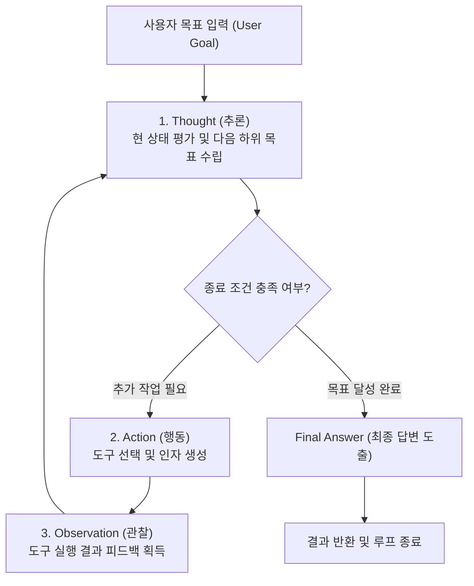
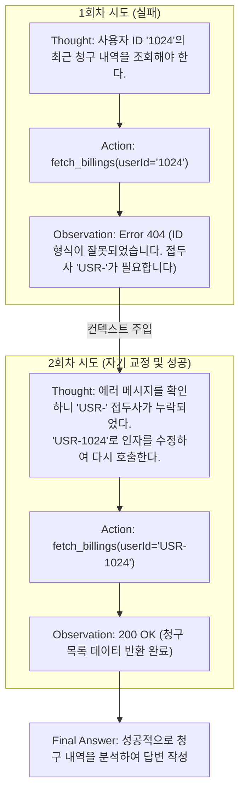

> 앞선 글에서 살펴본 Function Calling이 "호스트가 정해준 1회성 도구 실행"이라면, 진정한 AI 에이전트(Agent)의 시작은 **"복잡한 목표를 달성할 때까지 스스로 계획을 세우고 도구를 반복 호출하는 자율 추론 루프"**에 있습니다. Yao et al.(2022)의 논문에서 제안된 **ReAct(Reasoning + Acting)** 패턴은 LLM의 내부 추론(Thought)과 환경과의 상호작용(Action/Observation)을 하나로 결합하여 환각을 억제하고 동적인 문제 해결 능력을 비약적으로 끌어올렸습니다.  
> 이 글에서는 1회성 도구 호출과 자율 에이전트의 구조적 차이점, ReAct 사이클의 3단계 흐름, 목표 완수 판별(Finish Condition), 그리고 도구 호출 실패 시의 자기 교정(Self-Correction) 전략을 엔지니어링 관점에서 깊이 있게 다룹니다.

---

## 1. Single-turn 도구 호출과 ReAct 에이전트의 결정적 차이

단순한 Function Calling(Single-turn)과 자율 에이전트(Multi-turn Agentic Loop)의 차이는 **"다음에 취할 행동을 누가 결정하는가"**에 있습니다.

```
[Single-turn Function Calling]
사용자 질문 ➔ 도구 호출 1회 ➔ 결과 반환 ➔ 답변 종료
(흐름이 결정론적이며, 선행 작업 결과에 따라 새로운 도구를 탐색하는 분기 처리가 불가능함)

[Agentic ReAct Loop]
사용자 질문 ➔ [생각 ➔ 행동 ➔ 관찰] ➔ [생각 ➔ 행동 ➔ 관찰] ... ➔ 최종 목표 달성 판별 ➔ 종료
(이전 도구 실행 결과(Observation)를 보고 다음 행동을 모델 스스로 동적으로 결정함)
```

예를 들어 `"지난달 VIP 고객 중 이탈 징후가 있는 사용자를 조회해서, 최근 결제 실패 원인을 로그에서 확인한 뒤 담당 매니저에게 슬랙 알림을 보내줘"`라는 요청이 있다고 가정해 보겠습니다.

이 작업은 한 번의 API 호출로 해결할 수 없습니다:
1. CRM API를 호출해 VIP 고객 목록을 가져옵니다.
2. 결과 데이터를 보고 이탈 징후 조건을 검사합니다.
3. 해당 고객의 ID를 추출하여 로그 서버 API를 호출합니다.
4. 로그 분석 결과를 바탕으로 슬랙 메시지 템플릿을 생성해 알림 API를 호출합니다.

선행 단계의 결과물이 후행 단계의 입력 인자로 체인처럼 연결되어야 하며, 도중에 데이터가 비어 있거나 오류가 발생하면 계획을 유연하게 틀어야 합니다. 이를 가능하게 하는 설계 양식이 바로 **ReAct 패턴**입니다.

---

## 2. ReAct 패턴의 핵심 구조: Thought ➔ Action ➔ Observation

ReAct는 단순한 프롬프트 기법이 아니라, **인간의 인지적 문제 해결 과정**을 모방한 상태 머신(State Machine)입니다.



### 각 단계의 핵심 역할

1. **Thought (생각 / 내부 추론)**
   - 모델이 즉각적으로 도구를 호출하기 전에, **현재까지 모인 정보가 무엇인지 평가**하고 **다음에 어떤 행동을 취해야 할지 스스로에게 텍스트로 설명**합니다.
   - 이 과정은 모델의 환각(Hallucination)을 극적으로 줄여주며, 불필요한 도구 호출을 방지하는 브레이크 역할을 합니다.
2. **Action (행동 / 도구 호출)**
   - 이전 Thought에서 수립한 계획에 따라 구체적인 도구(Function)와 파라미터를 JSON 형태로 결정합니다.
   - 예: `lookup_user_logs(userId="VIP-8901", days=30)`
3. **Observation (관찰 / 환경 피드백)**
   - 호스트 애플리케이션이 실제 도구를 실행하고 반환한 결과물(Raw Data 또는 에러 메시지)입니다.
   - 모델의 컨텍스트 윈도우에 새로운 사실(Ground Truth)로 주입되며, 다음 Thought의 근거가 됩니다.

---

## 3. ReAct 에이전트 실행 엔진(Runner) 설계 및 구현

에이전트의 런타임 루프는 무한 루프에 빠지지 않도록 **최대 반복 횟수(Max Iterations)**와 **타임아웃**을 보장하는 엄격한 제어기(Runner)로 감싸야 합니다.

다음은 Kotlin 기반으로 작성한 ReAct 에이전트 코어 루프 엔진 예제입니다.

```kotlin
// src/main/kotlin/com/example/ai/agent/ReActAgentRunner.kt
package com.example.ai.agent

import org.slf4j.LoggerFactory
import org.springframework.stereotype.Component

data class AgentExecutionResult(
    val finalAnswer: String,
    val totalIterations: Int,
    val history: List<AgentStep>
)

data class AgentStep(
    val iteration: Int,
    val thought: String?,
    val actionName: String?,
    val actionArguments: String?,
    val observation: String?
)

@Component
class ReActAgentRunner(
    private val llmClient: AgentLlmClient,
    private val toolDispatcher: AgentToolDispatcher
) {
    private val log = LoggerFactory.getLogger(javaClass)
    private val maxIterations = 8

    fun run(userGoal: String): AgentExecutionResult {
        val history = mutableListOf<AgentStep>()
        var currentContext = "User Goal: $userGoal\n"

        for (iteration in 1..maxIterations) {
            log.info("ReAct 루프 시작: Step {} / {}", iteration, maxIterations)

            // 1. LLM 호출 (Thought 및 Action 결정)
            val stepDecision = llmClient.decideNextStep(currentContext)

            // 2. 종료 조건 검사 (Finish Action 또는 Final Answer 도출)
            if (stepDecision.isFinished) {
                log.info("목표 달성 감지 (Finish Condition 충족)")
                history.add(AgentStep(iteration, stepDecision.thought, null, null, null))
                return AgentExecutionResult(
                    finalAnswer = stepDecision.finalAnswer ?: "요청이 완료되었습니다.",
                    totalIterations = iteration,
                    history = history
                )
            }

            // 3. Action 실행 및 Observation 획득
            val toolName = stepDecision.toolName ?: throw IllegalStateException("도구 이름 누락")
            val arguments = stepDecision.arguments ?: "{}"

            val observation = try {
                toolDispatcher.execute(toolName, arguments)
            } catch (ex: Exception) {
                log.warn("도구 실행 실패: tool={}, error={}", toolName, ex.message)
                "Error: 도구 실행 중 오류가 발생했습니다: ${ex.message}"
            }

            // 4. 컨텍스트 누적
            val stepRecord = AgentStep(
                iteration = iteration,
                thought = stepDecision.thought,
                actionName = toolName,
                actionArguments = arguments,
                observation = observation
            )
            history.add(stepRecord)

            // 다음 턴을 위한 컨텍스트 업데이트
            currentContext += """
                Thought: ${stepDecision.thought}
                Action: $toolName($arguments)
                Observation: $observation
            """.trimIndent() + "\n"
        }

        // 최대 횟수 초과 시 안전한 Fallback
        log.error("최대 반복 횟수({}) 초과로 인한 루프 강제 종료", maxIterations)
        return AgentExecutionResult(
            finalAnswer = "주어진 반복 횟수 내에 작업을 완전히 종료하지 못했습니다. 현재까지 확인된 내용만 정리합니다.",
            totalIterations = maxIterations,
            history = history
        )
    }
}
```

---

## 4. 종료 조건(Finish Condition)의 정밀한 판별

에이전트가 언제 작업을 끝낼지 판단하는 것은 자율 루프 안정성의 핵심입니다. 일반적으로 두 가지 접근 방식이 사용됩니다:

1. **특수 Finish Action 도구 등록**:
   - `finish(final_response="...")` 형태의 가상 도구를 도구 목록에 포함시킵니다.
   - 모델이 모든 정보를 획득했다고 판단하면 다른 비즈니스 API 대신 `finish` 도구를 호출하고, 러너는 루프를 종료합니다.
2. **텍스트 스트림 내 접두사 파싱**:
   - 모델이 `Final Answer:`라는 규약으로 문장을 시작하면 이를 최종 답변으로 인식합니다.

> **루프 폭주(Infinite Loop) 방지 원칙**  
> 모델이 똑같은 도구와 파라미터를 반복 호출하거나 종료 조건을 찾지 못해 맴도는 현상을 방지하기 위해, 반드시 **`maxIterations` 상한선**을 설정하고 **직전 호출 파라미터와의 중복 검사(Cycle Detection)** 로직을 호스트에 두어야 합니다.
{: .prompt-danger }

---

## 5. 도구 실패 시의 자율 복구: 자기 교정(Self-Correction) 메커니즘

ReAct 패턴의 진정한 강점은 **도구 실행이 실패했을 때 에이전트가 스스로 원인을 분석하고 대안을 찾는 복원력(Resilience)**에 있습니다.

기존의 고정된 절차적 코드에서는 외부 API가 404 Not Found나 400 Bad Request를 반환하면 전체 배치가 에러와 함께 중단됩니다. 반면 ReAct 루프에서는 에러 로그 자체가 **Observation**으로 전달되므로, 모델이 다음 **Thought**에서 이를 학습하고 궤도를 수정합니다.



### 실제 자율 교정 트레이스 로그 예제

```text
[Step 1]
Thought: 고객 '김철수'의 전화번호를 알아내기 위해 주소록 검색 API를 호출한다.
Action: search_contacts(name="김철수")
Observation: [] (검색 결과 0건)

[Step 2]
Thought: 정확한 이름 검색으로 결과가 나오지 않았다. 혹시 사내 조직도 검색 도구인 search_employee가 더 적합할 수 있다. 도구를 전환해 재검색한다.
Action: search_employee(query="김철수")
Observation: [{"empId": "EMP-9921", "dept": "플랫폼개발팀", "phone": "010-XXXX-5678"}]

[Step 3]
Thought: 조직도에서 'EMP-9921' 김철수 님의 연락처를 성공적으로 찾았다. 추가 도구 호출 없이 최종 답변을 작성한다.
Final Answer: 플랫폼개발팀 김철수 님의 사내 연락처는 010-XXXX-5678 입니다.
```

이처럼 실패 정보를 숨기지 않고 상세한 에러 텍스트로 `Observation`에 제공할수록, LLM은 더욱 뛰어난 문제 해결 능력을 발휘합니다.

---

## 6. 프로덕션 운영 시 직면하는 과제와 최적화 방안

실무 시스템에 ReAct 루프를 도입할 때는 다음 두 가지 현실적인 병목을 반드시 고려해야 합니다:

### 1. 컨텍스트 팽창(Context Bloat)과 비용 문제
루프가 5회, 6회 거듭될수록 이전의 모든 Thought, Action, Observation이 대화 히스토리에 누적됩니다. 특히 도구가 반환하는 데이터가 수십 KB에 달하는 JSON 배열이라면 입력 토큰 수가 기하급수적으로 폭증합니다.

- **대응책**: 도구 실행 결과(Observation)를 그대로 넣지 않고, 호스트 레벨에서 필요한 필드만 남기는 **프로젝션(Field Filtering)**을 적용하거나 중간 단계의 이전 Observation을 요약 압축합니다.

### 2. 누적 지연 시간(Cumulative Latency)
매 스텝마다 `[LLM 네트워크 호출 ➔ 로컬 도구 실행]`이 반복되므로 전체 응답 시간이 수 초에서 수십 초까지 늘어날 수 있습니다.

- **대응책**: 도구 간 의존성이 없는 하위 작업은 앞서 살펴본 병렬 도구 호출(Parallel Tool Calling)을 접목하고, 사용자에게는 SSE(Server-Sent Events)를 통해 현재 어떤 Thought와 Action이 진행 중인지 실시간 스트리밍으로 피드백을 전달해야 합니다.

---

## 7. 정리: 결정론적 안전장치와 자율 추론의 조화

ReAct 패턴은 복잡한 비즈니스 문제를 LLM 스스로 분해하고 도구를 활용해 해결하도록 만드는 가장 검증된 에이전트 아키텍처입니다.

- **Thought**는 맹목적인 행동을 막는 이정표 역할을 합니다.
- **Action과 Observation**은 최신 사실을 실시간으로 수집하는 창구가 됩니다.
- **Self-Correction**은 외부 환경의 일시적 오류나 파라미터 미스매치를 유연하게 극복합니다.
- 그리고 **Max Iterations와 가드레일**은 자율 시스템이 폭주하지 않도록 지켜주는 안전벨트입니다.

단순한 API 연동을 넘어 자율적인 백엔드 어시스턴트를 구상하고 있다면, 견고한 ReAct 실행 엔진을 설계하는 것부터 시작해 보시길 권장합니다.
