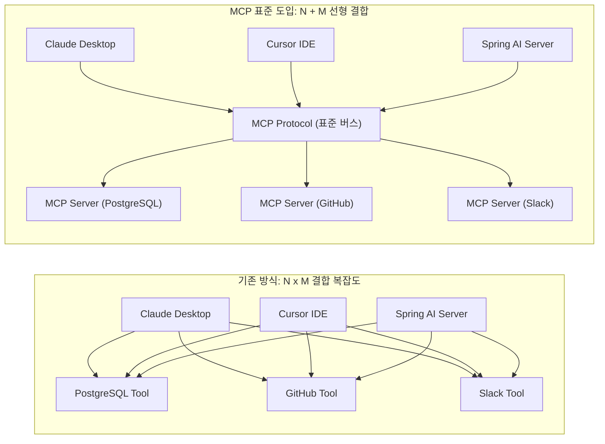
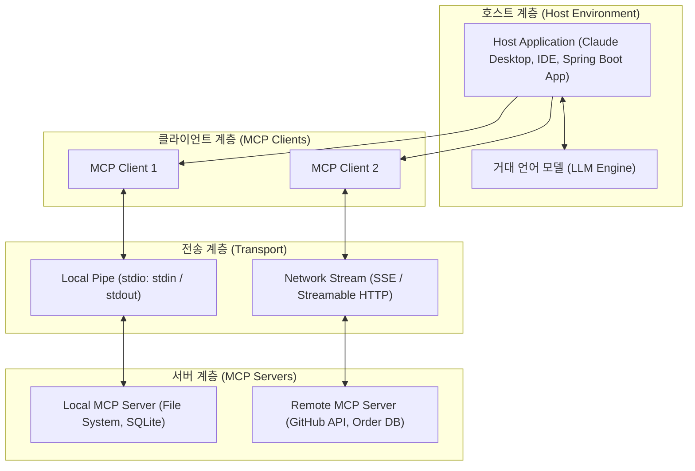
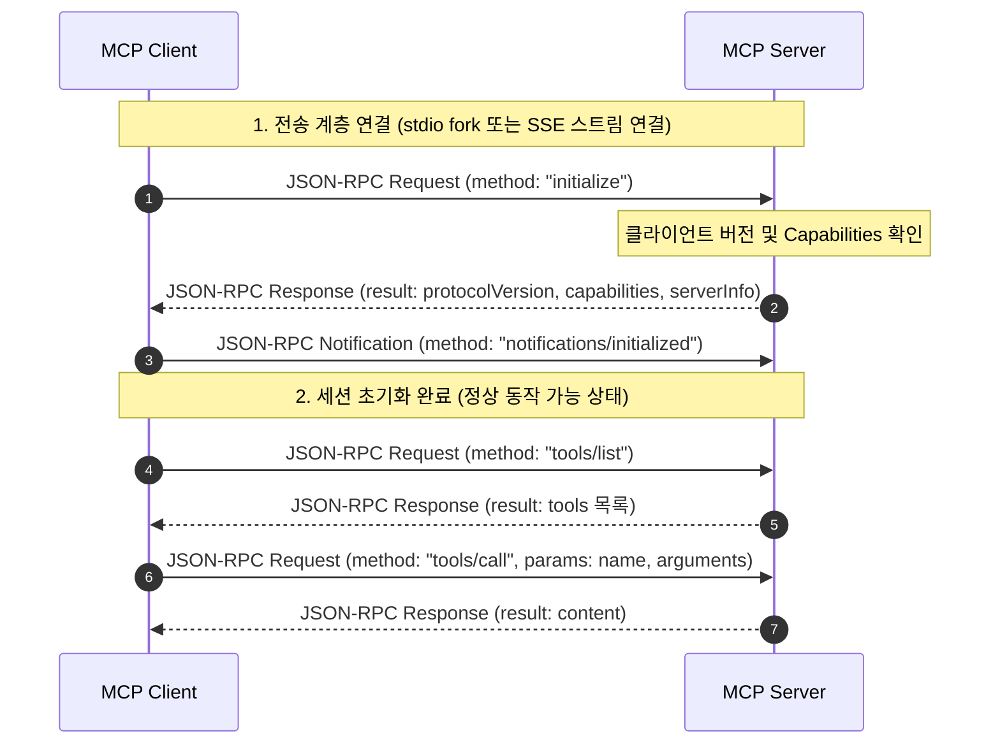

> 거대 언어 모델(LLM)이 현실의 다양한 시스템과 상호작용하기 위해 등장한 수많은 도구 연동 방식은 각 클라이언트와 모델 제공자마다 제각각 파편화되어 N×M의 결합 복잡도를 야기했습니다. **Model Context Protocol(MCP)**는 마치 개발 도구 생태계의 언어 서버 프로토콜(LSP)처럼, AI 애플리케이션과 외부 컨텍스트 제공자 간의 통신 규격을 개방형 표준으로 통일한 기술입니다. 본 글에서는 MCP의 등장 배경부터 Host, Client, Server 3계층 책임 분리, STDIO와 SSE 전송 메커니즘, 그리고 연결 초기화(Initialize) 핸드셰이크의 내부 동작 원리를 깊이 있게 살펴봅니다.

---

## 1. 등장 배경: N×M 파편화에서 N+M 개방형 표준으로

초기 LLM 기반 애플리케이션 개발에서 외부 데이터베이스를 조회하거나 사내 API를 호출하려면, 각 LLM 제공자(OpenAI, Anthropic, Google 등)의 전용 Function Calling 규격에 맞추어 도구(Tool)를 직접 작성해야 했습니다. 

이 방식은 단일 모델을 단일 클라이언트(예: 특정 웹 챗봇)에 연동할 때는 큰 무리가 없었으나, 개발 생태계가 확장되면서 심각한 확장성 한계에 부딪혔습니다:

1. **도구 재사용의 부재**: Claude Desktop에서 동작하도록 작성한 PostgreSQL 조회 도구를 IDE(Cursor, VS Code)나 사내 스프링 부트 백엔드 에이전트에서 재사용하려면, 클라이언트별 프레임워크 규격에 맞추어 도구 어댑터를 매번 재작성해야 했습니다.
2. **파편화된 인증 및 보안 관리**: 데이터베이스, 로컬 파일시스템, GitHub 등 M개의 외부 시스템에 접근하기 위한 인증 로직과 권한 검증 코드가 N개의 AI 클라이언트마다 중복 구현되었습니다.
3. **N × M 연결 복잡도**: N개의 클라이언트 환경과 M개의 데이터 소스가 존재할 때 필요한 연동 비용이 $N \times M$으로 폭증했습니다.



Anthropic이 2024년 11월 오픈소스로 공개한 **Model Context Protocol(MCP)**은 이러한 문제를 근본적으로 해결합니다. 마이크로소프트가 언어 서버 프로토콜(LSP, Language Server Protocol)을 통해 IDE와 프로그래밍 언어 분석기를 1:1 결합에서 표준 통신으로 분리했던 것처럼, MCP는 AI 애플리케이션(호스트)과 컨텍스트 제공자(서버)를 표준 프로토콜로 격리하여 연결 비용을 **$N + M$**으로 낮추었습니다.

---

## 2. MCP 3계층 아키텍처: Host, Client, Server

MCP 아키텍처는 명확한 책임 분리를 위해 **Host**, **Client**, **Server**의 3계층 구조로 설계되어 있습니다.



### 1) Host (호스트)
- **정의**: 최종 사용자 인터페이스를 제공하고 LLM의 추론 루프를 총괄하는 상위 애플리케이션입니다 (예: Claude Desktop, Cursor, Custom Agent Server).
- **책임**:
  - LLM 모델과의 직접적인 통신(프롬프트 전달, 완성 응답 수신).
  - 여러 개의 MCP Client 인스턴스를 생성하고 생명주기(기동, 재시작, 종료)를 통제.
  - 보안 경계 제어: 모델이 도구 실행을 요청했을 때 사용자에게 승인(HITL, Human-in-the-Loop)을 요청하거나 권한을 검증.

### 2) Client (클라이언트)
- **정의**: 호스트 애플리케이션 내부에서 동작하며, 단 하나의 MCP 서버와 1:1 연결을 맺고 유지하는 프로토콜 어댑터입니다.
- **책임**:
  - 전송 계층(Transport)을 추상화하여 서버와의 JSON-RPC 2.0 세션 수립.
  - 프로토콜 규격 협상(Capability Negotiation) 및 도구/리소스/프롬프트 목록 동기화.
  - 모델의 함수 호출 요청을 서버 규격에 맞추어 JSON-RPC 메시지로 인코딩하고, 서버 응답을 역직렬화하여 호스트에 반환.

### 3) Server (서버)
- **정의**: 특정 데이터 소스나 도구 실행 기능을 격리된 형태로 노출하는 경량 서비스 프로세스입니다.
- **책임**:
  - 외부에 노출할 기능(Tools, Resources, Prompts)의 메타데이터와 JSON Schema 정의.
  - 클라이언트의 요청에 따라 실제 시스템 로직(SQL 쿼리 실행, 파일 읽기, API 호출)을 수행하고 표준 포맷으로 결과 반환.
  - 호스트나 모델의 내부 상태를 알 필요 없이, 오직 들어오는 JSON-RPC 요청에만 응답하는 독립적인 무상태(또는 세션 기반) 컴포넌트로 동작.

---

## 3. 전송 계층 (Transport Layer): stdio vs SSE

MCP는 클라이언트와 서버 간의 통신 물리 계층을 추상화하여 지원하며, 대표적으로 **표준 입출력(stdio)** 방식과 **Server-Sent Events(SSE)** 방식 두 가지를 표준으로 채택하고 있습니다.

| 비교 항목 | 로컬 프로세스 (stdio) | 원격 네트워크 (SSE / Streamable HTTP) |
| :--- | :--- | :--- |
| **통신 메커니즘** | OS 자식 프로세스의 `stdin` / `stdout` 파이프 | 클라이언트 송신: HTTP POST<br/>서버 스트리밍: Server-Sent Events (SSE) |
| **실행 주체** | MCP Client가 서버 바이너리를 직접 fork | 독립적인 원격 웹 서버 (마이크로서비스)로 상시 구동 |
| **네트워크 지연** | 없음 (동일 머신 내 메모리 파이프 통신) | 네트워크 레이턴시 및 연결 단절 고려 필요 |
| **보안 환경** | OS 사용자 계정 권한 및 샌드박스 정책 적용 | HTTPS, Bearer 토큰, mTLS 등 웹 보안 표준 적용 |
| **주요 사용 사례** | 로컬 파일 탐색, Git CLI, SQLite 로컬 조회 | 사내 데이터베이스, 클라우드 API, 공유 마이크로서비스 |

### stdio 전송 방식의 엔지니어링 주의점
stdio 방식은 호스트가 서버 프로세스를 fork한 뒤 표준 입력(`stdin`)으로 요청 JSON-RPC 문자열을 쓰고, 표준 출력(`stdout`)으로 결과를 읽습니다.

> stdio 기반 서버 개발 시 가장 흔한 실수는 서버 내부의 디버그 로깅(`System.out.println`, `console.log`)이 표준 출력으로 섞여 들어가는 것입니다. 비정형 로그가 `stdout`에 유입되면 클라이언트의 JSON 역직렬화 파서가 즉시 크래시되므로, 모든 애플리케이션 로그는 반드시 표준 에러(`stderr`)로 리다이렉트해야 합니다.
{: .prompt-warning }

---

## 4. JSON-RPC 2.0 기반 생명주기와 Initialize 핸드셰이크

MCP는 클라이언트와 서버 간의 모든 메시지 교환에 **JSON-RPC 2.0** 프로토콜을 사용합니다. 연결이 수립되면 양측은 엄격한 3단계 초기화 핸드셰이크를 거쳐 상호 지원 기능을 확인합니다.



### Step 1. 연결 초기화 요청 (`initialize`)
클라이언트는 서버에 가장 먼저 `initialize` 메서드를 호출하며 지원하는 프로토콜 버전과 클라이언트 기능(Capabilities)을 전달합니다:

```json
{
  "jsonrpc": "2.0",
  "id": 1,
  "method": "initialize",
  "params": {
    "protocolVersion": "2024-11-05",
    "capabilities": {
      "roots": {
        "listChanged": true
      },
      "sampling": {}
    },
    "clientInfo": {
      "name": "NamjuBlogAgent",
      "version": "1.0.0"
    }
  }
}
```

### Step 2. 서버 초기화 응답
서버는 자신이 지원하는 프로토콜 버전과 서버 정보, 그리고 제공 가능한 프리미티브 기능(Tools, Resources, Prompts)의 지원 여부를 응답합니다:

```json
{
  "jsonrpc": "2.0",
  "id": 1,
  "result": {
    "protocolVersion": "2024-11-05",
    "capabilities": {
      "tools": {
        "listChanged": true
      },
      "resources": {
        "subscribe": true,
        "listChanged": true
      },
      "prompts": {
        "listChanged": false
      }
    },
    "serverInfo": {
      "name": "enterprise-inventory-server",
      "version": "2.1.0"
    }
  }
}
```

### Step 3. 초기화 완료 선언 (`notifications/initialized`)
클라이언트는 서버의 응답을 수신하고 정상적으로 협상이 완료되었음을 알리는 단방향 알림(Notification, 응답이 없는 메시지)을 보냅니다:

```json
{
  "jsonrpc": "2.0",
  "method": "notifications/initialized",
  "params": {}
}
```

이 핸드셰이크가 완료된 이후에만 클라이언트는 `tools/list`, `resources/list` 등의 실제 비즈니스 요청을 수행할 수 있습니다. 만약 초기화 완료 전에 다른 요청을 보낼 경우 서버는 JSON-RPC 에러(`-32600`, Invalid Request)를 반환해야 합니다.

---

## 5. 엔지니어링 관점에서의 핵심 설계 고려사항

실무에서 MCP 아키텍처를 도입할 때 염두에 두어야 할 핵심 엔지니어링 포인트는 다음과 같습니다:

1. **보안 경계와 권한 격리 (Security Isolation)**:
   - 외부 MCP 서버가 제공하는 도구 목록 중 시스템을 변경하거나 데이터를 삭제하는 파괴적인 도구가 포함될 수 있습니다.
   - 호스트 애플리케이션 단에서 도구 허용 목록(Allowlist) 필터를 구성하거나, 모델의 호출 결과를 사용자에게 사전에 확인받는 승인 인터페이스(HITL)가 반드시 수반되어야 합니다.
2. **에러 핸들링과 프로토콜 무결성**:
   - 도구 실행 도중 발생하는 비즈니스 예외(예: 주문 ID 조회 실패)는 JSON-RPC 통신 에러(`error` 필드)로 감싸기보다, `result.isError = true`와 함께 텍스트 결과로 반환하는 것이 권장됩니다.
   - 그래야만 LLM이 실패 원인을 자연어로 인지하고 "다른 주문 번호로 재시도"하는 등의 능동적 에러 복구를 수행할 수 있습니다.
3. **무상태(Stateless) 설계 지향**:
   - 특히 SSE 기반 원격 MCP 서버의 경우 수평 확장을 고려하여 서버 내부에 모델과의 대화 세션 상태를 저장하지 않고, 필요한 파라미터는 `tools/call` 요청 인자로 모두 전달받도록 설계하는 것이 바람직합니다.

---

## 6. 정리

- **Model Context Protocol(MCP)**는 AI 클라이언트와 외부 시스템 간의 결합을 개방형 표준으로 분리하여 개발 및 유지보수 복잡도를 $N \times M$에서 $N + M$으로 혁신하는 프로토콜입니다.
- **Host, Client, Server 3계층**의 책임 분리를 통해 호스트는 UI와 보안을, 클라이언트는 세션과 프로토콜을, 서버는 고유한 도구 실행을 전담합니다.
- 로컬 환경에서는 오버헤드가 없는 **stdio**, 원격 분산 환경에서는 **SSE/HTTP Stream**을 통해 통신하며, JSON-RPC 2.0 기반의 엄격한 초기화 핸드셰이크로 안정성을 보장합니다.
- 다음 글에서는 MCP 서버가 외부에 컨텍스트를 제공하는 **3대 핵심 프리미티브(Tools, Resources, Prompts)**의 명확한 역할 정의와 페이로드 스펙을 비교해 보겠습니다.

---

## 참고 자료
- Model Context Protocol 공식 명세서:  
  
- Anthropic MCP Specification GitHub:  
  
- JSON-RPC 2.0 Specification:  
  
