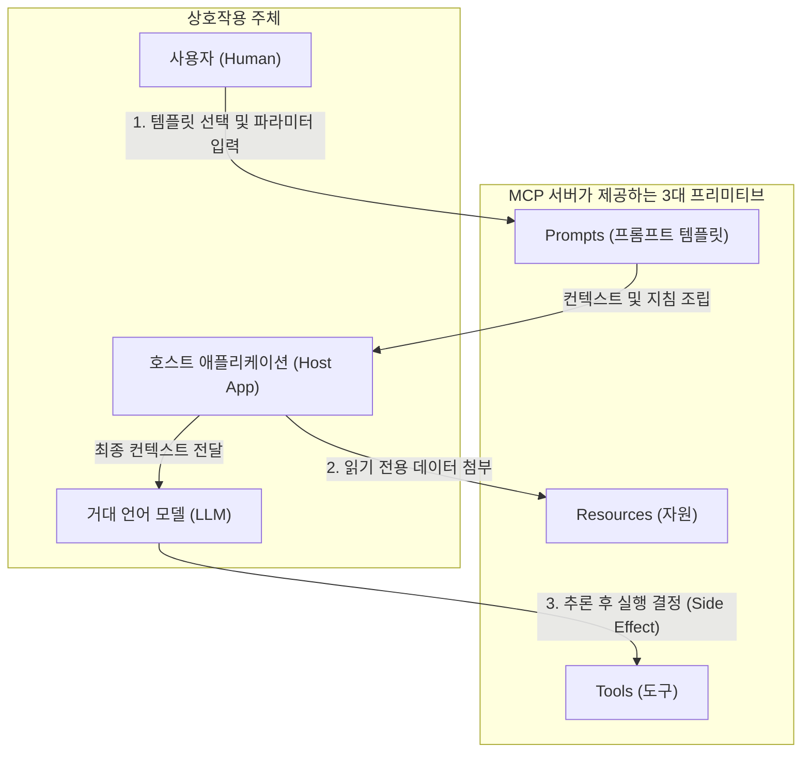
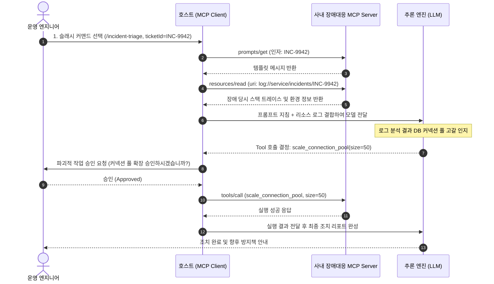

> Model Context Protocol(MCP)을 처음 접할 때 가장 혼란스러운 지점 중 하나는 "도구(Tools), 데이터(Resources), 프롬프트(Prompts)를 왜 굳이 세 가지 개념으로 분리했을까?"라는 의문입니다. 과거 Function Calling 방식에서는 모델에 데이터를 주입하는 모든 행위를 단순 함수로 포장했지만, 이는 보안 경계가 흐려지고 시스템 부수 효과(Side Effect)의 통제가 어려워지는 문제를 낳았습니다. MCP는 모델의 능동적 실행, 외부 데이터의 안전한 관측, 사람이 주도하는 워크플로우를 명확히 분리하기 위해 3대 프리미티브를 정의합니다. 본 글에서는 이 세 가지 프리미티브의 핵심 역할과 차이점, 그리고 실제 JSON-RPC 2.0 프로토콜 페이로드를 상세히 살펴봅니다.

---

## 1. 3대 프리미티브의 역할 분담과 비교

MCP 아키텍처에서 서버는 호스트와 모델에게 컨텍스트를 제공하기 위해 **Tools**, **Resources**, **Prompts**라는 상호보완적인 3대 프리미티브(Primitives)를 노출합니다.



세 프리미티브는 제어 주체와 부수 효과 유무, 그리고 데이터 흐름의 방향성에서 명확한 차이를 보입니다:

| 구분                | Tools (도구)                                                     | Resources (자원)                                       | Prompts (프롬프트)                                |
| :------------------ | :--------------------------------------------------------------- | :----------------------------------------------------- | :------------------------------------------------ |
| **호출 주체**       | **모델 (Model)**이 자율 판단                                     | **호스트 / 사용자**가 명시적 지정                      | **사용자 (User)**가 명시적 선택                   |
| **부수 효과**       | **있음 (State Change 가능)**<br/>(DB 수정, 메일 발송, 파일 쓰기) | **없음 (Read-Only)**<br/>순수 데이터 조회 및 파일 읽기 | **없음 (Template Assembly)**<br/>메시지 목록 조합 |
| **식별 체계**       | 고유한 함수 이름 (`name`)                                        | 표준 URI (`file://`, `db://`)                          | 고유한 템플릿 이름 (`name`)                       |
| **클라이언트 제어** | 실행 전 사용자 승인(HITL) 권장                                   | 백그라운드 구독 및 실시간 갱신 가능                    | UI 슬래시 커맨드(`/`) 연동 최적화                 |
| **대표 예시**       | `create_order`, `send_slack`                                     | `file:///var/log/app.log`, DB 스키마                   | `/code-review`, `/debug-incident`                 |

---

## 2. Tools: 모델이 주도하는 동적 실행과 부수 효과

### 개념과 책임
**Tools**는 LLM이 주어진 문제를 해결하는 과정에서 외부 세계와 상호작용하기 위해 스스로 실행을 결정하는 **행동(Action) 프리미티브**입니다.

- **능동성**: 사용자가 직접 지정하지 않더라도, 모델이 대화 흐름을 분석하여 적절한 도구와 인자(Arguments)를 계산해 호출합니다.
- **부수 효과(Side Effect)**: 외부 API 호출, 레코드 삽입/삭제, 프로세스 실행 등 시스템의 상태를 영구적으로 변경할 수 있습니다.
- **보안 검증**: 부수 효과가 존재하기 때문에 클라이언트는 민감한 도구 실행 전 사용자 확인 절차를 두거나 허용 목록(Allowlist)을 강제해야 합니다.

### JSON-RPC 통신 규격

#### 1) 도구 목록 조회 (`tools/list`)
클라이언트는 서버가 제공하는 도구 목록과 입력 스키마를 요청합니다:

```json
{
  "jsonrpc": "2.0",
  "id": 10,
  "method": "tools/list",
  "params": {}
}
```

서버 응답에는 각 도구의 이름, 설명, JSON Schema 기반의 매개변수 명세가 포함됩니다:

```json
{
  "jsonrpc": "2.0",
  "id": 10,
  "result": {
    "tools": [
      {
        "name": "cancel_order",
        "description": "지정한 주문 번호의 결제를 취소하고 환불을 접수합니다.",
        "inputSchema": {
          "type": "object",
          "properties": {
            "orderId": {
              "type": "string",
              "description": "취소할 주문 고유 식별자"
            },
            "reason": {
              "type": "string",
              "description": "취소 및 환불 사유"
            }
          },
          "required": ["orderId", "reason"]
        }
      }
    ]
  }
}
```

#### 2) 도구 실행 요청 (`tools/call`)
모델이 결정을 내리면 클라이언트는 서버로 실행 명령을 전달합니다:

```json
{
  "jsonrpc": "2.0",
  "id": 11,
  "method": "tools/call",
  "params": {
    "name": "cancel_order",
    "arguments": {
      "orderId": "ORD-20251124-001",
      "reason": "고객 변심에 의한 즉시 취소"
    }
  }
}
```

서버는 비즈니스 로직을 수행한 후 `content` 배열 형태로 결과를 반환합니다:

```json
{
  "jsonrpc": "2.0",
  "id": 11,
  "result": {
    "content": [
      {
        "type": "text",
        "text": "주문번호 ORD-20251124-001의 취소 처리가 완료되었습니다. (환불 승인 번호: RF-8821)"
      }
    ],
    "isError": false
  }
}
```

---

## 3. Resources: URI 기반 읽기 전용 데이터와 실시간 구독

### 개념과 책임
**Resources**는 모델이나 호스트 애플리케이션이 참조할 수 있는 **정적/동적 데이터 소스(Data Source) 프리미티브**입니다. 파일 시스템의 파일, 데이터베이스의 스키마 정의, 실시간 로그 스트림, API 명세 등이 이에 해당합니다.

- **순수 읽기 전용 (Idempotent & Safe)**: 리소스 조회는 어떠한 시스템 부수 효과도 발생시키지 않습니다. 따라서 사용자 승인 절차 없이 안전하게 로딩할 수 있습니다.
- **URI 체계**: 모든 리소스는 RFC 3986을 준수하는 고유 URI(예: `postgres://orders/schema`, `file:///workspace/README.md`)로 식별됩니다.
- **실시간 구독(Subscription)**: 클라이언트는 특정 리소스의 변경 사항을 구독(`resources/subscribe`)할 수 있으며, 내용이 갱신되면 서버가 `notifications/resources/updated` 알림을 발행하여 컨텍스트를 최신화할 수 있습니다.

### JSON-RPC 통신 규격

#### 1) 리소스 조회 (`resources/read`)
클라이언트가 특정 URI의 데이터를 읽고자 할 때 전송합니다:

```json
{
  "jsonrpc": "2.0",
  "id": 20,
  "method": "resources/read",
  "params": {
    "uri": "postgres://production-db/tables/orders/schema"
  }
}
```

서버 응답은 텍스트 형태(`text`) 또는 바이너리 base64(`blob`) 형태로 콘텐츠를 전달합니다:

```json
{
  "jsonrpc": "2.0",
  "id": 20,
  "result": {
    "contents": [
      {
        "uri": "postgres://production-db/tables/orders/schema",
        "mimeType": "application/sql",
        "text": "CREATE TABLE orders (\n  order_id VARCHAR(32) PRIMARY KEY,\n  customer_id VARCHAR(32) NOT NULL,\n  total_amount NUMERIC(12, 2) NOT NULL,\n  status VARCHAR(20) NOT NULL,\n  created_at TIMESTAMP WITH TIME ZONE DEFAULT NOW()\n);"
      }
    ]
  }
}
```

#### 2) 변경 구독 및 알림 (`resources/subscribe`)
로그 파일이나 실시간 지표를 모니터링할 때 사용합니다:

```json
{
  "jsonrpc": "2.0",
  "id": 21,
  "method": "resources/subscribe",
  "params": {
    "uri": "log://server/errors/today"
  }
}
```

이후 서버에서 신규 에러가 발생하면 클라이언트로 단방향 알림을 보냅니다:

```json
{
  "jsonrpc": "2.0",
  "method": "notifications/resources/updated",
  "params": {
    "uri": "log://server/errors/today"
  }
}
```

---

## 4. Prompts: 사용자 주도의 재사용 가능한 상호작용 템플릿

### 개념과 책임
**Prompts**는 서버 개발자가 사전에 설계해 둔 **재사용 가능한 대화 및 워크플로우 템플릿 프리미티브**입니다.

- **사용자 제어 (Human-Driven)**: 모델이 호출하는 것이 아니라, 사용자가 호스트 UI(예: 슬래시 커맨드 `/코드리뷰`, 드롭다운 메뉴)에서 의도적으로 선택하여 발동합니다.
- **매개변수화(Parameterized)**: 템플릿에 동적 인자(Arguments)를 주입하여 상황에 맞춤화된 시스템 메시지와 사용자 메시지 구성을 동적으로 조립합니다.
- **리소스 바인딩**: 특정 프롬프트는 동작에 필수적인 Resource(예: 분석 대상 소스코드, 스타일 가이드)를 자동으로 메시지 컨텍스트에 포함하도록 선언할 수 있습니다.

### JSON-RPC 통신 규격

#### 1) 프롬프트 템플릿 가져오기 (`prompts/get`)
사용자가 `/incident-triage` 템플릿을 선택하고 장애 티켓 ID를 입력했을 때 클라이언트가 서버에 호출합니다:

```json
{
  "jsonrpc": "2.0",
  "id": 30,
  "method": "prompts/get",
  "params": {
    "name": "incident-triage",
    "arguments": {
      "ticketId": "INC-9942",
      "severity": "CRITICAL"
    }
  }
}
```

서버는 역할(`role`)과 콘텐츠(`content`)로 구조화된 메시지 목록을 생성하여 반환합니다:

```json
{
  "jsonrpc": "2.0",
  "id": 30,
  "result": {
    "description": "장애 티켓 분석 및 초동 조치 가이드 템플릿",
    "messages": [
      {
        "role": "user",
        "content": {
          "type": "text",
          "text": "현재 발생한 심각도 CRITICAL 등급의 장애 티켓(INC-9942)을 분석합니다. 아래 제공된 시스템 리소스와 진단 도구를 활용하여 원인을 진단하고 즉각적인 조치 방안을 제시하세요."
        }
      }
    ]
  }
}
```

---

## 5. 실무 아키텍처: 3대 프리미티브의 유기적 결합 시나리오

실제 프로덕션 엔지니어링 환경에서 이 세 가지 프리미티브는 독립적으로 쓰이기보다, 하나의 정교한 워크플로우 안에서 유기적으로 결합되어 동작합니다.



### 왜 이 분리가 중요한가?
만약 이 워크플로우를 레거시 Function Calling 단일 모델로만 설계했다면:
1. 장애 로그 데이터를 모델이 `get_logs()`라는 도구를 직접 호출해서 가져와야 하므로 **불필요한 토큰과 왕복 네트워크 레이턴시가 발생**합니다. Resources를 사용하면 호스트가 사전에 안전하게 주입할 수 있습니다.
2. 장애 대응 규칙이 프롬프트 엔지니어마다 제각각 흩어지지만, Prompts 프리미티브를 사용하면 **사내 SRE 팀의 모범 대응 지침을 버전 관리되는 서버 템플릿으로 중앙 집중화**할 수 있습니다.
3. 커넥션 풀을 변경하는 위험 작업(Tools)은 **부수 효과가 명확히 분리**되어 있으므로, 호스트가 자동으로 감지하여 관리자의 최종 승인(Human-in-the-Loop)을 강제할 수 있습니다.

---

## 6. 정리

- **Tools**: 모델이 상황을 판단하여 능동적으로 실행하며 시스템 상태 변화(Side Effect)를 동반하는 **행동(Action) 프리미티브**입니다.
- **Resources**: URI로 식별되는 안전하고 멱등한 **읽기 전용 데이터(Data) 프리미티브**로, 실시간 변경 구독을 지원합니다.
- **Prompts**: 사용자가 명시적으로 선택하여 재사용 가능한 워크플로우 맥락을 조립하는 **사람 주도 템플릿(Workflow) 프리미티브**입니다.
- 세 프리미티브의 명확한 역할 분담은 AI 에이전트 시스템의 **보안 경계 수립**, **네트워크 효율화**, 그리고 **중앙 집중식 지침 관리**를 가능하게 만드는 MCP의 가장 핵심적인 강점입니다.
