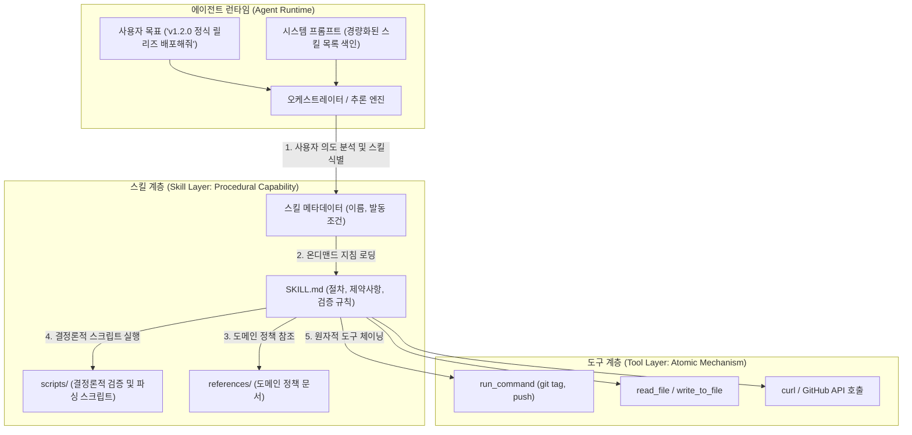
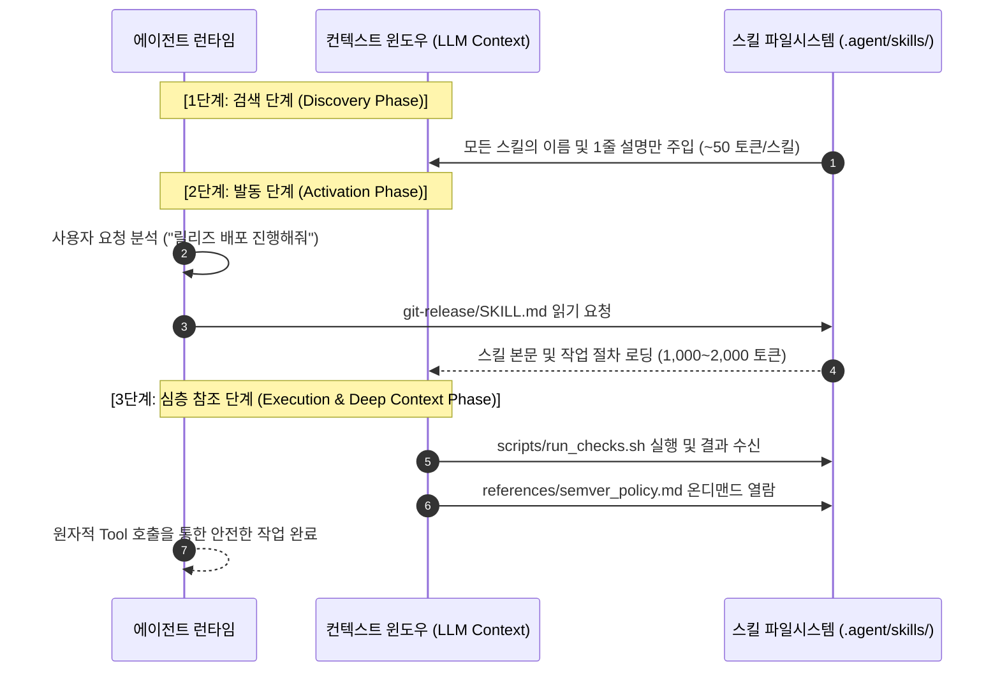

> 대규모 언어 모델(LLM) 기반 에이전트를 구축할 때 단순 프롬프트와 개별 함수 호출 도구(Tool)만으로는 복잡한 다단계 엔지니어링 작업을 일관성 있게 완수하기 어렵습니다. 본 글에서는 원자적 I/O를 수행하는 Tool, 인지적 맥락을 부여하는 Prompt, 그리고 절차적 도메인 지식과 오류 복구 체계를 캡슐화한 **'스킬(Skill)'**의 개념적 위계를 규명하고, 점진적 로딩(Progressive Disclosure) 기반의 최신 표준 스킬 아키텍처를 정리합니다.

---

## 1. 원자적 도구 호출의 한계와 추상화의 부재

LLM에 함수 호출(Function Calling) 기능이 도입되면서 모델은 외부 시스템과 상호작용하는 능력을 얻었습니다. 파일 시스템 읽기/쓰기, 터미널 쉘 명령 실행, REST API 호출 등은 에이전트가 현실 세계의 상태를 변경할 수 있는 기반이 되었습니다.

그러나 실제 프로덕션 환경에서 에이전트를 운용해 보면, **"단일 도구(Tool)의 나열만으로는 신뢰할 수 있는 엔지니어링 자동화를 달성할 수 없다"**는 구조적 한계에 직면하게 됩니다.

### 1.1 도구의 원자성(Atomicity)과 절차적 지식의 결여
개별 도구는 본질적으로 상태가 없고(Stateless) 원자적(Atomic)입니다. 예를 들어 `run_command`라는 도구는 쉘 명령을 입력받아 표준 출력을 반환할 뿐입니다. 

- 어떤 순서로 파이프라인을 실행해야 하는지
- 테스트가 실패했을 때 어떤 로그를 확인하고 롤백해야 하는지
- 프로덕션 배포 전에 반드시 거쳐야 하는 사전 유효성 검증(Pre-flight Check)이 무엇인지

이러한 **도메인 절차와 엔지니어링 규칙**은 도구 시그니처(`parameters: { command: string }`) 내부에 담을 수 없습니다.

### 1.2 프롬프트 비대화와 주의 집중력 분산(Attention Dilution)
절차적 지식을 모델에 주입하기 위해 흔히 선택하는 방법은 시스템 프롬프트(System Prompt)에 수많은 텍스트 규칙을 빼곡하게 작성하는 것입니다. 

하지만 수십 가지 업무 시나리오(Git 브랜치 관리, DB 마이그레이션 검증, API 보안 감사 등)를 하나의 시스템 프롬프트에 모두 밀어 넣으면 다음과 같은 부작용이 발생합니다:

1. **컨텍스트 윈도우 낭비 및 추론 비용 급증**: 모든 턴(Turn)마다 사용하지도 않는 업무 지침이 컨텍스트로 전달되어 토큰 비용이 선형적으로 증가합니다.
2. **주의 집중력 분산(Lost in the Middle)**: 프롬프트 길이가 수만 토큰에 달하면 모델이 핵심 지침을 무시하거나 엉뚱한 규칙을 교차 적용하는 환각(Hallucination)이 빈번해집니다.
3. **재사용 및 버전 관리 불가**: 프롬프트가 거대한 모놀리식 텍스트 덩어리가 되어, 특정 워크플로우만 수정하거나 팀 간에 공유하기가 불가능해집니다.

이러한 문제를 해결하기 위해 등장한 개념이 바로 **'스킬(Skill)'**입니다.

---

## 2. Prompt, Tool, Skill의 3단계 개념적 위계

에이전트 시스템을 안정적으로 설계하려면 Prompt, Tool, Skill의 역할 경계를 명확히 분리해야 합니다.



### 2.1 개념별 역할 비교

| 분류 | 추상화 대상 | 핵심 역할 | 예시 |
| :--- | :--- | :--- | :--- |
| **Prompt** | 인지적 상태 (Cognitive State) | 모델의 역할, 페르소나, 출력 형식, 상위 원칙 정의 | *"당신은 백엔드 릴리즈 엔지니어입니다."* |
| **Tool** | 원자적 메커니즘 (Atomic Mechanism) | 외부 환경과 물리적으로 상호작용하는 단일 I/O API | `run_command`, `read_file`, `web_search` |
| **Skill** | 절차적 역량 (Procedural Capability) | 특정 도메인 문제를 해결하기 위한 **[지침 + 도구 오케스트레이션 + 도메인 규칙 + 결정론적 스크립트 + 폴백/복구 로직]의 캡슐화** | `git-release-manager`, `db-migration-verifier` |

- **도구(Tool)는 '손발'**에 불과하며, 스스로 무엇을 해야 할지 모릅니다.
- **프롬프트(Prompt)는 '의식'**을 형성하지만, 구체적인 도메인 작업 단위로 쪼개어지지 않으면 통제력을 잃습니다.
- **스킬(Skill)은 '체화된 기술'**입니다. 특정 목적을 달성하기 위해 손발(Tool)을 어떤 순서로 움직이고, 예상치 못한 오류가 났을 때 어떻게 복구해야 하는지 완결된 실행 지침을 지닙니다.

---

## 3. 점진적 로딩(Progressive Disclosure) 아키텍처

스킬 아키텍처의 핵심 메커니즘은 **점진적 로딩(Progressive Disclosure)**입니다. 에이전트가 시작될 때 모든 스킬의 세부 구현을 컨텍스트에 올리지 않고, 필요할 때만 계층적으로 탐색합니다.



1. **검색 단계(Discovery)**: 초기 시스템 프롬프트에는 스킬의 `name`과 `description`만 등록됩니다. 50개의 스킬이 존재하더라도 2,000토큰 이내로 매우 가볍게 유지됩니다.
2. **발동 단계(Activation)**: 사용자의 의도가 특정 스킬과 부합하면, 에이전트는 파일 읽기 도구를 통해 해당 스킬의 메인 명세서(`SKILL.md`)를 컨텍스트에 적재합니다.
3. **심층 참조 단계(Deep Execution)**: 복잡한 정규식 검증이나 버전 계산 등은 LLM이 직접 토큰 단위로 추론하지 않고, 스킬에 포함된 확정적 스크립트(`scripts/`)에 위임하여 연산의 정확성을 100% 보장합니다.

---

## 4. 최신 에이전트 런타임의 표준 스킬 디렉토리 구조

Claude Code, Antigravity, Semantic Kernel 등 현대적인 자율 에이전트 런타임은 스킬을 단일 텍스트가 아닌 **독립적인 파일시스템 패키지** 형태로 격리하여 관리합니다.

```text
skills/
└── git-release-manager/
    ├── SKILL.md              # [필수] 스킬 메타데이터(Frontmatter) 및 워크플로우 지침
    ├── scripts/              # [선택] 결정론적(Deterministic) 실행 헬퍼 스크립트
    │   ├── bump_version.py   # SemVer 유효성 검증 및 버전 태그 계산
    │   └── preflight_check.sh# Git 워킹 트리 청결도 및 CI 통과 여부 검사
    ├── references/           # [선택] 필요 시 참조하는 도메인 정책 문서
    │   ├── semver-rules.md   # 사내 시맨틱 버저닝 명세
    │   └── rollback-guide.md # 릴리즈 실패 시 비상 롤백 절차
    └── examples/             # [선택] One-shot/Few-shot 실행 모범 사례
        └── release-demo.md
```

### 각 구성 요소의 역할 분담

- **`SKILL.md`**: 스킬의 진입점(Entrypoint)입니다. YAML Frontmatter에는 에이전트가 이 스킬을 언제 트리거해야 하는지 기술하고, 본문 마크다운에는 실행 단계(Step-by-step), 유효성 검증 기준, 금지 사항(Constraints)을 명시합니다.
- **`scripts/`**: LLM의 약점인 정밀 연산, 복잡한 문자열 파싱, 대규모 파일 변환을 오차 없이 수행하기 위한 실행 파일(Python, Bash, Node.js)을 둡니다. 모델은 스크립트를 호출하고 결과 표준 출력(stdout)만 받아 판단합니다.
- **`references/`**: 릴리즈 정책, 에러 코드 테이블, API 스펙 등 방대한 도메인 문서를 분리해 둡니다. 모델이 지침을 수행하다가 세부 규칙이 모호할 때만 선택적으로 읽도록 설계하여 불필요한 토큰 낭비를 원천 차단합니다.

---

## 5. 실전 구현 예제: 프로덕션급 `SKILL.md` 완성형 명세

아래는 사내 Git 릴리즈 배포를 완전 자동화하기 위해 작성된 표준 스킬 명세서 예시입니다.

```markdown
---
name: git-release-manager
description: Git 저장소의 변경 사항을 분석하여 시맨틱 버저닝(SemVer) 기반 릴리즈 태그를 발행하고 GitHub Release 및 변경 이력을 자동 배포합니다.
required_tools:
  - run_command
  - read_file
  - write_to_file
tags: [git, release, semver, cicd]
---

# Git Release Manager Skill

## 1. 개요 및 사전 조건 (Pre-flight Checks)
이 스킬은 현재 저장소의 미커밋 변경 사항이 없고, 기본 브랜치(main)의 최신 커밋이 CI 테스트를 통과한 상태에서만 실행되어야 합니다.

작업을 시작하기 전 반드시 아래 스크립트를 먼저 실행하여 검증하세요:
```bash
bash scripts/preflight_check.sh
```
- 출력이 `PREFLIGHT_PASS`가 아닐 경우 작업을 즉시 중단하고 사용자에게 실패 사유를 보고하세요.

## 2. 표준 릴리즈 워크플로우

### Step 1: 릴리즈 버전 결정
1. 직전 Git 태그를 조회합니다:
   ```bash
   git describe --tags --abbrev=0
   ```
2. 직전 태그 이후 발생한 커밋 로그를 확인합니다:
   ```bash
   git log $(git describe --tags --abbrev=0)..HEAD --oneline
   ```
3. `scripts/bump_version.py`를 실행하여 커밋 컨벤션(feat, fix, breaking change) 기반 다음 버전을 산출합니다:
   ```bash
   python3 scripts/bump_version.py --target-type auto
   ```

### Step 2: 릴리즈 노트 생성 및 검증
- 수집된 커밋 중 `docs:`나 `chore:`는 제외하고, 사용자 관점의 변경점(`feat:`, `fix:`)만 요약하여 `CHANGELOG.md` 상단에 추가합니다.
- 작성된 변경점은 `references/semver-rules.md`의 카테고리 분류 정책을 준수해야 합니다.

### Step 3: Git 태그 발행 및 원격 푸시
1. 변경 이력 파일을 커밋합니다:
   ```bash
   git add CHANGELOG.md
   git commit -m "docs: 릴리즈 vX.Y.Z 변경 이력 갱신"
   ```
2. 주석이 포함된(Annotated) 태그를 생성합니다:
   ```bash
   git tag -a vX.Y.Z -m "Release vX.Y.Z"
   ```
3. 원격 저장소에 커밋과 태그를 푸시합니다:
   ```bash
   git push origin main --follow-tags
   ```

## 3. 예외 처리 및 롤백 절차
- 원격 저장소 푸시 중 충돌(Conflict)이 발생할 경우 로컬에 생성된 태그를 즉시 삭제하세요:
  ```bash
  git tag -d vX.Y.Z
  ```
- 임의로 `git push --force` 명령을 실행하는 것은 엄격히 금지됩니다.
```

> [!TIP]
> `SKILL.md` 내부에 사용 금지 규칙(Constraints)과 명시적 롤백 명령어(`git tag -d`)를 정의해 두면, 예외 상황 발생 시 에이전트가 패닉 상태에 빠져 파괴적인 명령어(`rm -rf`, `--force`)를 실행하는 위험을 방지할 수 있습니다.

---

## 6. 스킬 캡슐화가 가져오는 아키텍처적 가치

단일 Tool 호출 모델에서 스킬(Skill) 기반 아키텍처로 전환할 때 얻을 수 있는 공학적 이점은 명확합니다:

1. **결정론적 신뢰성(Deterministic Reliability)**: 복잡한 정규식, 버전 계산, 린트 검사는 스크립트에 맡기고, LLM은 상태 판단과 순차적 오케스트레이션에만 집중하여 작업 성공률을 비약적으로 끌어올립니다.
2. **컨텍스트 최적화(Context Window Efficiency)**: 필요한 순간에만 관련 스킬과 레퍼런스를 메모리에 올리므로, 50개 이상의 다양한 도메인 작업을 단일 에이전트가 토큰 낭비 없이 수행할 수 있습니다.
3. **팀 단위 역량 자산화(Shareable Engineering Assets)**: 특정 시니어 엔지니어의 디버깅 노하우나 릴리즈 수칙을 `SKILL.md`와 `scripts/`로 패키징하여 Git 저장소에 공유함으로써, 조직 전체가 즉시 활용할 수 있는 실행 가능한 소프트웨어 자산이 됩니다.

---

## 7. 마치며

AI 에이전트의 발전은 단순히 더 강력한 파운데이션 모델을 사용하는 데서 끝나지 않습니다. 모델이 환경과 상호작용하는 접점을 어떻게 설계하느냐가 시스템의 완성도를 결정짓습니다.

원자적 도구(Tool)를 넘어 절차와 복구 규칙을 패키징한 스킬(Skill)은 에이전트 시스템을 장난감 수준의 챗봇에서 실무 프로덕션 엔지니어링 에이전트로 도약시키는 핵심 추상화 계층입니다. 다음 글에서는 이렇게 작성된 스킬들을 GitHub 저장소를 통해 체계적으로 배포하고, 의존성을 자동으로 해결하며 버전별로 설치하는 **'에이전트 스킬 마켓플레이스 및 패키지 관리 생태계'**를 다루어 보겠습니다.
