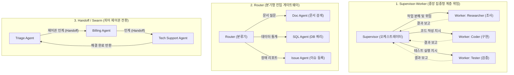
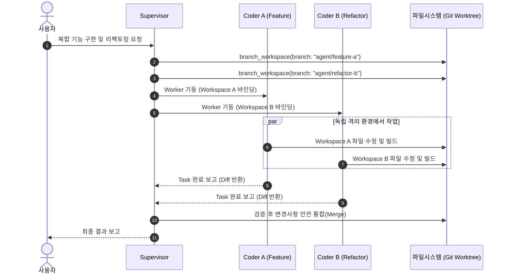

> LLM 기반 에이전트 시스템을 구축할 때 마주치는 가장 흔한 실패는 모든 역할과 도구를 하나의 "만능 에이전트(Monolithic Agent)"에 몰아넣는 것입니다. 시스템 프롬프트가 비대해질수록 모델의 지시 준수 능력(Instruction Following)은 급격히 저하되고, 수십 개의 도구가 바인딩되면 엉뚱한 파라미터를 채워 넣거나 잘못된 도구를 호출하는 도구 환각(Tool Selection Failure)이 빈번하게 발생합니다.  
> 복잡한 엔지니어링 태스크를 안정적으로 해결하기 위해서는 **관심사의 분리(Separation of Concerns)** 원칙을 에이전트 아키텍처에 도입해야 합니다. 이 글에서는 단일 에이전트의 한계를 극복하는 **Supervisor-Worker, Router, Handoff(Swarm)** 3대 멀티 에이전트 패턴을 심층 분석하고, Agent-to-Agent(A2A) 통신 구조와 독립 작업 공간(Workspace Branching) 격리 설계를 정리합니다.

---

## 단일 만능 에이전트(Monolithic Agent)의 한계와 병목

초기 LLM 에이전트 프로젝트는 대개 단일 LLM 인스턴스에 파일 읽기/쓰기, 웹 검색, Git 조작, 코드 분석, 데이터베이스 쿼리 등 모든 도구를 쥐어주는 형태로 시작합니다. 초기 프로토타입 단계에서는 그럴싸하게 동작하지만, 작업의 복잡도가 조금만 올라가도 다음과 같은 구조적 병목에 직면합니다.

```
[단일 만능 에이전트의 문제 악순환]
방대한 프롬프트 & 50개 이상의 도구 바인딩
       ▼
컨텍스트 윈도우 오염 (불필요한 이전 턴의 로그 누적)
       ▼
도구 선택 실패(Tool Hallucination) & 지시 누락(Lost in the Middle)
       ▼
불필요한 재시도 반복으로 인한 비용 폭증 및 응답 지연 (Latency Spikes)
```

1. **컨텍스트 윈도우 오염 (Context Bloat & Poisoning)**:  
   에이전트가 리서치 과정에서 읽어 들인 수천 줄의 웹 문서나 로그 파일이 전체 대화 이력에 그대로 남습니다. 이로 인해 정작 최종 코드를 작성할 때 토큰 한도에 임박하거나, 모델이 핵심 요구사항을 망각하는 'Lost in the Middle' 현상이 발생합니다.
2. **도구 선택 실패율 증가 (Tool Selection Errors)**:  
   LLM에 제공되는 도구(Tool / Function)의 개수가 20~30개를 넘어가면, 모델은 도구 스키마 간의 미묘한 차이를 구별하지 못하고 엉뚱한 도구를 호출하거나 필수 인자를 누락합니다.
3. **추론 비용과 레이턴시의 급증**:  
   사소한 상태 확인 명령어 하나를 실행할 때조차 수만 토큰의 누적 대화 기록 전체를 다시 프롬프트로 전송해야 하므로 매 턴마다 API 비용과 응답 지연이 기하급수적으로 증가합니다.

이러한 문제를 해결하는 유일한 엔지니어링 해법은 **"한 가지 역할에 특화된 경량 에이전트들을 조율하는 멀티 에이전트 시스템(Multi-Agent System)"**을 구축하는 것입니다.

---

## 멀티 에이전트 3대 오케스트레이션 패턴

에이전트 간의 협업 방식은 작업의 성격과 제어 흐름의 집중 여부에 따라 크게 세 가지 패턴으로 분류할 수 있습니다.



### 1. Supervisor-Worker 패턴 (계층형 위임)

중앙의 **Supervisor(감독관)** 에이전트가 전체 목표를 분석하여 세부 태스크로 분해(Decomposition)하고, 전문성을 가진 하위 Worker(작업자) 에이전트들에게 작업을 위임(Delegation)한 뒤 최종 결과를 취합(Aggregation)하는 구조입니다.

- **장점**:
  - Worker 에이전트는 자신에게 할당된 작업에 필요한 도구(예: Coder는 파일 편집기만, Researcher는 브라우저만)만 주입받으므로 도구 선택 실수가 거의 없습니다.
  - Worker가 수집한 방대한 원천 데이터(웹 페이지 raw html, 긴 빌드 로그)는 Worker 내부 컨텍스트에서만 소비되고, Supervisor에게는 정제된 요약 리포트만 전달되므로 **상위 에이전트의 컨텍스트 청결도가 완벽히 유지**됩니다.
- **적합한 사용처**: 코드베이스 대규모 리팩토링, 아키텍처 조사 및 마이그레이션 계획 수립, 멀티스텝 CI/CD 자동화 파이프라인.

### 2. Router 패턴 (분기형 게이트웨이)

사용자의 요청이 들어왔을 때 중앙의 **Router**가 의도(Intent)를 분류하여 최적의 단일 전문 에이전트나 전용 파이프라인으로 트래픽을 분기시키는 패턴입니다.

- **장점**:
  - 불필요한 에이전트 간 핑퐁 통신 없이 가장 적합한 전문가에게 직행하므로 레이턴시가 매우 낮습니다.
  - 라우터 자체는 복잡한 도구를 가질 필요 없이 텍스트 분류 프롬프트나 경량 LLM(예: Flash/Haiku 계열)으로 초고속 판단이 가능합니다.
- **적합한 사용처**: 고객 지원 챗봇(환불/기술지원/계정문의 분류), 복합 도메인 검색(사내 위키 vs 실시간 DB vs 공지사항).

### 3. Handoff / Swarm 패턴 (피어 제어권 전환)

중앙 컨트롤러 없이 에이전트들이 서로 대등한 피어(Peer)로서 제어권(Active Agent Context)을 동적으로 주고받는 구조입니다. OpenAI의 Swarm 아키텍처가 대표적입니다.

- **작동 원리**:
  - `Triage Agent`가 대화를 시작하다가 사용자가 "결제 내역을 환불해 줘"라고 요구하면, Triage 에이전트는 `transfer_to_billing()` 함수를 호출합니다.
  - 제어권을 넘겨받은 `Billing Agent`가 사용자 세션을 이어받아 환불 처리를 완료합니다.
- **장점**:
  - 중앙 오케스트레이터의 병목이 없고 에이전트 추가 및 확장이 유연합니다.
- **적합한 사용처**: 대화형 멀티 도메인 상담, 연속적인 티켓 처리 워크플로우.

---

## 3대 오케스트레이션 패턴 비교 매트릭스

| 비교 항목 | Supervisor-Worker | Router | Handoff (Swarm) |
| :--- | :--- | :--- | :--- |
| **제어 구조** | 계층형 (수직적 통제) | 단발성 분기 (게이트웨이) | 분산형 (수평적 인계) |
| **컨텍스트 격리도** | **최상** (요약본만 수집) | 상 (에이전트별 독립 세션) | 중 (대화 이력 전달 필요) |
| **도구 바인딩 수** | 에이전트당 3~5개 이하 | 에이전트당 5개 내외 | 에이전트당 3~7개 |
| **평균 레이턴시** | 중~하 (단계별 다중 호출) | **최저** (1회 라우팅 후 직행) | 빠름 (단일 에이전트 활성) |
| **실패 복구력** | 우수 (감독관이 재할당 가능) | 보통 (실패 시 재라우팅 필요) | 보통 (무한 루프 방지 장치 필요) |

---

## Agent-to-Agent (A2A) 통신 프로토콜 설계

에이전트 간의 효율적이고 안전한 협업을 위해서는 구조화된 메시지 규약(Message Envelope)이 필요합니다. 단순히 raw string을 주고받을 경우, 발신 주체와 작업 상태를 추적하기 어려워집니다.

```kotlin
// src/main/kotlin/com/example/agent/orchestration/model/AgentMessage.kt
package com.example.agent.orchestration.model

import java.time.Instant
import java.util.UUID

enum class MessageType {
    TASK_ASSIGNMENT, // 작업 할당 (Supervisor -> Worker)
    TASK_PROGRESS,   // 중간 진행 보고 (Worker -> Supervisor)
    TASK_COMPLETE,   // 완료 및 최종 요약 반환 (Worker -> Supervisor)
    TASK_FAILED,     // 에러 보고 (Worker -> Supervisor)
    PEER_HANDOFF     // 제어권 전환 (Agent -> Agent)
}

data class AgentMessage(
    val messageId: String = UUID.randomUUID().toString(),
    val senderId: String,
    val recipientId: String,
    val type: MessageType,
    val summary: String,
    val payload: Map<String, Any> = emptyMap(),
    val timestamp: Instant = Instant.now()
)
```

### 메시지 전달 규칙
1. **상태 분리 원칙**: Worker가 생성한 raw 실행 로그(예: 10,000줄의 컴파일 로그)는 로컬 아티팩트 저장소나 격리 파일에 기록하고, `TASK_COMPLETE` 메시지의 `summary`에는 핵심 요약과 산출물 경로만 담습니다.
2. **비동기 인터럽트 지원**: Supervisor는 Worker가 작업을 수행하는 동안 블로킹 대기하지 않고 비동기 이벤트 루프를 유지하며, 타임아웃 발생 시 즉시 Worker 태스크를 강제 중단(`kill`)할 수 있어야 합니다.

---

## 독립 작업 공간 격리(Workspace Branching) 전략

멀티 에이전트 시스템에서 가장 치명적인 문제는 여러 에이전트가 동일한 파일시스템을 동시에 수정할 때 발생하는 **경쟁 상태(Race Condition)**와 **파일 오염**입니다.



### 작업 공간 모드 (Workspace Modes)
- **Inherit 모드**: 부모 에이전트와 동일한 디렉토리를 공유합니다. 읽기 전용 분석 작업에 적합합니다.
- **Branch 모드**: Git 워크트리(`git worktree`) 또는 임시 복제 디렉토리를 생성하여 완전히 독립된 격리 공간을 제공합니다. 에이전트 작업이 실패하더라도 메인 작업 트리에 아무런 영향 없이 디렉토리만 즉시 폐기할 수 있습니다.
- **Share 모드**: 동일한 기본 레포지토리를 참조하되 인덱스와 워킹 트리를 분리하여 저장 공간을 절약하면서 독립적인 브랜치 변경을 보장합니다.

---

## 오케스트레이터 및 워크스페이스 격리 구현

Kotlin과 Coroutine을 활용해 Supervisor-Worker 패턴과 작업 공간 격리를 조율하는 오케스트레이션 엔진의 핵심 구현 예시입니다.

```kotlin
// src/main/kotlin/com/example/agent/orchestration/engine/SupervisorOrchestrator.kt
package com.example.agent.orchestration.engine

import com.example.agent.orchestration.model.AgentMessage
import com.example.agent.orchestration.model.MessageType
import kotlinx.coroutines.async
import kotlinx.coroutines.awaitAll
import kotlinx.coroutines.coroutineScope
import java.io.File
import java.util.UUID

data class SubagentSpec(
    val name: String,
    val role: String,
    val systemPrompt: String,
    val tools: List<String>,
    val workspaceMode: WorkspaceMode = WorkspaceMode.BRANCH
)

enum class WorkspaceMode { INHERIT, BRANCH, SHARE }

class SupervisorOrchestrator(
    private val baseWorkspaceDir: File
) {
    suspend fun executeComplexTask(taskDescription: String): String = coroutineScope {
        println("=== [Supervisor] 목표 분석 및 태스크 분해 시작 ===")
        
        // 1. 계획 수립: 작업을 독립적인 하위 태스크로 분해
        val subtasks = listOf(
            SubagentSpec(
                name = "research-worker",
                role = "Codebase Researcher",
                systemPrompt = "코드베이스 구조를 탐색하고 수정 포인트를 요약 보고합니다.",
                tools = listOf("view_file", "search_code"),
                workspaceMode = WorkspaceMode.INHERIT
            ),
            SubagentSpec(
                name = "code-worker",
                role = "Feature Developer",
                systemPrompt = "요구사항에 맞추어 실제 코드를 구현합니다.",
                tools = listOf("replace_file_content", "write_to_file", "run_build"),
                workspaceMode = WorkspaceMode.BRANCH
            )
        )

        // 2. Worker 실행 및 워크스페이스 바인딩
        val researchDeferred = async {
            val workspace = prepareWorkspace(subtasks[0])
            runWorker(subtasks[0], workspace, "기존 인증 모듈 의존성 분석")
        }

        val researchResult = researchDeferred.await()
        println("=== [Supervisor] 리서치 완료: 컨텍스트 오염 없이 요약 수신 ===")

        // 3. 리서치 결과를 기반으로 구현 Worker 실행
        val coderDeferred = async {
            val workspace = prepareWorkspace(subtasks[1])
            runWorker(
                subtasks[1],
                workspace,
                "리서치 요약(${researchResult.summary})을 바탕으로 리팩토링 진행"
            )
        }

        val coderResult = coderDeferred.await()
        "태스크 완료 보고:\n- 리서치: ${researchResult.summary}\n- 변경 내역: ${coderResult.summary}"
    }

    private fun prepareWorkspace(spec: SubagentSpec): File {
        return when (spec.workspaceMode) {
            WorkspaceMode.INHERIT -> baseWorkspaceDir
            WorkspaceMode.BRANCH -> {
                val branchDir = File(baseWorkspaceDir.parentFile, "workspaces/${spec.name}-${UUID.randomUUID().toString().take(8)}")
                branchDir.mkdirs()
                // git worktree add 또는 안전한 격리 스냅샷 생성
                println("[Workspace] ${spec.name} 전용 격리 공간 생성: ${branchDir.absolutePath}")
                branchDir
            }
            WorkspaceMode.SHARE -> baseWorkspaceDir
        }
    }

    private suspend fun runWorker(
        spec: SubagentSpec,
        workspace: File,
        instruction: String
    ): AgentMessage {
        println("[${spec.name}] 작업 시작: '$instruction' (경로: ${workspace.name})")
        // 실제 LLM 루프 및 도구 실행 수행 (가상 완료 반환)
        return AgentMessage(
            senderId = spec.name,
            recipientId = "supervisor",
            type = MessageType.TASK_COMPLETE,
            summary = "${spec.role} 작업 성공 완료 (산출물 검증 완료)",
            payload = mapOf("workspacePath" to workspace.absolutePath)
        )
    }
}
```

### 토폴로지 설정 정의 (YAML)

에이전트 시스템의 위임 관계와 도구 권한은 하드코딩하기보다 선언적 설정으로 관리하는 것이 유지보수에 유리합니다.

```yaml
# config/orchestration-topology.yml
orchestrator:
  name: "project-supervisor"
  model: "claude-3-5-sonnet"
  delegation_limit: 5
  timeout_seconds: 600

workers:
  - id: "researcher"
    role: "Codebase Researcher"
    model: "claude-3-5-haiku" # 빠른 탐색용 경량 모델
    workspace_mode: "inherit"
    allowed_tools:
      - "view_file"
      - "search_web"
      - "code_search"
    max_tokens_per_turn: 4096

  - id: "developer"
    role: "Core Developer"
    model: "claude-3-5-sonnet" # 정밀한 추론용 고성능 모델
    workspace_mode: "branch"
    allowed_tools:
      - "write_to_file"
      - "replace_file_content"
      - "run_command"
    max_tokens_per_turn: 8192
```

---

## 정리 및 아키텍처 수립 체크리스트

복합 에이전트 시스템을 성공적으로 운영하기 위해서는 다음 원칙들을 준수해야 합니다.

1. **상위 에이전트의 컨텍스트는 순수하게 유지하라**: Worker 에이전트의 상세 중간 로그를 부모 에이전트의 메인 대화창으로 쏟아붓지 말고, 요약과 아티팩트 경로만 전달해야 합니다.
2. **도구는 에이전트당 5개 이내로 제한하라**: 특정 도메인에 꼭 필요한 도구만 바인딩할 때 도구 호출 성공률이 95% 이상으로 유지됩니다.
3. **쓰기 권한이 있는 Worker에는 독립 작업 공간을 부여하라**: 동시 다발적인 파일 수정 시 Git 충돌과 오염을 방지하기 위해 Branch 격리 방식을 필수로 도입해야 합니다.

에이전트를 무조건 하나로 크게 만들기보다는, 작고 명확한 책임을 가진 에이전트들의 오케스트레이션 네트워크를 구성하는 것이 프로덕션 레벨 AI 시스템의 핵심입니다.
