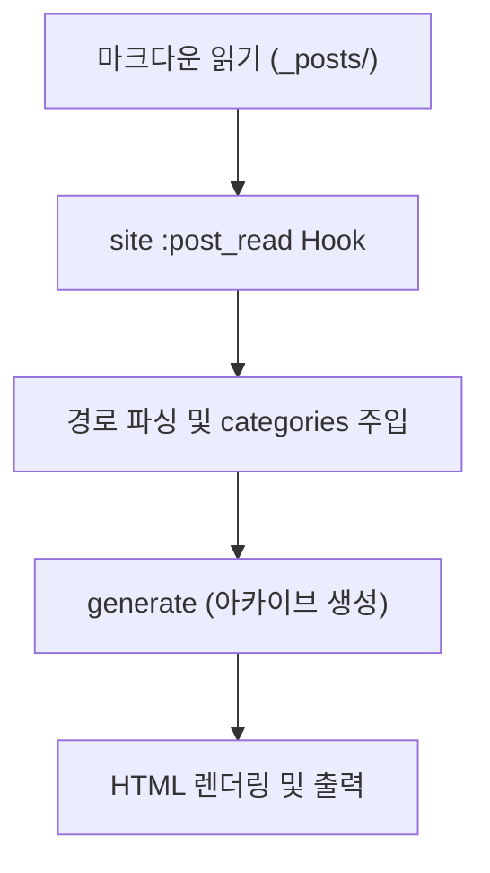

> Jekyll `_posts/` 하위 디렉토리 구조를 단일 진실 공급원(SSOT)으로 삼아, Front Matter의 `categories` 중복 선언 없이 빌드 시점에 자동 주입하는 Ruby Hook 플러그인 구현과 운영 주의사항을 정리합니다.

> 본 문서는 **Jekyll 4.4 / jekyll-theme-chirpy 7.6 / Ruby 3.4** 환경을 기준으로 작성되었습니다.
{: .prompt-info }

## 도입 배경: Front Matter 카테고리 관리의 한계

Jekyll 블로그에 글이 늘어나면 `_posts/Blog/Jekyll/2026-11-20-post.md`처럼 주제별 하위 폴더로 파일을 정리하게 됩니다. 하지만 Jekyll 기본 동작은 `_posts/` **하위** 폴더를 카테고리로 인식하지 않으므로, 매번 Front Matter에 `categories: [Blog, Jekyll]`을 직접 적어야 합니다. 이 이중 관리는 다음과 같은 문제를 일으킵니다.

- **대소문자 불일치·오타**: `Spring`과 `spring`처럼 표기가 어긋나면 아카이브에서 별도 카테고리로 분리됩니다.
- **폴더-카테고리 드리프트(Drift)**: 파일을 다른 폴더로 옮기고 Front Matter 수정을 놓치면 디스크 구조와 블로그 메뉴가 어긋납니다.

Jekyll 공식 방식인 `_posts/` 바깥 상위 폴더 분리(`blog/jekyll/_posts/`)는 포스트가 저장소 전역에 흩어져 관리가 번거롭습니다.

| 관리 방식 | 파일 탐색 편의성 | 오타·드리프트 위험 | 커스텀 플러그인 |
| :--- | :--- | :--- | :--- |
| Front Matter 수동 선언 | 보통 | 높음 (이중 관리) | 불필요 |
| 상위 폴더 분리 (`cat/_posts/`) | 낮음 (분산됨) | 낮음 | 불필요 |
| `_posts/` 하위 폴더 + Ruby Hook | 높음 (중앙 집중) | 없음 (폴더가 SSOT) | 필요 (`_plugins/`) |

중앙 집중 구조를 유지하면서 폴더 경로 자체를 단일 진실 공급원(SSOT)으로 삼기 위해 Ruby Hook 플러그인을 도입했습니다.

## 동작 원리: Jekyll Hook 라이프사이클과 실행 시점

Jekyll 빌드는 `reset` ➔ `read` ➔ `generate` ➔ `render` ➔ `cleanup` ➔ `write` 순서로 진행됩니다. 커스텀 훅에서 가장 중요한 점은 실행 시점 선택입니다.



포스트 렌더링 직전인 `:posts, :pre_render`에 로직을 걸면 너무 늦습니다. Chirpy의 `/categories/` 목록과 `jekyll-archives`의 `/categories/:name/` 페이지는 모두 `generate` 단계에서 이미 집계된 `site.categories`를 참조해 생성되기 때문입니다.

반면 `Jekyll::Hooks.register :site, :post_read`는 모든 포스트를 `site.posts.docs`로 읽은 직후이자 `generate` 직전에 실행됩니다. 이 시점에 `post.data['categories']`를 주입하면 아카이브 페이지, 사이드바 카운트, 브레드크럼까지 모두 일관되게 반영됩니다.

## 구현: _plugins/category-folder-hook.rb 작성

프로젝트 루트의 `_plugins/category-folder-hook.rb`에 아래 코드를 작성합니다.

```ruby
# frozen_string_literal: true

# _plugins/category-folder-hook.rb
#
# Automatically populates post categories directly from the directory structure under `_posts/`.
# The folder names on disk are the Single Source of Truth for category names.
#
# Examples:
#   _posts/Spring/Feature/post.md          => categories: ["Spring", "Feature"]
#   _posts/Spring/Wanted-Challenge/post.md => categories: ["Spring", "Wanted-Challenge"]
#   _posts/Blog/Jekyll/post.md             => categories: ["Blog", "Jekyll"]
#   _posts/Dev/post.md                     => categories: ["Dev"]

Jekyll::Hooks.register :site, :post_read do |site|
  site.posts.docs.each do |post|
    rel_path = post.relative_path.sub(%r{^_posts/}, '')
    subdirs = rel_path.split('/')[0...-1]

    # Subdirectories directly dictate post categories as-is
    unless subdirs.empty?
      post.data['categories'] = subdirs
    end
  end
end
```

`post.relative_path`에서 `_posts/` 접두사를 제거한 뒤 슬래시(`/`)로 나누고, 파일명을 제외한 디렉토리 배열(`0...-1`)을 그대로 `post.data['categories']`에 할당합니다. `_posts/` 루트에 바로 놓인 글(`subdirs.empty?`)은 기존 Front Matter를 유지하며, 1단계(`_posts/Dev/`)와 2단계(`_posts/Blog/Jekyll/`) 모두 동일하게 동작합니다.

이제 포스트 Front Matter에서는 `categories`를 생략하고 `tags`만 유지하면 됩니다.

```yaml
---
title: "Jekyll 폴더 구조로 카테고리 자동 주입하기"
description: "Jekyll _posts 디렉토리 구조를 SSOT로 삼는 Ruby Hook 플러그인 구현 정리"
date: 2026-11-20 09:00:00 +0900
tags: [jekyll, chirpy, ruby, plugin]
---
```

## 운영 함정과 주의사항

### 1. GitHub Pages 기본 빌드(Safe Mode)에서는 미실행

GitHub Pages 기본 브랜치 배포는 보안상 `--safe` 모드로 동작해 `_plugins/`의 커스텀 Ruby 코드를 실행하지 않습니다. 따라서 배포 소스를 **GitHub Actions**로 전환하고 `.github/workflows/pages-deploy.yml`에서 직접 빌드한 `_site`를 배포해야 합니다.

```yaml
# .github/workflows/pages-deploy.yml (핵심 빌드 단계)
jobs:
  build:
    runs-on: ubuntu-latest
    steps:
      - name: Checkout
        uses: actions/checkout@v7
        with:
          fetch-depth: 0

      - name: Setup Pages
        id: pages
        uses: actions/configure-pages@v6

      - name: Setup Ruby
        uses: ruby/setup-ruby@v1
        with:
          ruby-version: 3.4
          bundler-cache: true

      - name: Build site
        run: bundle exec jekyll b -d "_site${{ steps.pages.outputs.base_path }}" --config _config.yml,_config_prod.yml
        env:
          JEKYLL_ENV: "production"
```

> `fetch-depth: 0`을 함께 지정하면 Git 히스토리 기반의 `last_modified_at` 훅도 정상 동작합니다.
{: .prompt-tip }

### 2. `_drafts/` 초안 미리보기 시 경로 매칭

프로덕션 빌드에서는 `_drafts/`가 제외되지만, 로컬에서 `jekyll serve --drafts`로 미리 볼 때는 초안도 `site.posts.docs`에 포함됩니다. 이때 `post.relative_path`가 `_drafts/`로 시작해 `"_drafts"`가 카테고리로 주입될 수 있으므로, 로컬 미리보기를 자주 쓴다면 반복문 첫 줄에 `next unless post.relative_path.start_with?('_posts/')` 가드를 두는 것이 안전합니다.

### 3. 폴더명에 공백이 있을 때의 URL 슬러그 처리

`_posts/Home Server/Containers/`처럼 폴더명에 공백이 들어가면 화면에는 `Home Server`로 표시되지만, `jekyll-archives`는 `Jekyll::Utils.slugify` 규칙에 따라 공백을 하이픈으로 치환해 `/categories/home-server/` URL을 생성합니다. 내부 링크나 `htmlproofer` 검증 시 `%20` 대신 소문자 하이픈 슬러그를 사용해야 합니다.

## 마치며

20줄 남짓의 `:site, :post_read` 훅으로 디스크 폴더 구조와 블로그 카테고리를 완전히 동기화할 수 있었습니다. Jekyll 훅의 전체 이벤트 목록은 공식 문서에서 확인할 수 있습니다.


