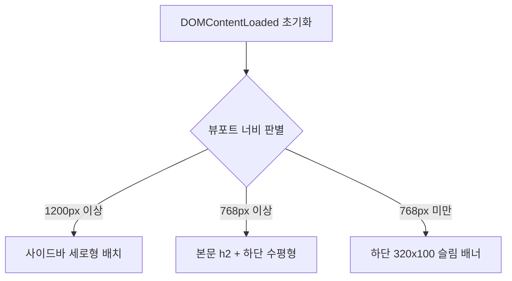

> 구글 애드센스 자동 광고가 Chirpy 테마의 포스트 카드와 모바일 화면을 깨뜨리는 문제를 해결하기 위해, 테마 레이아웃을 덮어쓰지 않고 공식 훅과 JavaScript/SCSS만으로 3종 수동 광고를 배치한 과정을 정리합니다.

> 본 문서는 **Jekyll 4.4 / jekyll-theme-chirpy 7.6** 환경을 기준으로 작성되었습니다.
{: .prompt-info }

## 문제 상황: 자동 광고가 Chirpy 레이아웃을 깨뜨리는 이유

애드센스 자동 광고(Auto Ads)는 `<head>`에 스크립트 한 줄만 넣으면 되어 간편하지만, Chirpy 테마에 적용해 실측해 보니 두 가지 심각한 문제가 나타났습니다.

- **포스트 카드 깨짐**: 홈 목록의 `.card-wrapper` 내부 제목과 요약 텍스트 사이에 광고가 끼어들어 카드 정렬과 높이가 무너졌습니다.
- **모바일 대형 정사각형 확장**: 모바일(`375px`)에서 반응형 자동 광고가 `375x375px` 정사각형으로 커져 첫 화면과 본문 읽기 흐름을 심하게 가렸습니다.

수동 광고로 전환할 때 `_layouts/`나 `_includes/head.html`을 덮어쓰면 Chirpy 테마 업데이트마다 병합 충돌이 생깁니다.

| 구현 방식 | 테마 업그레이드 호환성 | 배치 정밀도 | 유지보수 비용 |
| :--- | :--- | :--- | :--- |
| `_layouts/post.html` 등 덮어쓰기 | 낮음 (업데이트마다 충돌) | 높음 | 높음 |
| 공식 훅 + JS DOM 주입 + SCSS | 높음 (원본 무수정) | 높음 | 낮음 |

따라서 Chirpy 공식 확장 지점인 `_includes/metadata-hook.html`만 사용해 스크립트를 로드하고, DOM 주입은 별도 JS로 처리하는 방식을 선택했습니다.

## 설계: 뷰포트별 3종 수동 광고 배치 전략

Bootstrap 브레이크포인트(`768px`, `1200px`)를 기준으로 3가지 수동 슬롯을 설계했습니다.



- **넓은 화면(`>= 1200px`) 우측 사이드바 세로형**: 포스트에서는 목차(`#toc-wrapper`) 바로 아래에 붙이고, 홈·카테고리처럼 목차가 없는 페이지에서는 `Trending Tags` 아래에 `sticky`로 고정합니다.
- **데스크톱(`>= 768px`) 본문 인아티클**: 직계 `<h2>`(`:scope > h2`)가 4개 이상이면 45% 지점, 8개 이상이면 78% 지점에 자동 삽입합니다. 모바일은 읽기 몰입을 위해 생략합니다.
- **포스트 하단(`.post-tail-wrapper` 직전)**: 데스크톱은 본문 폭 내 수평형(`fullWidthResponsive: false`), 모바일(`< 768px`)은 애드센스 공식 슬림 배너 `320x100px`로 고정합니다.

## 구현: 공식 훅과 DOM 주입 스크립트 작성

### 1. `_includes/metadata-hook.html` 연결

Chirpy `<head>` 끝에 자동 포함되는 훅에 애드센스 스크립트와 프로덕션 전용 배치 스크립트를 추가합니다.


```html
<!-- _includes/metadata-hook.html -->
<script
  async
  src="https://pagead2.googlesyndication.com/pagead/js/adsbygoogle.js?client=ca-pub-XXXXXXXXXXXXXXXX"
  crossorigin="anonymous"
></script>

  <script defer src="{{ '/assets/js/adsense-layout.js' | relative_url }}"></script>

```


### 2. `assets/js/adsense-layout.js` 핵심 로직

Chirpy의 Tocbot은 비동기적으로 `#toc-wrapper`의 `#toc`를 채우고 `invisible` 클래스를 제거합니다. 따라서 `MutationObserver`로 초기화 완료를 감시한 뒤 광고를 마운트하고, 목차가 없는 글을 대비해 1.5초 폴백 타이머를 두었습니다.

```javascript
// assets/js/adsense-layout.js
(function () {
  'use strict';

  var AD_CLIENT = 'ca-pub-XXXXXXXXXXXXXXXX'; // 본인 애드센스 게시자 ID
  var SLOTS = {
    sidebarVertical: '1111111111',
    inArticle: '2222222222',
    postBottom: '3333333333'
  };

  function createAdContainer(className, slotId, options) {
    var wrapper = document.createElement('div');
    wrapper.className = 'ad-slot-wrapper ' + className;
    wrapper.setAttribute('aria-label', 'Advertisement');

    var label = document.createElement('span');
    label.className = 'ad-slot-label';
    label.textContent = 'AD';
    wrapper.appendChild(label);

    var ins = document.createElement('ins');
    ins.className = 'adsbygoogle';
    ins.style.display = options.display || 'block';
    if (options.width) ins.style.width = options.width;
    if (options.height) ins.style.height = options.height;
    if (options.textAlign) ins.style.textAlign = options.textAlign;

    ins.setAttribute('data-ad-client', AD_CLIENT);
    ins.setAttribute('data-ad-slot', slotId);
    if (options.layout) ins.setAttribute('data-ad-layout', options.layout);
    if (options.format) ins.setAttribute('data-ad-format', options.format);
    if (options.fullWidthResponsive !== undefined) {
      ins.setAttribute('data-full-width-responsive', String(options.fullWidthResponsive));
    }

    wrapper.appendChild(ins);
    return wrapper;
  }

  function pushAd() {
    try {
      (window.adsbygoogle = window.adsbygoogle || []).push({});
    } catch (e) {
      // AdBlock 등 스크립트 차단 환경에서는 조용히 무시
    }
  }

  function mountSidebarAd(target, isSticky) {
    var panelWrapper = document.getElementById('panel-wrapper');
    if (!panelWrapper || panelWrapper.querySelector('.ad-slot-sidebar')) return;

    var adEl = createAdContainer(
      isSticky ? 'ad-slot-sidebar ad-slot-sidebar-sticky' : 'ad-slot-sidebar',
      SLOTS.sidebarVertical,
      { format: 'vertical', fullWidthResponsive: false }
    );
    target.appendChild(adEl);
    pushAd();
  }

  function injectSidebarAd() {
    if (!window.matchMedia('(min-width: 1200px)').matches) return;

    var panelWrapper = document.getElementById('panel-wrapper');
    if (!panelWrapper || panelWrapper.querySelector('.ad-slot-sidebar')) return;

    var tocWrapper = document.getElementById('toc-wrapper');
    if (!tocWrapper) {
      mountSidebarAd(panelWrapper, true);
      return;
    }

    var tocReady = function () {
      var tocNav = tocWrapper.querySelector('#toc');
      return !tocWrapper.classList.contains('invisible') && tocNav && tocNav.children.length > 0;
    };

    if (tocReady()) {
      mountSidebarAd(tocWrapper, false);
      return;
    }

    var settled = false;
    var observer = new MutationObserver(function () {
      if (!settled && tocReady()) {
        settled = true;
        observer.disconnect();
        mountSidebarAd(tocWrapper, false);
      }
    });
    observer.observe(tocWrapper, {
      attributes: true,
      attributeFilter: ['class'],
      childList: true,
      subtree: true
    });

    window.setTimeout(function () {
      if (!settled) {
        settled = true;
        observer.disconnect();
        mountSidebarAd(tocReady() ? tocWrapper : panelWrapper, !tocReady());
      }
    }, 1500);
  }

  function injectPostAds() {
    var content = document.querySelector('article .content');
    var tailWrapper = document.querySelector('.post-tail-wrapper');
    if (!content || !tailWrapper) return;

    var isDesktop = window.matchMedia('(min-width: 768px)').matches;

    if (isDesktop) {
      var headings = Array.prototype.slice.call(content.querySelectorAll(':scope > h2'));
      var insertIndices = [];
      if (headings.length >= 4) insertIndices.push(Math.floor(headings.length * 0.45));
      if (headings.length >= 8) {
        var secondIdx = Math.floor(headings.length * 0.78);
        if (secondIdx > insertIndices[0] + 1) insertIndices.push(secondIdx);
      }

      insertIndices.forEach(function (idx) {
        var targetH2 = headings[idx];
        if (!targetH2 || !targetH2.parentNode) return;
        var inArticleAd = createAdContainer('ad-slot-in-article', SLOTS.inArticle, {
          layout: 'in-article',
          format: 'fluid',
          textAlign: 'center'
        });
        targetH2.parentNode.insertBefore(inArticleAd, targetH2);
        pushAd();
      });
    }

    if (!document.querySelector('.ad-slot-post-bottom')) {
      var bottomOptions = isDesktop
        ? { format: 'horizontal', fullWidthResponsive: false }
        : { display: 'inline-block', width: '320px', height: '100px' };

      var bottomAd = createAdContainer(
        isDesktop ? 'ad-slot-post-bottom' : 'ad-slot-post-bottom ad-slot-post-bottom-mobile',
        SLOTS.postBottom,
        bottomOptions
      );
      tailWrapper.parentNode.insertBefore(bottomAd, tailWrapper);
      pushAd();
    }
  }

  function init() {
    window.requestAnimationFrame(function () {
      injectSidebarAd();
      injectPostAds();
    });
  }

  if (document.readyState === 'loading') {
    document.addEventListener('DOMContentLoaded', init);
  } else {
    init();
  }
})();
```

### 3. `assets/css/jekyll-theme-chirpy.scss` 스타일 보완

긴 글에서 목차가 사이드바 광고를 화면 밖으로 밀어내지 않도록 `#toc-wrapper #toc`에 `max-height: 42vh; overflow-y: auto;`를 지정했습니다.

```scss
/* assets/css/jekyll-theme-chirpy.scss */
.ad-slot-wrapper {
  position: relative;
  text-align: center;
}

.ad-slot-label {
  display: block;
  margin-bottom: 0.35rem;
  font-size: 0.65rem;
  font-weight: 600;
  letter-spacing: 0.08em;
  color: var(--text-muted-color);
  opacity: 0.65;
  text-align: left;
  user-select: none;
}

.ad-slot-sidebar {
  display: none;
}

@media (min-width: 1200px) {
  #toc-wrapper #toc {
    max-height: 42vh;
    overflow-y: auto;
  }

  .ad-slot-sidebar {
    display: block;
    width: 100%;
    max-width: 247px;
    margin-top: 1.5rem;
    padding-left: 1rem;
  }

  .ad-slot-sidebar-sticky {
    position: sticky;
    top: 2rem;
    padding-left: 0;
  }
}

.ad-slot-in-article {
  margin: 2rem 0;
  padding: 0.75rem 0;
  border-top: 1px solid var(--border-color);
  border-bottom: 1px solid var(--border-color);
}

.ad-slot-post-bottom {
  margin: 2.25rem 0 1.25rem;
  padding-top: 0.75rem;
  border-top: 1px solid var(--border-color);
}

.ad-slot-post-bottom-mobile {
  margin: 1.5rem 0 1rem;
  text-align: center;
}

.ad-slot-post-bottom-mobile .ad-slot-label {
  max-width: 320px;
  margin-left: auto;
  margin-right: auto;
}
```

## 운영 함정과 애드센스 정책 주의사항

### 1. 숨겨진 `<ins>`에 `push({})` 호출 시 `availableWidth=0` 에러

`< 1200px` 화면에서 CSS로만 `.ad-slot-sidebar { display: none; }` 처리하고 DOM에 `<ins>`를 넣어 `push({})`를 호출하면 콘솔에 에러가 발생합니다.

```text
TagError: adsbygoogle.push() error: No slot size for availableWidth=0
```

`display: none` 상태에서는 너비가 `0`으로 계산되기 때문입니다. JS에서 `window.matchMedia('(min-width: 1200px)').matches`를 먼저 검사해 조건을 만족할 때만 DOM을 생성하고 `pushAd()`를 호출해야 합니다.

### 2. `overflow: hidden`으로 광고 강제 크롭 금지

> 주의: 광고가 크다고 부모 컨테이너에 `max-height: 100px; overflow: hidden;`을 걸어 강제로 잘라내면 애드센스 정책(광고 수정 및 가림) 위반 대상이 됩니다.
{: .prompt-warning }

CSS로 자르는 대신 애드센스 공식 고정 규격(`display: inline-block; width: 320px; height: 100px`)이나 `data-full-width-responsive="false"`를 선언해 애초에 알맞은 크기의 소재가 내려오도록 구성해야 합니다.

### 3. 프로덕션 전용 조건(`jekyll.environment == 'production'`)

로컬 `jekyll serve` 중 잦은 새로고침으로 무효 트래픽이 쌓이는 것을 막기 위해 `_includes/metadata-hook.html`에서 프로덕션 환경 조건으로 감싸 두었습니다. GitHub Actions 배포(`JEKYLL_ENV="production"`) 시에만 스크립트가 로드됩니다.

## 마치며

공식 훅과 수동 배치 스크립트로 전환한 뒤 포스트 카드 깨짐과 모바일 대형 배너 문제가 모두 사라졌고, 테마 업데이트 부담도 줄었습니다. 반응형 광고 코드 수정 기준은 애드센스 공식 문서를 참고하시기 바랍니다.


