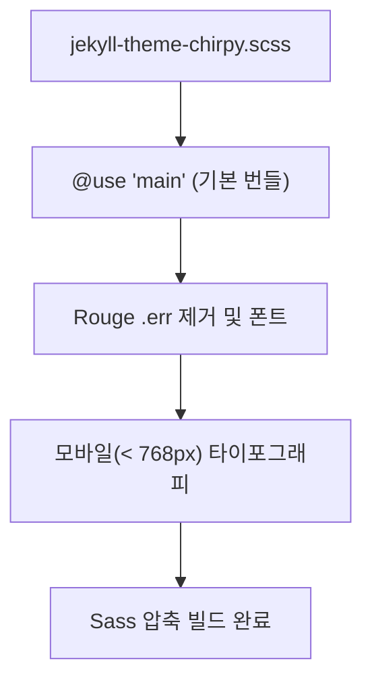

> 영문(Latin) 기준으로 설계된 Chirpy 테마에서 모바일 한글 본문이 데스크톱보다 크게 보이는 원인을 분석하고, `assets/css/jekyll-theme-chirpy.scss` 한 파일로 모바일 타이포그래피·Rouge 문법 강조 오류(`.highlight .err`)·코딩 폰트 스택을 개선한 방법을 정리합니다.

> 본 문서는 **Jekyll 4.4 / jekyll-theme-chirpy 7.6 / Rouge** 환경을 기준으로 작성되었습니다.
{: .prompt-info }

## 문제 상황: 모바일 한글 본문이 데스크톱보다 크게 보이는 현상

Chirpy 테마는 영문(Latin) 가독성을 전제로 설계되었습니다. 영문은 소문자 높이(x-height)가 낮아 모바일에서 글자를 키워야 편하게 읽히므로, Chirpy 기본 스타일은 데스크톱 `.content`를 `1.03rem`(`16.48px`)으로 두면서도 모바일에서는 오히려 `1.08rem`(`17.28px`)으로 크게 설정합니다.

반면 한글은 네모꼴 공간에 획이 꽉 차 있어 같은 `px`라도 체감 크기가 훨씬 큽니다. 375~390px 스마트폰 화면에서는 다음과 같은 불편이 겹쳤습니다.

- 본문이 과하게 커 보여 한 줄 어절 수가 줄고 읽기 흐름이 자주 끊깁니다.
- 제목(`h1`, `h2`)과 표 셀 패딩이 넓어 스크롤 피로도가 커집니다.
- Kotlin 어노테이션(`@field:NotNull`)이나 한글 식별자에서 Rouge 문법 강조기가 `.highlight .err` 붉은 배경을 칠합니다.

테마 원본을 건드리지 않고 커스텀 진입점(`assets/css/jekyll-theme-chirpy.scss`)에서 순서대로 오버라이드해 해결했습니다.



## 모바일(< 768px) 한글 타이포그래피 최적화

모바일 한글 가독성의 핵심은 **글자 크기는 `0.95rem`(`15.2px`)으로 정돈하고 행간(`line-height`)을 `1.72`로 넉넉히 확보하는 것**입니다. 획이 많은 한글 특성상 행간이 충분해야 줄 바꿈 시 시선이 자연스럽게 이어집니다.

| 요소 | 적용 값 (`< 768px`) | 조정 의도 |
| :--- | :--- | :--- |
| 포스트 제목 (`article header h1`) | `1.5rem` / 행간 `1.35` | 긴 한글 제목의 과도한 줄 바꿈 방지 |
| 본문 (`.content`) | `0.95rem` / 행간 `1.72` | 네모꼴 한글의 시각적 압박감 완화 |
| 소제목 (`h2` / `h3` / `h4`) | `1.25rem` / `1.1rem` / `1rem` | 본문 대비 명확한 시각 위계 유지 |
| 표 셀 (`.table-wrapper > table`) | `0.85rem` / 패딩 `0.35rem 0.75rem` | 모바일 비교 표의 가로 스크롤 완화 |
| 코드 블록 (`.highlight pre`) | `0.8rem` | 들여쓰기 깊은 코드의 가독성 확보 |
| 홈 카드 제목 (`.card-title`) | `1.1rem` / 행간 `1.4` | 목록 스캔 시 화면 밀도 균형 유지 |

실제 `assets/css/jekyll-theme-chirpy.scss`에 적용한 모바일 미디어 쿼리는 다음과 같습니다.

```scss
/* assets/css/jekyll-theme-chirpy.scss */
/* =========================================================
 * 모바일(< 768px) 한글 가독성 타이포그래피 최적화
 * (Chirpy 영문 기본값 대비 모바일 폰트 크기 정돈)
 * ========================================================= */
@media (max-width: 767.98px) {
  article header h1 {
    font-size: 1.5rem;
    line-height: 1.35;
  }

  .content {
    font-size: 0.95rem;
    line-height: 1.72;

    h2 {
      font-size: 1.25rem;
      line-height: 1.35;
    }

    h3 {
      font-size: 1.1rem;
      line-height: 1.4;
    }

    h4 {
      font-size: 1rem;
    }
  }

  .table-wrapper > table {
    thead th,
    tbody tr td {
      font-size: 0.85rem;
      padding: 0.35rem 0.75rem;
    }
  }

  .highlight pre,
  code.highlighter-rouge {
    font-size: 0.8rem;
  }

  #post-list .card-wrapper .card-title {
    font-size: 1.1rem;
    line-height: 1.4;
  }
}
```

## Rouge 문법 강조 오류(.highlight .err) 제거와 코딩 폰트 확장

Jekyll은 `Kramdown`과 `Rouge` 파이프라인으로 코드 블록을 렌더링하며, 렉서(Lexer)가 해석하지 못한 토큰에 `<span class="err">`를 부여합니다. Kotlin의 Use-site Target(`@field:NotNull`, `@get:JsonProperty`)이나 테스트 메서드의 한글 백틱 식별자에서 Rouge 렉서가 오탐을 일으켜 코드 중간에 빨간 배경이 칠해지는 문제가 잦았습니다.

이를 제거하고, 영문 고정폭 폰트 뒤에 `Pretendard`, `D2Coding`, OS 기본 한글 고딕을 fallback으로 연결해 코드 속 한글 주석이 굴림체로 뭉개지지 않게 보완했습니다.

```scss
/* assets/css/jekyll-theme-chirpy.scss */
/* Rouge 문법 강조기 에러(.err) 시 붉은 배경 제거 (@field, 한글 등) */
.highlight .err {
  color: inherit !important;
  background-color: transparent !important;
}

/* 코드 블록 폰트 스택 확장 (설치된 프리텐다드/코딩 폰트 우선 + OS별 기본 한글 fallback) */
pre,
code,
kbd,
samp {
  font-family:
    SFMono-Regular,
    Menlo,
    Monaco,
    Consolas,
    'Liberation Mono',
    'Courier New',
    'Pretendard Variable',
    Pretendard,
    'D2Coding',
    'Nanum Gothic Coding',
    'Apple SD Gothic Neo',
    'Malgun Gothic',
    monospace !important;
}
```

브라우저는 글자 단위(Per-glyph)로 폰트를 매칭하므로 영문 기호는 앞쪽 모노스페이스로 유지되고, 한글 글리프만 뒤쪽 폰트로 자연스럽게 fallback됩니다.

## 운영 함정과 SCSS 오버라이드 주의사항

### 1. `@use 'main'` 번들 순서와 Liquid 분기 유지

Chirpy 7.x는 Dart Sass의 `@use` 규칙과 프로덕션 번들 분기를 파일 최상단에 둡니다.


```scss
---
---

@use 'main

  .bundle

';

/* append your custom style below */
```


> 주의: `@use` 위에 스타일을 작성하면 Sass 컴파일 에러가 발생하며, Liquid 분기를 지우면 프로덕션 빌드에서 번들 최적화가 빠집니다. 상단 8줄은 그대로 두고 아래에 커스텀 규칙을 추가해야 합니다.
{: .prompt-warning }

### 2. `!important` 남용 금지와 다크 모드 호환성

`.highlight .err`와 `pre, code`처럼 기본 명시도가 높은 규칙에만 제한적으로 `!important`를 쓰고, 모바일 타이포그래피 블록에는 쓰지 않아야 유지보수가 쉽습니다. 색상을 하드코딩하면 다크 모드에서 글자가 묻히므로 반드시 `inherit`이나 Chirpy CSS 변수를 사용해야 합니다.

### 3. 무거운 웹폰트 CDN 추가 시 LCP 저하 주의

코드 블록 한글을 위해 수 MB짜리 웹폰트를 외부 CDN으로 로드하면 모바일 LCP(Largest Contentful Paint)가 악화됩니다. 로컬 설치 폰트와 OS 기본 한글 폰트 fallback 조합을 쓰면 추가 네트워크 비용 없이 가독성을 높일 수 있습니다.

## 마치며

`assets/css/jekyll-theme-chirpy.scss` 한 파일만으로 모바일 한글 타이포그래피, Rouge 오탐 붉은 배경, 코드 블록 한글 폰트를 모두 정돈했습니다. 수정 후에는 390px 모바일 에뮬레이션과 다크/라이트 모드 전환을 함께 확인하는 것이 좋습니다. Jekyll의 Sass 자산 처리는 공식 문서를 참고하시기 바랍니다.


