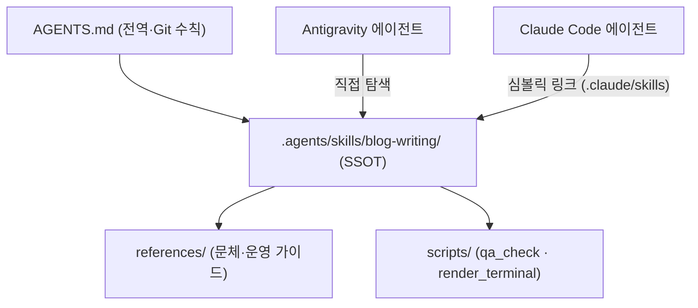
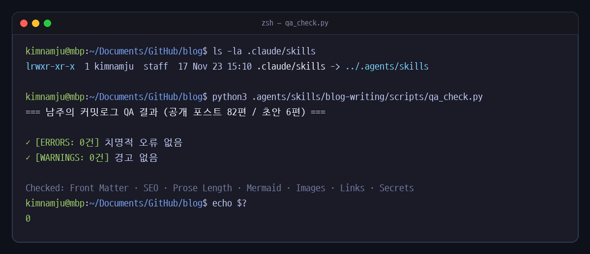

> Jekyll 기반 기술 블로그에서 Antigravity와 Claude Code가 동일한 글쓰기 기준과 검증 도구를 공유할 수 있도록, `.agents/skills` 단일 원본(SSOT)과 `.claude/skills` 심볼릭 링크 기반의 공용 스킬 아키텍처를 설계한 과정을 정리합니다.

> 본 문서는 Jekyll 4.4 / `jekyll-theme-chirpy` 7.6.0, Python 3(Pillow), GitHub Actions 기반 저장소(`namju.kim`)의 실제 운영 구성을 기준으로 작성되었습니다.
{: .prompt-info }

## 기존 루트 지침서 구조의 한계와 Progressive Disclosure

초기에는 저장소 루트에 `AGENTS.md`와 `writing-tone.md`를 두고 블로그 아키텍처, 문체, Front Matter 규격, Mermaid 규칙, Git 수칙을 모두 담아두었습니다. 하지만 규칙이 늘어나고 Antigravity와 Claude Code를 병행하면서 두 가지 한계가 드러났습니다.

첫째는 **컨텍스트 낭비**입니다. 단순 SCSS 수정이나 CI 설정 변경 작업에서도 수백 줄짜리 글쓰기 템플릿이 매 턴 컨텍스트에 실려 토큰을 소모하고 모델의 주의를 분산시켰습니다. 둘째는 **도구별 설정 파편화**입니다. Antigravity는 `.agents/skills/`, Claude Code는 `.claude/skills/`를 기본 탐색하므로 복사본을 따로 두면 규칙 수정 때마다 동기화가 어긋납니다.

이를 해결하기 위해 **Agent Skills의 Progressive Disclosure(점진적 공개)** 구조를 도입했습니다. 평상시에는 YAML Front Matter(`name`, `description`)만 가볍게 인덱싱하고, 포스트 작성·수정 의도가 감지될 때만 `SKILL.md`와 하위 참조 문서를 단계적으로 읽는 방식입니다.

| 비교 항목 | 기존 루트 지침서 일괄 로딩 | Agent Skills (Progressive Disclosure) |
| :--- | :--- | :--- |
| 로딩 시점 | 모든 세션 시작 시 전체 문서 상시 로드 | 메타데이터만 상시 로드, 필요 시 본문 로드 |
| 도구 동기화 | 도구별 규칙 파일 중복 관리 필요 | `.agents/skills` SSOT + 심볼릭 링크 공유 |
| 실행 도구 | 문서에 명령어 예시만 텍스트 기재 | `scripts/` 하위에 QA·캡처 스크립트 내장 |
| 부적합 대상 | 50줄 미만 소규모 단일 저장소 | 모든 턴에 강제할 전역 Git·보안 가드레일 |

단, `git commit`/`push` 금지나 `_includes/head.html` 덮어쓰기 금지처럼 모든 작업에 상시 적용할 전역 가드레일은 루트 `AGENTS.md`에 그대로 남겨 두었습니다.

## .agents/skills 단일 원본과 .claude/skills 심볼릭 링크 아키텍처

전역 규칙(`AGENTS.md`)과 도메인 스킬(`blog-writing`)을 분리하고, 멀티 에이전트가 단일 원본(SSOT)을 참조하도록 구성했습니다.



저장소에서는 `.agents/skills/blog-writing/`에 원본을 두고 `.claude/skills`를 **상대 경로 심볼릭 링크**로 연결했습니다.

```bash
mkdir -p .claude
ln -s ../.agents/skills .claude/skills
ls -la .claude/skills
# lrwxr-xr-x  1 kimnamju  staff  17 Nov 23 15:10 .claude/skills -> ../.agents/skills
```

절대 경로 대신 `../.agents/skills` 상대 경로를 사용한 덕분에 macOS 호스트, VS Code Dev Container(`/workspaces/blog`), CI 러너 등 체크아웃 경로가 달라져도 링크가 깨지지 않습니다. Git이 심볼릭 링크 대상 경로 자체를 모드 `120000`으로 추적하므로 클론 직후 두 에이전트가 즉시 동일 스킬을 인식합니다.

## blog-writing 스킬 내부 구조와 역할 분담

스킬 디렉터리는 역할에 따라 진입점, 참조 문서, 실행 스크립트의 3계층으로 나눴습니다.

```text
.agents/skills/blog-writing/
├── SKILL.md                      # 진입점: 워크플로우, Front Matter·Mermaid·이미지 규격
├── references/
│   ├── writing-tone.md           # 페르소나, 경어체 문체, 제목 금지어, 심화 체크리스트
│   └── operations-guide.md       # AdSense 수동 광고, _drafts 승격 기준, 정기 점검표
└── scripts/
    ├── qa_check.py               # 정적 전수 검증 스크립트
    └── render_terminal.py        # Pillow 기반 Tokyo Night 터미널 캡처 생성기
```

`SKILL.md` 상단의 YAML Front Matter는 에이전트가 스킬 활성화 시점을 판단하는 트리거입니다.

```yaml
# .agents/skills/blog-writing/SKILL.md
---
name: blog-writing
description: >-
  남주의 커밋로그(namju.kim) 기술 블로그 포스트를 작성·수정·최신화·정기 점검할 때 사용하는 표준 운영 스킬.
  작성자 페르소나, 톤앤매너, SEO·애드센스 연계 구조, Front Matter·카테고리 규격, Mermaid 문법,
  이미지 내재화·보안 규칙, 시리즈 병렬 집필 절차 및 자동 QA 스크립트(scripts/qa_check.py)를 포함합니다.
---
```

문서 규칙만으로는 `mermaid: true` 누락이나 600자 미만 Thin Content, API 키 패턴 노출을 놓치기 쉽습니다. 그래서 Python 표준 라이브러리만으로 1초 이내에 전수 검사를 수행하는 `scripts/qa_check.py`를 내장했습니다. Ruby 3.4가 없는 호스트 환경에서도 Front Matter, 분량, Mermaid 특수문자 따옴표, 이미지 무결성, 내부 링크를 결정적으로 검증합니다.

또한 CLI 실행 결과를 글에 첨부할 때마다 수동 캡처·크롭하는 수고를 덜기 위해 `scripts/render_terminal.py`를 통합했습니다. Pillow로 Tokyo Night 다크 테마와 macOS 타이틀바를 그리고, 줄 수에 맞춰 세로 높이를 자동 계산해 하단 여백 없는 타이트 크롭 PNG를 생성합니다. 한글·영문 2:1 고정폭 정렬을 위해 `D2Coding` 폰트를 우선 탐색하고, 미설치 시 `Menlo`나 `DejaVuSansMono`로 폴백합니다.

```bash
cat << 'EOF' | python3 .agents/skills/blog-writing/scripts/render_terminal.py \
  --title "zsh — qa_check.py" \
  --out assets/images/2026-11-23/qa-check-pass-terminal.png
[green]kimnamju@mbp[/]:[blue]~/Documents/GitHub/blog[/]$ python3 .agents/skills/blog-writing/scripts/qa_check.py
[bold]=== 남주의 커밋로그 QA 결과 (공개 포스트 82편 / 초안 6편) ===[/]
[green]✓ [ERRORS: 0건][/] 치명적 오류 없음
[green]✓ [WARNINGS: 0건][/] 경고 없음
EOF
```

심볼릭 링크 확인과 `qa_check.py` 통과 화면은 다음과 같습니다.



## GitHub Actions 불필요한 재배포 방지 설정

스킬 문서나 스크립트를 저장소에서 함께 버전 관리하면, 프롬프트 문구만 고쳐도 GitHub Pages 배포 파이프라인이 실행되는 낭비가 생깁니다. `.github/workflows/pages-deploy.yml`의 `paths-ignore`에 에이전트 경로를 제외했습니다.

```yaml
# .github/workflows/pages-deploy.yml
on:
  push:
    branches: [main, master]
    paths-ignore:
      - AGENTS.md
      - writing-tone.md
      - ".agents/**"
      - ".claude/**"
```

`_config.yml`의 `exclude`에도 `AGENTS.md`와 `writing-tone.md`를 함께 등록했습니다. Jekyll은 점(`.`)으로 시작하는 숨김 디렉터리는 자동 제외하지만, 루트 마크다운 파일은 명시하지 않으면 `_site/`로 그대로 배포되기 때문입니다.

## 운영 시 주의할 점과 함정

> 심볼릭 링크를 절대 경로로 생성하면 로컬에서는 동작해도 Dev Container나 다른 머신에서 즉시 깨집니다. 반드시 `../.agents/skills` 상대 경로로 만들고 `ls -la`로 대상을 검증해야 합니다.
{: .prompt-warning }

1. **Windows 환경의 `core.symlinks`**: macOS·Linux와 달리 Windows 기본 Git 설정에서는 심볼릭 링크가 일반 텍스트 파일로 체크아웃될 수 있습니다. Windows를 병행한다면 `git config core.symlinks true`와 개발자 모드 활성화가 필요합니다.
2. **`SKILL.md` 비대화 방지**: 루트 `AGENTS.md`를 줄여놓고 `SKILL.md`에 모든 체크리스트를 몰아넣으면 같은 컨텍스트 낭비가 재발합니다. `SKILL.md`는 150줄 이내의 핵심 인덱스로 유지하고 상세 지침은 `references/`로 분리합니다.
3. **규칙과 검증 스크립트 동기화**: 새 글쓰기 규칙을 추가할 때는 `scripts/qa_check.py`에도 대응 검사를 함께 반영해야 프롬프트의 확률적 누락을 종료 코드 `1`로 확실히 차단할 수 있습니다.
