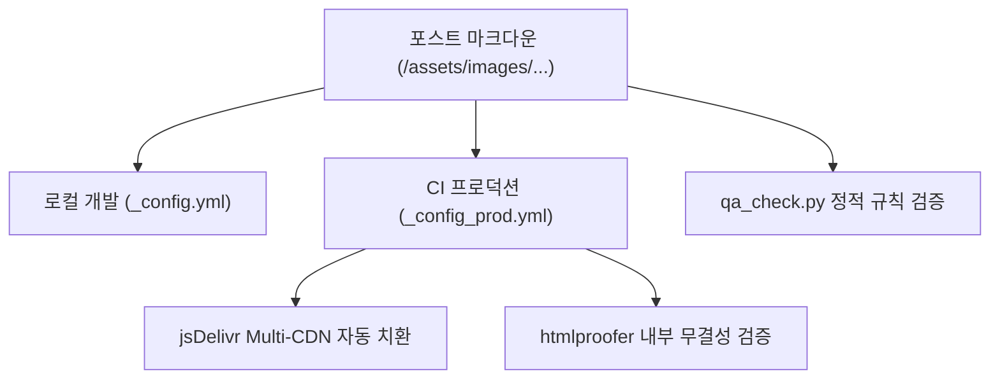
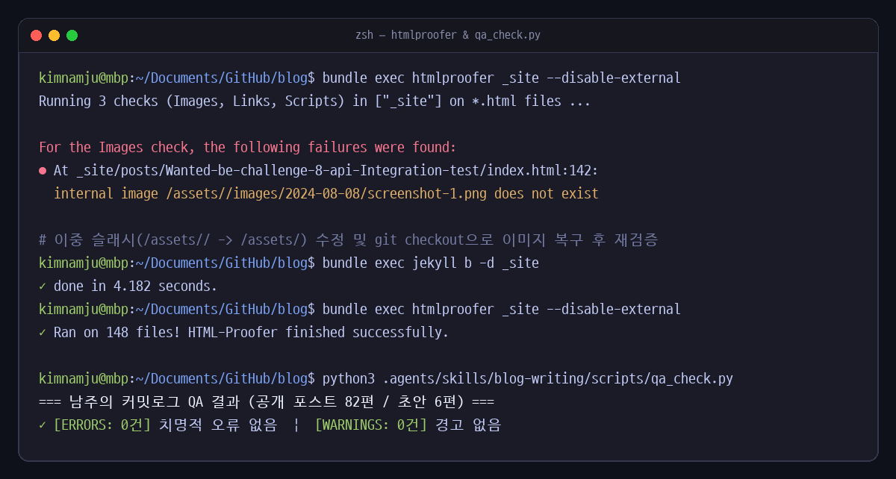

> 외부 플랫폼에 의존하던 핫링크 이미지를 저장소 내부와 jsDelivr CDN으로 내재화하고, 그 과정에서 겪은 `htmlproofer` 이중 슬래시 오류, `AGENTS.md` 배포 노출, Thin Content 정리, Dev Container Bookworm 전환 과정을 정리합니다.

> 본 문서는 Jekyll 4.4 / `jekyll-theme-chirpy` 7.6.0, `html-proofer`, GitHub Actions(Ruby 3.4) 환경을 기준으로 작성되었습니다.
{: .prompt-info }

## 외부 핫링크 이미지의 위험성과 jsDelivr CDN 내재화 전략

오래 운영한 블로그에는 예전 플랫폼(Velog, 원티드 챌린지, GitHub 이슈 등)에 올린 이미지 URL을 그대로 붙여 둔 글이 쌓이기 쉽습니다. 외부 핫링크 의존 구조는 장기 운영에서 분명한 위험을 안고 있습니다. 외부 서비스가 CDN 도메인을 바꾸거나 `Referer` 검사로 `403`을 반환하면 이미지가 예고 없이 깨지고, 응답 지연과 캐시 정책도 통제할 수 없어 LCP와 SNS 미리보기 품질이 흔들립니다.

| 방식 | 장점 | 단점 및 트레이드오프 |
| :--- | :--- | :--- |
| 외부 플랫폼 핫링크 | Git 저장소 용량을 차지하지 않음 | 정책 변경·삭제 시 즉시 깨짐, 성능 제어 불가 |
| 로컬 저장 + jsDelivr CDN | 저장소와 생명주기 일치, 글로벌 엣지 캐싱 | 대용량 이미지 누적 시 저장소 비대화(1MB 관리 필요) |

이를 해결하기 위해 외부 이미지를 모두 `assets/images/YYYY-MM-DD/`로 내려받아 내재화하고, 로컬 개발과 프로덕션 배포의 미디어 서빙 경로를 분리했습니다.



`jekyll-theme-chirpy`는 `_config.yml`의 `cdn` 값이 존재하면 `/`로 시작하는 미디어 경로 앞에 CDN 주소를 자동 결합합니다. 로컬용 `_config.yml`에서는 `cdn:`을 비워 두고, 프로덕션 전용 `_config_prod.yml`에만 jsDelivr 엔드포인트를 지정합니다.

```yaml
# _config_prod.yml
# GitHub Actions 배포 시 적용: bundle exec jekyll b --config _config.yml,_config_prod.yml
cdn: 'https://cdn.jsdelivr.net/gh/cmsong111/blog@main'
```

덕분에 로컬 미리보기에서는 방금 저장한 이미지가 즉시 보이고, `main` 브랜치 배포 시에만 자동으로 jsDelivr Multi-CDN 주소로 서빙됩니다.

## 이중 슬래시 오타로 발생한 고아 이미지 오탐과 복구

이미지 내재화 후 미사용(고아) 이미지를 일괄 정리하던 중 실제 장애가 발생했습니다. 참조되지 않는 파일을 삭제한 직후 CI의 `htmlproofer` 단계에서 `2024-08-08-Wanted-be-challenge-8-api-Integration-test.md`의 이미지가 없다는 오류가 뜬 것입니다.

원인은 포스트 본문에 `/assets`와 `/images/2024-08-08/screenshot-1.png` 사이 슬래시(`/`)가 두 번 겹쳐 입력된 오타였습니다. 브라우저는 연속 슬래시를 관대하게 정규화해 보여주기 때문에 평소에는 눈치채지 못했지만, 단순 문자열 매칭 스크립트는 이 경로를 인식하지 못해 실제 사용 중인 `screenshot-1.png`를 고아 파일로 오탐하고 삭제해 버렸습니다.

다행히 `htmlproofer`가 배포 전에 문제를 차단해 주었고, `git checkout`으로 이미지를 복구한 뒤 이중 슬래시 경로를 바로잡아 검증을 통과했습니다.



재발 방지를 위해 `.agents/skills/blog-writing/scripts/qa_check.py`에 이중 슬래시 탐지, 외부 핫링크 경고, 그리고 초안·탭·설정 파일의 이미지 참조까지 수집하는 `extra_refs` 보호 로직을 추가했습니다.

```python
# .agents/skills/blog-writing/scripts/qa_check.py (발췌)
HOTLINK_DOMAINS = (
    "velog.velcdn.com",
    "static.wanted.co.kr",
    "user-images.githubusercontent.com",
)

double_slash = "/assets/" + "/"
if double_slash in content:
    errors["double_slash_assets_path"].append(p)

extra_refs = set()
for pat in ["_drafts/**/*.md", "_tabs/*.md", "_config.yml", "_includes/*.html", "_data/**/*"]:
    for ef in glob.glob(pat, recursive=True):
        if os.path.isfile(ef):
            txt = open(ef, encoding="utf-8", errors="ignore").read()
            for im in re.findall(r"assets/images/[^\s\"'\)]+", txt):
                extra_refs.add(im.split("?")[0].split("#")[0])
```

## AGENTS.md 외부 배포 노출 차단과 설정 정합성 점검

점검 중 발견한 또 다른 문제는 내부 AI 에이전트 지침서의 외부 노출이었습니다. 과거 `agent.md`를 `AGENTS.md`로 이름을 바꿨지만 `_config.yml`의 `exclude`에는 구 파일명만 남아 있었습니다. Jekyll은 `exclude`에 없는 루트 마크다운을 그대로 `_site/AGENTS.md`로 복사해 배포합니다.

`_config.yml`의 `exclude`와 `.github/workflows/pages-deploy.yml`의 `paths-ignore` 양쪽에 `AGENTS.md`를 추가하고, `qa_check.py`에도 `_config.yml` 내 `AGENTS.md` 제외 누락을 검사하는 `config_missing_agents_exclude` 오류 규칙을 심었습니다.

```yaml
# _config.yml
exclude:
  - README.md
  - agent.md
  - AGENTS.md
  - writing-tone.md
```

## Thin Content 초안 분리와 Dev Container Bookworm 전환

검색엔진과 Google AdSense 품질 저하의 원인이 되는 Thin Content도 함께 정리했습니다. 링크 한 줄이나 메모 수준으로만 남아 있던 미완성 포스트 6편(원티드 챌린지 5편, 독서 메모 1편)을 `_drafts/`로 분리하고, `qa_check.py`가 순수 본문 600자 미만 포스트를 `thin_content_under_600` 오류로 차단하도록 강제했습니다.

로컬 개발용 `.devcontainer/devcontainer.json` 베이스 이미지도 지원 종료(EOL)된 Debian Bullseye에서 `mcr.microsoft.com/devcontainers/jekyll:2-bookworm`으로 전환했습니다.

```json
// .devcontainer/devcontainer.json
{
  "name": "Jekyll",
  "image": "mcr.microsoft.com/devcontainers/jekyll:2-bookworm",
  "onCreateCommand": "git config --global --add safe.directory ${containerWorkspaceFolder} && sudo chown -R \"$(id -u):$(id -g)\" \"${GEM_HOME:-/usr/local/bundle}\"",
  "forwardPorts": [4000, 35729],
  "postCreateCommand": "bash .devcontainer/post-create.sh"
}
```

Bookworm 기반 이미지는 `/usr/local/bundle` 하위 디렉터리가 `root` 소유로 패키징되어 있습니다. `postCreateCommand`의 `bundle install`이 실행되기 전에 `onCreateCommand`로 소유권을 `vscode` 사용자로 보정해 두어야 `Bundler::PermissionError`를 예방할 수 있습니다.

## 운영 시 주의할 점과 함정

> jsDelivr `@main` 브랜치 URL은 엣지 서버에 캐시되므로, 같은 파일명으로 이미지를 덮어써도 브라우저에 기존 이미지가 한동안 남을 수 있습니다. 교체 시에는 파일명에 구분자(`-v2.png`)를 붙이거나 jsDelivr Purge API로 캐시를 비우는 편이 안전합니다.
{: .prompt-warning }

1. **저장소 용량과 1MB 상한**: 무압축 스크린샷이 누적되면 클론 속도가 느려집니다. 불필요한 여백을 자르고 `qa_check.py`의 `1MB` 경고 기준 이하로 PNG·WebP 용량을 관리합니다.
2. **`htmlproofer --disable-external` 운용**: CI에서 외부 URL까지 매번 검사하면 일시적 타임아웃이나 `403`/`429` 차단으로 배포가 자주 실패합니다. CI는 내부 무결성 검증에 집중하고 외부 링크는 분기별로 별도 점검합니다.
3. **정적 QA와 실제 빌드의 역할 분담**: `qa_check.py`는 Ruby 없이 1초 만에 마크다운·설정 오류를 잡는 1차 방어선이고, Liquid 렌더링과 최종 HTML 링크 무결성은 `jekyll build` + `htmlproofer`가 담당하는 2중 구조로 운영해야 빈틈이 없습니다.
