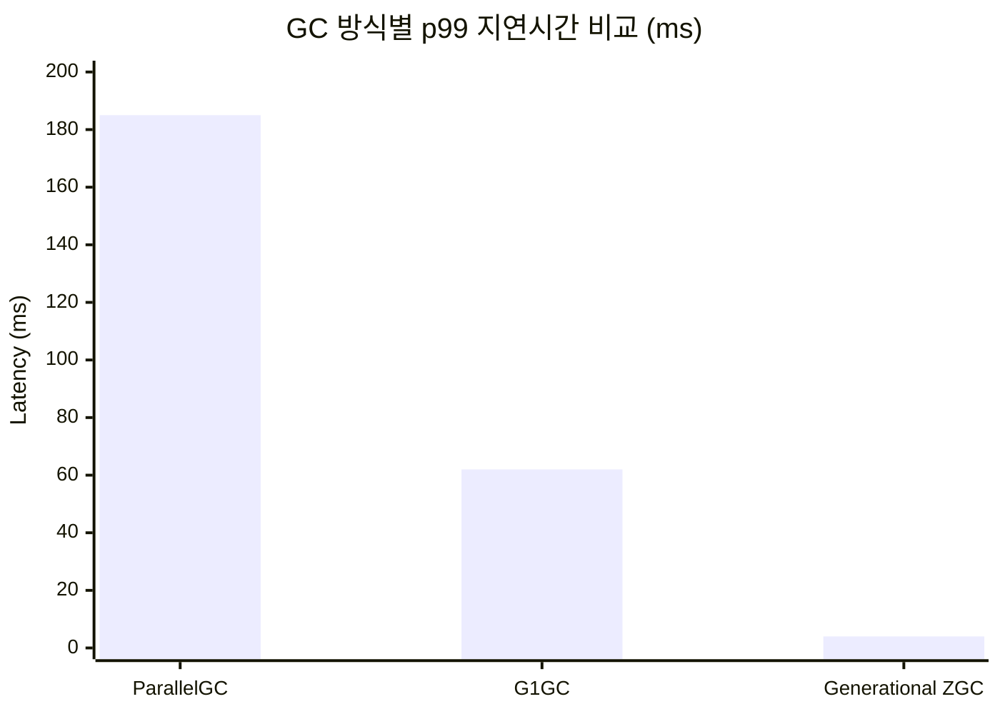
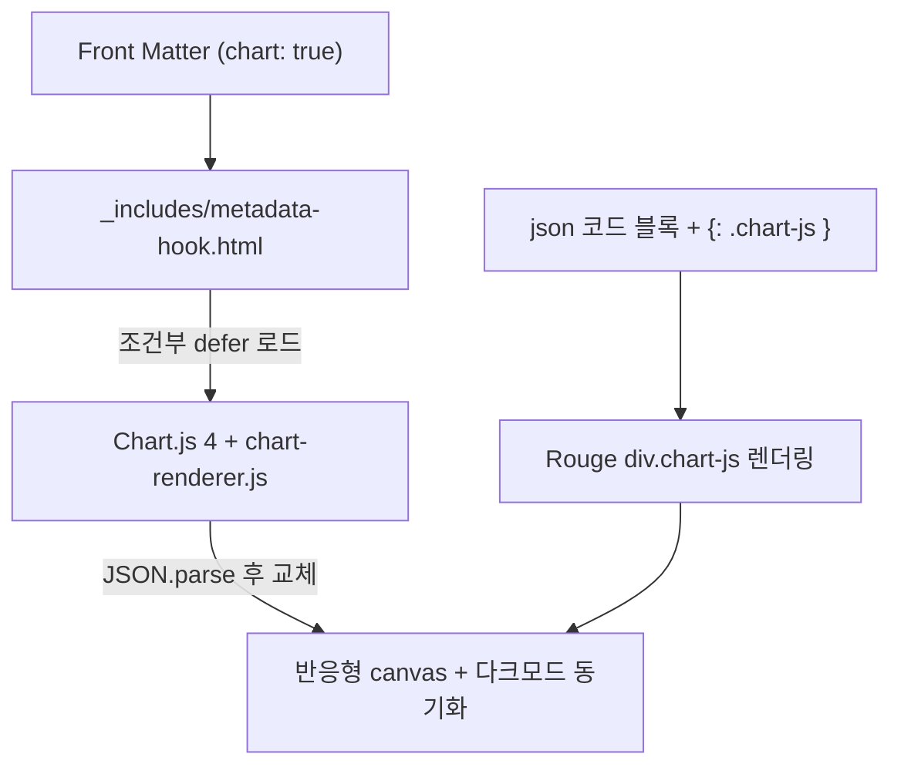

> 기술 블로그에서 벤치마크 응답 시간이나 번들 용량 변화를 비교할 때 표만으로는 수치 격차가 한눈에 들어오지 않습니다. 이 글에서는 Jekyll Chirpy v7.6 테마의 레이아웃을 덮어쓰지 않고 내장 Mermaid `xychart-beta`와 조건부 Chart.js 4를 도입해 다크모드 동기화와 정적 QA까지 구성한 과정을 정리합니다.

> 기준 환경: **Jekyll 4.4 / jekyll-theme-chirpy 7.6.0 / Mermaid 11 (내장) / Chart.js 4**
{: .prompt-info }

## 마크다운 블로그에서 차트를 넣는 3가지 방식 비교

블로그에 수치 비교 차트를 넣으려 할 때 가장 흔히 고민하는 선택지는 **정적 이미지(PNG/WebP)**, **내장 Mermaid `xychart-beta`**, **Chart.js 같은 인터랙티브 JS 라이브러리** 세 가지입니다. 무작정 모든 글에 JS 차트 라이브러리를 전역 로드하면 일반 텍스트 글의 LCP와 JS 파싱 비용만 늘어나므로, 목적에 따라 명확한 선택 기준을 세워야 합니다.

| 구분 | 정적 이미지 (PNG/WebP) | Mermaid `xychart-beta` | 조건부 Chart.js 4 (`chart: true`) |
| :--- | :--- | :--- | :--- |
| **추가 JS 용량** | 0 KB (이미지 전송만) | 0 KB (Chirpy `mermaid@11` 내장) | 약 65 KB gzip (`chart: true` 글 한정) |
| **다크/라이트 대응** | 별도 제작 없이는 고정 | 테마 전환 자동 반영 | `MutationObserver`로 실시간 동기화 |
| **인터랙션·표현력** | 없음 | 단순 1시리즈 막대·선 차트 | 다중 시리즈, 도넛, 호버 툴팁 지원 |
| **수정 편의성** | 재생성·재업로드 필요 | 마크다운 텍스트 즉시 수정 | JSON 텍스트 즉시 수정 |
| **적합한 상황** | Grafana·DevTools 실제 캡처 | 단순 전후 수치 막대·선 비교 | 그룹 막대·다중 지표 벤치마크 비교 |

단순한 2~4개 항목 비교라면 표나 내장 `xychart-beta`로 충분합니다. 반대로 **실제 모니터링 화면 증거**(Grafana, Lighthouse)는 차트로 다시 그리지 말고 스크린샷을 써야 신뢰도가 유지됩니다. 여러 시리즈를 나란히 비교하거나 마우스 호버로 정확한 수치를 보여 주고 싶을 때만 조건부 Chart.js를 선택하는 것이 합리적입니다.

## Chirpy 내장 Mermaid xychart-beta 활용하기

Chirpy v7.6은 `mermaid: true`를 선언한 글에서 jsDelivr을 통해 `mermaid@11`을 자동 로드합니다. Mermaid 11에는 **`xychart-beta`**가 이미 포함되어 있어 별도 플러그인이나 스크립트 추가 없이 곧바로 막대·꺾은선 차트를 그릴 수 있습니다.

아래는 실제 본문에 렌더링된 `xychart-beta` 막대 차트 예시입니다.



텍스트만으로 수치 격차를 시각적으로 전달할 수 있고 추가 네트워크 요청이 전혀 생기지 않는 점이 큰 장점입니다. 다만 다중 데이터셋 범례(Legend)나 호버 툴팁, 도넛 차트 같은 표현에는 제약이 있어 이 구간부터는 Chart.js가 유리합니다.

## 조건부 Chart.js 4 로더와 Kramdown IAL 기반 렌더러 구현

Chirpy 테마에서 `_layouts/post.html`이나 `_includes/head.html`을 직접 덮어쓰면 테마 업그레이드마다 충돌이 발생합니다. 기존 [Chirpy 수동 애드센스 배치 글](/posts/chirpy-manual-adsense-sidebar-and-mobile-layout/)과 동일하게 공식 확장 훅인 `_includes/metadata-hook.html`을 활용해 **`chart: true`가 선언된 포스트에서만** Chart.js 4와 렌더러를 조건부 로드합니다.



### 1. `_includes/metadata-hook.html` 조건부 스크립트 주입


```html
<!-- _includes/metadata-hook.html -->

  <script defer src="https://cdn.jsdelivr.net/npm/chart.js@4/dist/chart.umd.min.js"></script>
  <script defer src="{{ '/assets/js/chart-renderer.js' | relative_url }}"></script>

```


`page.chart`가 없는 일반 글에서는 `<script>` 태그 자체가 HTML에 출력되지 않아 불필요한 리소스 로딩을 원천 차단합니다.

### 2. Kramdown IAL(`{: .chart-js }`)을 선택한 내부 원리

마크다운 본문에 `<script>`와 `<canvas>`를 직접 쓰면 글 가독성이 떨어지고 다크모드 대응 코드를 매번 복붙해야 합니다. 대신 `json` 코드 블록 직후에 Kramdown의 **IAL(Inline Attribute List)** 문법인 `{: .chart-js }`를 붙이는 방식을 택했습니다.

내부적으로 Kramdown과 Rouge는 이 블록을 `<div class="language-json highlighter-rouge chart-js">`로 렌더링합니다. 표준 `json` 렉서를 그대로 쓰므로 알 수 없는 언어 경고가 나지 않고, JS가 비활성화된 RSS 리더나 GitHub 파일 뷰어에서도 깨진 빈 화면 대신 읽기 쉬운 JSON 데이터로 우아하게 폴백(Graceful Degradation)됩니다.

### 3. `assets/js/chart-renderer.js` 다크모드 동기화 렌더러

렌더러는 DOM 로드 직후 `.chart-js` 블록의 텍스트를 `JSON.parse()`로 읽어 `<canvas>`로 교체합니다. Chirpy는 테마 토글 시 `document.documentElement`의 `data-mode` 속성을 바꾸므로, `MutationObserver`와 `prefers-color-scheme` 리스너를 연결해 사용자가 다크/라이트 모드를 전환하는 즉시 축·격자·범례 색상을 `chart.update('none')`으로 깜빡임 없이 재적용합니다.

```javascript
// assets/js/chart-renderer.js (핵심 발췌)
function isDarkMode() {
  var mode = document.documentElement.getAttribute('data-mode');
  if (mode === 'dark') return true;
  if (mode === 'light') return false;
  return window.matchMedia && window.matchMedia('(prefers-color-scheme: dark)').matches;
}

function renderCharts() {
  if (typeof window.Chart === 'undefined') return;

  document.querySelectorAll('.chart-js').forEach(function (block) {
    // Rouge line_numbers: true 환경에서는 td.rouge-gutter 줄 번호를 제외하고 순수 코드만 추출
    var codeEl =
      block.querySelector('td.rouge-code pre') ||
      block.querySelector('pre code') ||
      block.querySelector('code');
    if (!codeEl) return;

    var config = JSON.parse(codeEl.textContent);
    var container = document.createElement('div');
    container.className = 'chart-container';
    var canvas = document.createElement('canvas');
    container.appendChild(canvas);

    block.parentNode.replaceChild(container, block);
    var chart = new window.Chart(canvas.getContext('2d'), applyTheme(config));
    instances.push(chart);
  });
}
```

### 4. Chirpy 디자인 토큰에 맞춘 반응형 카드 스타일 (`assets/css/jekyll-theme-chirpy.scss`)

Chart.js에서 `maintainAspectRatio: false`를 쓰면 부모 컨테이너에 명시적 높이가 필요합니다. [Chirpy 한글 가독성 튜닝 글](/posts/chirpy-korean-typography-and-rouge-error-fix/)에서 구성한 커스텀 SCSS 하단에 Chirpy의 기본 카드 변수(`--card-bg`, `--card-shadow`, `--card-header-bg`, `--tb-border-color`)를 그대로 재사용해 카드 헤더와 본문 높이를 데스크톱(`320px`)·모바일(`260px`)로 분리합니다.

```scss
// assets/css/jekyll-theme-chirpy.scss
.chart-card {
  margin: 1.75rem 0;
  border-radius: 0.625rem;
  background-color: var(--card-bg);
  box-shadow: var(--card-shadow);
  overflow: hidden;
}

.chart-card-header {
  display: flex;
  align-items: center;
  justify-content: space-between;
  padding: 0.75rem 1.15rem;
  border-bottom: 1px solid var(--tb-border-color);
  background-color: var(--card-header-bg, var(--highlight-bg-color));
}

.chart-card-body {
  position: relative;
  width: 100%;
  height: 320px;
  padding: 1.15rem 1.25rem 0.9rem;
}

@media (max-width: 767.98px) {
  .chart-card-body {
    height: 260px;
    padding: 0.9rem 0.75rem 0.65rem;
  }
}
```

## 다양한 Chart.js 라이브 예시와 JSON 데이터 토글

이 글의 Front Matter에 `chart: true`를 선언하고 본문에 JSON 블록 + `{: .chart-js }`만 적어 실제 렌더링한 **8가지 차트 갤러리**(다중 막대 · 수평 누적 막대 · 영역 꺾은선 · 도넛 · 다수 포인트 XY 산점도 · 3차원 버블 · 레이더 · 폴라 영역)입니다. 각 차트 우측 상단의 **`JSON 보기`** 버튼을 누르면 실제 원본 JSON 설정을 바로 펼쳐 볼 수 있으며, 사이드바 다크/라이트 토글 시 팔레트·축·격자·방사형 축 색상이 실시간으로 전환됩니다.

### 1. 다중 시리즈 막대 차트 (`bar`)

```json
{
  "type": "bar",
  "data": {
    "labels": ["HTTP/1.1", "HTTP/2", "HTTP/3 (QUIC)"],
    "datasets": [
      {
        "label": "정상 망 초기 로딩 (ms)",
        "data": [780, 440, 390]
      },
      {
        "label": "패킷 손실 2% 환경 (ms)",
        "data": [1620, 1480, 520]
      }
    ]
  },
  "options": {
    "plugins": {
      "title": {
        "display": true,
        "text": "프로토콜별 네트워크 조건에 따른 초기 로딩 시간 비교"
      }
    },
    "scales": {
      "y": {
        "beginAtZero": true,
        "title": {
          "display": true,
          "text": "ms"
        }
      }
    }
  }
}
```
{: .chart-js }

### 2. 도넛 차트 (`doughnut`)

메모리 점유율이나 트래픽 비율처럼 전체 대비 비중을 보여 줄 때는 도넛 차트가 직관적입니다. 렌더러가 `cutout: '64%'`와 `--card-bg` 슬라이스 구분선을 기본 적용해 다크모드에서도 경계가 자연스럽게 유지됩니다.

```json
{
  "type": "doughnut",
  "data": {
    "labels": [
      "Heap (512MB)",
      "Metaspace (120MB)",
      "GC / Native (85MB)",
      "CodeCache (80MB)",
      "Thread Stack (75MB)",
      "Direct Buffer (64MB)"
    ],
    "datasets": [
      {
        "label": "메모리 사용량 (MB)",
        "data": [512, 120, 85, 80, 75, 64]
      }
    ]
  },
  "options": {
    "plugins": {
      "title": {
        "display": true,
        "text": "1GB 컨테이너 Spring Boot JVM RSS 메모리 구성 (MB)"
      }
    }
  }
}
```
{: .chart-js }

### 3. 다수 포인트 XY 산점도 차트 (`scatter`)

부하 증가에 따른 응답 지연 분포나 이상치(Outlier)를 표현할 때는 `{ "x": ..., "y": ... }` 좌표 배열을 받는 `scatter` 차트가 효과적입니다. `scatter` 타입에서는 X·Y 양축 보조선과 `nearest` 포인트 호버 모드가 자동 활성화되어 수십 개의 점도 겹치지 않게 탐색할 수 있습니다.

```json
{
  "type": "scatter",
  "data": {
    "datasets": [
      {
        "label": "Tomcat 스레드 풀 (max=200)",
        "data": [
          { "x": 20, "y": 42 }, { "x": 40, "y": 48 }, { "x": 60, "y": 55 },
          { "x": 80, "y": 64 }, { "x": 100, "y": 78 }, { "x": 120, "y": 95 },
          { "x": 140, "y": 118 }, { "x": 160, "y": 152 }, { "x": 180, "y": 210 },
          { "x": 200, "y": 315 }, { "x": 220, "y": 490 }, { "x": 240, "y": 710 },
          { "x": 260, "y": 960 }, { "x": 280, "y": 1240 }, { "x": 300, "y": 1580 },
          { "x": 320, "y": 1920 }, { "x": 340, "y": 2280 }, { "x": 360, "y": 2650 }
        ]
      },
      {
        "label": "Java 21 Virtual Threads",
        "data": [
          { "x": 20, "y": 41 }, { "x": 40, "y": 45 }, { "x": 60, "y": 49 },
          { "x": 80, "y": 53 }, { "x": 100, "y": 58 }, { "x": 120, "y": 64 },
          { "x": 140, "y": 70 }, { "x": 160, "y": 77 }, { "x": 180, "y": 84 },
          { "x": 200, "y": 92 }, { "x": 220, "y": 101 }, { "x": 240, "y": 112 },
          { "x": 260, "y": 124 }, { "x": 280, "y": 139 }, { "x": 300, "y": 156 },
          { "x": 320, "y": 175 }, { "x": 340, "y": 198 }, { "x": 360, "y": 224 }
        ]
      }
    ]
  },
  "options": {
    "plugins": {
      "title": {
        "display": true,
        "text": "동시 요청 수(VU) 증가에 따른 외부 I/O API 응답 지연 분포"
      }
    },
    "scales": {
      "x": {
        "type": "linear",
        "title": {
          "display": true,
          "text": "동시 요청 수 (VU)"
        }
      },
      "y": {
        "beginAtZero": true,
        "title": {
          "display": true,
          "text": "p95 응답 시간 (ms)"
        }
      }
    }
  }
}
```
{: .chart-js }

### 4. 영역 꺾은선 차트 (`line` + `fill: true`)

시간 흐름에 따른 p99 지연시간 추이나 GC 스파이크 비교에는 곡선 꺾은선 차트에 `"fill": true`를 켜는 편이 시각적 대비가 선명합니다. 렌더러가 `tension: 0.34`와 반투명 영역 채움(`alpha: 0.16`)을 자동 적용합니다.

```json
{
  "type": "line",
  "data": {
    "labels": ["00m", "05m", "10m", "15m", "20m", "25m", "30m", "35m", "40m", "45m"],
    "datasets": [
      {
        "label": "G1GC p99 (ms)",
        "data": [28, 34, 82, 41, 37, 118, 45, 39, 96, 36],
        "fill": true
      },
      {
        "label": "Generational ZGC p99 (ms)",
        "data": [9, 10, 11, 10, 12, 11, 10, 9, 11, 10],
        "fill": true
      }
    ]
  },
  "options": {
    "plugins": {
      "title": {
        "display": true,
        "text": "부하 테스트 45분간 GC 방식별 p99 지연시간 추이"
      }
    },
    "scales": {
      "y": {
        "beginAtZero": true,
        "title": {
          "display": true,
          "text": "p99 Latency (ms)"
        }
      }
    }
  }
}
```
{: .chart-js }

### 5. 수평 누적 막대 차트 (`bar` + `indexAxis: "y"` + `stacked: true`)

Docker 이미지 레이어 용량이나 요청 구간별 지연 분해처럼 **항목별 총량과 구성 요소**를 함께 보여 줄 때는 수평 누적 막대가 가장 읽기 쉽습니다.

```json
{
  "type": "bar",
  "data": {
    "labels": [
      "단일 스테이지 JDK",
      "멀티스테이지 JRE",
      "Distroless + jlink"
    ],
    "datasets": [
      { "label": "OS 베이스", "data": [118, 78, 22] },
      { "label": "JVM 런타임", "data": [340, 145, 48] },
      { "label": "의존성 JAR", "data": [64, 64, 64] },
      { "label": "애플리케이션", "data": [8, 8, 8] }
    ]
  },
  "options": {
    "indexAxis": "y",
    "plugins": {
      "title": {
        "display": true,
        "text": "Docker 빌드 전략별 Spring Boot 이미지 레이어 용량 (MB)"
      }
    },
    "scales": {
      "x": {
        "stacked": true,
        "title": {
          "display": true,
          "text": "이미지 크기 (MB)"
        }
      },
      "y": {
        "stacked": true
      }
    }
  }
}
```
{: .chart-js }

### 6. 3차원 버블 차트 (`bubble`)

`x`(초당 요청 수), `y`(p95 지연시간)에 **`r`(오류율·트래픽 영향도 반지름)**을 더해 3개 지표를 한 화면에 압축할 수 있습니다. 우상단의 큰 버블이 최우선 최적화 대상임을 직관적으로 드러냅니다.

```json
{
  "type": "bubble",
  "data": {
    "datasets": [
      {
        "label": "조회 API (GET)",
        "data": [
          { "x": 420, "y": 35, "r": 7 },
          { "x": 680, "y": 58, "r": 10 },
          { "x": 910, "y": 145, "r": 16 },
          { "x": 260, "y": 24, "r": 6 },
          { "x": 540, "y": 82, "r": 9 }
        ]
      },
      {
        "label": "쓰기·결제 API (POST)",
        "data": [
          { "x": 110, "y": 180, "r": 12 },
          { "x": 195, "y": 340, "r": 18 },
          { "x": 310, "y": 520, "r": 22 },
          { "x": 85, "y": 130, "r": 8 },
          { "x": 240, "y": 410, "r": 15 }
        ]
      },
      {
        "label": "외부 연동 API",
        "data": [
          { "x": 65, "y": 620, "r": 14 },
          { "x": 140, "y": 790, "r": 20 }
        ]
      }
    ]
  },
  "options": {
    "plugins": {
      "title": {
        "display": true,
        "text": "API 엔드포인트별 RPS · 지연시간 · 장애 영향도(반지름) 분포"
      }
    },
    "scales": {
      "x": {
        "beginAtZero": true,
        "title": {
          "display": true,
          "text": "초당 요청 수 (RPS)"
        }
      },
      "y": {
        "beginAtZero": true,
        "title": {
          "display": true,
          "text": "p95 지연시간 (ms)"
        }
      }
    }
  }
}
```
{: .chart-js }

### 7. 다차원 레이더 차트 (`radar`)

아키텍처나 동시성 모델의 장단점을 5~6개 평가 축으로 비교할 때 유용합니다. 렌더러가 방사형 축(`scales.r`)의 숫자 배경을 투명(`backdropColor: 'transparent'`)으로 처리해 다크모드에서도 깔끔하게 유지됩니다.

```json
{
  "type": "radar",
  "data": {
    "labels": [
      "I/O 동시 처리량",
      "디버깅 편의성",
      "메모리 효율",
      "JDBC·JPA 호환성",
      "학습 용이성",
      "초대형 스트리밍"
    ],
    "datasets": [
      {
        "label": "Spring MVC (Platform Thread)",
        "data": [55, 95, 55, 100, 95, 45]
      },
      {
        "label": "Spring MVC + Virtual Threads",
        "data": [85, 90, 82, 92, 90, 68]
      },
      {
        "label": "Spring WebFlux (Netty)",
        "data": [96, 52, 95, 40, 48, 98]
      }
    ]
  },
  "options": {
    "plugins": {
      "title": {
        "display": true,
        "text": "Spring 서버 동시성 모델 6축 트레이드오프 비교 (100점 기준)"
      }
    },
    "scales": {
      "r": {
        "min": 0,
        "max": 100,
        "ticks": {
          "stepSize": 25
        }
      }
    }
  }
}
```
{: .chart-js }

### 8. 폴라 영역 차트 (`polarArea`)

항목별 절대 규모 차이를 부채꼴 반지름으로 동시에 드러낼 때 적합합니다. 아래는 이 블로그의 실제 대분류별 발행 포스트 분포를 폴라 영역 차트로 표현한 예시입니다.

```json
{
  "type": "polarArea",
  "data": {
    "labels": [
      "Spring",
      "Vite",
      "Java",
      "Home Server",
      "Docker",
      "Blog",
      "CS",
      "Book & AI & Dev"
    ],
    "datasets": [
      {
        "label": "발행 포스트 수",
        "data": [53, 31, 23, 17, 16, 14, 10, 24]
      }
    ]
  },
  "options": {
    "plugins": {
      "title": {
        "display": true,
        "text": "남주의 커밋로그 대분류별 발행 포스트 분포 (총 188편)"
      }
    }
  }
}
```
{: .chart-js }

JSON 문법 오타나 `chart: true` 누락은 빌드 시점에는 에러가 나지 않아 배포 후 빈 코드 블록으로 노출되기 쉽습니다. 이를 막기 위해 정적 QA 스크립트(`qa_check.py`)에 `{: .chart-js }` 블록의 `json.loads()` 유효성 검사와 `chart: true` 플래그 일치 검사를 추가해 배포 전 오류를 차단했습니다.

## 운영 시 주의사항과 적용 체크리스트

> 주의: `_config.yml`에서 Rouge `line_numbers: true`를 쓰는 경우 `code.textContent`에 줄 번호(`td.rouge-gutter`)까지 섞여 `JSON.parse()`가 실패하므로 반드시 `td.rouge-code pre`를 먼저 조회해야 합니다. 또한 JSON 안에 JavaScript 콜백 함수(`ticks.callback: function() {}`)는 넣을 수 없으므로 선언형 옵션만 사용해야 합니다.
{: .prompt-warning }

또한 `Chart.js`를 포함한 서드파티 CDN 스크립트는 `defer`로 로드해 본문 렌더링을 막지 않아야 하며, 차트 높이를 CSS로 고정해 두어야 로딩 전후 **CLS(누적 레이아웃 이동)**가 발생하지 않습니다.

실제 블로그에 적용할 때는 아래 4가지를 순서대로 점검해 보시기 바랍니다.

- [ ] 단순 1시리즈 비교는 내장 Mermaid `xychart-beta`로 먼저 해결하고, 다중 시리즈·인터랙티브 차트에만 `chart: true` 사용
- [ ] `_includes/metadata-hook.html`에서 `page.chart` 조건부 로드 여부 확인 (일반 글 0바이트 유지)
- [ ] 데스크톱·모바일(390px) 및 다크/라이트 테마 토글 시 축·범례 가독성 확인
- [ ] 배포 전 `qa_check.py`로 `chart: true` 플래그 일치와 JSON 문법 오류 0건 검증
