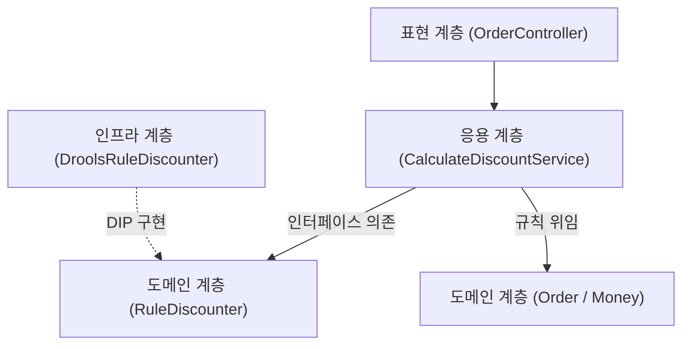

> 《도메인 주도 개발 시작하기》 1~2장을 복습하며 도메인 모델링의 출발점인 엔티티·밸류 구분과 4계층 DIP 아키텍처를 Kotlin 코드와 실무 기준 중심으로 정리합니다.

> 본 글의 예제 코드는 **Kotlin 1.9, Java 21, Spring Boot 3.x, Spring Data JPA (Hibernate 6)** 환경을 기준으로 작성했습니다.
{: .prompt-info }

## 도메인 개념과 모델의 점진적 진화

소프트웨어가 해결하려는 문제 영역을 **도메인(Domain)**이라 부르며, 온라인 쇼핑 도메인은 카탈로그·회원·주문·결제·배송 같은 **하위 도메인(Subdomain)**으로 나뉩니다. 하위 도메인을 구분하지 않고 거대한 서비스 하나에 몰아넣으면 요구사항이 커질수록 변경 여파를 통제하기 어려워집니다.

도메인 모델은 이해관계자와 문제를 정리하는 **개념 모델**과 실제 코드로 동작하는 **구현 모델**로 나뉩니다. 처음부터 완벽한 개념 모델을 만든 뒤 한 번에 구현하려 들면 분석 단계에 갇히기 쉽습니다. 단순한 초안으로 시작해 코드를 작성하고 피드백을 반영하며 구현 모델 쪽으로 점진적으로 다듬는 편이 실용적입니다.

이때 **유비쿼터스 언어(Ubiquitous Language)**가 중요합니다. 기획자는 "결제 대기"라 부르는데 코드가 `STEP_1`이면 소통할 때마다 번역 비용과 오해가 쌓입니다. `PAYMENT_WAITING`, `PREPARING`, `cancel()`처럼 도메인 용어를 코드에 그대로 반영하면 코드 자체가 최신 기획 문서 역할을 합니다.

## 엔티티와 밸류 타입 구분 및 불변 설계

도메인 객체를 설계할 때는 고유 식별자로 생명주기를 추적하는 **엔티티**와 값 자체를 표현하는 **밸류 타입**을 명확히 구분해야 합니다.

| 구분 | 엔티티 (Entity) | 밸류 타입 (Value Object) |
| :--- | :--- | :--- |
| **식별자 및 동등성** | 고유 식별자(`OrderNo`) 기준 비교 | 식별자 없음, 전체 속성 값 비교 |
| **가변성** | 생명주기 동안 상태 전이 가능 | **불변(Immutable)**, 변경 시 새 객체 교체 |
| **Kotlin 구현** | 일반 `class` + 도메인 행위 메서드 | `data class` + `val` 프로퍼티 |
| **예시** | `Order`, `Member`, `Product` | `Money`, `Address`, `ShippingInfo`, `Receiver` |

`Money`, `Address`, `ShippingInfo`, `Receiver` 같은 밸류는 가변으로 두면 의도치 않은 상태 공유 버그가 생깁니다. 모든 필드를 `val`로 선언하고 연산 시 새 인스턴스를 반환하게 만들어 사이드 이펙트를 차단합니다.

엔티티에서는 단순 `set` 메서드를 열어두지 않아야 합니다. `order.state = OrderState.CANCELED`처럼 필드를 직접 수정하게 두면 핵심 규칙이 응용 서비스로 흩어지는 빈약한 도메인 모델(Anemic Domain Model)이 됩니다. 대신 `changeShippingInfo()`, `cancel()` 같은 행위 메서드를 두고 내부에서 `verifyNotYetShipped()`로 불변식을 강제합니다.

```kotlin
// com/example/shop/common/model/Money.kt
package com.example.shop.common.model

data class Money(val value: Int) {
    init {
        require(value >= 0) { "금액은 0 이상이어야 합니다: $value" }
    }

    operator fun plus(other: Money): Money = Money(value + other.value)
    operator fun times(multiplier: Int): Money = Money(value * multiplier)
}
```

```kotlin
// com/example/shop/order/domain/OrderModels.kt
package com.example.shop.order.domain

import com.example.shop.common.model.Money
import jakarta.persistence.Column
import jakarta.persistence.Embeddable
import jakarta.persistence.Embedded
import jakarta.persistence.EmbeddedId
import jakarta.persistence.Entity
import jakarta.persistence.EnumType
import jakarta.persistence.Enumerated
import jakarta.persistence.Table
import java.io.Serializable

@Embeddable
data class OrderNo(
    @Column(name = "order_number")
    val number: String
) : Serializable

enum class OrderState {
    PAYMENT_WAITING, PREPARING, SHIPPED, DELIVERING, DELIVERY_COMPLETED, CANCELED
}

@Embeddable
data class Receiver(
    @Column(name = "receiver_name") val name: String,
    @Column(name = "receiver_phone") val phone: String
)

@Embeddable
data class Address(
    @Column(name = "shipping_zip_code") val zipCode: String,
    @Column(name = "shipping_addr1") val address1: String,
    @Column(name = "shipping_addr2") val address2: String
)

@Embeddable
data class ShippingInfo(
    @Embedded val receiver: Receiver,
    @Embedded val address: Address,
    @Column(name = "shipping_message") val message: String
)

@Entity
@Table(name = "purchase_order")
class Order(
    @EmbeddedId
    val number: OrderNo,
    shippingInfo: ShippingInfo,
    totalAmounts: Money
) {
    @Embedded
    var shippingInfo: ShippingInfo = shippingInfo
        protected set

    @Column(name = "total_amounts")
    var totalAmounts: Money = totalAmounts
        protected set

    @Enumerated(EnumType.STRING)
    @Column(name = "state")
    var state: OrderState = OrderState.PAYMENT_WAITING
        protected set

    fun changeShippingInfo(newShippingInfo: ShippingInfo) {
        verifyNotYetShipped()
        this.shippingInfo = newShippingInfo
    }

    fun cancel() {
        verifyNotYetShipped()
        this.state = OrderState.CANCELED
    }

    fun verifyNotYetShipped() {
        check(state == OrderState.PAYMENT_WAITING || state == OrderState.PREPARING) {
            "이미 출고된 주문은 변경하거나 취소할 수 없습니다. 현재 상태: $state"
        }
    }
}
```

## 4계층 아키텍처와 DIP 적용

DDD는 애플리케이션을 **표현(HTTP 입출력), 응용(트랜잭션 조율), 도메인(비즈니스 규칙), 인프라(DB·외부 연동)** 4계층으로 나눕니다. 전통적인 계층 구조에서는 고수준 응용/도메인 계층이 저수준 인프라 구현체에 직접 의존하기 때문에, 룰 엔진을 교체할 때 비즈니스 코드가 함께 흔들리고 단위 테스트도 무거워집니다.

이를 해결하는 원칙이 **DIP(의존 역전 원칙)**입니다. 고수준 서비스 `CalculateDiscountService`가 저수준 `DroolsRuleDiscounter`에 의존하는 대신, 도메인 패키지에 추상화 인터페이스 `RuleDiscounter`를 두고 저수준 인프라 모듈이 이를 구현하게 의존 방향을 역전시킵니다.



```kotlin
// com/example/shop/order/domain/RuleDiscounter.kt
package com.example.shop.order.domain

import com.example.shop.common.model.Money

interface RuleDiscounter {
    fun applyRules(customerGrade: String, orderAmount: Money): Money
}
```

```kotlin
// com/example/shop/order/application/CalculateDiscountService.kt
package com.example.shop.order.application

import com.example.shop.common.model.Money
import com.example.shop.order.domain.RuleDiscounter
import org.springframework.stereotype.Service

@Service
class CalculateDiscountService(
    private val ruleDiscounter: RuleDiscounter
) {
    fun calculateDiscount(customerGrade: String, orderAmount: Money): Money {
        return ruleDiscounter.applyRules(customerGrade, orderAmount)
    }
}
```

```kotlin
// com/example/shop/order/infra/DroolsRuleDiscounter.kt
package com.example.shop.order.infra

import com.example.shop.common.model.Money
import com.example.shop.order.domain.RuleDiscounter
import org.springframework.stereotype.Component

@Component
class DroolsRuleDiscounter : RuleDiscounter {
    override fun applyRules(customerGrade: String, orderAmount: Money): Money {
        val discountRate = if (customerGrade == "VIP") 10 else 0
        return Money(orderAmount.value * discountRate / 100)
    }
}
```

Spring 내부 동작을 보면 컴파일 타임에는 `order.application`과 `order.domain` 어디에도 인프라 구현체 import가 없습니다. 기동 시 `DefaultListableBeanFactory`가 `DroolsRuleDiscounter` 빈을 등록하고 생성자 주입 단계에서 `RuleDiscounter` 타입에 연결해 줌으로써, 컴파일 의존 방향(안쪽)과 런타임 실행 흐름(바깥쪽)을 깔끔하게 분리합니다. 패키지 구조도 계층별 분리보다 `com.example.shop.order.{domain, application, infra}`처럼 하위 도메인 중심으로 묶어야 기능 수정 시 응집도와 모듈 분리 유연성이 높아집니다.

## 실무 적용 시 주의할 운영 함정

첫째는 **Kotlin `data class`를 JPA `@Entity`로 사용하는 실수**입니다. 불변 밸류 타입(`@Embeddable`)은 값 동등성이 핵심이라 `data class`가 적합하지만, `@Entity`에 쓰면 심각한 문제가 생깁니다. `data class`는 상속 불가(`final`)라 Hibernate의 ByteBuddy 지연 로딩 프록시를 생성하지 못합니다. 또한 모든 주 생성자 필드로 `equals()`/`hashCode()`가 생성되므로 지연 로딩 연관 필드를 건드려 추가 쿼리나 `LazyInitializationException`을 유발하고, 영속화 전후 상태 변경 시 `HashSet` 해시 불일치가 발생합니다. `toString()` 순환 참조와 `copy()`의 불변식 우회 위험도 큽니다.

> 주의: `@Entity`는 일반 `class`로 선언해 식별자(`OrderNo`) 기준으로만 동등성을 관리하고, `data class`는 식별자가 없는 불변 밸류 타입에만 사용해야 합니다.
{: .prompt-warning }

둘째는 **DIP 과설계 주의**입니다. 모든 구현 클래스마다 기계적으로 1:1 인터페이스를 추출하면 코드 탐색 비용만 늘어납니다. 변경 가능성이 높거나 외부 기술 격리·단위 테스트 대역(Stub/Fake) 주입이 필요한 경계에만 선택적으로 DIP를 적용하는 것이 합리적인 트레이드오프입니다.

## 마치며

1~2장의 핵심은 하위 도메인 분리, 유비쿼터스 언어, 엔티티와 불변 밸류 구분, 그리고 필요한 경계에 대한 DIP 적용으로 복잡도를 통제하는 데 있습니다. 책의 원본 Java 예제는 아래 저장소에서 확인할 수 있습니다.


