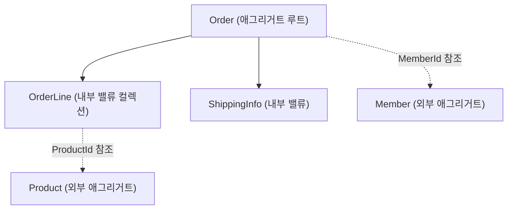

> 《도메인 주도 개발 시작하기》 3장을 복습하며 애그리거트 경계 도출 기준, 애그리거트 루트 중심의 일관성·트랜잭션 관리, 그리고 ID 기반 간접 참조의 트레이드오프를 Kotlin 코드로 정리합니다.

> 본 글의 예제 코드는 **Kotlin 1.9, Java 21, Spring Boot 3.x, Spring Data JPA (Hibernate 6)** 환경을 기준으로 작성했습니다.
{: .prompt-info }

## 복잡한 도메인 모델에서 애그리거트 경계 도출하기

엔티티와 밸류가 수십 개로 늘어나면 개별 객체 관계만으로는 전체 구조를 파악하기 어렵고, 한 필드를 수정했을 때 어떤 불변식이 함께 깨지는지 추적하기 힘들어집니다. **애그리거트(Aggregate)**는 관련 객체를 하나의 군집으로 묶어 **데이터 일관성(불변식)과 트랜잭션의 경계**로 삼는 설계 단위입니다.

흔한 실수는 "A가 B를 갖는다"는 이유만으로 한 애그리거트에 몰아넣는 것입니다. 예를 들어 `Product` 안에 수만 개의 `Review`를 넣으면 리뷰 작성마다 상품 전체에 락 경합이 발생합니다. 진짜 경계 기준은 **함께 생성·변경·소멸되는 생명주기**와 **한 트랜잭션 안에서 반드시 일치해야 하는 규칙**입니다. `Order`·`OrderLine`·`ShippingInfo`는 주문 총액(`totalAmounts`)과 출고 상태를 함께 지켜야 하므로 하나의 주문 애그리거트로 묶고, 독립적으로 변하는 `Member`와 `Product`는 별도 애그리거트로 분리합니다.



## 애그리거트 루트 중심의 일관성 유지와 트랜잭션 범위

애그리거트의 일관성을 지키려면 **애그리거트 루트(`Order`)**가 유일한 진입점이 되어야 합니다. 하위 객체의 상태를 외부에 직접 노출하면 `verifyNotYetShipped()`나 `totalAmounts` 재계산을 우회해 데이터가 깨집니다. 모든 변경은 루트의 도메인 메서드를 통해서만 허용해야 합니다.

```kotlin
// com/example/shop/order/domain/Order.kt
package com.example.shop.order.domain

import com.example.shop.common.model.Money
import jakarta.persistence.CollectionTable
import jakarta.persistence.Column
import jakarta.persistence.ElementCollection
import jakarta.persistence.Embedded
import jakarta.persistence.EmbeddedId
import jakarta.persistence.Entity
import jakarta.persistence.EnumType
import jakarta.persistence.Enumerated
import jakarta.persistence.JoinColumn
import jakarta.persistence.OrderColumn
import jakarta.persistence.Table

@Entity
@Table(name = "purchase_order")
class Order(
    @EmbeddedId
    val number: OrderNo,
    @Embedded
    val orderer: Orderer,
    orderLines: List<OrderLine>,
    shippingInfo: ShippingInfo
) {
    @ElementCollection
    @CollectionTable(name = "order_line", joinColumns = [JoinColumn(name = "order_number")])
    @OrderColumn(name = "line_idx")
    private val _orderLines: MutableList<OrderLine> = mutableListOf()

    val orderLines: List<OrderLine>
        get() = _orderLines.toList()

    @Column(name = "total_amounts")
    var totalAmounts: Money = Money(0)
        protected set

    @Embedded
    var shippingInfo: ShippingInfo = shippingInfo
        protected set

    @Enumerated(EnumType.STRING)
    @Column(name = "state")
    var state: OrderState = OrderState.PAYMENT_WAITING
        protected set

    init {
        replaceOrderLines(orderLines)
    }

    fun changeShippingInfo(newShippingInfo: ShippingInfo) {
        verifyNotYetShipped()
        this.shippingInfo = newShippingInfo
    }

    fun cancel() {
        verifyNotYetShipped()
        this.state = OrderState.CANCELED
    }

    fun verifyNotYetShipped() {
        check(state == OrderState.PAYMENT_WAITING || state == OrderState.PREPARING) {
            "이미 출고된 주문은 변경하거나 취소할 수 없습니다. 현재 상태: $state"
        }
    }

    private fun replaceOrderLines(lines: List<OrderLine>) {
        require(lines.isNotEmpty()) { "최소 하나 이상의 주문 항목이 필요합니다." }
        _orderLines.clear()
        _orderLines.addAll(lines)
        this.totalAmounts = Money(lines.sumOf { it.amounts.value })
    }
}
```

트랜잭션 범위는 **1트랜잭션 = 1애그리거트**가 원칙입니다. Spring `@Transactional` 안에서 여러 애그리거트를 함께 수정하면 커밋 시점에 Hibernate의 `DefaultFlushEntityEventListener`가 변경된 모든 테이블에 `UPDATE`를 발행하고, InnoDB는 트랜잭션이 끝날 때까지 각 행에 배타적 레코드 락(X-Lock)을 점유합니다. 락 범위와 점유 시간이 늘어나면서 데드락과 처리량 저하로 직결됩니다.

따라서 타 애그리거트 상태 동기화는 도메인 이벤트를 활용한 비동기 **최종 일관성(Eventual Consistency)**으로 푸는 것이 기본입니다. 다만 팀 표준이나 비동기 인프라 부재로 부득이하게 한 트랜잭션에서 두 애그리거트를 수정해야 한다면, 루트 내부가 아닌 응용 서비스에서 각 리포지터리를 호출해 명시적으로 조율해야 합니다.

## 리포지터리 단위와 객체 직접 참조 vs ID 간접 참조

리포지터리는 **애그리거트 루트 단위로만 존재**합니다. `OrderRepository`만 두고 `OrderLineRepository`는 만들지 않아야 루트 검증을 우회하는 경로를 원천 차단할 수 있습니다.

다른 애그리거트와 연결할 때도 JPA `@ManyToOne` 객체 직접 참조보다 **ID 값 객체(`MemberId`, `ProductId`) 간접 참조**를 권장합니다.

| 비교 항목 | 객체 직접 참조 (`@ManyToOne Member`) | ID 간접 참조 (`MemberId`) |
| :--- | :--- | :--- |
| **경계 보호** | `order.member.changePassword()` 등 타 애그리거트 수정 유혹 | 루트 경계가 코드 레벨에서 강제됨 |
| **로딩 제어** | 지연·즉시 로딩 및 예상치 못한 프록시 초기화 위험 | 필요한 애그리거트만 명시적 조회 |
| **확장성** | 단일 RDB에 강하게 결합 | 도메인별 DB 분리·MSA 전환에 유리 |
| **조회 편의성** | 객체 그래프 탐색이 직관적 | 별도 조회 쿼리 또는 조회 모델 필요 |

```kotlin
// com/example/shop/member/domain/MemberId.kt
package com.example.shop.member.domain

import jakarta.persistence.Column
import jakarta.persistence.Embeddable
import java.io.Serializable

@Embeddable
data class MemberId(
    @Column(name = "member_id")
    val id: String
) : Serializable
```

```kotlin
// com/example/shop/catalog/domain/ProductId.kt
package com.example.shop.catalog.domain

import jakarta.persistence.Column
import jakarta.persistence.Embeddable
import java.io.Serializable

@Embeddable
data class ProductId(
    @Column(name = "product_id")
    val id: String
) : Serializable
```

```kotlin
// com/example/shop/order/domain/OrdererAndLine.kt
package com.example.shop.order.domain

import com.example.shop.catalog.domain.ProductId
import com.example.shop.common.model.Money
import com.example.shop.member.domain.MemberId
import jakarta.persistence.AttributeOverride
import jakarta.persistence.Column
import jakarta.persistence.Embeddable
import jakarta.persistence.Embedded

@Embeddable
data class Orderer(
    @Embedded
    @AttributeOverride(name = "id", column = Column(name = "orderer_id"))
    val memberId: MemberId,
    @Column(name = "orderer_name")
    val name: String
)

@Embeddable
data class OrderLine(
    @Embedded
    val productId: ProductId,
    @Column(name = "price")
    val price: Money,
    @Column(name = "quantity")
    val quantity: Int,
    @Column(name = "amounts")
    val amounts: Money = price * quantity
)
```

## ID 참조 시 조회 성능, 집합 연관, 그리고 팩토리

ID 참조의 대표적인 트레이드오프는 **조회 성능(N+1 문제)**입니다. 주문 목록 20건을 가져온 뒤 각 주문의 `productId`마다 `ProductRepository.findById()`를 호출하면 1 + 20회 쿼리가 발생합니다. 따라서 상태 변경은 애그리거트 루트와 ID 참조로 경계를 지키되, 여러 애그리거트를 조합하는 목록·상세 조회는 **조회 전용 쿼리(JPQL DTO 프로젝션, Querydsl 조인 등)**로 분리해 한 번의 조인으로 해결하는 전략이 필요합니다.

애그리거트 간 **1-N, M-N 집합 연관**도 조심해야 합니다. `Category`가 `List<Product>`를 직접 들고 있으면 단순 조회나 수정에도 수만 건의 상품이 메모리에 로딩될 수 있습니다. 1-N은 N쪽(`Product`)이 `CategoryId`를 참조하도록 방향을 뒤집고, M-N은 `Product`가 `Set<CategoryId>`만 값 컬렉션으로 보관하는 편이 안전합니다.

다른 애그리거트의 상태를 검증해 새 애그리거트를 생성해야 한다면 **도메인 팩토리 메서드**를 활용합니다. "차단된 상점은 상품을 등록할 수 없다"는 규칙을 응용 서비스에 흩뿌리지 않고 `Store.createProduct()`에 응집시키면 도메인 의도가 분명해집니다.

```kotlin
// com/example/shop/catalog/domain/Store.kt
package com.example.shop.catalog.domain

import com.example.shop.common.model.Money

class Store(
    val id: String,
    var blocked: Boolean = false
) {
    fun createProduct(newProductId: ProductId, name: String, price: Money): Product {
        check(!blocked) { "차단된 상점은 상품을 등록할 수 없습니다. storeId=$id" }
        return Product(id = newProductId, storeId = id, name = name, price = price)
    }
}

class Product(
    val id: ProductId,
    val storeId: String,
    val name: String,
    val price: Money
)
```

## 실무 적용 시 주의할 운영 함정과 정리

Kotlin 엔티티에서 자주 발생하는 함정은 **가변 컬렉션의 외부 노출**입니다. `val orderLines: MutableList<OrderLine>`을 그대로 공개하면 호출자가 `order.orderLines.add(...)`로 루트의 `verifyNotYetShipped()`와 `totalAmounts` 재계산을 우회할 수 있습니다. 내부 `private val _orderLines`와 읽기 전용 반환(`_orderLines.toList()`)으로 반드시 캡슐화해야 합니다.

> 주의: ID 참조 전환 시 DB 물리 외래 키(FK)를 유지할지 여부도 검토해야 합니다. 단일 DB에서는 정합성 보호에 유리하지만, 트래픽이 큰 테이블의 부모 행 공유 락(S-Lock) 경합이나 추후 DB 분리를 고려한다면 물리 FK 대신 애플리케이션 검증과 보정 로직을 선택하는 경우도 많습니다.
{: .prompt-warning }

애그리거트 설계는 불변식이 지켜져야 할 범위와 트랜잭션 락의 반경을 통제하는 작업입니다. 루트 중심 캡슐화, 1트랜잭션 1애그리거트, ID 간접 참조를 기준으로 잡으면 시스템이 커져도 변경의 영향 범위를 안정적으로 예측할 수 있습니다.
