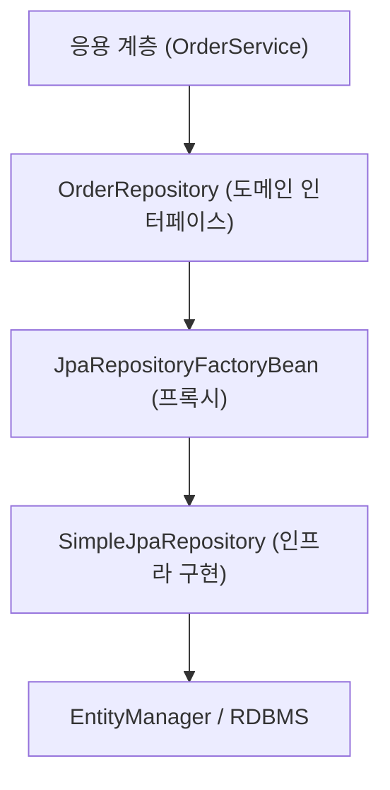

> 《도메인 주도 개발 시작하기》 4장을 바탕으로 Spring Data JPA를 활용해 DDD 리포지터리와 도메인 모델을 매핑하는 방법과 Kotlin JPA 환경의 필수 설정을 정리합니다.

> 본 글의 예제 코드는 **Kotlin 1.9, Java 21, Spring Boot 3.x, Spring Data JPA (Hibernate 6)** 환경을 기준으로 작성했습니다.
{: .prompt-info }

## Spring Data JPA 리포지터리 배치와 인터페이스 규칙

DDD에서 리포지터리 인터페이스는 도메인 계층(`com.example.shop.order.domain`)에 두고, 구현 역할은 Spring Data JPA가 인프라 계층에서 맡습니다. 이때 `JpaRepository`를 그대로 상속하면 `flush()`, `deleteAllInBatch()` 같은 인프라 메서드가 도메인에 노출되므로, `org.springframework.data.repository.Repository<Order, OrderNo>`를 상속해 필요한 메서드만 선언하는 편이 깔끔합니다.

```kotlin
// com/example/shop/order/domain/OrderRepository.kt
package com.example.shop.order.domain

import org.springframework.data.repository.Repository

interface OrderRepository : Repository<Order, OrderNo> {
    fun findById(id: OrderNo): Order?
    fun save(order: Order): Order
    fun delete(order: Order)
}
```

Spring Data JPA 내부에서는 기동 시 `JpaRepositoriesRegistrar`가 인터페이스를 스캔해 `JpaRepositoryFactoryBean`을 등록하고, 이 팩토리 빈이 `SimpleJpaRepository`를 감싸는 JDK 동적 프록시를 생성해 `EntityManager` 호출을 위임합니다. 덕분에 도메인 패키지는 JPA 구현 세부를 전혀 몰라도 영속성을 다룰 수 있습니다.



## 엔티티, Embeddable 밸류, 그리고 AttributeConverter 매핑

식별자에 `String` 대신 `OrderNo`를 `@EmbeddedId`로 매핑하면 타입 안전성과 도메인 의도를 동시에 얻을 수 있습니다. Hibernate 6 스펙상 `@EmbeddedId` 클래스는 1차 캐시 키로 쓰이므로 `Serializable` 구현과 값 기반 `equals()`/`hashCode()`가 필수이며, Kotlin `data class`가 이 조건을 간결하게 충족합니다.

복합 밸류(`Orderer`, `ShippingInfo`, `OrderLine`)는 `@Embeddable`로 매핑하고 컬럼명 충돌 시 `@AttributeOverride`로 재정의합니다. 반면 `Money`처럼 단일 컬럼에 원시 값으로 저장되는 밸류는 `AttributeConverter<Money, Int>`에 `@Converter(autoApply = true)`를 붙여 전역 자동 변환하는 편이 코드가 깔끔합니다.

```kotlin
// com/example/shop/common/model/MoneyConverter.kt
package com.example.shop.common.model

import jakarta.persistence.AttributeConverter
import jakarta.persistence.Converter

@Converter(autoApply = true)
class MoneyConverter : AttributeConverter<Money, Int> {
    override fun convertToDatabaseColumn(attribute: Money?): Int? = attribute?.value
    override fun convertToEntityAttribute(dbData: Int?): Money? = dbData?.let { Money(it) }
}
```

```kotlin
// com/example/shop/order/domain/OrderMapping.kt
package com.example.shop.order.domain

import com.example.shop.catalog.domain.ProductId
import com.example.shop.common.model.Money
import com.example.shop.member.domain.MemberId
import jakarta.persistence.AttributeOverride
import jakarta.persistence.CollectionTable
import jakarta.persistence.Column
import jakarta.persistence.ElementCollection
import jakarta.persistence.Embeddable
import jakarta.persistence.Embedded
import jakarta.persistence.EmbeddedId
import jakarta.persistence.Entity
import jakarta.persistence.EnumType
import jakarta.persistence.Enumerated
import jakarta.persistence.FetchType
import jakarta.persistence.JoinColumn
import jakarta.persistence.OrderColumn
import jakarta.persistence.Table
import java.io.Serializable

@Embeddable
data class OrderNo(
    @Column(name = "order_number")
    val number: String
) : Serializable

@Embeddable
data class Orderer(
    @Embedded
    @AttributeOverride(name = "id", column = Column(name = "orderer_id"))
    val memberId: MemberId,
    @Column(name = "orderer_name")
    val name: String
)

@Embeddable
data class OrderLine(
    @Embedded
    val productId: ProductId,
    @Column(name = "price")
    val price: Money,
    @Column(name = "quantity")
    val quantity: Int,
    @Column(name = "amounts")
    val amounts: Money = price * quantity
)

@Entity
@Table(name = "purchase_order")
class Order(
    @EmbeddedId
    val number: OrderNo,
    @Embedded
    val orderer: Orderer,
    orderLines: List<OrderLine>,
    shippingInfo: ShippingInfo
) {
    @ElementCollection(fetch = FetchType.LAZY)
    @CollectionTable(name = "order_line", joinColumns = [JoinColumn(name = "order_number")])
    @OrderColumn(name = "line_idx")
    private val _orderLines: MutableList<OrderLine> = orderLines.toMutableList()

    val orderLines: List<OrderLine>
        get() = _orderLines.toList()

    @Column(name = "total_amounts")
    var totalAmounts: Money = Money(orderLines.sumOf { it.amounts.value })
        protected set

    @Embedded
    var shippingInfo: ShippingInfo = shippingInfo
        protected set

    @Enumerated(EnumType.STRING)
    @Column(name = "state")
    var state: OrderState = OrderState.PAYMENT_WAITING
        protected set

    fun changeShippingInfo(newShippingInfo: ShippingInfo) {
        verifyNotYetShipped()
        this.shippingInfo = newShippingInfo
    }

    fun cancel() {
        verifyNotYetShipped()
        this.state = OrderState.CANCELED
    }

    fun verifyNotYetShipped() {
        check(state == OrderState.PAYMENT_WAITING || state == OrderState.PREPARING) {
            "이미 출고된 주문은 변경하거나 취소할 수 없습니다. 현재 상태: $state"
        }
    }
}
```

## 밸류 컬렉션 매핑 전략 비교

`OrderLine`이나 이메일 목록 같은 밸류 컬렉션은 요구사항에 따라 매핑 방식을 선택해야 합니다.

| 매핑 전략 | 저장 구조 | 변경 시 SQL 동작 | 적합한 상황 |
| :--- | :--- | :--- | :--- |
| **`@ElementCollection` + `@CollectionTable`** | 별도 테이블(`order_line`) | 기존 행 전체 `DELETE` 후 재 `INSERT` 발생 가능 | 요소 수가 적고 조인·조건 검색이 필요한 밸류 목록 |
| **`AttributeConverter` 한 컬럼 변환** | 구분자/JSON 문자열 컬럼 | 부모 테이블 `UPDATE` 1회 | 이메일·태그 등 단순 값이고 개별 행 검색이 불필요할 때 |
| **`@OneToMany` 별도 엔티티 승격** | 자체 PK를 가진 자식 테이블 | 변경 행만 개별 SQL 실행 | 부분 수정이 잦거나 대량 데이터·이력을 다룰 때 |

Hibernate 내부 동작상 `@ElementCollection`의 요소는 자체 PK가 없으므로, 컬렉션을 수정하면 해당 부모 키의 기존 행을 모두 `DELETE`한 뒤 남은 요소를 전부 다시 `INSERT`하는 비효율이 생길 수 있습니다. `@OrderColumn`을 두어도 중간 요소 삭제 시 인덱스 재정렬 쿼리가 뒤따르므로, 수정 빈도가 높은 컬렉션은 엔티티 승격을 검토하는 편이 안전합니다.

## 애그리거트 로딩 전략, 영속성 전파, 식별자 생성

애그리거트 루트 로딩 시 하위 구성을 한 번에 가져오려 `FetchType.EAGER`를 고려할 수 있습니다. 하지만 실무에서는 **`FetchType.LAZY`를 기본으로 두고 필요한 유스케이스에서만 Fetch Join이나 `@EntityGraph`로 로딩**하는 편이 안전합니다. `EAGER`는 단순 상태 조회나 목록 페이징에서도 불필요한 조인과 메모리 페이징 경고(`HHH90003004`), 1+N 쿼리를 유발하기 쉽습니다.

영속성 전파는 `@Embeddable`·`@ElementCollection`이 별도 `cascade` 없이 루트 수명에 자동 종속되며, 하위 `@Entity`가 있을 때만 `CascadeType.ALL`과 `orphanRemoval = true`를 씁니다. 단, 운영 환경에서 주문 같은 핵심 데이터를 물리 삭제(`DELETE`)하면 정산과 감사 추적이 깨지므로 `OrderState.CANCELED` 상태 전이나 `deletedAt` 소프트 삭제가 표준입니다.

식별자 생성은 사용자 입력, 도메인 직접 생성(`OrderNo` 조합), DB 위임(`GenerationType.IDENTITY`)으로 나뉩니다. MySQL `IDENTITY` 전략은 `persist()` 시점에 즉시 `INSERT`를 실행해 쓰기 지연과 JDBC 배치를 포기해야 하므로, 도메인 규칙 기반 `OrderNo` 생성이 테스트와 이벤트 발행에 유리합니다.

## Kotlin JPA 환경의 필수 설정과 운영 함정

Kotlin 클래스는 기본 `final`이고 파라미터 없는 기본 생성자가 없어 Hibernate의 리플렉션 인스턴스화와 ByteBuddy 프록시 생성이 실패합니다. 따라서 `build.gradle.kts`에 `kotlin("plugin.jpa")`와 `allOpen` 설정이 필수입니다.

```kotlin
// build.gradle.kts
plugins {
    kotlin("jvm") version "1.9.25"
    kotlin("plugin.spring") version "1.9.25"
    kotlin("plugin.jpa") version "1.9.25"
}

allOpen {
    annotation("jakarta.persistence.Entity")
    annotation("jakarta.persistence.MappedSuperclass")
    annotation("jakarta.persistence.Embeddable")
}
```

실무 함정은 두 가지입니다. 첫째, `plugin.jpa`만 넣고 `allOpen`을 빼먹으면 클래스가 `final`로 남아 `@ManyToOne(fetch = LAZY)` 프록시 생성이 실패하고 `EAGER`로 조용히 퇴화합니다. 둘째, JPA 접근 전략이 섞이면 불변 `val` 필드에서 setter 누락 오류가 나므로 어노테이션은 모두 필드에 일관되게 배치하고 가변 상태는 `var ... protected set`으로 캡슐화해야 합니다.

> 주의: `plugin.jpa`가 합성하는 `protected` 기본 생성자는 바이트코드 레벨에서 `init { ... }`을 거치지 않습니다. DB 조회 시 `init`이 실행되지 않으므로 상태 초기화 로직을 `init`에 넣지 않아야 합니다.
{: .prompt-warning }

## 정리

Spring Data JPA는 애그리거트 루트 단위의 영속성 경계와 밸류 불변식을 지탱하는 도구입니다. 최소 권한 리포지터리, `@EmbeddedId`·`AttributeConverter` 매핑, `LAZY` 로딩 제어, 그리고 Kotlin `plugin.jpa`/`allOpen` 설정을 함께 갖추면 도메인 순수성과 운영 안정성을 모두 챙길 수 있습니다.
