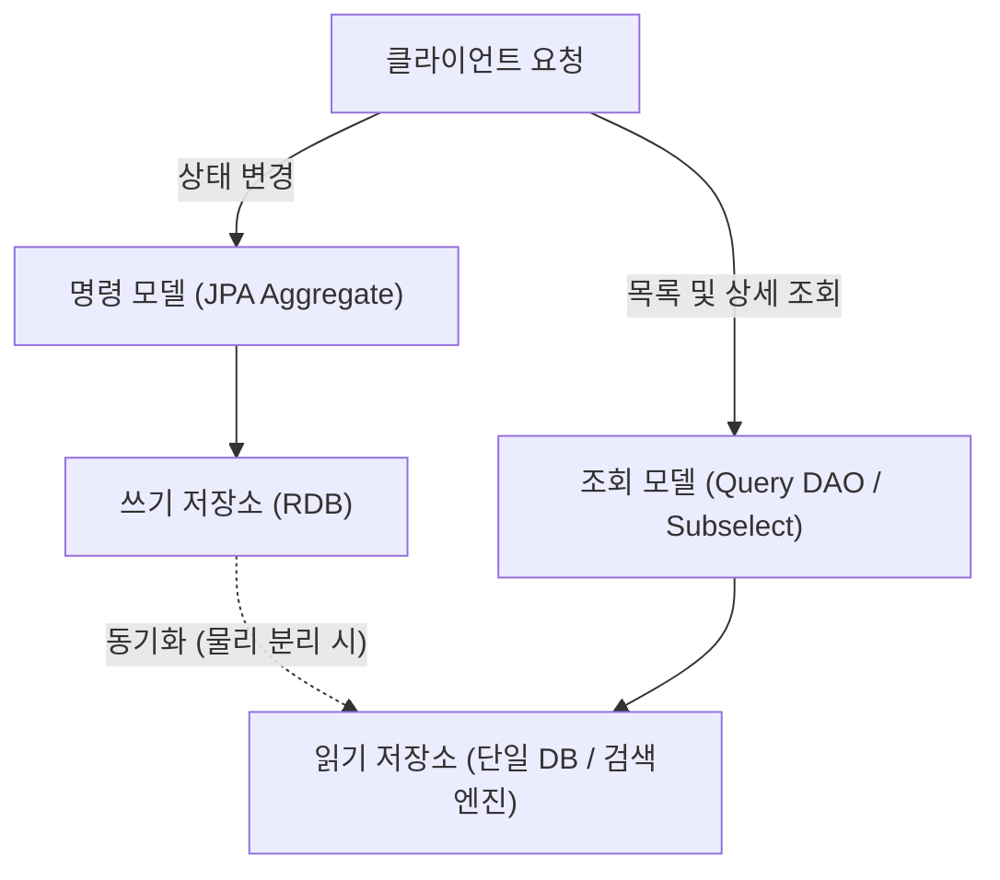

> 《도메인 주도 개발 시작하기》 5장과 11장을 복습하며 단일 JPA 도메인 모델로 복잡한 조회를 처리할 때의 한계와 Spring Data JPA 조회 기법, CQRS 분리 전략을 Kotlin 코드로 정리합니다.

> 본 글의 코드는 **Kotlin 1.9, Java 21, Spring Boot 3.x, Spring Data JPA (Hibernate 6)** 환경을 기준으로 작성했습니다.
{: .prompt-info }

## 단일 도메인 모델 조회의 한계와 CQRS

DDD에서 `Order` 애그리거트는 상태 변경의 일관성을 지키는 데 최적화되어 있습니다. 결합을 끊으려 `MemberId`, `ProductId`만 참조하도록 설계했는데, 주문 목록 화면에서는 주문자명·대표 상품명·결제 총액을 한 번에 요구합니다.

명령(Command) 모델로 복잡한 조회까지 처리하면 세 가지 문제가 겹칩니다.

- **지연 로딩과 N+1**: 연관 조회마다 추가 쿼리가 생기고, 즉시 로딩(`EAGER`)을 걸면 상태 변경 트랜잭션까지 불필요한 조인으로 느려집니다.
- **애그리거트 간 조인 충돌**: 독립된 생명주기를 가진 `Order`, `Member`, `Product`를 화면 때문에 억지로 묶으면 애그리거트 경계가 무너집니다.
- **조회 튜닝의 도메인 오염**: 정렬·검색용 필드와 페치 조인이 늘어나며 도메인 모델이 화면 요구에 종속됩니다.

이를 해소하는 구조가 **CQRS(Command Query Responsibility Segregation)**입니다. 상태를 바꾸는 명령 모델과 데이터를 읽는 조회 모델을 분리해 목적에 맞는 기술을 택합니다.



CQRS 도입 시 먼저 결정할 기준은 **단일 DB 내 모델 분리**와 **저장소 물리 분리** 사이의 트레이드오프입니다.

| 구분 | 단일 DB 내 모델 분리 | 저장소 물리 분리 (Read Replica / 검색엔진) |
| :--- | :--- | :--- |
| **구현 복잡도** | 낮음 (기존 RDB·트랜잭션 재사용) | 높음 (CDC·메시지 브로커 동기화 필요) |
| **데이터 일관성** | 강한 일관성 (쓰기 직후 즉시 반영) | 최종 일관성 (동기화 지연 발생) |
| **적합한 상황** | 대부분 서비스의 복잡한 조인 화면 해소 | 읽기 트래픽 폭증, 전문 검색·대용량 집계 |

실무에서는 처음부터 DB를 쪼개기보다 단일 DB 위에서 명령 모델(JPA 애그리거트)과 조회 모델(조회 전용 DAO·JPQL·QueryDSL 등)만 먼저 논리적으로 분리하는 편이 안전합니다.

## Specification과 Kotlin SpecBuilder로 동적 조건 조합하기

검색 필터가 유동적인 목록 조회에는 Spring Data JPA의 `JpaSpecificationExecutor<T>`와 `Specification<T>`를 활용할 수 있습니다. `and`/`or` 조합 시 `null` 분기가 지저분해지는 단점은 Kotlin 확장 빌더(`SpecBuilder`)로 감싸면 선언적으로 정리됩니다.

```kotlin
// com/example/shop/order/query/SpecBuilder.kt
package com.example.shop.order.query

import org.springframework.data.jpa.domain.Specification

class SpecBuilder<T> {
    private val specs = mutableListOf<Specification<T>>()

    fun ifHasText(value: String?, supplier: (String) -> Specification<T>) {
        if (!value.isNullOrBlank()) specs.add(supplier(value))
    }

    fun <V : Any> ifNotNull(value: V?, supplier: (V) -> Specification<T>) {
        if (value != null) specs.add(supplier(value))
    }

    fun toSpec(): Specification<T> =
        specs.fold(Specification.where(null)) { acc, spec -> acc.and(spec) }
}

fun <T> specBuilder(block: SpecBuilder<T>.() -> Unit): Specification<T> =
    SpecBuilder<T>().apply(block).toSpec()
```

```kotlin
// com/example/shop/order/query/OrderSummarySpecs.kt
package com.example.shop.order.query

import com.example.shop.order.domain.OrderState
import org.springframework.data.jpa.domain.Specification
import java.time.LocalDateTime

object OrderSummarySpecs {
    fun ordererId(ordererId: String): Specification<OrderSummary> =
        Specification { root, _, cb -> cb.equal(root.get<String>("ordererId"), ordererId) }

    fun state(state: OrderState): Specification<OrderSummary> =
        Specification { root, _, cb -> cb.equal(root.get<OrderState>("state"), state) }

    fun orderDateBetween(from: LocalDateTime, to: LocalDateTime): Specification<OrderSummary> =
        Specification { root, _, cb -> cb.between(root.get("orderDate"), from, to) }
}
```

내부적으로 `SimpleJpaRepository`의 `applySpecificationToCriteria()`가 `CriteriaBuilder`와 `Root`로 각 `Specification.toPredicate()`를 조립해 `CriteriaQuery`를 생성합니다. Hibernate 6에서는 이 트리가 내부 SQM(Semantic Query Model)을 거쳐 파라미터 바인딩이 적용된 SQL로 번역됩니다. 다만 `root.get("ordererId")`처럼 문자열 필드명을 쓰면 리팩토링에 취약하므로, 조건이 복잡해지면 JPA Metamodel이나 QueryDSL로 전환하는 편이 유리합니다.

## Sort·Pageable 페이징 전략과 JPQL 동적 인스턴스

정렬과 페이징에는 `Sort`와 `Pageable`을 전달하되, 반환 타입에 따른 카운트 쿼리 비용을 구분해야 합니다.

- **`Page<T>`**: 전체 건수와 총 페이지 계산을 위해 별도 `SELECT COUNT(*)` 쿼리를 실행합니다. 총 개수가 꼭 필요한 관리자 화면에만 한정해 사용합니다.
- **`Slice<T>`**: 요청 크기보다 1건 더 조회(`LIMIT size + 1`)해 다음 페이지 여부만 확인하므로 카운트 쿼리를 생략합니다. 무한 스크롤이나 대용량 목록에 적합합니다.
- **`List<T>`**: 카운트 쿼리 없이 지정한 범위만 조회합니다.

여러 엔티티의 일부 컬럼만 추려 DTO로 바로 매핑할 때는 **JPQL 동적 인스턴스(`new`)**를 사용합니다.

```kotlin
// com/example/shop/order/query/OrderView.kt
package com.example.shop.order.query

import com.example.shop.common.model.Money
import com.example.shop.member.domain.MemberId
import com.example.shop.order.domain.OrderNo
import com.example.shop.order.domain.OrderState

data class OrderView(
    val number: String,
    val state: OrderState,
    val memberName: String,
    val memberId: String,
    val totalAmounts: Int,
) {
    constructor(
        number: OrderNo,
        state: OrderState,
        memberName: String,
        memberId: MemberId,
        totalAmounts: Money,
    ) : this(number.number, state, memberName, memberId.id, totalAmounts.value)
}
```

```kotlin
// com/example/shop/order/query/OrderViewDao.kt
package com.example.shop.order.query

import org.springframework.data.domain.Pageable
import org.springframework.data.domain.Slice
import org.springframework.data.jpa.repository.Query
import org.springframework.data.repository.Repository
import org.springframework.data.repository.query.Param

interface OrderViewDao : Repository<OrderSummary, String> {
    @Query(
        """
        select new com.example.shop.order.query.OrderView(
            o.number, o.state, m.name, m.id, o.totalAmounts
        )
        from Order o
        join Member m on o.orderer.memberId = m.id
        where o.orderer.memberId.id = :ordererId
        order by o.number.number desc
        """
    )
    fun findByOrdererId(
        @Param("ordererId") ordererId: String,
        pageable: Pageable,
    ): Slice<OrderView>
}
```

동적 인스턴스는 일반 DTO를 반환하므로 영속성 컨텍스트 1차 캐시와 더티 체킹 스냅샷을 만들지 않아 메모리 효율이 좋습니다. 단, 전체 패키지 경로를 문자열로 적어야 해 컴파일 타임 검증이 약하다는 한계가 있습니다.

## Hibernate @Subselect로 조회 전용 모델 매핑하기

DB 뷰를 따로 만들지 않고도 복잡한 조인 쿼리 결과를 엔티티처럼 다루고 싶다면 Hibernate의 `@Subselect`, `@Immutable`, `@Synchronize`를 조합합니다.

```kotlin
// com/example/shop/order/query/OrderSummary.kt
package com.example.shop.order.query

import com.example.shop.order.domain.OrderState
import jakarta.persistence.Column
import jakarta.persistence.Entity
import jakarta.persistence.EnumType
import jakarta.persistence.Enumerated
import jakarta.persistence.Id
import org.hibernate.annotations.Immutable
import org.hibernate.annotations.Subselect
import org.hibernate.annotations.Synchronize
import java.time.LocalDateTime

@Entity
@Immutable
@Subselect(
    """
    select o.order_number as number, o.version as version,
           o.orderer_id as orderer_id, o.orderer_name as orderer_name,
           o.total_amounts as total_amounts, o.state as state,
           o.order_date as order_date, p.name as product_name
    from purchase_order o
    inner join order_line ol on o.order_number = ol.order_number
    inner join product p on ol.product_id = p.product_id
    where ol.line_idx = 0
    """
)
@Synchronize("purchase_order", "order_line", "product")
class OrderSummary(
    @Id @Column(name = "number") val number: String,
    @Column(name = "version") val version: Long,
    @Column(name = "orderer_id") val ordererId: String,
    @Column(name = "orderer_name") val ordererName: String,
    @Column(name = "total_amounts") val totalAmounts: Int,
    @Enumerated(EnumType.STRING) @Column(name = "state") val state: OrderState,
    @Column(name = "order_date") val orderDate: LocalDateTime,
    @Column(name = "product_name") val productName: String,
)
```

- **`@Immutable`**: `StatefulPersistenceContext`가 변경 감지용 스냅샷(`loadedState`)을 저장하지 않아 메모리를 절약하며, 값이 수정되어도 `UPDATE` SQL이 실행되지 않습니다.
- **`@Synchronize`**: 같은 트랜잭션 안에서 `purchase_order`를 수정한 직후 `OrderSummary`를 조회할 때 `DefaultAutoFlushEventListener`가 명시된 테이블의 변경분을 먼저 `flush()`해 데이터 불일치를 방지합니다.

## 운영 시 주의해야 할 조회 모델과 CQRS 함정

> **주의**: `@Subselect`는 Hibernate가 `FROM ( <subselect SQL> )` 형태의 인라인 뷰로 감싸 실행하므로 실행 계획 검증이 필수입니다.
{: .prompt-warning }

1. **`@Subselect` 인라인 뷰 성능·인덱스 주의**: 내부 쿼리에 `GROUP BY`, `DISTINCT`, `UNION` 등이 섞이면 옵티마이저가 조건 푸시다운을 못 하고 파생 테이블 전체를 임시 테이블로 구체화(Materialization)해 인덱스를 타지 못할 수 있습니다. 반드시 `EXPLAIN`으로 외부 `WHERE`·`ORDER BY`의 인덱스 활용을 확인해야 합니다.
2. **CQRS 과설계 경계**: 단순 CRUD 도메인에 명령·조회 모델을 전면 분리하면 클래스 수와 매핑 코드만 늘어납니다. 애그리거트 조회 충돌이 실제로 발생할 때 단일 DB 논리 분리부터 점진적으로 적용하는 것이 합리적입니다.
3. **물리 분리 시 동기화 지연(Eventual Consistency)**: 쓰기 DB와 읽기 저장소를 분리하면 주문 완료 직후 목록에 방금 생성한 주문이 안 보이는 지연이 생깁니다. 명령 응답에 핵심 요약 데이터를 함께 반환해 UI를 낙관적으로 갱신하거나, 생성 직후 단건 조회만 쓰기 DB로 라우팅하는 보완이 필요합니다.
