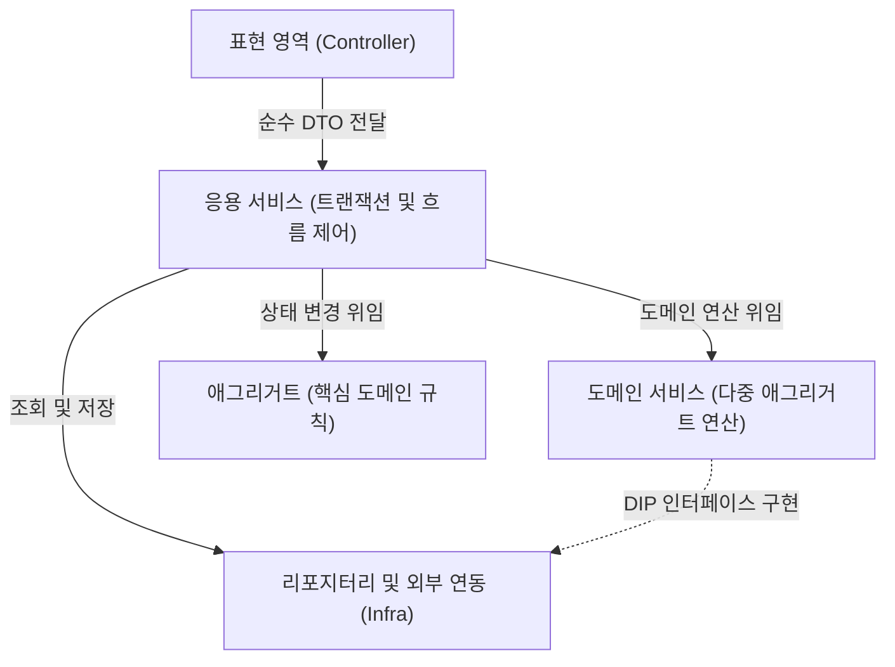

> 《도메인 주도 개발 시작하기》 6장과 7장을 복습하며 표현 영역·응용 서비스·도메인 서비스의 책임 경계와 검증·권한 검사 배치 기준, 다중 애그리거트 연산의 분리 방법을 Kotlin 코드로 정리합니다.

> 본 글의 코드는 **Kotlin 1.9, Java 21, Spring Boot 3.x, Spring Security 6, Spring Data JPA** 환경을 기준으로 작성했습니다.
{: .prompt-info }

## 표현 영역과 응용 서비스의 역할 분담

계층형 아키텍처에서 가장 쉽게 비대해지는 곳이 **응용 서비스(Application Service)**입니다. 기능이 쌓이면 HTTP 파싱, 상태 검증, 할인 계산까지 서비스 클래스에 몰리기 쉽습니다.

- **표현 영역 (`presentation`)**: HTTP 요청을 DTO로 변환하고 입력 형식을 검증하며, 인증 정보를 추출해 응용 서비스를 호출한 뒤 결과를 HTTP 응답으로 반환합니다.
- **응용 서비스 (`application`)**: 애그리거트를 조회해 도메인 객체·도메인 서비스에 실행을 위임하고, `@Transactional` 경계와 이벤트 발행을 조율합니다.



응용 서비스에 도메인 로직을 넣으면 배송 전 검증 같은 규칙이 여러 서비스에 흩어져 응집도가 떨어지고 중복이 생깁니다. 결국 엔티티는 데이터 홀더로 전락하고, 핵심 규칙 테스트에도 스프링 컨텍스트와 리포지터리 Mock이 필요해져 테스트 비용이 급증합니다.

## 응용 서비스 설계 기준과 검증·권한 분담

- **서비스 크기 (도메인별 vs 기능별)**: 단일 `OrderService`에 모든 기능을 모으면 의존성이 비대해집니다. 기능이 늘어나면 `CancelOrderService`, `ChangeShippingService`처럼 유스케이스별 클래스로 나누는 편이 변경 범위와 테스트 격리에 유리합니다.
- **인터페이스 도입 기준**: 구현체가 하나뿐인 응용 서비스에 관습적으로 인터페이스를 두지 않고, 다중 구현체가 명확할 때만 도입합니다.
- **표현 기술 비의존과 DTO**: `HttpServletRequest`, `HttpSession`을 파라미터로 받지 않고 순수 Kotlin DTO로 주고받습니다. 반환값도 엔티티 대신 식별자(`OrderNo`)나 최소 결과만 돌려주며, 단순 조회는 응용 서비스 없이 컨트롤러가 `OrderViewDao`를 직접 호출할 수 있습니다.

값 검증은 표현 영역에서 `@Valid`로 필수값·형식 오류를 일괄 검증하고, 응용·도메인 영역에서 존재 여부와 상태 전이(`verifyNotYetShipped()`)를 검증합니다. 권한 검사는 URL 접근 제어를 `SecurityFilterChain`에 맡기고, 메서드 역할 검사는 `@PreAuthorize`를 활용합니다. Spring Security 6의 `@EnableMethodSecurity`는 내부 `AuthorizationManagerBeforeMethodInterceptor` 프록시로 진입 직전 SpEL을 평가해 `AccessDeniedException`을 던지며, 주문자 본인 확인처럼 상태 조회가 필요한 인가는 도메인 정책(`CancelPolicy`)에서 처리합니다.

```kotlin
// com/example/shop/order/application/CancelOrderService.kt
package com.example.shop.order.application

import com.example.shop.order.domain.CancelPolicy
import com.example.shop.order.domain.Canceller
import com.example.shop.order.domain.OrderNo
import com.example.shop.order.domain.OrderRepository
import com.example.shop.order.domain.RefundService
import org.springframework.security.access.prepost.PreAuthorize
import org.springframework.stereotype.Service
import org.springframework.transaction.annotation.Transactional

@Service
class CancelOrderService(
    private val orderRepository: OrderRepository,
    private val cancelPolicy: CancelPolicy,
    private val refundService: RefundService,
) {
    @PreAuthorize("hasRole('USER') or hasRole('ADMIN')")
    @Transactional
    fun cancel(orderNo: OrderNo, canceller: Canceller) {
        val order = orderRepository.findById(orderNo)
            ?: throw NoOrderException(orderNo)
        if (!cancelPolicy.hasCancellationPermission(order, canceller)) {
            throw NoCancellablePermissionException()
        }
        order.cancel()
        refundService.refund(order.number)
    }
}
```

## 다중 애그리거트 연산과 외부 연동을 위한 도메인 서비스

결제 금액 할인 계산처럼 `OrderLine`, `Coupon`, `MemberGrade` 등 여러 애그리거트가 함께 필요한 도메인 규칙은 어느 한 애그리거트에 밀어 넣기 어색합니다. 이때 상태를 갖지 않고(Stateless) 순수 도메인 연산만 담당하는 **도메인 서비스(Domain Service)**를 도입합니다.

```kotlin
// com/example/shop/order/domain/DiscountCalculationService.kt
package com.example.shop.order.domain

import com.example.shop.common.model.Money
import com.example.shop.member.domain.MemberGrade
import org.springframework.stereotype.Component

@Component
class DiscountCalculationService {
    fun calculateDiscountAmounts(
        orderLines: List<OrderLine>,
        coupons: List<Coupon>,
        grade: MemberGrade,
    ): Money {
        val couponDiscount = coupons.fold(Money(0)) { acc, c -> acc + c.discountAmount }
        val total = orderLines.fold(Money(0)) { acc, line -> acc + line.amounts }
        val gradeDiscount = Money(total.value * grade.discountRate / 100)
        return couponDiscount + gradeDiscount
    }
}
```

`Order`는 스프링 빈을 직접 주입받지 않고 `order.calculateAmounts(discountCalculationService, member.grade)`처럼 메서드 파라미터로 도메인 서비스를 전달받아 협력합니다.

또한 결제 환불처럼 외부 PG 시스템과 연동해야 하는 도메인 규칙은 **의존 역전 원칙(DIP)**에 따라 `RefundService` 인터페이스를 `com.example.shop.order.domain`에 정의하고, 실제 HTTP 구현체(`PgRefundService`)는 `com.example.shop.order.infra`에 배치합니다.

```kotlin
// com/example/shop/order/domain/RefundService.kt
package com.example.shop.order.domain

interface RefundService {
    fun refund(orderNo: OrderNo)
}

// com/example/shop/order/infra/PgRefundService.kt
package com.example.shop.order.infra

import com.example.shop.order.domain.OrderNo
import com.example.shop.order.domain.RefundService
import org.springframework.stereotype.Component

@Component
class PgRefundService(
    private val pgClient: PgHttpClient,
) : RefundService {
    override fun refund(orderNo: OrderNo) {
        pgClient.requestCancel(orderNo.number)
    }
}
```

이 구조 덕분에 PG사가 바뀌거나 테스트에서 스텁으로 대체할 때도 도메인·응용 코드는 전혀 수정하지 않아도 됩니다.

## 응용 서비스와 도메인 서비스 비교

두 서비스의 책임과 동작 경계는 아래 표로 명확히 구분됩니다.

| 비교 항목 | 응용 서비스 (Application Service) | 도메인 서비스 (Domain Service) |
| :--- | :--- | :--- |
| **소속 패키지** | `com.example.shop.order.application` | `com.example.shop.order.domain` |
| **핵심 역할** | 유스케이스 조율, 트랜잭션·권한·이벤트 관리 | 다중 애그리거트 도메인 계산, 외부 연동 추상화 |
| **트랜잭션 경계** | `@Transactional`로 시작·종료 관리 | 직접 열지 않고 호출자 트랜잭션에 참여 |
| **리포지터리 호출** | 애그리거트 조회·저장을 직접 수행 | 필요한 도메인 객체를 파라미터로 전달받음 |
| **대표 예시** | `CancelOrderService`, `ChangeShippingService` | `DiscountCalculationService`, `RefundService` |

스프링의 `@Transactional`은 `TransactionInterceptor` AOP 프록시가 메서드 경계에서 DB 커넥션과 영속성 컨텍스트를 열고 닫습니다. 원자성은 사용자 유스케이스 단위로 보장되어야 하므로 트랜잭션 경계는 도메인 서비스가 아닌 응용 서비스가 책임지는 것이 원칙입니다.

## 운영 시 주의해야 할 서비스 계층 설계 함정

> **주의**: `@Transactional` 범위 안에서 외부 HTTP API를 동기 호출하면 외부 지연이 DB 커넥션 풀(HikariCP) 고갈로 직결됩니다.
{: .prompt-warning }

1. **트랜잭션 경계와 외부 API 점유**: `CancelOrderService.cancel()`처럼 DB 트랜잭션 안에서 `refundService.refund()`를 동기 호출하면 PG 응답이 지연되는 동안 DB 커넥션이 점유됩니다. 트래픽이 큰 환경에서는 주문 취소 커밋 후 도메인 이벤트나 Transactional Outbox 패턴으로 환불을 비동기 분리하거나 보상 트랜잭션을 함께 설계해야 합니다.
2. **도메인 서비스에 상태를 두는 실수**: 스프링 빈은 기본 싱글톤이므로 도메인 서비스에 가변 프로퍼티(`var`)를 두면 멀티스레드 요청 간에 계산 값이 오염됩니다. 도메인 서비스는 철저히 무상태(Stateless)로 유지해야 합니다.
3. **응용 서비스 간 상호 호출**: 공통 로직을 재사용하려 응용 서비스끼리 주입받기 시작하면 순환 참조와 트랜잭션 전파 혼선이 생깁니다. 공유해야 할 비즈니스 규칙은 반드시 애그리거트나 도메인 서비스로 추출하는 것이 올바른 해법입니다.
