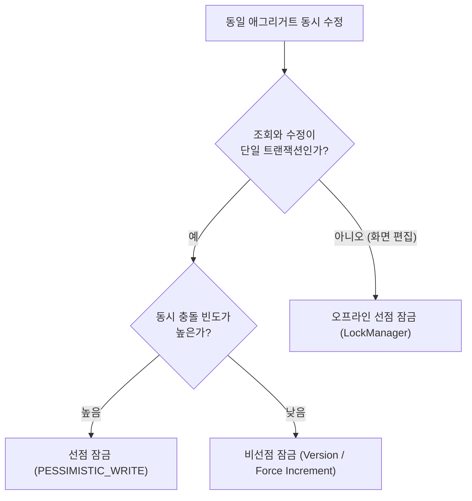

> 《도메인 주도 개발 시작하기》 8장을 복습하며 애그리거트 동시 수정으로 인한 데이터 일관성 훼손 원인을 짚고, JPA 선점 잠금·비선점 잠금·오프라인 선점 잠금 구현과 운영 주의점을 Kotlin 코드로 정리합니다.

> 본 글의 코드는 **Kotlin 1.9, Java 21, Spring Boot 3.x, Spring Data JPA (Hibernate 6)** 환경을 기준으로 작성했습니다.
{: .prompt-info }

## 애그리거트 동시 수정과 일관성 훼손 시나리오

단일 요청에서는 안전하던 애그리거트 불변식도 동시 요청 앞에서는 쉽게 깨집니다. **운영자가 배송을 시작하는 순간 고객이 동시에 배송지를 변경하는 상황**이 대표적입니다.

1. 스레드 A(배송 시작)와 스레드 B(배송지 변경)가 동시에 `Order(state = PREPARING)`를 조회합니다.
2. 스레드 A가 상태를 `SHIPPED`로 바꾸고 커밋합니다.
3. 스레드 B는 앞서 읽은 `PREPARING` 기준으로 `verifyNotYetShipped()`를 통과해 배송지를 갱신·커밋합니다.

MySQL InnoDB의 `REPEATABLE READ`(MVCC 스냅샷 읽기)나 PostgreSQL의 `READ COMMITTED`에서는 일반 `SELECT`가 잠금을 걸지 않아, 이미 배송된 주문의 배송지가 바뀌는 불일치가 생깁니다. 이를 막으려면 트랜잭션 범위와 충돌 빈도에 맞춰 잠금 전략을 선택해야 합니다.



## 선점 잠금과 교착 상태 예방

**선점 잠금(Pessimistic Lock)**은 조회 시점에 DB 행 수준 배타 잠금(Exclusive Lock)을 획득해 커밋 전까지 다른 트랜잭션의 접근을 대기시킵니다. Spring Data JPA에서는 `@Lock(LockModeType.PESSIMISTIC_WRITE)`를 선언합니다.

```kotlin
// com/example/shop/order/domain/OrderRepository.kt
package com.example.shop.order.domain

import jakarta.persistence.LockModeType
import jakarta.persistence.QueryHint
import org.springframework.data.jpa.repository.Lock
import org.springframework.data.jpa.repository.Query
import org.springframework.data.jpa.repository.QueryHints
import org.springframework.data.repository.Repository
import org.springframework.data.repository.query.Param

interface OrderRepository : Repository<Order, OrderNo> {
    fun findById(id: OrderNo): Order?

    @Lock(LockModeType.PESSIMISTIC_WRITE)
    @QueryHints(
        QueryHint(name = "jakarta.persistence.lock.timeout", value = "2000")
    )
    @Query("select o from Order o where o.number = :id")
    fun findByIdForUpdate(@Param("id") id: OrderNo): Order?

    fun save(order: Order): Order
}
```

Hibernate 6는 DB 방언에 맞춰 `SELECT ... FROM purchase_order WHERE order_number = ? FOR UPDATE` 쿼리를 실행합니다. 스레드 A가 커밋한 뒤에야 스레드 B가 최신 `SHIPPED` 상태를 읽게 되므로 `verifyNotYetShipped()`가 안전하게 변경을 차단합니다.

선점 잠금에서는 **교착 상태(Deadlock)** 예방이 핵심입니다. 두 스레드가 서로 다른 두 행을 반대 순서로 잠그면 순환 대기에 빠지므로, 여러 애그리거트를 잠글 때는 식별자 오름차순 등 획득 순서를 통일하고 `jakarta.persistence.lock.timeout` 힌트로 대기 시간을 제한합니다. 단, DBMS마다 `FOR UPDATE WAIT N` 지원 여부가 다르므로 MySQL 등에서는 `innodb_lock_wait_timeout` 설정과 실제 생성 SQL을 함께 확인해야 합니다.

## 비선점 잠금과 강제 버전 증가

충돌이 드문 구간에 매번 DB 잠금을 걸면 대기 비용만 커집니다. 또한 조회 요청과 수정 요청이 서로 다른 HTTP 트랜잭션으로 나뉜 경우에는 선점 잠금만으로 충돌을 막을 수 없습니다. 이때 애그리거트 루트에 `@Version`을 두는 **비선점 잠금(Optimistic Lock)**을 사용합니다.

```kotlin
// com/example/shop/order/domain/Order.kt (핵심 발췌)
package com.example.shop.order.domain

import jakarta.persistence.EmbeddedId
import jakarta.persistence.Entity
import jakarta.persistence.EnumType
import jakarta.persistence.Enumerated
import jakarta.persistence.Table
import jakarta.persistence.Version

@Entity
@Table(name = "purchase_order")
class Order(
    @EmbeddedId val number: OrderNo,
    @Enumerated(EnumType.STRING) var state: OrderState,
    @Version var version: Long = 0,
) {
    fun matchVersion(expectedVersion: Long): Boolean = this.version == expectedVersion

    fun changeShippingInfo(newShippingInfo: ShippingInfo) {
        verifyNotYetShipped()
        // 배송지 갱신 로직
    }

    private fun verifyNotYetShipped() {
        check(state == OrderState.PAYMENT_WAITING || state == OrderState.PREPARING) {
            "이미 배송이 시작된 주문은 변경할 수 없습니다."
        }
    }
}
```

커밋 시 Hibernate는 `UPDATE purchase_order SET ..., version = version + 1 WHERE order_number = ? AND version = ?`를 실행합니다. 다른 트랜잭션이 먼저 버전을 올렸다면 영향받은 행 수(`rowCount`)가 `0`이 되어 Hibernate가 `OptimisticLockException`을 던지고, Spring Data JPA의 예외 변환기가 이를 `ObjectOptimisticLockingFailureException`으로 감싸 전달합니다.

```kotlin
// com/example/shop/order/application/ChangeShippingService.kt
package com.example.shop.order.application

import com.example.shop.order.domain.OrderNo
import com.example.shop.order.domain.OrderRepository
import com.example.shop.order.domain.ShippingInfo
import org.springframework.stereotype.Service
import org.springframework.transaction.annotation.Transactional

data class ChangeShippingRequest(
    val orderNumber: String,
    val shippingInfo: ShippingInfo,
    val version: Long,
)

@Service
class ChangeShippingService(
    private val orderRepository: OrderRepository,
) {
    @Transactional
    fun changeShipping(request: ChangeShippingRequest) {
        val order = orderRepository.findById(OrderNo(request.orderNumber))
            ?: throw NoOrderException(request.orderNumber)
        if (!order.matchVersion(request.version)) {
            throw VersionConflictException("이미 다른 사용자가 주문을 수정했습니다.")
        }
        order.changeShippingInfo(request.shippingInfo)
    }
}
```

주의할 점은 **애그리거트 루트 외 하위 객체만 수정될 때**입니다. `purchase_order` 컬럼 변경 없이 `order_line` 테이블만 수정하면 기본 `@Version`은 루트 버전을 올리지 않아 동시 수정 감지가 빠질 수 있습니다. 이럴 때는 조회 시 `LockModeType.OPTIMISTIC_FORCE_INCREMENT`를 적용해 커밋 시점에 루트 엔티티의 `version`을 강제로 증가시켜 애그리거트 전체의 일관성을 보장합니다.

## 오프라인 선점 잠금 구현

관리자가 주문 수정 폼을 열어 장시간 편집하는 동안 다른 관리자의 동시 편집 자체를 막고 싶다면, 트랜잭션을 넘어 잠금을 유지하는 **오프라인 선점 잠금(Offline Pessimistic Lock)**이 필요합니다. 별도 `locks` 테이블에 `(type, id)` 복합 PK와 `expiration_time`을 두고 `LockManager`로 제어합니다.

```kotlin
// com/example/shop/lock/LockManager.kt
package com.example.shop.lock

data class LockId(val value: String)

interface LockManager {
    fun tryLock(type: String, id: String): LockId
    fun checkLock(lockId: LockId)
    fun releaseLock(lockId: LockId)
    fun extendLockExpiration(lockId: LockId, incMillis: Long)
}
```

```kotlin
// com/example/shop/lock/SpringLockManager.kt
package com.example.shop.lock

import org.springframework.dao.DuplicateKeyException
import org.springframework.jdbc.core.JdbcTemplate
import org.springframework.stereotype.Component
import org.springframework.transaction.annotation.Propagation
import org.springframework.transaction.annotation.Transactional
import java.sql.Timestamp
import java.util.UUID

@Component
class SpringLockManager(
    private val jdbcTemplate: JdbcTemplate,
) : LockManager {
    private val lockTimeoutMillis: Long = 5 * 60 * 1000L

    @Transactional(propagation = Propagation.REQUIRES_NEW)
    override fun tryLock(type: String, id: String): LockId {
        val rows = jdbcTemplate.query(
            "select expiration_time from locks where type = ? and id = ?",
            { rs, _ -> rs.getTimestamp("expiration_time").time },
            type, id,
        )
        if (rows.isNotEmpty()) {
            if (rows.first() > System.currentTimeMillis()) throw AlreadyLockedException()
            jdbcTemplate.update("delete from locks where type = ? and id = ?", type, id)
        }
        val lockId = LockId(UUID.randomUUID().toString())
        try {
            jdbcTemplate.update(
                "insert into locks (type, id, lockid, expiration_time) values (?, ?, ?, ?)",
                type, id, lockId.value, Timestamp(System.currentTimeMillis() + lockTimeoutMillis),
            )
        } catch (ex: DuplicateKeyException) {
            throw LockingFailException(ex)
        }
        return lockId
    }

    @Transactional(propagation = Propagation.REQUIRES_NEW)
    override fun checkLock(lockId: LockId) {
        val rows = jdbcTemplate.query(
            "select expiration_time from locks where lockid = ?",
            { rs, _ -> rs.getTimestamp("expiration_time").time },
            lockId.value,
        )
        if (rows.isEmpty() || rows.first() < System.currentTimeMillis()) {
            throw LockExpiredException()
        }
    }

    @Transactional(propagation = Propagation.REQUIRES_NEW)
    override fun releaseLock(lockId: LockId) {
        jdbcTemplate.update("delete from locks where lockid = ?", lockId.value)
    }

    @Transactional(propagation = Propagation.REQUIRES_NEW)
    override fun extendLockExpiration(lockId: LockId, incMillis: Long) {
        val updated = jdbcTemplate.update(
            "update locks set expiration_time = ? where lockid = ?",
            Timestamp(System.currentTimeMillis() + incMillis),
            lockId.value,
        )
        if (updated == 0) throw LockExpiredException()
    }
}
```

`Propagation.REQUIRES_NEW`를 사용해 잠금 획득·해제가 비즈니스 트랜잭션 롤백과 무관하게 즉시 커밋되도록 분리하고, 동시 `INSERT` 경쟁은 `(type, id)` PK 유니크 제약으로 원자적으로 차단합니다.

## 잠금 전략 비교와 운영 환경 함정

세 가지 잠금 전략의 특성과 적합한 적용 구간은 다음과 같습니다.

| 비교 항목 | 선점 잠금 (`PESSIMISTIC_WRITE`) | 비선점 잠금 (`@Version`) | 오프라인 선점 잠금 (`LockManager`) |
| :--- | :--- | :--- | :--- |
| **잠금 시점** | DB 행 잠금, 조회 시점 즉시 | 버전 비교, 커밋 시점 검증 | `locks` 테이블, 편집 화면 진입 시 |
| **트랜잭션 범위** | 단일 DB 트랜잭션 | 단일·다중 트랜잭션(버전 전달 시) | 여러 HTTP 요청에 걸친 편집 세션 |
| **교착 상태 위험** | 있음 (타임아웃·순서 통제 필요) | 없음 | 없음 (만료 시간 누락 시 영구 잠금) |
| **적합한 사례** | 재고 차감·정산 등 충돌 빈번 구간 | 일반 주문·회원 수정 등 충돌 드문 구간 | 백오피스 장시간 선점 편집 화면 |

> **주의**: 선점 잠금은 DB 커넥션을 점유한 채 스레드를 대기시키므로, 잠금 구간에 외부 API 호출이 섞이면 HikariCP 커넥션 풀이 빠르게 고갈됩니다.
{: .prompt-warning }

1. **커넥션 풀 고갈 방지**: `PESSIMISTIC_WRITE` 트랜잭션은 외부 I/O를 배제하고 최소 길이로 유지하며 짧은 잠금 타임아웃을 걸어야 합니다.
2. **만료 시간 미설정과 영구 잠금**: 편집 중 브라우저를 닫으면 `releaseLock()`이 호출되지 않으므로 `expiration_time` 만료 시각이 필수입니다. 반대로 정상 편집 중 만료되는 상황을 막기 위해 주기적 하트비트로 `extendLockExpiration()`을 호출하는 API를 함께 제공합니다.
3. **충돌 시 재시도 UX 구분**: 비선점 잠금 예외(`ObjectOptimisticLockingFailureException`)는 단순 필드 경합이라면 횟수 제한 재시도가 유효하지만, 배송 시작처럼 비즈니스 상태 자체가 바뀐 경우에는 재시도해도 실패합니다. 이럴 때는 `409 Conflict`를 반환해 사용자가 최신 상태를 확인하고 다시 판단하도록 UX를 설계해야 합니다.
