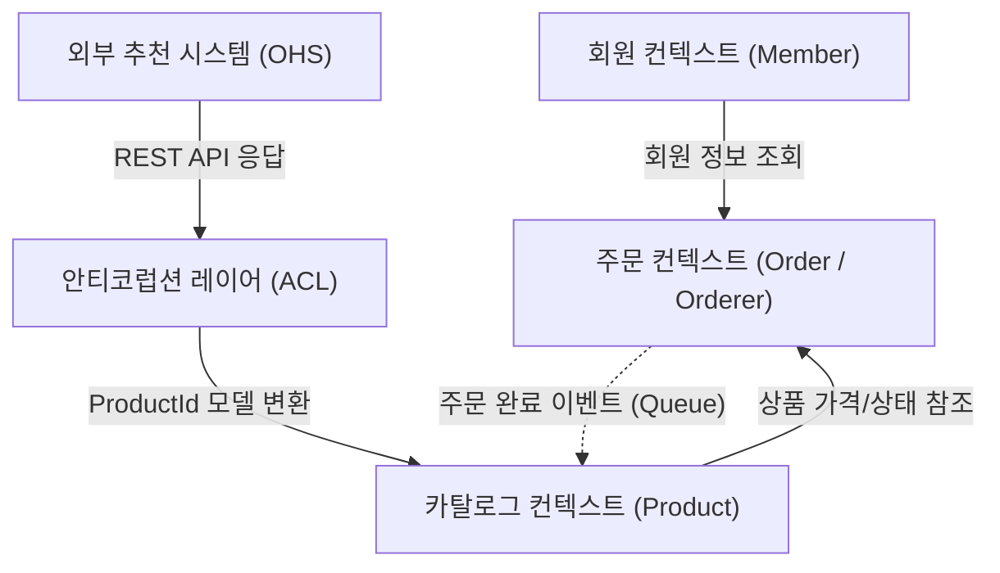

> 《도메인 주도 개발 시작하기》 9장을 복습하며 하나의 도메인 모델로 서비스 전체를 표현할 때의 한계와, 바운디드 컨텍스트 경계 설정·REST/메시징 통합·컨텍스트 맵 관계 패턴을 Kotlin 코드로 정리합니다.

> 본 글의 예제 코드는 **Kotlin 1.9, Java 21, Spring Boot 3.x, Spring Data JPA (Hibernate 6)** 환경을 기준으로 작성했습니다.
{: .prompt-info }

## 하나의 모델로 모든 하위 도메인을 표현할 때의 한계

쇼핑몰 초기에 `Member`와 `Product` 엔티티 하나씩만 두고 모든 기능이 이를 직접 참조하면 당장은 단순해 보입니다. 하지만 도메인이 커질수록 같은 용어라도 하위 도메인마다 전혀 다른 의미와 생명주기를 가진다는 한계에 부딪힙니다.

`상품`은 카탈로그에서는 전시명·옵션 중심의 `Product`이지만, 주문에서는 구매 시점 가격 스냅샷인 `OrderLine`, 재고에서는 가용 수량 중심의 재고 항목, 배송에서는 무게와 송장 정보로 의미가 달라집니다. 회원 역시 인증 영역의 `Member`, 주문 영역의 `Orderer`, 리뷰 영역의 `Writer`로 역할이 다릅니다. 이를 단일 엔티티에 몰아넣으면 거대 클래스가 만들어지고, JPA 환경에서는 불필요한 연관 프록시 로딩과 하위 도메인 간 불변식 충돌로 변경 비용이 급격히 커집니다.

## 바운디드 컨텍스트 경계 설정과 구현 아키텍처

바운디드 컨텍스트(Bounded Context)는 특정 모델과 유비쿼터스 언어가 일관된 의미로 통용되는 논리적 경계입니다. 이상적으로는 하위 도메인과 1:1로 대응하지만, 실무에서는 팀 구조나 레거시 여건에 따라 1:N 또는 N:1로 구성되기도 합니다.

경계를 나누면 **컨텍스트마다 내부 아키텍처와 기술 스택을 독립적으로 선택**할 수 있습니다. 규칙이 복잡한 주문 컨텍스트(`com.example.shop.order.domain`)는 DDD와 Spring Data JPA로 불변식을 보호하고, 다조건 목록 조회가 핵심인 카탈로그 조회 컨텍스트는 CQRS나 MyBatis 기반 조회 모델로 단순하게 구현하는 식입니다. 물리적 서버를 나누지 않은 모듈러 모놀리스라도 패키지 경계와 모델 소유권을 분리해 두면 추후 서비스 추출 비용이 크게 줄어듭니다.

```kotlin
// com/example/shop/order/domain/Orderer.kt
package com.example.shop.order.domain

import com.example.shop.member.domain.MemberId
import jakarta.persistence.AttributeOverride
import jakarta.persistence.Column
import jakarta.persistence.Embeddable
import jakarta.persistence.Embedded

@Embeddable
data class Orderer(
    @Embedded
    @AttributeOverride(name = "id", column = Column(name = "orderer_id"))
    val memberId: MemberId,

    @Column(name = "orderer_name", nullable = false)
    val name: String,
)
```

주문 컨텍스트는 회원 엔티티를 직접 참조하지 않고 자신의 문맥에 맞는 `Orderer`와 `MemberId` 식별자만 보관합니다.



## 바운디드 컨텍스트 간 통합 방식과 트레이드오프

컨텍스트 간 통합은 REST API 등을 활용한 **직접 통합(동기)**과 메시지 큐 기반의 **간접 통합(비동기)**으로 나뉩니다. 실시간 응답이 필요한지, 일시적 장애를 격리해야 하는지에 따라 선택이 갈립니다.

| 비교 항목 | 직접 통합 (REST API) | 간접 통합 (메시지 큐) |
| :--- | :--- | :--- |
| 결합도 | 대상 엔드포인트·응답 스펙에 직접 의존 | 브로커와 메시지 스키마에만 의존 |
| 일관성 | 호출 시점 최신 상태 즉시 확인 | 최종 일관성(Eventual Consistency) |
| 장애 전파 | 대상 지연·오류가 호출 스레드에 전파 | 브로커 버퍼링으로 장애 격리 |
| 적합한 용도 | 실시간 조회, 즉시 검증 흐름 | 상태 변경 알림, 추천·통계 갱신 |

카탈로그에서 외부 추천 상품 목록을 실시간 조회할 때는 도메인 계층에 인터페이스를 두고, 인프라 계층에서 Spring Boot 3.2의 `RestClient`로 외부 응답을 `ProductId`로 변환합니다.

```kotlin
// com/example/shop/catalog/domain/ProductRecommendationService.kt
package com.example.shop.catalog.domain

interface ProductRecommendationService {
    fun getRecommendationsOf(productId: ProductId): List<ProductId>
}
```

```kotlin
// com/example/shop/catalog/infra/RecSystemClient.kt
package com.example.shop.catalog.infra

import com.example.shop.catalog.domain.ProductId
import com.example.shop.catalog.domain.ProductRecommendationService
import org.springframework.core.ParameterizedTypeReference
import org.springframework.http.client.JdkClientHttpRequestFactory
import org.springframework.stereotype.Component
import org.springframework.web.client.RestClient
import java.net.http.HttpClient
import java.time.Duration

@Component
class RecSystemClient(
    builder: RestClient.Builder,
) : ProductRecommendationService {

    private val restClient: RestClient = builder
        .baseUrl("https://rec.internal.example.com")
        .requestFactory(
            JdkClientHttpRequestFactory(
                HttpClient.newBuilder()
                    .connectTimeout(Duration.ofSeconds(1))
                    .build()
            ).apply {
                setReadTimeout(Duration.ofSeconds(2))
            }
        )
        .build()

    override fun getRecommendationsOf(productId: ProductId): List<ProductId> {
        val items = restClient.get()
            .uri("/api/v1/recommendations/{id}", productId.id)
            .retrieve()
            .body(object : ParameterizedTypeReference<List<RecItemResponse>>() {})
            ?: emptyList()

        return items.map { ProductId(it.itemCode) }
    }
}

data class RecItemResponse(
    val itemCode: String,
    val score: Double,
)
```

내부적으로 `RestClient`는 주입된 `ClientHttpRequestFactory`로 HTTP 커넥션을 열고, `HttpMessageConverter` 체인으로 응답을 역직렬화한 뒤 `ResponseErrorHandler`로 오류 상태를 판별합니다. 기본 팩토리만 쓰면 읽기 타임아웃이 길어져 스레드가 고갈될 수 있으므로, 위처럼 연결·읽기 타임아웃을 명시적으로 제한해야 합니다.

## 컨텍스트 맵과 바운디드 컨텍스트 간 관계 패턴

컨텍스트 맵(Context Map)은 컨텍스트 간 의존 방향과 통합 방식을 한눈에 보여 주는 지도입니다. 서비스를 제공하는 쪽을 **상류(Upstream)**, 소비하는 쪽을 **하류(Downstream)**로 두고 팀 관계에 맞는 패턴을 적용합니다.

| 관계 패턴 | 방향 및 성격 | 목적과 트레이드오프 |
| :--- | :--- | :--- |
| 공개 호스트 서비스 (OHS) | 상류 → 다수 하류 | 표준 API로 공개해 확장성 확보, 단 하위 호환 유지 비용 발생 |
| 안티코럽션 레이어 (ACL) | 하류 방어 계층 | 외부 모델 오염 차단, 대신 매핑·번역 코드 유지 비용 추가 |
| 공유 커널 (Shared Kernel) | 양방향 공동 소유 | 공통 모델 중복 제거, 변경 시 양 팀 협의·동시 배포 필요 |
| 독립 방식 (Separate Ways) | 통합 없음 | 결합도 0으로 빠른 개발 가능, 기능 중복이나 수동 연동 감수 |

`RecSystemClient`는 외부 `itemCode`를 내부 `ProductId`로 번역하는 **ACL** 구현입니다. 반면 `com.example.shop.common.model`의 `Money`처럼 변경 빈도가 극히 낮은 기본 밸류 타입만 **공유 커널**로 제한해 두면 팀 간 배포 병목을 피할 수 있습니다.

```kotlin
// com/example/shop/common/model/Money.kt
package com.example.shop.common.model

data class Money(val value: Int) {
    operator fun plus(other: Money): Money = Money(value + other.value)
    operator fun times(multiplier: Int): Money = Money(value * multiplier)
}
```

## 실무 적용 시 마주하는 운영 함정

첫째는 **팀 구조와 맞지 않는 성급한 마이크로서비스 분리**입니다. 바운디드 컨텍스트는 논리적 모델 경계이지 곧바로 물리적 배포 단위가 아닙니다. 배포·관측 체계가 갖춰지지 않은 상태에서 무리하게 서비스를 쪼개면 네트워크 지연과 분산 트랜잭션 비용만 떠안게 되므로, 모듈러 모놀리스로 경계를 먼저 검증하는 편이 안전합니다.

둘째는 **ACL 없이 외부 응답 DTO를 도메인에 직접 의존하는 실수**입니다. `RecItemResponse`를 서비스와 컨트롤러까지 그대로 노출하면 상류 API 필드 변경이 하류 도메인 전체로 번집니다.

셋째는 **동기 REST 호출의 연쇄 장애**입니다. 상품 상세 조회 중 부가 기능인 추천 API가 지연되거나 실패할 때 격리 장치가 없으면 핵심 조회까지 마비됩니다.

> 부가 컨텍스트를 동기 호출할 때는 짧은 타임아웃과 빈 목록 반환 같은 폴백, 서킷 브레이커를 함께 구성해야 핵심 도메인의 가용성을 지킬 수 있습니다.
{: .prompt-warning }
