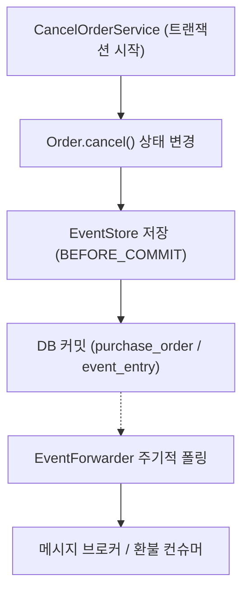

> 《도메인 주도 개발 시작하기》 10장을 복습하며 주문 취소처럼 여러 컨텍스트가 연쇄 반응해야 하는 흐름의 도메인 이벤트 설계와, Spring 동기 처리 한계 및 비동기 이벤트 처리 3가지 전략을 Kotlin 코드로 정리합니다.

> 본 글의 예제 코드는 **Kotlin 1.9, Java 21, Spring Boot 3.x, Spring Data JPA (Hibernate 6)** 환경을 기준으로 작성했습니다.
{: .prompt-info }

## 시스템 간 강결합 문제와 도메인 이벤트 도입 배경

주문 취소 시 `CancelOrderService` 안에서 `Order.cancel()` 호출 직후 외부 환불 API(`RefundService.refund()`)와 알림 발송을 직접 호출하면 세 가지 문제가 동시에 생깁니다.

첫째, 외부 환불 API가 네트워크 오류를 던질 때 주문 취소 트랜잭션 전체를 롤백해야 할지 판단이 모호해집니다. 둘째, 외부 API 응답이 수 초 지연되는 동안 DB 커넥션과 행 락이 점유되어 전체 처리량이 떨어집니다. 셋째, 적립금 회수나 통계 갱신 같은 후속 요구가 늘 때마다 주문 서비스 코드를 계속 고쳐야 해 도메인 로직이 오염됩니다.

도메인 이벤트(Domain Event)는 **"과거에 도메인에서 발생한 의미 있는 사실"**을 객체로 발행해 이 결합을 끊습니다. 주문 도메인은 취소 사실만 알리고, 환불·알림 컨텍스트가 이벤트를 구독해 독립적으로 반응하도록 제어권을 역전시킵니다.

## 도메인 이벤트 구성요소와 Spring 기반 발행 구조

도메인 이벤트 구조는 **생성 주체(애그리거트)**, **이벤트 객체**, **디스패처(`ApplicationEventPublisher`)**, **이벤트 핸들러** 네 요소로 구성됩니다. 이벤트 이름은 `OrderCanceledEvent`처럼 과거 시제로 짓고, 페이로드에는 JPA 엔티티 통째로가 아닌 발생 시각과 `orderNumber` 같은 최소 식별자만 담습니다. 엔티티를 그대로 넘기면 비동기 스레드에서 `LazyInitializationException`이나 직렬화 순환 참조가 발생하기 쉽기 때문입니다.

```kotlin
// com/example/shop/common/event/Events.kt
package com.example.shop.common.event

import org.springframework.context.ApplicationEventPublisher

interface Event {
    val timestamp: Long
}

object Events {
    private var publisher: ApplicationEventPublisher? = null

    fun setPublisher(publisher: ApplicationEventPublisher) {
        this.publisher = publisher
    }

    fun raise(event: Any) {
        publisher?.publishEvent(event)
    }

    fun reset() {
        publisher = null
    }
}
```

```kotlin
// com/example/shop/common/event/EventsConfiguration.kt
package com.example.shop.common.event

import org.springframework.beans.factory.InitializingBean
import org.springframework.context.ApplicationContext
import org.springframework.context.annotation.Bean
import org.springframework.context.annotation.Configuration

@Configuration
class EventsConfiguration(
    private val applicationContext: ApplicationContext,
) {
    @Bean
    fun eventsInitializer(): InitializingBean = InitializingBean {
        Events.setPublisher(applicationContext)
    }
}
```

```kotlin
// com/example/shop/order/domain/OrderCanceledEvent.kt
package com.example.shop.order.domain

import com.example.shop.common.event.Event

data class OrderCanceledEvent(
    val orderNumber: String,
    override val timestamp: Long = System.currentTimeMillis(),
) : Event
```

```kotlin
// com/example/shop/order/domain/Order.kt (핵심 메서드 발췌)
package com.example.shop.order.domain

import com.example.shop.common.event.Events
import com.example.shop.common.model.Money
import jakarta.persistence.EmbeddedId
import jakarta.persistence.Entity
import jakarta.persistence.EnumType
import jakarta.persistence.Enumerated
import jakarta.persistence.Table

@Entity
@Table(name = "purchase_order")
class Order(
    @EmbeddedId
    val number: OrderNo,

    @Enumerated(EnumType.STRING)
    var state: OrderState,

    var totalAmounts: Money,
) {
    fun cancel() {
        verifyNotYetShipped()
        this.state = OrderState.CANCELED
        Events.raise(OrderCanceledEvent(number.number))
    }

    private fun verifyNotYetShipped() {
        check(state == OrderState.PAYMENT_WAITING || state == OrderState.PREPARING) {
            "이미 출고된 주문은 취소할 수 없습니다. 현재 상태: $state"
        }
    }
}
```

정적 홀더 `Events`를 쓰면 도메인 객체가 Spring 빈을 직접 주입받지 않아도 되지만, 단위 테스트 후 `Events.reset()` 정리가 필요합니다. 정적 상태를 피하고 싶다면 Spring Data의 `AbstractAggregateRoot`와 `@DomainEvents`로 저장 시점 발행을 선택할 수 있습니다.

## 동기 이벤트 처리의 한계와 트랜잭션 내부 동작

기본 `@EventListener`는 `ApplicationEventPublisher.publishEvent()` 호출 시 내부 `SimpleApplicationEventMulticaster.multicastEvent()`가 별도 `TaskExecutor` 없이 리스너를 순회하므로 **발행자와 같은 스레드·같은 트랜잭션에서 동기 실행**됩니다. 따라서 외부 환불 API의 지연과 예외가 주문 취소 트랜잭션에 그대로 전파됩니다.

트랜잭션 시점을 분리하려면 `@TransactionalEventListener`를 사용합니다. 내부적으로는 `TransactionalApplicationListenerMethodAdapter`가 현재 스레드의 `TransactionSynchronizationManager`에 `TransactionSynchronization` 콜백을 등록해 커밋 전후(`BEFORE_COMMIT`, `AFTER_COMMIT`)에 핸들러를 호출합니다.

주의할 점은 `AFTER_COMMIT` 핸들러가 이미 커밋이 끝난 트랜잭션 컨텍스트에서 실행된다는 사실입니다. 이 안에서 JPA로 환불 이력을 저장하면서 기본 `@Transactional`(`REQUIRED`)만 붙이면 쓰기 쿼리가 커밋되지 않으므로, 반드시 `@Transactional(propagation = Propagation.REQUIRES_NEW)`로 새 트랜잭션을 열어야 합니다.

## 비동기 이벤트 처리 3가지 전략과 트레이드오프

외부 시스템 장애를 격리하고 처리량을 확보하려면 요구 신뢰성에 맞춰 아래 세 가지 비동기 전략 중 하나를 선택합니다.

| 비동기 처리 전략 | 구현 난이도 | 유실 위험 | 재처리·순서 보장 | 적합한 적용 시점 |
| :--- | :--- | :--- | :--- | :--- |
| 로컬 핸들러 비동기 (`AFTER_COMMIT` + `@Async`) | 낮음 | 높음 (JVM 종료 시 메모리 유실) | 별도 구현 없으면 불가 | 알림, 캐시 무효화, 로그 |
| 메시징 시스템 연동 (Kafka / RabbitMQ) | 중간 | 낮음 (DB-브로커 이중 쓰기 구간 존재) | 브로커 재소비·파티션 순서 | 서비스 간 대규모 팬아웃 |
| 이벤트 저장소(`EventStore`) + 포워더/API (Outbox) | 높음 | 매우 낮음 (비즈니스 데이터와 원자적 저장) | 오프셋 기반 재전송 | 결제·환불·정산 핵심 흐름 |

가벼운 후속 처리는 로컬 비동기 핸들러로 빠르게 적용할 수 있습니다.

```kotlin
// com/example/shop/order/infra/OrderCanceledEventHandler.kt
package com.example.shop.order.infra

import com.example.shop.order.domain.OrderCanceledEvent
import com.example.shop.order.domain.OrderNo
import com.example.shop.order.domain.RefundService
import org.springframework.scheduling.annotation.Async
import org.springframework.stereotype.Component
import org.springframework.transaction.event.TransactionPhase
import org.springframework.transaction.event.TransactionalEventListener

@Component
class OrderCanceledEventHandler(
    private val refundService: RefundService,
) {
    @Async("eventExecutor")
    @TransactionalEventListener(phase = TransactionPhase.AFTER_COMMIT)
    fun handle(event: OrderCanceledEvent) {
        refundService.refund(OrderNo(event.orderNumber))
    }
}
```

반면 환불처럼 유실을 허용할 수 없다면 **이벤트 저장소와 포워더 방식(Transactional Outbox 패턴)**을 적용합니다. 주문 취소와 같은 DB 트랜잭션 안에서 `BEFORE_COMMIT` 핸들러로 `event_entry` 테이블에 이벤트를 함께 저장하고, 별도 `EventForwarder`가 `@Scheduled`로 미전송 오프셋을 폴링해 브로커로 전달하거나 조회 API로 노출합니다.



```kotlin
// com/example/shop/common/event/EventStoreHandler.kt
package com.example.shop.common.event

import com.fasterxml.jackson.databind.ObjectMapper
import org.springframework.stereotype.Component
import org.springframework.transaction.event.TransactionPhase
import org.springframework.transaction.event.TransactionalEventListener

@Component
class EventStoreHandler(
    private val eventEntryRepository: EventEntryRepository,
    private val objectMapper: ObjectMapper,
) {
    @TransactionalEventListener(phase = TransactionPhase.BEFORE_COMMIT)
    fun store(event: Event) {
        val entry = EventEntry(
            type = event::class.java.name,
            contentType = "application/json",
            payload = objectMapper.writeValueAsString(event),
            timestamp = event.timestamp,
        )
        eventEntryRepository.save(entry)
    }
}
```

## 운영 환경에서 반드시 대비해야 할 이벤트 함정

첫째는 **트랜잭션 커밋 전 이벤트 발행으로 인한 유령 처리**입니다. 일반 `@EventListener`에 `@Async`를 붙이면 주문 취소 트랜잭션이 롤백되었는데도 비동기 스레드가 먼저 환불을 실행하는 사고가 발생합니다. 외부 연동은 반드시 `AFTER_COMMIT`으로 지연하거나 동일 트랜잭션 Outbox(`BEFORE_COMMIT`)에 기록해야 합니다.

둘째는 **중복 수신에 대비한 멱등성(Idempotency)**입니다. 포워더가 메시지를 발행한 직후 오프셋 갱신 전에 장애가 나면 같은 `OrderCanceledEvent`가 재전송됩니다. 최소 한 번(At-least-once) 전달을 전제로 두고 `eventId`나 `orderNumber` 유니크 제약으로 중복 환불을 막아야 합니다.

셋째는 **`@Async` 스레드 풀 고갈과 예외 삼킴**입니다.

> 커스텀 `ThreadPoolTaskExecutor`를 명시하지 않으면 Spring 기본 `SimpleAsyncTaskExecutor`가 요청마다 새 스레드를 생성해 리소스가 고갈될 수 있습니다. 또한 반환값이 `Unit`인 비동기 메서드의 예외는 호출자에게 전파되지 않으므로 `AsyncUncaughtExceptionHandler`와 재시도·DLQ(Dead Letter Queue) 전략을 반드시 함께 설계해야 합니다.
{: .prompt-warning }
