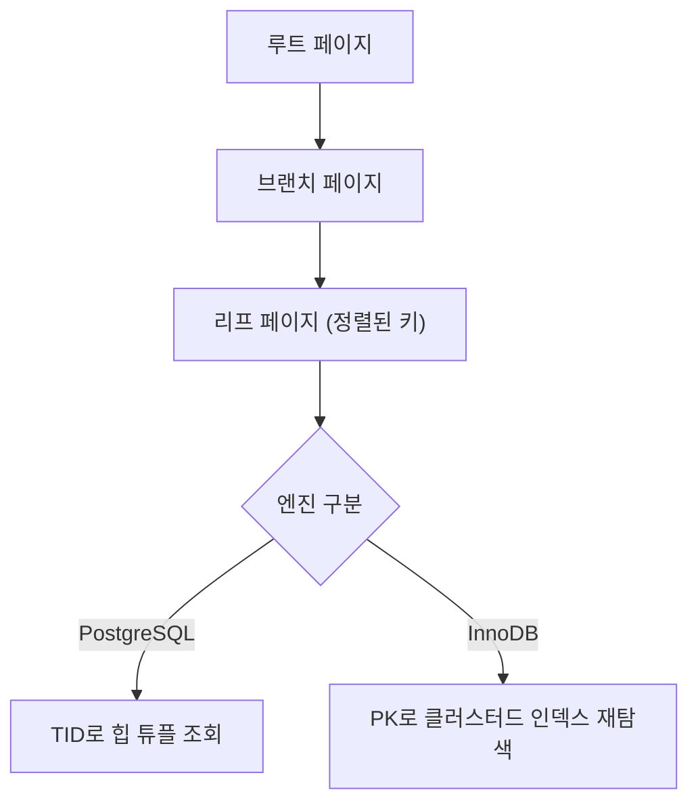

> 복합 인덱스는 "자주 쓰는 컬럼을 앞에" 두는 것만으로는 제대로 동작하지 않습니다. 이 글에서는 B-Tree의 정렬 구조에서 출발해 leftmost prefix 규칙, 등호와 범위 조건의 배치, 커버링 인덱스까지 컬럼 순서를 정하는 기준을 정리합니다.

> 기준 환경: PostgreSQL 15.4, MySQL 8.0.34 (InnoDB). 실행 계획 예시는 로컬 Docker 컨테이너에서 100만 건 더미 데이터로 확인했습니다.
{: .prompt-info }

## 배경

데이터베이스 수업 팀 프로젝트로 간단한 주문 관리 서비스를 만들면서 `orders` 테이블에 `(created_at, user_id)` 복합 인덱스를 걸어 두었습니다. "사용자별 최근 주문" 조회가 느려서 인덱스를 추가했는데, 실행 계획을 보니 인덱스는 타지만 수십만 건의 인덱스 엔트리를 훑고 있었습니다. 컬럼 순서 하나를 `(user_id, created_at)`으로 바꾸자 읽는 블록 수가 수천 개에서 한 자릿수로 줄었습니다.

이 경험 이후로 인덱스를 "검색 속도를 높여 주는 마법"이 아니라 **정렬된 자료구조**로 이해하고, 쿼리 조건이 그 정렬 순서를 얼마나 활용하는지 따져 보는 습관을 들이게 되었습니다.

## 동작 원리

B-Tree 인덱스는 루트, 브랜치, 리프 페이지로 이루어진 균형 트리입니다. 리프 페이지에는 **인덱스 키가 정렬된 상태**로 저장되고, 리프끼리는 양방향 링크로 연결되어 범위 스캔 시 옆 페이지로 바로 이동합니다. 트리 높이가 보통 3~4 단계라서 수백만 건 테이블에서도 키 하나를 찾는 데 몇 번의 페이지 접근이면 충분합니다.



한 단계 더 들어가 보면 두 엔진의 리프 구조가 다릅니다.

- **PostgreSQL**: 테이블은 순서 없는 힙(Heap)이고, 인덱스 리프는 `(키, TID)`를 가집니다. TID는 `(블록 번호, 오프셋)`이라 인덱스에서 바로 힙 위치로 점프합니다. 페이지 크기는 8KB이며, PostgreSQL 13부터는 중복 키를 묶는 deduplication으로 인덱스 크기가 줄었습니다.
- **InnoDB**: 테이블 자체가 PK 기준 클러스터드 인덱스입니다. 세컨더리 인덱스 리프에는 `(키, PK 값)`이 들어 있어서, 다른 컬럼이 필요하면 PK로 클러스터드 인덱스를 한 번 더 탐색합니다. 페이지 크기는 기본 16KB입니다.

복합 인덱스 `(a, b, c)`는 `a`로 먼저 정렬하고, `a`가 같으면 `b`, 그다음 `c` 순으로 정렬한 하나의 키입니다. 전화번호부가 성으로 정렬되고 성이 같으면 이름으로 정렬된 것과 같습니다. 이름만 알고 성을 모르면 전화번호부 전체를 넘겨야 하듯, **선두 컬럼 조건 없이 뒤 컬럼만으로는 트리 탐색 시작점을 정할 수 없습니다.** 이것이 leftmost prefix 규칙입니다.

## 비교와 선택 기준

컬럼 순서를 정할 때 제가 확인하는 기준은 다음과 같습니다.

| 조건 형태 | `(a, b, c)` 인덱스 활용 | 설명 |
| :--- | :--- | :--- |
| `a = ? AND b = ? AND c = ?` | 세 컬럼 모두 탐색 조건 | 가장 이상적 |
| `a = ? AND b > ? AND c = ?` | `a`, `b`만 탐색 조건, `c`는 필터 | 범위 조건 뒤 컬럼은 정렬이 끊김 |
| `b = ? AND c = ?` | 선두 컬럼 누락 | PostgreSQL은 인덱스 전체 스캔, MySQL 8.0.13+는 조건에 따라 skip scan |
| `a = ? ORDER BY b` | 정렬 생략 가능 | 인덱스 순서가 곧 정렬 순서 |
| `a IN (?, ?) AND b = ?` | 여러 범위로 탐색 | IN 목록이 짧을 때 유리 |

여기서 나오는 설계 원칙은 세 가지입니다.

1. **등호 조건 컬럼을 앞에, 범위 조건 컬럼을 뒤에** 둡니다. `a = ? AND b BETWEEN ...` 쿼리라면 `(a, b)`가 맞고 `(b, a)`는 `b` 범위 안에서 `a`를 하나하나 걸러야 합니다.
2. 등호 조건끼리는 **선택도(Selectivity)**가 높은 컬럼, 즉 값의 종류가 많은 컬럼을 앞에 두는 것이 일반적으로 유리합니다. 다만 다른 쿼리에서 선두 컬럼만 단독으로 쓰는지가 더 중요한 경우가 많아서, 선택도는 동률일 때의 보조 기준으로 봅니다.
3. **ORDER BY와 LIMIT**이 붙는 목록 쿼리는 정렬 컬럼까지 인덱스에 포함해 정렬 작업 자체를 없앱니다.

커버링 인덱스는 쿼리에 필요한 컬럼이 모두 인덱스에 있어서 테이블 접근을 생략하는 방식입니다. PostgreSQL에서는 `Index Only Scan`, MySQL에서는 `Extra: Using index`로 표시됩니다. PostgreSQL 11부터는 `INCLUDE` 절로 탐색에 쓰지 않는 컬럼을 리프에만 실어 둘 수 있습니다.

**언제 쓰지 말아야 하는가**도 분명히 해 두어야 합니다. 쓰기 비율이 높은 테이블에 조회 패턴마다 복합 인덱스를 하나씩 추가하면 INSERT·UPDATE마다 모든 인덱스를 갱신해야 하므로 쓰기 성능과 저장 공간이 나빠집니다. 성별이나 상태 플래그처럼 값 종류가 두세 개뿐인 컬럼에 단독 인덱스를 거는 것도 대부분 효과가 없습니다. 플래너가 결국 순차 스캔을 고르기 때문입니다. 또 `(a)`와 `(a, b)`를 함께 두는 것은 대개 중복이므로 앞의 것을 지워도 됩니다.

## 진단과 적용

아래 스크립트로 직접 확인할 수 있습니다.

```sql
-- PostgreSQL 15
CREATE TABLE orders (
    id         bigserial PRIMARY KEY,
    user_id    bigint      NOT NULL,
    status     varchar(20) NOT NULL,
    created_at timestamptz NOT NULL
);

INSERT INTO orders (user_id, status, created_at)
SELECT (random() * 10000)::bigint,
       (ARRAY['PAID', 'SHIPPED', 'CANCELED'])[1 + (random() * 2)::int],
       now() - (random() * interval '365 days')
FROM generate_series(1, 1000000);

CREATE INDEX idx_orders_created_user ON orders (created_at, user_id);
ANALYZE orders;

EXPLAIN (ANALYZE, BUFFERS)
SELECT id, created_at FROM orders
WHERE user_id = 42 AND created_at >= now() - interval '30 days'
ORDER BY created_at DESC LIMIT 20;

-- 순서를 바꾸고 커버링 컬럼까지 포함한 인덱스
DROP INDEX idx_orders_created_user;
CREATE INDEX idx_orders_user_created ON orders (user_id, created_at) INCLUDE (id);
VACUUM ANALYZE orders;  -- visibility map 갱신으로 Index Only Scan 유도
```

첫 번째 인덱스에서도 `Index Cond`에는 두 조건이 함께 표시됩니다. 하지만 스캔 범위를 좁히는 것은 선두 컬럼 `created_at`뿐이고, `user_id = 42`는 최근 30일 구간의 엔트리를 하나씩 비교하는 데 쓰일 뿐이라 `Buffers: shared hit`가 크게 나옵니다. 두 번째 인덱스에서는 `Index Only Scan Backward`가 선택되고 읽는 버퍼가 한 자릿수로 줄어드는 것을 확인했습니다. 실행 계획을 읽는 방법은 [PostgreSQL EXPLAIN ANALYZE 실행 계획 읽기](/posts/postgresql-explain-analyze-execution-plan/)에 따로 정리했습니다.

MySQL 8.0에서는 같은 쿼리를 `EXPLAIN FORMAT=TREE` 또는 `EXPLAIN ANALYZE`(8.0.18+)로 확인합니다.

```sql
-- MySQL 8.0
CREATE INDEX idx_orders_user_created ON orders (user_id, created_at);
EXPLAIN FORMAT=TREE
SELECT id, created_at FROM orders
WHERE user_id = 42 AND created_at >= NOW() - INTERVAL 30 DAY
ORDER BY created_at DESC LIMIT 20;
```

InnoDB 세컨더리 인덱스에는 PK가 자동으로 포함되므로 `id`를 따로 넣지 않아도 커버링이 됩니다.

## 운영 함정 및 정리

> 주의: 인덱스 컬럼을 함수나 형변환으로 감싸면(`WHERE date(created_at) = ...`, 문자열 컬럼에 숫자 비교 등) 정렬 순서를 활용할 수 없어 인덱스가 무시됩니다. 또 PostgreSQL의 `Index Only Scan`은 visibility map에 all-visible로 표시된 페이지에서만 힙 접근을 생략하므로, 갱신이 잦은 테이블은 `Heap Fetches` 수치가 커져 기대한 효과가 나지 않을 수 있습니다.
{: .prompt-warning }

복합 인덱스 설계는 결국 "이 쿼리가 B-Tree의 정렬 순서를 어디까지 따라갈 수 있는가"를 묻는 일이었습니다. 인덱스를 추가하기 전에 아래 항목을 점검합니다.

- [ ] 등호 조건 컬럼이 범위 조건 컬럼보다 앞에 있는가?
- [ ] 선두 컬럼 없이 실행되는 쿼리가 따로 존재하지 않는가?
- [ ] `ORDER BY ... LIMIT` 쿼리의 정렬 컬럼이 인덱스 순서와 일치하는가?
- [ ] 기존 인덱스의 prefix와 겹치는 중복 인덱스는 없는가?
- [ ] `EXPLAIN (ANALYZE, BUFFERS)`로 읽은 버퍼 수가 실제로 줄었는가?
