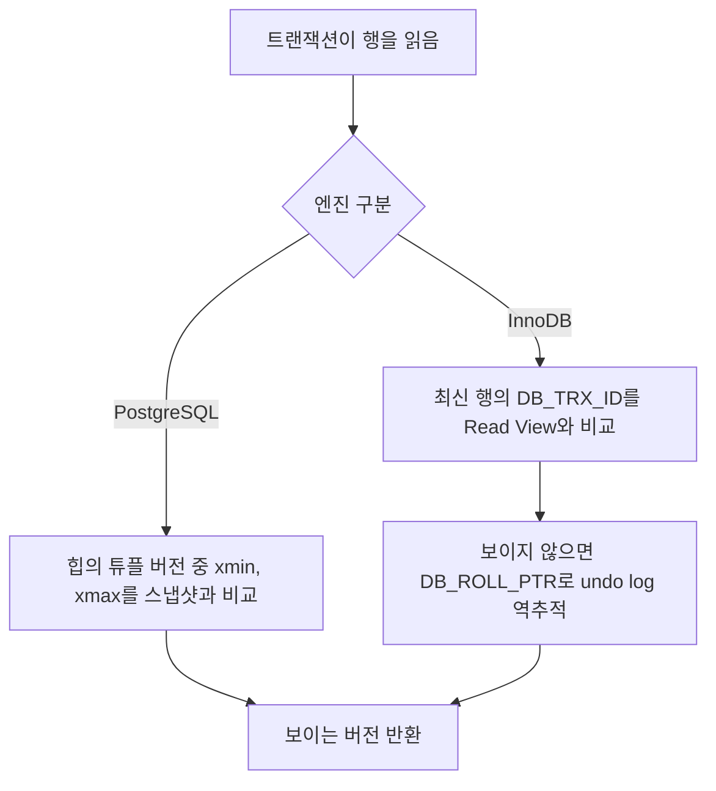

> 격리 수준은 이름이 같아도 DB 엔진마다 보장하는 내용이 다릅니다. 이 글에서는 두 개의 세션으로 이상 현상을 직접 재현하고, PostgreSQL과 InnoDB의 MVCC 구현 차이가 REPEATABLE READ 동작을 어떻게 바꾸는지 정리합니다.

> 기준 환경: PostgreSQL 15.4 (기본 격리 수준 READ COMMITTED), MySQL 8.0.34 InnoDB (기본 격리 수준 REPEATABLE READ)
{: .prompt-info }

## 배경

데이터베이스 수업에서 격리 수준 표를 외울 때는 "REPEATABLE READ에서는 팬텀 리드가 발생할 수 있다" 정도로만 이해했습니다. 그런데 스터디에서 같은 시나리오를 PostgreSQL과 MySQL로 각각 돌려 보니 결과가 달랐습니다. 한쪽은 에러를 던지고, 다른 쪽은 아무 일 없이 커밋되면서 값이 덮어써졌습니다.

원인은 SQL 표준의 격리 수준 정의가 "어떤 이상 현상을 허용하지 않는가"만 규정하고, 구현 방식은 엔진에 맡기기 때문이었습니다. 두 엔진 모두 MVCC(Multi-Version Concurrency Control)를 쓰지만 버전을 저장하는 위치와 쓰기 충돌을 다루는 방식이 다릅니다.

## 동작 원리

MVCC의 핵심은 **읽기가 쓰기를 막지 않도록 행의 여러 버전을 유지**하고, 각 트랜잭션이 자기 시점에 보여야 할 버전만 고르는 것입니다.



**PostgreSQL**은 UPDATE 시 기존 튜플을 그 자리에서 고치지 않고 새 튜플을 힙에 추가합니다. 튜플 헤더의 `xmin`은 생성한 트랜잭션 ID, `xmax`는 삭제하거나 갱신한 트랜잭션 ID입니다. 스냅샷은 `(xmin, xmax, 진행 중인 트랜잭션 목록)`으로 구성되고, 튜플의 `xmin`이 스냅샷 기준으로 커밋되었고 `xmax`가 아직 보이지 않으면 그 버전을 읽습니다. 오래된 버전은 힙에 남아 있다가 VACUUM이 정리합니다.

**InnoDB**는 클러스터드 인덱스의 행을 직접 갱신하고, 이전 값은 undo log에 기록합니다. 각 행에는 숨은 컬럼 `DB_TRX_ID`(마지막 수정 트랜잭션)와 `DB_ROLL_PTR`(undo 레코드 포인터)가 있습니다. 읽기 시점의 Read View로 보이지 않는 버전이면 undo 체인을 따라가 과거 버전을 재구성합니다. 더 이상 필요 없는 undo는 purge 스레드가 정리합니다.

스냅샷을 언제 만드는지도 중요합니다. READ COMMITTED는 **문장마다** 새 스냅샷을, REPEATABLE READ는 **트랜잭션의 첫 읽기 시점**에 만든 스냅샷을 끝까지 사용합니다. `BEGIN` 직후가 아니라 첫 쿼리 시점이라는 점이 실험할 때 자주 헷갈립니다.

## 비교와 선택 기준

| 항목 | PostgreSQL 15 | MySQL 8.0 InnoDB |
| :--- | :--- | :--- |
| 기본 격리 수준 | READ COMMITTED | REPEATABLE READ |
| 이전 버전 저장 위치 | 힙 (새 튜플 추가) | undo log |
| 정리 주체 | VACUUM / autovacuum | purge 스레드 |
| READ UNCOMMITTED | READ COMMITTED와 동일하게 동작 | Dirty Read 허용 |
| RR에서 동시 갱신 충돌 | `could not serialize access` 에러 | 최신 커밋 값 기준으로 갱신 진행 |
| RR에서 팬텀 | 스냅샷 읽기로 방지 | 일반 읽기는 방지, 잠금 읽기는 갭 락으로 방지 |

가장 큰 차이는 **REPEATABLE READ에서 쓰기 충돌을 다루는 방식**입니다. PostgreSQL은 내 스냅샷 이후 다른 트랜잭션이 커밋한 행을 수정하려 하면 트랜잭션을 실패시키고 재시도를 요구합니다. InnoDB는 UPDATE와 `SELECT ... FOR UPDATE`가 스냅샷이 아닌 **최신 커밋 버전(current read)**을 읽기 때문에, 같은 트랜잭션 안에서도 일반 SELECT와 UPDATE가 서로 다른 버전을 보게 됩니다.

**언제 높은 격리 수준을 쓰지 말아야 하는가**도 정리해 두었습니다. PostgreSQL에서 REPEATABLE READ나 SERIALIZABLE을 쓰면 직렬화 실패(SQLSTATE `40001`)가 정상적인 결과로 발생하므로, 애플리케이션에 재시도 로직이 없다면 오히려 장애가 됩니다. 또 긴 REPEATABLE READ 트랜잭션은 오래된 스냅샷을 붙잡아 VACUUM이나 purge를 막고, 테이블 팽창과 undo 증가로 이어집니다. 단순 조회 API에 격리 수준을 올리는 것은 대부분 득보다 실이 큽니다.

## 진단과 적용

실험용 테이블은 아래와 같이 준비했습니다.

```sql
CREATE TABLE account (id int PRIMARY KEY, balance int NOT NULL);
INSERT INTO account VALUES (1, 1000);
```

먼저 READ COMMITTED에서 Non-Repeatable Read를 확인했습니다. PostgreSQL 기본값 그대로 두 세션을 엽니다.

```sql
-- 세션 A (READ COMMITTED)
BEGIN;
SELECT balance FROM account WHERE id = 1;   -- 1000

-- 세션 B
UPDATE account SET balance = 900 WHERE id = 1;  -- 자동 커밋

-- 세션 A
SELECT balance FROM account WHERE id = 1;   -- 900, 문장마다 새 스냅샷
COMMIT;
```

세션 A를 `BEGIN ISOLATION LEVEL REPEATABLE READ`로 바꾸면 두 번째 SELECT도 1000을 반환합니다. 다음으로 두 터미널에서 Lost Update 시나리오를 재현했습니다.

```sql
-- 값 초기화
UPDATE account SET balance = 1000 WHERE id = 1;

-- 세션 A
BEGIN ISOLATION LEVEL REPEATABLE READ;
SELECT balance FROM account WHERE id = 1;          -- 1000, 이 시점에 스냅샷 생성

-- 세션 B
BEGIN ISOLATION LEVEL REPEATABLE READ;
UPDATE account SET balance = balance - 300 WHERE id = 1;
COMMIT;

-- 세션 A
UPDATE account SET balance = balance - 500 WHERE id = 1;
-- ERROR:  could not serialize access due to concurrent update
ROLLBACK;
```

같은 순서를 MySQL 8.0의 두 세션에서 실행하면 세션 A의 SELECT는 여전히 1000을 보여 주지만, UPDATE는 최신 값 700에서 500을 빼 200으로 커밋됩니다. 이 경우에는 결과가 맞지만, 애플리케이션이 SELECT로 읽은 1000을 기준으로 `SET balance = 500`처럼 계산된 값을 쓰면 세션 B의 차감이 사라집니다. 이것이 InnoDB REPEATABLE READ에서 Lost Update가 가능한 이유입니다.

```sql
-- MySQL: 현재 세션의 격리 수준과 활성 트랜잭션 확인
SELECT @@transaction_isolation;
SELECT trx_id, trx_state, trx_started, trx_isolation_level
FROM information_schema.innodb_trx;

-- PostgreSQL: 현재 스냅샷과 오래된 트랜잭션 확인
SELECT pg_current_snapshot();
SELECT pid, xact_start, state, backend_xmin
FROM pg_stat_activity
WHERE backend_xmin IS NOT NULL
ORDER BY xact_start;
```

MySQL에서 Lost Update를 막으려면 읽는 시점에 `SELECT ... FOR UPDATE`로 잠그거나, `version` 컬럼을 둔 낙관적 락을 사용합니다. 잠금 방식이 실제로 어떤 범위를 잠그는지는 [행 잠금·갭 락과 데드락 진단](/posts/row-lock-gap-lock-deadlock-diagnosis/)에서 이어서 다뤘습니다.

## 운영 함정 및 정리

> 주의: InnoDB REPEATABLE READ에서 `START TRANSACTION` 직후가 아니라 첫 SELECT 시점에 Read View가 생깁니다. 트랜잭션 시작 시점의 스냅샷이 필요하면 `START TRANSACTION WITH CONSISTENT SNAPSHOT`을 사용해야 합니다. 또 `SHOW ENGINE INNODB STATUS`의 `History list length`가 계속 증가한다면 커밋되지 않은 긴 트랜잭션이 purge를 막고 있다는 신호입니다.
{: .prompt-warning }

격리 수준은 표를 외우는 것보다 "내 엔진에서 스냅샷이 언제 만들어지고, 쓰기 충돌 시 무엇을 하는가"를 아는 것이 훨씬 실용적이었습니다.

- [ ] 사용하는 DB의 기본 격리 수준을 알고 있는가? (PostgreSQL RC, MySQL RR)
- [ ] 읽은 값을 기반으로 계산해 쓰는 로직에 잠금이나 버전 검사가 있는가?
- [ ] PostgreSQL에서 RR 이상을 쓴다면 `40001` 재시도 로직이 있는가?
- [ ] 장시간 열린 트랜잭션을 `pg_stat_activity`, `innodb_trx`로 감시하고 있는가?
