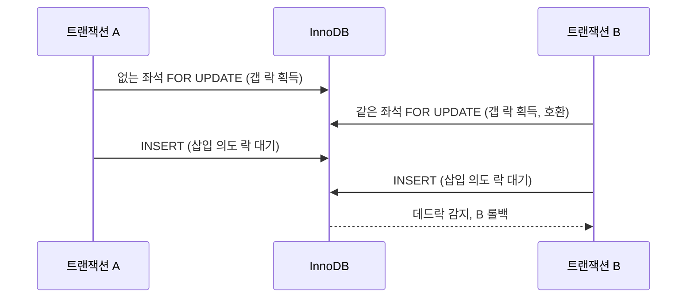

> 존재하지 않는 행을 `SELECT ... FOR UPDATE`로 조회했을 뿐인데 다른 세션의 INSERT가 멈추고 데드락까지 발생했습니다. 이 글에서는 InnoDB의 갭 락과 넥스트 키 락이 무엇을 잠그는지, PostgreSQL과는 어떻게 다른지, 데드락을 어떤 명령으로 진단하는지 정리합니다.

> 기준 환경: MySQL 8.0.34 InnoDB (REPEATABLE READ), PostgreSQL 15.4 (READ COMMITTED)
{: .prompt-info }

## 배경

스터디에서 만든 좌석 예약 토이 프로젝트에서 "같은 좌석에 예약이 없으면 INSERT"하는 로직을 이렇게 작성했습니다. 먼저 `SELECT ... FOR UPDATE`로 예약 존재 여부를 확인하고, 없으면 INSERT합니다. 중복 예약을 막으려고 잠금 읽기를 넣은 것인데, 부하 테스트에서 동시 요청 두 개가 들어오자 한쪽이 `Deadlock found when trying to get lock; try restarting transaction`(MySQL 에러 1213)으로 실패했습니다.

같은 코드를 PostgreSQL에서 돌리면 데드락은 나지 않았지만 중복 예약이 생겼습니다. 두 결과 모두 잠금의 범위를 정확히 몰라서 생긴 문제였습니다.

## 동작 원리

InnoDB의 행 잠금은 실제로는 **인덱스 레코드에 거는 잠금**입니다. 종류는 다음과 같습니다.

- **레코드 락(Record Lock)**: 인덱스 레코드 하나를 잠급니다.
- **갭 락(Gap Lock)**: 인덱스 레코드 사이의 빈 구간을 잠가 그 구간에 INSERT를 막습니다. 갭 락끼리는 서로 충돌하지 않습니다.
- **넥스트 키 락(Next-Key Lock)**: 레코드 락과 그 레코드 앞쪽 갭 락을 합친 것으로, REPEATABLE READ의 잠금 읽기와 범위 검색 기본 단위입니다.
- **삽입 의도 락(Insert Intention Lock)**: INSERT 직전에 거는 갭 잠금으로, 다른 트랜잭션의 갭 락과 충돌합니다.

유니크 인덱스로 존재하는 행을 등호 조회하면 레코드 락만 걸리지만, 존재하지 않는 값을 조회하거나 범위·비유니크 인덱스를 검색하면 갭까지 잠깁니다. 앞선 예약 로직의 데드락은 정확히 이 조합에서 발생합니다.



**PostgreSQL에는 갭 락이 없습니다.** 행 잠금은 튜플 헤더의 `xmax`와 infomask에 기록되고, 존재하지 않는 행은 잠글 대상이 없으므로 두 트랜잭션 모두 "없음"을 확인한 뒤 INSERT에 성공합니다. 이 때문에 데드락 대신 중복이 생겼습니다. PostgreSQL에서 범위 단위 보호가 필요하면 유니크 제약, `INSERT ... ON CONFLICT`, 또는 SERIALIZABLE 격리 수준의 SSI(predicate lock, `pg_locks`에서 `SIReadLock`)를 사용해야 합니다. 격리 수준과 MVCC 자체는 [트랜잭션 격리 수준과 MVCC](/posts/transaction-isolation-level-mvcc/)에 정리했습니다.

## 비교와 선택 기준

| 상황 | InnoDB (RR) | PostgreSQL (RC) | 권장 대응 |
| :--- | :--- | :--- | :--- |
| PK로 존재하는 행 잠금 | 레코드 락 | 행 잠금 | 그대로 사용 |
| 존재하지 않는 키 잠금 | 갭 락, INSERT 차단 | 잠글 대상 없음 | 유니크 제약 + 중복 예외 처리 |
| 비유니크 인덱스 범위 잠금 | 넥스트 키 락 | 조회된 행만 잠금 | 범위를 좁히거나 RC 검토 |
| 인덱스 없는 컬럼 조건 | 스캔한 모든 레코드 잠금 | 조건에 맞는 행만 잠금 | 조건 컬럼에 인덱스 추가 |
| 데드락 감지 | 즉시 감지(`innodb_deadlock_detect`) | `deadlock_timeout`(기본 1초) 후 검사 | 잠금 순서 통일 + 재시도 |

**갭 락에 기대지 말아야 하는 경우**도 있습니다. "없으면 INSERT" 패턴을 잠금 읽기로 구현하는 것은 InnoDB에서는 데드락을, PostgreSQL에서는 중복을 만드는 안티패턴입니다. 이 경우 유니크 제약을 걸고 중복 키 예외를 잡는 쪽이 단순하고 엔진에 관계없이 안전합니다. 또 MySQL을 READ COMMITTED로 운영하면 검색 시 갭 락이 거의 걸리지 않아 동시성은 좋아지지만, 팬텀 방지를 갭 락에 의존하던 로직은 깨질 수 있습니다.

## 진단과 적용

MySQL에서는 세 가지 도구로 잠금 상태를 봅니다.

```sql
-- 1. 마지막 데드락 상세 (LATEST DETECTED DEADLOCK 섹션)
SHOW ENGINE INNODB STATUS\G

-- 2. 현재 보유 및 대기 중인 잠금 (MySQL 8.0)
SELECT engine_transaction_id, object_name, index_name,
       lock_type, lock_mode, lock_status, lock_data
FROM performance_schema.data_locks;

-- 3. 누가 누구를 막고 있는지
SELECT * FROM sys.innodb_lock_waits\G

-- 모든 데드락을 에러 로그에 남기기
SET GLOBAL innodb_print_all_deadlocks = ON;
```

`data_locks`의 `lock_mode`가 `X,GAP`이면 갭 락, `X`면 넥스트 키 락, `X,REC_NOT_GAP`이면 레코드 락이고, `INSERT_INTENTION`이 포함되어 있으면 삽입 의도 락입니다. 데드락 로그에서는 각 트랜잭션이 보유한 잠금(`HOLDS THE LOCK(S)`)과 기다리는 잠금(`WAITING FOR THIS LOCK TO BE GRANTED`), 마지막 줄의 `WE ROLL BACK TRANSACTION (2)`를 순서대로 읽으면 순환 구조가 보입니다.

PostgreSQL은 `pg_locks`와 `pg_blocking_pids()`로 대기 관계를 확인합니다.

```sql
SELECT a.pid, pg_blocking_pids(a.pid) AS blocked_by,
       l.locktype, l.mode, l.granted, a.query
FROM pg_stat_activity a
JOIN pg_locks l ON l.pid = a.pid
WHERE NOT l.granted OR cardinality(pg_blocking_pids(a.pid)) > 0;

-- postgresql.conf: 1초 이상 잠금 대기 시 로그 기록
-- log_lock_waits = on
```

데드락의 근본 예방책은 **잠금 순서 통일**입니다. 여러 행을 갱신할 때는 항상 PK 오름차순으로 잠그고, 계좌 이체처럼 두 행을 다루면 `ORDER BY id ... FOR UPDATE`로 한 번에 잠급니다. 그래도 데드락은 완전히 없앨 수 없으므로 애플리케이션에서 MySQL 1213, PostgreSQL `40P01` 에러에 짧은 재시도를 둡니다.

## 운영 함정 및 정리

> 주의: InnoDB에서 조건 컬럼에 인덱스가 없으면 UPDATE·DELETE가 클러스터드 인덱스를 전부 스캔하면서 스캔한 레코드마다 잠금을 겁니다. 사실상 테이블 전체가 잠기는 것과 같아서, 배치성 UPDATE 하나가 서비스 전체 쓰기를 멈출 수 있습니다. 잠금 대기는 기본 `innodb_lock_wait_timeout` 50초 동안 이어지므로 증상이 데드락이 아닌 "응답 없음"으로 나타납니다.
{: .prompt-warning }

잠금은 "어떤 행"이 아니라 "어떤 인덱스 구간"을 잠그는지로 생각해야 결과가 예측됩니다.

- [ ] 잠금 읽기 조건이 유니크 인덱스 등호 조회인가, 범위 조회인가?
- [ ] "없으면 INSERT" 로직을 유니크 제약 기반으로 바꿀 수 있는가?
- [ ] 여러 행을 잠글 때 PK 순서가 모든 코드 경로에서 같은가?
- [ ] `innodb_print_all_deadlocks` 또는 `log_lock_waits`가 켜져 있는가?
- [ ] 데드락 에러(1213, `40P01`)에 대한 재시도가 구현되어 있는가?
