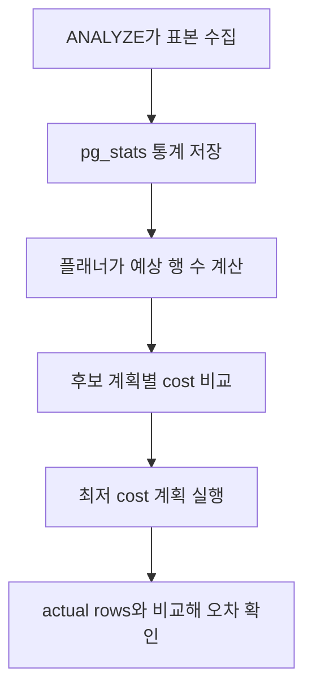

> 느린 쿼리를 고칠 때 인덱스부터 추가하기 전에 실행 계획이 무엇을 말하는지 읽을 수 있어야 합니다. 이 글에서는 PostgreSQL `EXPLAIN ANALYZE` 출력의 각 숫자 의미, 스캔·조인 노드의 선택 기준, 예상과 실제 행 수가 어긋날 때 확인할 통계를 정리합니다.

> 기준 환경: PostgreSQL 15.4. PostgreSQL 15에서는 `ANALYZE`를 지정해도 `BUFFERS`가 자동으로 켜지지 않으므로 `EXPLAIN (ANALYZE, BUFFERS)`처럼 명시해야 합니다.
{: .prompt-info }

## 배경

토이 프로젝트의 게시판 목록 API가 데이터 10만 건을 넘기면서 1초 가까이 걸리기 시작했습니다. `EXPLAIN`을 찍어 보긴 했지만 `cost=0.00..1834.00`이 무엇을 뜻하는지, 왜 인덱스가 있는데 `Seq Scan`이 나오는지 설명하지 못했습니다. 그래서 공식 문서의 "Using EXPLAIN" 장을 처음부터 읽고, 직접 데이터를 만들어 노드를 하나씩 바꿔 보며 정리했습니다.

## 동작 원리

실행 계획은 **트리**입니다. 들여쓰기가 깊은 노드가 먼저 실행되어 위쪽 노드로 행을 넘깁니다. 각 노드에는 두 종류의 숫자가 붙습니다.

- `cost=시작비용..총비용 rows=예상행수 width=평균바이트`: 플래너가 통계로 **추정한 값**입니다. 비용 단위는 `seq_page_cost`(기본 1.0) 기준 상대값입니다.
- `actual time=첫행ms..마지막행ms rows=실제행수 loops=반복횟수`: `ANALYZE`로 **실제 실행한 결과**입니다. `rows`와 `time`은 루프 1회당 평균이므로 총량은 `loops`를 곱해서 봐야 합니다.
- `Buffers: shared hit=a read=b`: 공유 버퍼에서 찾은 페이지(hit)와 디스크나 OS 캐시에서 읽어 온 페이지(read) 수입니다.

플래너는 `pg_statistic`(뷰는 `pg_stats`)에 저장된 컬럼 통계로 행 수를 추정하고, 그 추정치로 각 후보 계획의 비용을 계산해 가장 싼 것을 고릅니다.



따라서 실행 계획이 나쁜 이유의 상당수는 비용 모델이 아니라 **예상 행 수가 틀린 것**에서 시작합니다. 예상 1건, 실제 5만 건이면 플래너는 Nested Loop를 고르고, 그 안쪽 인덱스 스캔이 5만 번 반복됩니다.

## 비교와 선택 기준

스캔 노드는 읽을 행의 비율에 따라 달라집니다.

| 스캔 노드 | 선택되는 상황 | 출력에서 볼 지점 |
| :--- | :--- | :--- |
| Seq Scan | 테이블의 상당 부분을 읽거나 테이블이 작을 때 | `Rows Removed by Filter` |
| Index Scan | 소수의 행을 인덱스 순서대로 읽을 때 | `Index Cond` |
| Index Only Scan | 필요한 컬럼이 모두 인덱스에 있을 때 | `Heap Fetches` (0에 가까울수록 좋음) |
| Bitmap Heap Scan | 중간 비율의 행, 또는 여러 인덱스를 OR/AND 결합할 때 | `Recheck Cond`, `Heap Blocks: exact/lossy` |

조인 노드는 양쪽 입력 크기와 정렬 여부로 결정됩니다.

| 조인 노드 | 유리한 상황 | 주의점 |
| :--- | :--- | :--- |
| Nested Loop | 바깥 입력이 작고 안쪽에 인덱스가 있을 때 | 바깥 행 수 추정이 틀리면 급격히 느려짐 |
| Hash Join | 등호 조인, 한쪽이 `work_mem`에 들어갈 때 | `Batches`가 1보다 크면 디스크 사용 |
| Merge Join | 양쪽이 이미 조인 키로 정렬되어 있을 때 | 정렬 비용이 추가되면 불리 |

**EXPLAIN ANALYZE를 쓰지 말아야 하는 경우**도 있습니다. `ANALYZE`는 쿼리를 실제로 실행합니다. UPDATE·DELETE를 분석할 때는 반드시 `BEGIN; EXPLAIN ANALYZE ...; ROLLBACK;`으로 감싸야 합니다. 또 운영 DB에서 수십 초 걸리는 쿼리를 그대로 실행하면 그 자체가 부하가 되므로, 먼저 `ANALYZE` 없는 `EXPLAIN`으로 계획만 보고, 측정은 복제본에서 하는 편이 안전합니다. 노드마다 시간을 재는 오버헤드 때문에 `actual time` 합계가 실제보다 커질 수 있다는 점도 기억해 둡니다.

## 진단과 적용

게시판 목록 쿼리를 개선 전후로 비교했습니다. 아래는 개선 전 출력에서 핵심 줄만 남긴 것입니다.

```sql
EXPLAIN (ANALYZE, BUFFERS)
SELECT p.id, p.title, u.nickname
FROM post p JOIN users u ON u.id = p.user_id
WHERE p.board_id = 3
ORDER BY p.created_at DESC
LIMIT 20;
```

```text
Limit  (cost=4120.55..4120.60 rows=20 width=52) (actual time=812.4..812.4 rows=20 loops=1)
  Buffers: shared hit=1204 read=7310
  ->  Sort  (cost=4120.55..4170.55 rows=20000 width=52) (actual time=812.4..812.4 rows=20 loops=1)
        Sort Key: p.created_at DESC
        Sort Method: top-N heapsort  Memory: 30kB
        ->  Hash Join  (actual time=3.1..790.2 rows=33412 loops=1)
              ->  Seq Scan on post p  (actual time=0.0..760.8 rows=33412 loops=1)
                    Filter: (board_id = 3)
                    Rows Removed by Filter: 66588
```

`Seq Scan`이 10만 행을 읽어 6만여 행을 버리고, 남은 3만여 행을 전부 정렬한 뒤 20개만 가져가고 있었습니다. `read=7310`은 공유 버퍼에 없던 페이지를 그만큼 새로 읽었다는 뜻입니다. `(board_id, created_at)` 인덱스를 추가한 뒤에는 `Limit -> Nested Loop -> Index Scan Backward using idx_post_board_created`로 바뀌었고 `Buffers: shared hit=64`, 실행 시간 0.3ms로 줄었습니다. 컬럼 순서를 이렇게 정한 이유는 [B-Tree 인덱스 구조와 복합 인덱스 컬럼 순서 설계 기준](/posts/btree-index-composite-column-order/)에 정리했습니다.

예상과 실제 행 수가 크게 다르면 통계를 먼저 확인합니다.

```sql
-- 마지막 통계 수집 시각
SELECT relname, last_analyze, last_autoanalyze, n_live_tup, n_mod_since_analyze
FROM pg_stat_user_tables WHERE relname = 'post';

-- 컬럼 분포 통계
SELECT attname, n_distinct, most_common_vals, correlation
FROM pg_stats WHERE tablename = 'post' AND attname = 'board_id';

-- 표본 크기를 키우고 다시 수집
ALTER TABLE post ALTER COLUMN board_id SET STATISTICS 1000;
ANALYZE post;

-- 상관관계가 있는 컬럼 조합은 확장 통계로 보정
CREATE STATISTICS st_post_board_status (dependencies) ON board_id, status FROM post;
ANALYZE post;
```

## 운영 함정 및 정리

> 주의: 대량 INSERT나 데이터 이관 직후에는 autovacuum의 자동 ANALYZE가 돌기 전이라 통계가 비어 있거나 낡아 있습니다. 이 상태에서는 예상 행 수가 수천 배 틀려 Nested Loop가 선택되기 쉽습니다. 마이그레이션 스크립트 마지막에는 수동 `ANALYZE`를 넣어 두는 것이 좋습니다. 또 바인드 파라미터를 쓰는 prepared statement는 여러 번 실행된 뒤 generic plan으로 바뀔 수 있어서, `psql`에서 상수로 찍은 계획과 애플리케이션 계획이 다를 수 있습니다.
{: .prompt-warning }

실행 계획은 안쪽 노드부터, 예상과 실제의 차이부터 읽는 것이 핵심이었습니다.

- [ ] `EXPLAIN (ANALYZE, BUFFERS)`로 `BUFFERS`까지 함께 확인했는가?
- [ ] 각 노드의 `rows` 예상값과 실제값 차이가 10배 이상 나는 곳은 없는가?
- [ ] `loops`를 곱한 총 행 수와 시간을 기준으로 병목 노드를 찾았는가?
- [ ] `Rows Removed by Filter`, `Heap Fetches`, `Batches` 같은 낭비 지표를 확인했는가?
- [ ] 쓰기 쿼리는 트랜잭션 안에서 실행하고 롤백했는가?
