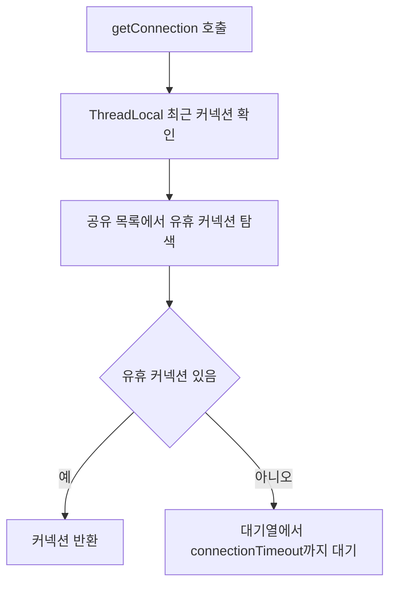

> 커넥션 풀은 크게 잡을수록 빨라질 것 같지만, 실제로는 DB가 동시에 처리할 수 있는 양을 넘기면 대기만 길어집니다. 이 글에서는 HikariCP 풀 크기 공식의 근거와 한계, 풀 고갈을 지표로 진단하는 방법, 중첩 트랜잭션이 만드는 풀 데드락을 정리합니다.

> 기준 환경: Spring Boot 3.1.3, Java 17, HikariCP 5.0.1, PostgreSQL 15.4. 메트릭은 Spring Boot Actuator(Micrometer)로 수집했습니다.
{: .prompt-info }

## 배경

학과 행사 신청 페이지를 토이 프로젝트로 만들어 부하 테스트를 했을 때, 동시 사용자 200명 시점부터 일부 요청이 정확히 30초 뒤에 실패했습니다. 로그에는 아래 예외가 찍혀 있었습니다.

```text
java.sql.SQLTransientConnectionException: HikariPool-1 - Connection is not available, request timed out after 30000ms.
```

처음에는 `maximumPoolSize`를 10에서 100으로 올렸습니다. 실패는 줄었지만 평균 응답 시간은 오히려 늘었고, DB 서버 CPU가 100%에 붙었습니다. 풀 크기는 "요청 수"가 아니라 "DB가 동시에 잘 처리할 수 있는 작업 수"에 맞춰야 한다는 것을 그때 배웠습니다.

## 동작 원리

HikariCP에서 커넥션을 빌리는 흐름은 단순합니다. 스레드가 `getConnection()`을 호출하면 먼저 자기 스레드가 최근 사용한 커넥션 목록(ThreadLocal)을 확인하고, 없으면 공유 목록에서 유휴 커넥션을 찾습니다. 그래도 없으면 대기열에 들어가 `connectionTimeout`(기본 30초)만큼 기다립니다.



이 내부 구조가 `ConcurrentBag`입니다. 대기 중인 스레드 수는 `HikariPoolMXBean.getThreadsAwaitingConnection()`으로 노출되고, Micrometer에서는 `hikaricp.connections.pending` 게이지가 됩니다.

HikariCP 위키의 "About Pool Sizing" 문서는 다음 공식을 출발점으로 제시합니다.

```text
connections = (core_count * 2) + effective_spindle_count
```

DB 서버 코어 수의 두 배에 디스크 수를 더한 값입니다. 근거는 CPU 코어 하나는 한 순간에 한 작업만 처리하므로, 코어 수를 크게 넘는 동시 쿼리는 컨텍스트 스위칭만 늘린다는 것입니다. 디스크 I/O 대기 동안 다른 작업을 끼워 넣을 여유를 spindle 수로 더합니다.

다만 이 공식에는 **한계**가 있습니다. 데이터가 대부분 메모리에 캐시되어 있으면 spindle 항은 0에 가깝고, SSD 환경에서는 "spindle"의 의미가 모호합니다. 또 이 값은 **DB 서버 하나 기준 전체 커넥션 수**라서, 애플리케이션 인스턴스가 4대라면 인스턴스당 풀은 그 값을 나눠 가져야 합니다. 저는 공식을 정답이 아니라 부하 테스트의 시작값으로 사용했습니다.

## 비교와 선택 기준

| 증상 | 지표 | 원인 후보 | 대응 |
| :--- | :--- | :--- | :--- |
| 30초 후 `SQLTransientConnectionException` | `pending` 증가, `active` = 최대치 | 느린 쿼리 또는 긴 트랜잭션 | 쿼리 튜닝, 트랜잭션 범위 축소 |
| 풀을 늘려도 응답 시간 증가 | DB CPU 포화 | 풀이 DB 처리량 초과 | 풀 축소, 쿼리 개선 |
| 모든 요청이 동시에 멈춤 | `active` = 최대, DB 측 쿼리 없음 | 중첩 트랜잭션 풀 데드락 | 풀 크기 재산정, 구조 변경 |
| 커넥션 수가 점점 줄지 않음 | `usage` 시간이 김 | 커넥션 반환 누락 | `leakDetectionThreshold` 설정 |

여기서 세 번째 증상이 제가 실제로 겪은 문제였습니다. 신청 처리 서비스가 `@Transactional` 안에서 감사 로그 저장 메서드를 `@Transactional(propagation = Propagation.REQUIRES_NEW)`로 호출하고 있었습니다. REQUIRES_NEW는 바깥 트랜잭션의 커넥션을 붙잡은 채 **새 커넥션을 하나 더** 빌립니다. 풀이 10개일 때 요청 10개가 동시에 들어와 모두 첫 커넥션을 잡으면, 두 번째 커넥션은 아무도 얻지 못하고 모두 30초 대기 후 실패합니다.

HikariCP 위키는 이 경우의 최소 풀 크기를 다음과 같이 제시합니다.

```text
pool size = Tn x (Cm - 1) + 1
Tn: 최대 동시 스레드 수, Cm: 스레드 하나가 동시에 잡는 최대 커넥션 수
```

스레드 8개가 각각 커넥션 2개를 잡는다면 `8 x (2 - 1) + 1 = 9`개가 있어야 최소한 한 스레드는 끝까지 진행할 수 있습니다.

**풀을 키워서 해결하지 말아야 하는 경우**도 분명합니다. 느린 쿼리나 외부 API 호출을 트랜잭션 안에서 기다리는 코드라면, 풀을 늘리는 것은 대기열 위치를 DB로 옮길 뿐입니다. 이때는 외부 호출을 트랜잭션 밖으로 빼고, REQUIRES_NEW 대신 같은 트랜잭션에서 처리하거나 이벤트로 분리하는 편이 근본 해결입니다.

## 진단과 적용

먼저 설정과 지표 노출을 정리했습니다.

```yaml
# src/main/resources/application.yml
spring:
  datasource:
    hikari:
      maximum-pool-size: 10
      connection-timeout: 3000      # 기본 30초는 장애 감지가 너무 늦음
      leak-detection-threshold: 10000
      pool-name: app-pool
  jpa:
    open-in-view: false             # 요청 전체 동안 커넥션 점유 방지
management:
  endpoints:
    web:
      exposure:
        include: health,metrics
```

부하 테스트 중에는 아래 명령으로 대기 스레드 수와 커넥션 획득 시간을 확인했습니다.

```bash
curl -s localhost:8080/actuator/metrics/hikaricp.connections.pending
curl -s localhost:8080/actuator/metrics/hikaricp.connections.active
curl -s localhost:8080/actuator/metrics/hikaricp.connections.acquire
curl -s localhost:8080/actuator/metrics/hikaricp.connections.timeout
```

풀 데드락은 아래처럼 풀 크기를 2로 줄이고 동시 요청 2개만 보내면 바로 재현됩니다.

```java
// src/main/java/com/example/apply/ApplyService.java
@Service
@RequiredArgsConstructor
public class ApplyService {

    private final ApplicationRepository applicationRepository;
    private final AuditService auditService;

    @Transactional
    public void apply(Long eventId, Long memberId) {
        applicationRepository.save(new Application(eventId, memberId)); // 커넥션 1 점유
        auditService.record("APPLY", memberId);                          // 커넥션 2 요청
    }
}

// src/main/java/com/example/apply/AuditService.java
@Service
@RequiredArgsConstructor
public class AuditService {

    private final AuditLogRepository auditLogRepository;

    @Transactional(propagation = Propagation.REQUIRES_NEW)
    public void record(String action, Long memberId) {
        auditLogRepository.save(new AuditLog(action, memberId));
    }
}
```

DB 쪽에서도 `pg_stat_activity`로 애플리케이션 커넥션이 `idle in transaction` 상태로 머무는지 확인하면, 트랜잭션은 열려 있는데 쿼리는 실행하지 않는 구간을 찾을 수 있습니다. 트랜잭션 안의 잠금 대기가 커넥션 점유 시간을 늘리는 경우는 [행 잠금·갭 락과 데드락 진단](/posts/row-lock-gap-lock-deadlock-diagnosis/)에서 다뤘습니다.

## 운영 함정 및 정리

> 주의: `spring.jpa.open-in-view`는 Spring Boot 기본값이 `true`라서, 컨트롤러가 응답을 렌더링하는 동안에도 커넥션을 반환하지 않습니다. 또 모든 애플리케이션 인스턴스의 `maximumPoolSize` 합계가 DB의 `max_connections`(PostgreSQL 기본 100)를 넘으면 스케일 아웃 시점에 새 인스턴스가 커넥션을 얻지 못합니다. 롤링 배포 중에는 구 버전과 신 버전 인스턴스가 동시에 떠 있으므로 그 순간의 합계까지 계산해야 합니다.
{: .prompt-warning }

풀 크기는 공식으로 시작하고, 지표로 검증하고, 커넥션을 오래 잡는 코드를 줄이는 순서로 다루는 것이 효과적이었습니다.

- [ ] 모든 인스턴스의 풀 합계가 DB `max_connections`보다 충분히 작은가?
- [ ] `hikaricp.connections.pending`과 `acquire` 지표를 대시보드에서 보고 있는가?
- [ ] `connectionTimeout`이 상위 타임아웃보다 짧게 설정되어 있는가?
- [ ] REQUIRES_NEW처럼 한 스레드가 커넥션 두 개를 잡는 경로가 있다면 `Tn x (Cm - 1) + 1`을 만족하는가?
- [ ] 트랜잭션 안에서 외부 API 호출이나 긴 대기 작업을 하지 않는가?
