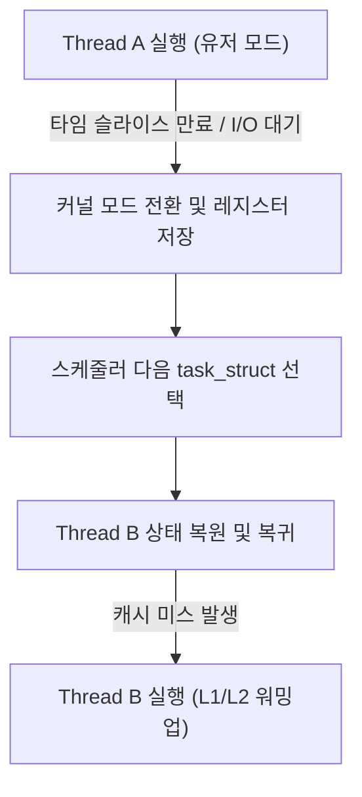

> 리눅스 위에서 동작하는 JVM 프로세스와 OS 스레드의 메모리 구조, 컨텍스트 스위칭 비용, 가상 메모리와 OOM Killer가 서버 성능에 미치는 영향을 정리합니다.

> 본 문서는 Linux Kernel 6.x 및 Java 21 (HotSpot JVM) 환경을 기준으로 작성되었습니다.
{: .prompt-info }

Spring 서버 운영 중 CPU 사용률은 높은데 처리량이 정체되거나, `OutOfMemoryError` 없이 컨테이너가 `Exit Code 137`로 종료되는 장애는 JVM 옵션만으로 원인을 파악하기 어렵습니다. 리눅스 커널의 스레드 스케줄링과 가상 메모리 동작을 함께 봐야 정확히 진단할 수 있습니다.

## JVM 프로세스와 OS 스레드의 메모리 구조

리눅스에서 JVM을 실행하면 커널은 `task_struct`로 표현되는 독립 프로세스와 전용 가상 주소 공간(Code·Data·Heap·Stack)을 할당합니다. 반면 HotSpot JVM의 일반 플랫폼 스레드(`java.lang.Thread`)는 리눅스 `pthread`(NPTL)를 통해 커널 스레드(LWP)와 **1:1로 매핑**됩니다. 커널 내부에서는 스레드도 `task_struct`로 관리되며, `clone()` 시스템 콜의 `CLONE_VM`·`CLONE_FILES` 플래그로 주소 공간과 파일 디스크립터를 공유합니다.

따라서 같은 JVM 내 스레드들은 **Code·Data·Heap(JVM Heap, Metaspace)**을 공유하고, **독립 Stack(`-Xss`)과 CPU 레지스터(PC 포함)**만 개별 보유합니다.

| 구분 | OS 프로세스 (JVM) | OS 스레드 (Java 플랫폼 스레드) |
| :--- | :--- | :--- |
| **역할** | 메모리·FD 자원 할당 단위 | CPU 실행·스케줄링 단위 |
| **주소 공간** | 완전히 독립된 가상 주소 공간 | 부모 프로세스 주소 공간 공유 |
| **공유 영역** | 없음 (별도 IPC 필요) | Code, Data, Heap, 열린 FD |
| **독립 영역** | 전체 메모리 및 레지스터 | Stack(`-Xss`), 레지스터, PC |
| **전환 비용** | 페이지 테이블 교체로 높음 | 주소 공간 공유로 상대적 낮음 |

힙 객체와 커넥션 풀을 복사 없이 공유할 수 있어 멀티 스레드가 유리하지만, 스레드가 과도해지면 동기화 경합과 스케줄링 비용이 급증하는 트레이드오프가 따릅니다.

## 컨텍스트 스위칭의 직접 비용과 간접 비용

실행 가능한 스레드 수가 CPU 코어 수를 초과하면 리눅스 스케줄러(Kernel 6.6+ EEVDF, 이전 CFS)는 타임 슬라이스 만료나 I/O 대기 시 CPU를 다른 스레드에 넘깁니다.



- **직접 비용**: 유저↔커널 모드 전환 후 현재 스레드의 레지스터·스택 포인터를 PCB/TCB(`task_struct`)에 저장하고 다음 스레드 상태를 복원하는 CPU 연산입니다.
- **간접 비용 (실질적 병목)**:
  - **L1/L2 CPU 캐시 콜드 미스**: 새 스레드가 실행되면 기존 핫 데이터가 밀려나고 RAM에서 데이터를 다시 불러오는 캐시 오염이 발생합니다.
  - **TLB Flush**: 프로세스 전환 시 페이지 테이블 기준 레지스터(`CR3`)가 교체되며 가상→물리 주소 캐시인 TLB가 무효화됩니다. 같은 JVM 내 스레드 전환은 주소 공간을 공유해 TLB Flush는 피하지만, L1/L2 캐시 미스와 파이프라인 플러시는 그대로 겪습니다.

## 가상 메모리와 페이지 폴트, 그리고 OOM Killer

리눅스는 프로세스마다 독립된 **가상 메모리**를 부여하고, 하드웨어 **MMU**가 **페이지 테이블**을 참조해 4KB 가상 페이지를 물리 프레임으로 변환합니다. JVM에 `-Xmx4g`를 지정해도 처음부터 RAM 4GB를 점유하지 않고, 실제 접근 시점에 물리 메모리를 할당하는 **요구 페이징(Demand Paging)**으로 동작합니다.

- **Minor Page Fault**: 여유 RAM 프레임이나 페이지 캐시만 매핑하며 디스크 I/O가 없어 빠릅니다.
- **Major Page Fault**: 필요한 페이지가 디스크 스왑 영역에 있어 디스크 읽기가 발생하며 수 밀리초 지연됩니다.

따라서 예약된 가상 크기인 **`VSZ`**보다 실제 물리 메모리 점유량인 **`RSS`**를 모니터링해야 합니다. 리눅스는 메모리 오버커밋을 허용하므로, JVM 힙(`-Xmx`)에 Metaspace·Direct Buffer·스레드 스택 등 네이티브 메모리를 합친 전체 `RSS`가 호스트나 컨테이너 `cgroup` 한도를 넘으면 커널의 **OOM Killer**가 작동합니다. 커널은 메모리 비중과 `oom_score_adj`로 **`oom_score`**를 계산해 점수가 가장 높은 JVM에 `SIGKILL(9)`을 전송합니다. 이때 JVM은 힙 덤프나 에러 로그 없이 즉시 종료되며 **`Exit Code 137`**(`128 + 9`)이 남습니다.

## 리눅스 커널 지표로 JVM 스레드와 메모리 진단하기

CPU 효율 저하나 예기치 않은 종료가 발생하면 아래 커널 지표로 원인을 확인합니다.

```bash
# 1. JVM 프로세스 내 OS 스레드(LWP) 목록과 CPU 코어 배치 확인
ps -eLf | grep java

# 2. 1초 간격 컨텍스트 스위칭 추이 측정 (sysstat 패키지)
pidstat -w -p <JVM_PID> 1 5

# 3. VSZ/RSS, 활성 스레드 수, 누적 컨텍스트 스위칭 조회
grep -E "VmSize|VmRSS|Threads|ctxt_switches" /proc/<JVM_PID>/status

# 4. OOM Killer 강제 종료 로그 확인
dmesg -T | grep -i -E "killed process|out of memory"
```

`voluntary_ctxt_switches`(`cswch/s`)는 I/O나 락 대기로 스스로 CPU를 양보한 횟수이며, **`nonvoluntary_ctxt_switches`(`nvcswch/s`)**는 타임 슬라이스 만료로 강제 선점된 횟수입니다. `nvcswch/s`가 급증하면 코어 대비 스레드가 과도하다는 신호이며, `VmRSS`가 `-Xmx`보다 크게 웃돈다면 네이티브 메모리 누수나 스택 폭증을 의심해야 합니다.

## 운영 환경에서 자주 겪는 스레드와 메모리 함정

> 스레드 풀을 무작정 수천 개로 늘리거나 스왑(Swap)을 켜 둔 채 JVM을 운영하면, CPU 스레싱과 초 단위 GC STW 지연으로 서비스 장애가 발생합니다.
{: .prompt-warning }

**첫째, 스레드 풀 과다 설정과 `-Xss` 스택 폭증입니다.** 리눅스 64비트 HotSpot의 기본 `-Xss`는 1MB이므로 스레드 2,000개만 활성화되어도 스택만으로 최대 2GB의 네이티브 메모리가 소모됩니다. 동시에 `nvcswch/s`와 캐시 미스가 폭증해 처리량이 오히려 떨어지는 **스레싱(Thrashing)**이 나타납니다. CPU 바운드 풀은 `코어 수 + 1` 수준으로 제한하고, I/O 풀도 부하 테스트로 포화 지점을 검증해야 합니다.

**둘째, 스왑(Swap) 영역으로 인한 GC STW 급증입니다.** 유휴 JVM 힙 페이지가 스왑으로 내려간 상태에서 GC 마킹이 전체 힙을 훑으면 **Major Page Fault**가 연쇄 발생해 수십 밀리초짜리 STW가 수 초 이상으로 늘어납니다. 운영 JVM 서버에서는 스왑을 비활성화(`swapoff -a`)하고, `-Xmx`를 컨테이너 메모리 한도의 **70~75% 이내**로 설정해 네이티브 영역과 OS 여유분을 확보하는 것이 안전합니다.
