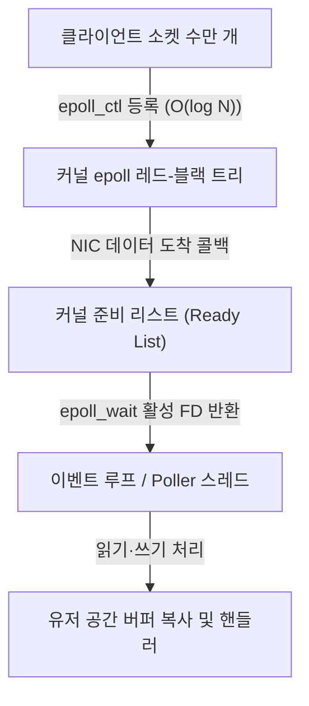

> Blocking·Non-Blocking과 Sync·Async 4가지 모델을 소켓 읽기 흐름으로 구분하고, 리눅스 `epoll`과 Tomcat·Netty 아키텍처 차이를 정리합니다.

> 본 문서는 Linux Kernel 6.x (`epoll`), Java 21, Spring Boot 3.x (Tomcat 10.1 / Reactor Netty) 기준입니다.
{: .prompt-info }

Spring MVC와 WebFlux를 비교할 때 "Tomcat은 Blocking, Netty는 Non-Blocking"으로 오해하기 쉽지만, 실제로는 Tomcat도 리눅스 `epoll`을 사용합니다. 두 서버의 차이는 커널 I/O 모델과 스레드 구조에서 갈립니다.

## Blocking·Non-Blocking과 Sync·Async의 4가지 조합

**Blocking/Non-Blocking**은 커널 호출 시 스레드 제어권을 즉시 돌려주는지 여부이고, **Sync/Async**는 작업 완료를 호출자가 직접 확인하는지 커널이 통지하는지의 차이입니다.

네트워크 소켓 읽기(`read()`)는 **(1) 커널 수신 버퍼에 데이터가 준비될 때까지 대기하는 단계**와 **(2) 커널 버퍼에서 유저 공간 버퍼로 복사하는 단계**로 나뉩니다. Blocking I/O는 두 단계 모두 스레드를 멈추지만, Non-Blocking + `epoll`은 1단계 대기를 커널 이벤트 감시로 위임합니다.

| 조합 | 제어권 반환 | 완료 통지 | 대표 API·사례 |
| :--- | :--- | :--- | :--- |
| **Sync + Blocking** | 완료 후 반환 | 호출자 대기 | `InputStream.read()`, JDBC |
| **Sync + Non-Blocking** | 즉시 (`EAGAIN`) | 호출자 확인 | `O_NONBLOCK` + `epoll`, Java NIO |
| **Async + Blocking** | 대기 발생 | 피호출 통지 | 비동기 호출 후 `Future.get()` |
| **Async + Non-Blocking** | 즉시 반환 | 커널 통지 | Linux `io_uring`, Windows IOCP |

`epoll` 기반 Java NIO·Netty는 알림 후 유저 스레드가 직접 버퍼를 복사하므로 **Sync + Non-Blocking**에 해당합니다.

## I/O 멀티플렉싱의 진화와 리눅스 epoll 내부 구조

연결당 스레드 1개 방식은 동시 접속 1만 건(C10K)에서 메모리와 스위칭 비용으로 무너집니다. 이를 풀기 위해 소수 스레드로 다수 FD를 감시하는 I/O 멀티플렉싱이 발전했습니다.

과거 **`select`/`poll`**은 호출마다 전체 FD 집합을 커널로 복사하고 전체를 **`O(N)` 순회**해야 합니다(`select`는 1,024개 제한). 리눅스 **`epoll`**은 FD 관리를 커널 자료구조로 옮겨 **`O(1)` 이벤트 알림**을 구현합니다.



- **`epoll_create1()`**: 감시 FD를 담는 **레드-블랙 트리**와 준비된 FD만 모으는 **준비 리스트(Ready List)**를 생성합니다.
- **`epoll_ctl()`**: FD를 트리에 한 번만 등록·수정·삭제(`O(log N)`)해 반복 복사를 없앱니다.
- **`epoll_wait()`**: 데이터 도착 시 커널 콜백이 준비 리스트에 FD를 넣으며, 전체 `N`이 아닌 **활성 이벤트 `K`만 `O(1)`로 반환**합니다.

**Level-Triggered(LT, 기본)**는 버퍼에 데이터가 남으면 계속 알림을 보내 안전하며(Java NIO 기본), **Edge-Triggered(ET)**는 상태 변화 시 한 번만 알려 효율적이지만 `EAGAIN`까지 끝까지 읽어야 합니다(Netty 네이티브 `epoll` 지원).

## Tomcat(Spring MVC) vs Netty(Spring WebFlux) 아키텍처 비교

Spring Boot 3.x Tomcat 10.1도 NIO 커넥터로 `epoll` 기반 `Selector`를 씁니다. 결정적 차이는 **이벤트 감지 이후 비즈니스 로직을 실행하는 스레드 모델**입니다.

- **Tomcat (MVC)**: `Acceptor`와 `Poller`(`epoll`)로 이벤트를 감지한 뒤, 실제 요청과 DB 조회는 **워커 스레드 풀(기본 `max-threads: 200`)**에서 **Thread-per-Request**로 처리합니다.
- **Netty (WebFlux)**: `Boss`가 연결을 받고, CPU 코어 수 기반 소수 **`Worker EventLoopGroup`**이 `epoll` 감지부터 논블로킹 파이프라인(R2DBC, `WebClient`)까지 전담합니다.

| 구분 | Tomcat (Spring MVC) | Netty (Spring WebFlux) |
| :--- | :--- | :--- |
| **멀티플렉싱** | NIO `Poller` (`epoll`) | `EventLoop` (`epoll`) |
| **처리 모델** | Thread-per-Request | Non-Blocking 파이프라인 |
| **기본 스레드** | `threads.max: 200` | CPU 코어 수 기반 소수 |
| **적합 용도** | JPA/JDBC CRUD, 트랜잭션 | 게이트웨이, 스트리밍, 대량 I/O |

JPA/JDBC 중심 서비스는 디버깅과 생산성이 높은 Tomcat + MVC가 실용적이며, 대규모 동시 연결과 I/O Fan-out이 집중되는 게이트웨이에서는 Netty가 유리합니다.

## Spring Boot 스레드 설정과 리눅스 소켓 상태 점검

Tomcat은 유휴 Keep-Alive 연결 한도(`max-connections`)와 요청 처리 워커 수(`threads.max`)를 분리해 관리합니다.

```yaml
# src/main/resources/application.yml
server:
  tomcat:
    threads:
      max: 200            # 요청 처리 워커 스레드 최대 수 (기본값 200)
      min-spare: 10       # 최소 유휴 워커 스레드
    max-connections: 8192 # Poller(epoll) 최대 TCP 연결 수
    accept-count: 100     # max-connections 초과 시 OS 백로그 큐 한도
```

리눅스에서는 `ss`와 `/proc`로 백로그 큐와 `epoll` FD를 즉시 점검할 수 있습니다.

```bash
# 1. 8080 포트 리스닝 백로그 큐(Recv-Q / Send-Q) 확인
ss -lnt | grep 8080

# 2. 현재 수립된 ESTABLISHED TCP 연결 수
ss -ant state established '( sport = :8080 )' | wc -l

# 3. JVM의 커널 epoll 인스턴스 FD 확인
ls -l /proc/<JVM_PID>/fd | grep anon_inode:eventpoll
```

`Recv-Q`가 `Send-Q`에 근접하면 연결 수락이 밀려 타임아웃이나 패킷 드롭이 시작되는 신호입니다.

## 운영 함정: Netty EventLoop 블로킹과 기아 현상

> Netty(WebFlux) `EventLoop`에서 `Thread.sleep()`, 동기 JDBC/JPA, `Mono.block()`을 호출하면 서버 전체가 응답 불능에 빠집니다.
{: .prompt-warning }

4코어 컨테이너의 Netty는 보통 4개의 `EventLoop` 스레드가 수천 개 소켓을 순환 처리합니다. 핸들러에서 3초 걸리는 JDBC나 `Thread.sleep(3000)`을 실행하면 해당 스레드가 `epoll_wait()`로 돌아가지 못합니다. 동시 요청 4건만으로 모든 `EventLoop`가 멈추어 헬스 체크와 수천 개의 정상 요청까지 타임아웃되는 **EventLoop 기아(Starvation) 현상**이 터집니다.

```kotlin
// src/main/kotlin/com/example/profile/LegacyProfileService.kt
// 불가피한 Blocking 호출은 전용 스케줄러 스레드 풀로 격리
fun loadLegacyProfile(userId: Long): Mono<UserProfile> =
    Mono.fromCallable { legacyJdbcRepository.findById(userId) }
        .subscribeOn(Schedulers.boundedElastic())
```

레거시 Blocking 코드는 `Schedulers.boundedElastic()`으로 격리하고 테스트에 **BlockHound**를 붙여 사전 차단해야 합니다. 반면 Tomcat에서는 외부 지연으로 워커 200개가 묶이는 **스레드 풀 고갈**을 막기 위해 모든 클라이언트·DB에 엄격한 Connect·Read 타임아웃을 설정해야 합니다.
