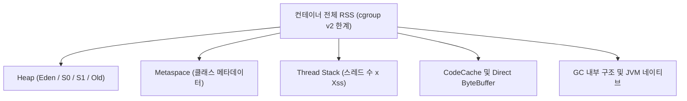

> Docker 컨테이너에 메모리 1GB를 할당하고 힙을 800MB로 설정했을 때 JVM 예외 없이 `OOMKilled(137)`가 발생하는 원인은 힙 바깥의 네이티브 메모리에 있습니다. 이 글에서는 HotSpot JVM 런타임 메모리 지도, 주요 `OutOfMemoryError` 유형별 진단 명령, 컨테이너 힙 산정 기준과 운영 함정을 정리합니다.

> 본 문서는 **Java 21 LTS (Eclipse Temurin / OpenJDK HotSpot JVM)**와 **Linux cgroup v2 / Docker** 환경을 기준으로 작성되었습니다.
{: .prompt-info }

## HotSpot JVM 런타임 메모리 전체 지도

JVM 메모리는 크게 가비지 컬렉터가 관리하는 **Heap**과 OS 네이티브 공간에 잡히는 **Non-Heap/Native 영역**으로 나뉩니다. Heap은 신규 객체가 할당되는 **Young Generation**(Eden, Survivor S0/S1)과 장기 생존 객체가 승격되는 **Old Generation**으로 구성됩니다.

Non-Heap 및 Native 영역에는 클래스 메타데이터를 담는 **Metaspace**, 스레드별 호출 프레임을 저장하는 **Thread Stack**, JIT 기계어 코드를 캐싱하는 **CodeCache**, NIO·Netty가 커널과 직접 통신하는 **Direct ByteBuffer**, 그리고 GC 내부 구조(Card Table, Remembered Set 등)가 자리합니다.



## 1GB 컨테이너에 힙 800MB를 주면 OOMKilled(137)가 나는 이유

실무에서 1GB 컨테이너에 `-Xmx800m`을 주면 트래픽 유입 시 JVM 예외 로그 없이 프로세스가 **Exit Code 137 (`OOMKilled`)**로 강제 종료되는 장애를 자주 겪습니다. JVM은 힙이 `-Xmx`를 넘을 때만 `OutOfMemoryError`를 던지지만, Linux 커널 OOM Killer는 cgroup v2 한계(`memory.max`)를 프로세스의 **전체 RSS**로 판단하기 때문입니다.

- `Total RSS ≈ Heap + Metaspace + (Thread Stack × 스레드 수) + CodeCache + Direct ByteBuffer + GC·네이티브 오버헤드`

Spring Boot 앱이 힙을 800MB까지 채운 상태에서 Metaspace 120MB, 스레드 150개의 커밋 스택 약 60MB, CodeCache 80MB, Direct Buffer 64MB, G1GC 내부 오버헤드 80MB가 더해지면 총 RSS는 1,200MB를 넘깁니다. 힙은 아직 여유가 있더라도 컨테이너 한계(1,024MB)를 초과하는 순간 커널이 `SIGKILL(9)`로 프로세스를 즉시 종료합니다(`128 + 9 = 137`).

## OutOfMemoryError 유형별 원인과 진단 도구

커널 OOMKill과 달리 JVM 내부 영역 한계를 넘으면 상세 메시지와 함께 `OutOfMemoryError`가 발생합니다.

| OOM 메시지 | 발생 영역 | 주요 원인 | 1차 조치 |
| :--- | :--- | :--- | :--- |
| `Java heap space` | Heap | 컬렉션 누수, 대량 조회, 힙 부족 | 힙 덤프 분석 및 `-Xmx` 조정 |
| `Metaspace` | Native (Metaspace) | 동적 프록시 과다 생성, 클래스로더 누수 | 누수 점검 및 `MaxMetaspaceSize` 설정 |
| `Direct buffer memory` | Direct Buffer | Netty/NIO 버퍼 미해제 또는 상한 부족 | `release()` 점검 및 `MaxDirectMemorySize` 조정 |
| `unable to create native thread` | OS 스레드 | 스레드 풀 무제한 생성, OS 메모리·`nproc` 한계 | 스레드 수 제한, `-Xss` 축소 또는 증설 |
| `GC overhead limit exceeded` | Heap / GC | 실행 시간 98% 이상 GC 후 2% 미만 회수 | 객체 할당·누수 점검 및 힙 재산정 |

원인이 Heap인지 Native인지 가리려면 `-XX:NativeMemoryTracking=summary`를 켜고 `jcmd`로 영역별 `committed` 메모리를 실측해야 합니다.

```bash
# 1. NMT와 OOM 힙 덤프 활성화 기동
java -XX:NativeMemoryTracking=summary \
  -XX:+HeapDumpOnOutOfMemoryError \
  -XX:HeapDumpPath=/var/log/jvm/heapdump.hprof \
  -jar app.jar

# 2. 전체 영역별 reserved / committed 조회 및 누수 증분 비교
jcmd <pid> VM.native_memory summary scale=MB
jcmd <pid> VM.native_memory baseline
jcmd <pid> VM.native_memory summary.diff scale=MB

# 3. 라이브 힙 덤프 수동 추출 (STW 유발, 트래픽 차단 후 수행)
jmap -dump:live,format=b,file=/tmp/live-heap.hprof <pid>
```

## 컨테이너 환경 JVM 힙 산정 기준과 권장 옵션

Java 21은 `-XX:+UseContainerSupport`가 기본 활성화되어 cgroup v2 한계를 자동 인식합니다. 이때 `-XX:MaxRAMPercentage=70.0`과 `-Xms`/`-Xmx` 고정 방식 사이에는 명확한 트레이드오프가 있습니다.

비율 지정은 컨테이너 스펙 변경에 유연하지만 1GB 이하 소형 컨테이너에서는 남은 30%(300MB)로 Non-Heap을 버티기 빠듯합니다. 반면 4GB 이상 대형 컨테이너에서는 Non-Heap 비중이 상대적으로 줄어 70~75% 배정이 안정적입니다. 실무에서는 **Non-Heap 고정분(Spring Boot 기준 350~512MB)을 먼저 뺀 뒤 나머지를 힙에 배정**하는 역산 방식이 안전합니다. 예를 들어 1GB 컨테이너는 512MB, 2GB 컨테이너는 60~65%(약 1.2GB), 4GB 이상은 70% 수준에서 시작해 NMT 실측치로 보정합니다.

```dockerfile
# Dockerfile (Eclipse Temurin Java 21 / 2GB 컨테이너 권장 예시)
FROM eclipse-temurin:21-jre-jammy
WORKDIR /app
COPY build/libs/app.jar app.jar

ENV JAVA_OPTS="\
  -XX:InitialRAMPercentage=65.0 \
  -XX:MaxRAMPercentage=65.0 \
  -XX:MaxMetaspaceSize=256m \
  -XX:MaxDirectMemorySize=128m \
  -XX:ReservedCodeCacheSize=128m \
  -XX:NativeMemoryTracking=summary \
  -XX:+HeapDumpOnOutOfMemoryError \
  -XX:HeapDumpPath=/var/log/jvm/heapdump.hprof \
  -XX:+ExitOnOutOfMemoryError"

ENTRYPOINT ["sh", "-c", "exec java $JAVA_OPTS -jar /app/app.jar"]
```

`MaxMetaspaceSize`와 `MaxDirectMemorySize`에 상한을 명시해 두면 커널 OOMKill로 침묵 종료되기 전에 JVM이 명확한 예외를 남기고 종료하도록 유도할 수 있습니다.

## 운영 환경에서 자주 겪는 메모리 함정

> 주의: 초기 힙을 고정하지 않거나 Direct Memory 상한을 비워 두면 평시에는 정상이다가 피크 트래픽 순간에만 OOMKilled가 반복됩니다.
{: .prompt-warning }

첫째, **초기 힙(`-Xms` 또는 `InitialRAMPercentage`) 미고정**은 트래픽 급증 시 힙 리사이징과 페이지 폴트를 동반해 응답 지연을 키웁니다. 더 위험한 점은 메모리 예산 초과가 기동 시점이 아닌 피크 구간에 뒤늦게 터진다는 사실입니다. 컨테이너 전용 서비스라면 초기 힙과 최대 힙을 동일하게 맞추는 편이 안전합니다.

둘째, **Netty·NIO 기반 Direct Memory 누수**입니다. Spring WebFlux, Lettuce, gRPC 환경에서 `ByteBuf` 해제가 누락되거나 GC 주기가 길어져 `Cleaner` 정리가 지연되면 힙은 안정적인데 RSS만 치솟습니다. 특히 `-XX:MaxDirectMemorySize` 미지정 시 기본값이 `-Xmx`와 같아 컨테이너 메모리를 순식간에 초과하므로 상한 지정이 필수입니다.

컨테이너 JVM 메모리 튜닝의 핵심은 힙 비율을 감으로 정하지 않고, 전체 RSS 구성을 NMT로 실측해 Non-Heap 상한과 함께 예산을 통제하는 데 있습니다.
