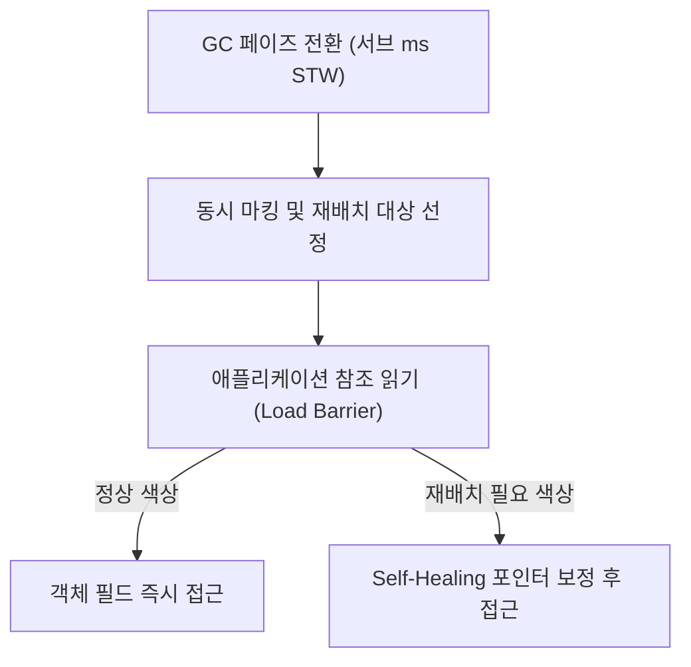

> JVM 가비지 컬렉션(GC)의 Stop-The-World(STW)는 백엔드 API의 p99 지연시간 스파이크를 만드는 대표 원인입니다. 이 글에서는 약한 세대 가설과 Safepoint 내부 원리를 짚고, 기본 GC인 G1GC와 Java 21 Generational ZGC의 구조적 차이와 운영 주의사항을 비교 정리합니다.

> 본 문서는 **Java 21 LTS (Eclipse Temurin / OpenJDK HotSpot JVM, JEP 439 Generational ZGC)** 환경을 기준으로 작성되었습니다.
{: .prompt-info }

## 약한 세대 가설과 Reachability 및 Safepoint 원리

현대 JVM GC는 **약한 세대 가설(Weak Generational Hypothesis)**에 기반합니다. 대부분 객체는 요청 처리 직후 곧바로 수명을 다하고, 오래 살아남은 객체가 젊은 객체를 참조하는 비율은 매우 낮다는 전제입니다. 덕분에 힙을 Young과 Old 세대로 분리해 Young만 짧고 자주 회수하는 방식이 높은 효율을 냅니다.

생존 객체 판별은 **Reachability Analysis**로 수행합니다. 스레드 스택의 지역 변수, `static` 필드, JNI 전역 참조 등을 **GC Root**로 삼아 참조 그래프를 탐색하고, 도달 불가능한 객체를 회수 대상으로 분류합니다.

GC가 루트와 참조를 안전하게 스캔하려면 모든 애플리케이션 스레드를 멈추는 **Stop-The-World(STW)**가 필요합니다. HotSpot JVM은 메서드 종료나 루프 백엣지처럼 참조 지도(OopMap)가 유효한 **Safepoint**에 모든 스레드가 도달할 때까지 대기합니다. 실무에서는 GC 자체 시간보다 특정 스레드가 `int` 기반 긴 Counted Loop나 페이지 폴트에 걸려 멈추지 못하는 **Time-To-Safepoint(TTSP)** 지연이 스파이크의 숨은 원인인 경우가 많습니다.

## G1GC의 Region 분할과 Mixed GC 동작 구조

Java 9+ 기본 GC인 **G1GC(Garbage-First)**는 힙을 1MB~32MB 고정 크기의 논리적 **Region**으로 나누어 Eden, Survivor, Old, Humongous 역할을 동적 배정합니다.

Young GC 때 Old 전체를 뒤지지 않기 위해 힙을 512바이트 카드로 나눈 **Card Table**과, 각 Region이 자신을 참조하는 외부 카드를 기록하는 **Remembered Set(RSet)**을 유지합니다. 참조 변경 시 Write Barrier가 카드를 갱신하므로 Young GC는 RSet만 스캔해 Old→Young 참조를 빠르게 추적합니다.

수집 흐름은 세 단계입니다. 평소 짧은 STW로 **Young GC**를 수행하다가 힙 점유율이 IHOP 임계치에 도달하면 애플리케이션과 동시에 **Concurrent Mark**를 돌려 Old Region별 가비지 비율을 산출합니다. 이어 회수 효율이 높은 Old Region을 선별해 Young과 함께 정리하는 **Mixed GC**를 수행합니다. `-XX:MaxGCPauseMillis`(기본 200ms)는 하드 리밋이 아닌 소프트 목표치로, G1GC는 이에 맞춰 Young 크기와 대상 Region 수를 동적 조절합니다.

## Java 21 Generational ZGC와 서브 밀리초 STW 원리

G1GC는 객체 이동(Compaction)을 STW 안에서 수행하므로 힙이 커질수록 정지 시간이 늘어납니다. 기존 단일 세대 ZGC는 객체 이동을 동시 수행해 서브 밀리초 STW를 달성했지만, 매번 전체 힙을 스캔해 할당률이 높은 서비스에서는 CPU·메모리 오버헤드가 컸습니다.

**Java 21 JEP 439로 도입된 Generational ZGC**(`-XX:+UseZGC -XX:+ZGenerational`)는 ZGC에 세대 분리를 결합해 단명 객체를 Young에서 가볍게 회수함으로써 할당률과 메모리 오버헤드를 대폭 낮췄습니다(Java 23 JEP 474에서 기본 모드 승격).

핵심 원리는 **Colored Pointer**와 **Load Barrier**입니다. 64비트 참조 포인터의 상위 비트에 마킹·재배치 상태(색상)를 인코딩하고, 애플리케이션이 참조를 읽을 때 Load Barrier가 색상을 검사합니다.



이동 중인 객체를 읽으면 Load Barrier가 포워딩 테이블을 참조해 새 주소로 옮기고 포인터를 즉시 갱신(**Self-Healing**)합니다. 덕분에 객체 이동까지 동시 처리되며 STW는 힙 크기와 무관하게 1ms 미만으로 유지됩니다.

## G1GC vs Generational ZGC 비교와 선택 기준

| 비교 항목 | G1GC (기본값) | Generational ZGC (Java 21) |
| :--- | :--- | :--- |
| **STW 지연시간** | 수십~200ms (`MaxGCPauseMillis` 목표) | 1ms 미만 (서브 밀리초, 힙 크기 무관) |
| **처리량 (Throughput)** | 높음 (Write Barrier 비용 낮음) | G1GC 대비 소폭 낮음 (동시 배리어 수행) |
| **메모리·CPU 오버헤드** | 낮음~보통 (RSet 사용) | 높음 (충분한 힙 헤드룸·CPU 코어 필요) |
| **Java 21 활성화** | 기본 적용 (`-XX:+UseG1GC`) | `-XX:+UseZGC -XX:+ZGenerational` |
| **적합한 워크로드** | 일반 API, 배치, 소형 컨테이너(2GB 이하) | p99 SLA가 엄격한 실시간 API·캐시(4GB 이상) |

CPU 코어가 적고 메모리가 2GB 이하인 소형 컨테이너에서는 **G1GC**가 처리량과 효율 면에서 유리합니다. 반대로 힙 4GB 이상, CPU 코어 여유가 있고 p99/p999 지연시간 제어가 중요한 서비스라면 **Generational ZGC** 전환 효과가 큽니다. 적용 전후는 Unified GC 로그와 `jstat`으로 반드시 검증합니다.

```bash
# 1. Generational ZGC 활성화 및 Unified GC·Safepoint 로그 출력
java -Xms4g -Xmx4g \
  -XX:+UseZGC -XX:+ZGenerational \
  -Xlog:gc*,safepoint:stdout:time,uptime,level,tags \
  -jar app.jar

# 2. 실행 중인 JVM의 세대별 점유율·GC 횟수 1초 단위 관측
jstat -gcutil <pid> 1000
```

## 운영 환경 GC 튜닝 시 주의해야 할 함정

> 주의: G1GC의 대형 객체 할당과 ZGC의 힙 헤드룸 부족은 각각 Full GC와 Allocation Stall이라는 치명적 지연으로 이어집니다.
{: .prompt-warning }

첫째, **G1GC의 Humongous Object 할당**입니다. 단일 객체(대형 `byte[]`, 거대한 JSON 등)가 Region 크기의 50%를 넘으면 Eden 대신 연속된 Old Region(Humongous Region)에 직접 할당됩니다. 빈번하면 단편화로 Full GC가 유발되므로 `-XX:G1HeapRegionSize`를 높이거나 스트리밍 파싱으로 대형 할당을 줄여야 합니다.

둘째, **Generational ZGC의 Allocation Stall**입니다. 애플리케이션의 객체 할당 속도를 백그라운드 GC 스레드가 따라잡지 못해 힙 여유가 바닥나면 할당 스레드가 강제로 멈춥니다. ZGC 운영 시에는 20~30% 이상의 힙 여유와 충분한 CPU 코어를 확보하고, 로그에서 `Allocation Stall` 0건을 확인해야 합니다.

GC 선택은 유행이 아니라 지연시간 목표와 인프라 여유에 따라 결정해야 합니다. Unified 로그로 TTSP와 할당 패턴을 측정한 뒤 G1GC와 Generational ZGC 중 적합한 방식을 고르는 것이 가장 확실합니다.
