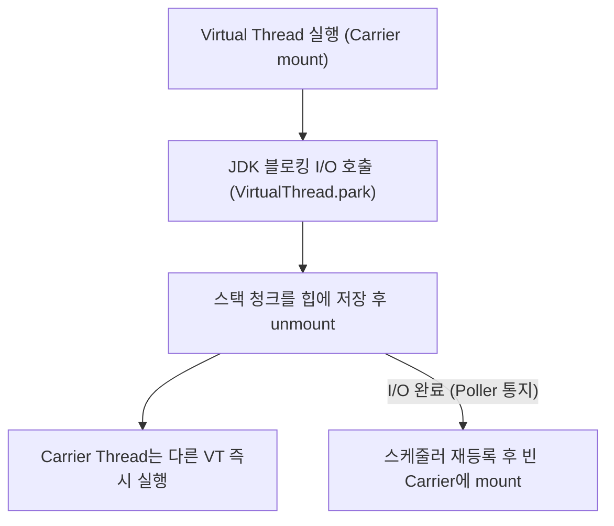

> Java 21의 Virtual Threads(JEP 444)는 기존 동기식 블로킹 코드를 유지하면서도 수만 건의 동시 I/O를 처리하게 해 주는 경량 스레드 모델입니다. 이 글에서는 Carrier Thread와 Continuation 기반 내부 스케줄링 원리, `synchronized` Pinning 함정 대응, Spring Boot 3.2+ 적용 기준을 정리합니다.

> 본 문서는 **Java 21 LTS (JEP 444 Virtual Threads)**와 **Spring Boot 3.2+ (Kotlin 1.9 / Java 21)** 환경을 기준으로 작성되었습니다.
{: .prompt-info }

## Platform Thread의 I/O 병목과 Virtual Threads 도입 배경

기존 Spring MVC(Tomcat)의 Thread-per-Request 모델은 요청 하나에 OS 커널 스레드와 1:1 매핑되는 **Platform Thread**를 배정합니다. 코드가 직관적이고 스택 트레이스가 깔끔하지만, 스레드당 기본 약 1MB 스택과 OS 컨텍스트 스위칭 비용 때문에 보통 200개 내외로 풀을 제한합니다.

문제는 백엔드 요청 대부분이 CPU 연산이 아니라 DB 쿼리나 외부 API 응답을 기다리는 **블로킹 I/O 대기**라는 점입니다. OS 스레드 200개가 모두 응답을 기다리면 CPU는 한가한데도 신규 요청은 큐에서 타임아웃됩니다. Spring WebFlux 같은 리액티브 모델이 대안이지만 학습 곡선, 디버깅 난이도, JDBC 호환성 제약이 큽니다. **Virtual Threads**는 JVM이 관리하는 **M:N 유저 모드 경량 스레드**로, 동기식 코드 스타일을 지키면서도 I/O 동시성을 크게 끌어올립니다.

## Carrier Thread와 Continuation 내부 스케줄링 원리

Virtual Thread는 OS가 아니라 JVM의 FIFO 모드 `ForkJoinPool`(기본 워커 수 = CPU 코어 수)이 스케줄링합니다. 실제 CPU를 점유해 코드를 실행하는 Platform Thread를 **Carrier Thread**라 하며, 각 Virtual Thread의 호출 스택(`StackChunk`)은 `Continuation` 단위로 **JVM 힙 영역**에 저장·복원됩니다.

Virtual Thread가 Carrier에 올라타 실행(`mount`)되다가 소켓 I/O나 `Thread.sleep()` 같은 JDK 표준 블로킹 호출을 만나면 `VirtualThread.park()`가 동작합니다. 이때 `Continuation` 스택 청크를 힙에 저장한 뒤 Carrier에서 내려오고(`unmount`), I/O 완료 감시는 내부 `Poller`(epoll/kqueue)에 넘깁니다.



비워진 Carrier Thread는 즉시 큐의 다른 Virtual Thread를 `mount`해 실행하고, 이후 I/O가 끝나면 `Poller`가 해당 Virtual Thread를 다시 스케줄러에 제출해 이어서 실행합니다.

## Platform Thread vs Virtual Thread vs WebFlux 비교

| 비교 항목 | Platform Thread (MVC) | Virtual Thread (Java 21+) | Reactive (WebFlux) |
| :--- | :--- | :--- | :--- |
| **스레드 매핑** | OS 1:1 (커널 스케줄링) | M:N (`ForkJoinPool` 스케줄링) | 소수 이벤트 루프 (논블로킹) |
| **스택·생성 비용** | 높음 (약 1MB 고정 스택) | 매우 낮음 (수 KB 힙 `StackChunk`) | 스레드 추가 생성 없음 |
| **블로킹 I/O 처리** | OS 스레드 점유로 병목 | 자동 `unmount`로 고동시성 확보 | 블로킹 시 이벤트 루프 장애 |
| **코드·디버깅 난이도** | 낮음 (동기식, 완전한 스택) | 낮음 (기존 동기식 유지) | 높음 (비동기 체이닝·추적 복잡) |
| **적합한 워크로드** | 저동시성 사내·관리 API | 외부 API·DB I/O 비중이 큰 MVC | 초고밀도 스트리밍·게이트웨이 |

리틀의 법칙(`처리량 = 동시성 / 지연시간`)처럼 Virtual Thread는 단일 요청을 더 빨리 끝내는 기술이 아니라, I/O 대기 중 동시성 상한을 넓혀 처리량을 높이는 도구입니다.

## synchronized Pinning 함정과 진단 및 ReentrantLock 전환

Java 21에서 가장 주의할 제약은 **Pinning(고정)**입니다. Virtual Thread가 `synchronized` 블록(모니터 락) 내부나 JNI 프레임에서 블로킹 I/O를 호출하면 JVM이 모니터 소유권을 Carrier와 분리하지 못해 `unmount`가 차단됩니다. 4코어 서버에서 4개 요청이 동시에 Pinning되면 모든 Carrier가 묶여 처리량이 급락합니다.

진단은 `-Djdk.tracePinnedThreads=full` 옵션이나 JFR(`jdk.VirtualThreadPinned`) 이벤트로 수행합니다. Java 21에서는 I/O가 포함된 임계 구역을 `ReentrantLock`으로 대체하면 정상적으로 `unmount`됩니다. 참고로 이후 **Java 24(JEP 491)**에서 `synchronized` Pinning이 JVM 차원에서 해소되었으나, Java 21 LTS 운영 시에는 사내 코드와 구버전 JDBC 드라이버 점검이 필수입니다.

```bash
# Pinning 발생 지점의 전체 스택 트레이스 진단
java -Djdk.tracePinnedThreads=full -jar app.jar
```

Spring Boot 3.2+에서는 `application.yml` 한 줄로 Tomcat과 `@Async`에 Virtual Threads를 적용할 수 있습니다.

```yaml
# src/main/resources/application.yml
spring:
  threads:
    virtual:
      enabled: true
```

병렬 외부 호출 시에는 스레드 풀 대신 `Executors.newVirtualThreadPerTaskExecutor()`와 `ReentrantLock`, 동시성 상한 제어용 `Semaphore`를 조합합니다.

```kotlin
// src/main/kotlin/com/example/demo/VirtualThreadClient.kt
package com.example.demo

import java.net.URI
import java.net.http.HttpClient
import java.net.http.HttpRequest
import java.net.http.HttpResponse
import java.time.Duration
import java.util.concurrent.Executors
import java.util.concurrent.Semaphore
import java.util.concurrent.locks.ReentrantLock
import kotlin.concurrent.withLock

class VirtualThreadClient {
    private val httpClient = HttpClient.newBuilder()
        .connectTimeout(Duration.ofSeconds(3))
        .build()

    private val cacheLock = ReentrantLock()
    private val tokenCache = mutableMapOf<String, String>()
    private val concurrencyLimit = Semaphore(50)

    fun fetchAll(urls: List<String>): List<String> {
        Executors.newVirtualThreadPerTaskExecutor().use { executor ->
            val futures = urls.map { url ->
                executor.submit<String> {
                    concurrencyLimit.acquire()
                    try {
                        callExternalApi(url)
                    } finally {
                        concurrencyLimit.release()
                    }
                }
            }
            return futures.map { it.get() }
        }
    }

    private fun callExternalApi(url: String): String {
        val token = cacheLock.withLock {
            // 락 내부에서 토큰 발급 I/O가 발생해도 ReentrantLock은 Carrier에서 정상 unmount됨
            tokenCache.getOrPut("api") { fetchAccessToken() }
        }
        val request = HttpRequest.newBuilder()
            .uri(URI.create(url))
            .header("Authorization", token)
            .GET()
            .build()
        return httpClient.send(request, HttpResponse.BodyHandlers.ofString()).body()
    }

    private fun fetchAccessToken(): String {
        val req = HttpRequest.newBuilder()
            .uri(URI.create("https://auth.example.com/oauth/token"))
            .POST(HttpRequest.BodyPublishers.noBody())
            .build()
        return httpClient.send(req, HttpResponse.BodyHandlers.ofString()).body()
    }
}
```

## 프로덕션 도입 시 피해야 할 운영 함정

> 주의: 설정 한 줄로 Virtual Threads를 켠 뒤 기존 스레드 풀·`ThreadLocal` 습관을 그대로 두면 힙 폭발이나 다운스트림 장애로 이어질 수 있습니다.
{: .prompt-warning }

첫째, **Virtual Thread는 풀링(Pooling)하지 않습니다.** 생성 비용이 극히 낮으므로 작업당 새로 생성해야 하며, 외부 API 보호를 위한 동시성 제한은 스레드 풀이 아니라 `Semaphore`로 제어해야 합니다.

둘째, **`ThreadLocal` 대량 객체 캐싱은 힙 폭발의 원인**입니다. Platform Thread 200개에서는 무리 없던 버퍼·파서 캐싱도 Virtual Thread 5만 개에서는 5만 개의 사본이 쌓여 OOM을 유발합니다. 무거운 캐싱을 제거하고 불변 컨텍스트 전파가 필요하면 `ScopedValue`(Java 21 Preview) 방향으로 전환하는 것이 안전합니다.

셋째, **CPU 바운드 연산과 DB 커넥션 풀 병목에는 효과가 없습니다.** 암호화·연산 위주 작업은 코어 수 이상으로 늘려도 빨라지지 않으며, HikariCP 커넥션 풀이 10개라면 Virtual Thread 수천 개가 결국 커넥션 대기열에서 막힙니다. 도입 전 Pinning 진단과 함께 다운스트림 커넥션·Rate Limit 상한을 반드시 함께 설계해야 합니다.
