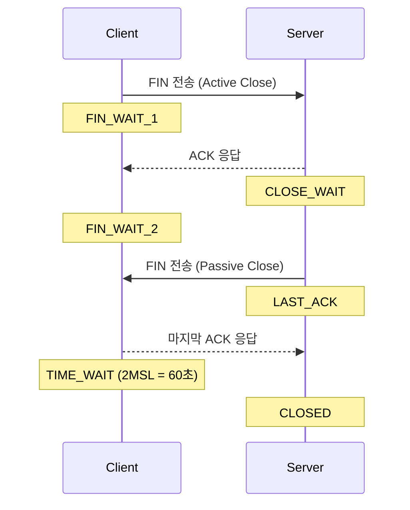

> 외부 API 호출이 몰릴 때 발생하는 `Cannot assign requested address` 오류와 응답 지연은 TCP 연결 수명주기와 커넥션 미재사용에서 비롯됩니다. 이 글에서는 TCP 핸드셰이크의 커널 큐 동작, `TIME_WAIT`가 2MSL 동안 유지되는 이유, 임시 포트 고갈 진단과 커넥션 풀 해결 방법을 정리합니다.

> 기준 환경: RFC 9293(TCP), Linux Kernel 6.x, Spring Boot 3.x / Java 21
{: .prompt-info }

## TCP 3-Way Handshake와 커널 큐 구조

TCP는 양방향 시퀀스 번호(ISN)를 동기화하기 위해 `SYN` → `SYN-ACK` → `ACK` 3단계 핸드셰이크를 거쳐 `ESTABLISHED` 상태에 진입합니다. 리눅스 커널 내부에서는 리스닝 소켓 뒤에 두 개의 큐가 이 과정을 처리합니다.

1. **SYN Queue**: 서버가 `SYN`을 받고 `SYN-ACK`를 보낸 `SYN_RECV` 연결이 대기하는 큐입니다(`net.ipv4.tcp_max_syn_backlog` 영향).
2. **Accept Queue**: 최종 `ACK`가 도착해 연결이 수립된 소켓이 이동하는 큐입니다. 크기는 `min(backlog, net.core.somaxconn)`로 제한되며, 서버 프로세스가 `accept()`를 호출할 때 비로소 소비됩니다.

트래픽 폭주로 Accept Queue가 가득 차면 리눅스 기본값(`tcp_abort_on_overflow = 0`)에서는 커널이 최종 `ACK`를 조용히 드롭합니다. 서버가 `SYN-ACK`를 지수 백오프(1초, 2초, 4초)로 재전송하면서 수 초 단위의 응답 지연이 발생합니다.

## 4-Way Handshake와 TIME_WAIT가 2MSL을 유지하는 이유

연결 종료 시에는 양방향 스트림을 각각 닫는 4-Way Handshake를 수행합니다. 먼저 `FIN`을 보내는 쪽이 **Active Close**, 수신하는 쪽이 **Passive Close**입니다.



Active Close 측이 마지막 `ACK`를 보낸 뒤 즉시 닫히지 않고 **`TIME_WAIT`** 상태로 **2MSL**(리눅스 커널 `TCP_TIMEWAIT_LEN = 60초` 고정)을 기다리는 이유는 두 가지입니다.

- **마지막 ACK 유실 대비**: 마지막 `ACK`가 유실되면 `LAST_ACK` 상태의 상대가 `FIN`을 재전송합니다. 소켓이 이미 닫혀 있으면 `RST`를 반환해 비정상 종료가 되므로, 재전송된 `FIN`에 `ACK`를 다시 보낼 시간을 확보합니다.
- **지연 패킷 혼선 방지**: 같은 4-Tuple(출발지/목적지 IP·Port)로 새 연결을 곧바로 열었을 때, 이전 연결의 지연 패킷이 뒤늦게 도착해 새 스트림 데이터를 오염시키는 현상을 차단합니다.

실무에서 자주 혼동하는 `TIME_WAIT`와 `CLOSE_WAIT`는 원인과 대응이 정반대입니다.

| 구분 | TIME_WAIT | CLOSE_WAIT |
| :--- | :--- | :--- |
| 발생 주체 | Active Close (먼저 종료 요청) | Passive Close (`FIN` 수신 측) |
| 발생 원인 | TCP 정상 종료 보호 절차 | 애플리케이션 `close()` 누락 |
| 유지 시간 | 2MSL (리눅스 60초) 후 자동 회수 | 프로세스 종료 전까지 무한 잔류 |
| 장애 증상 | 임시 포트(Ephemeral Port) 고갈 | 파일 디스크립터(FD) 고갈 |
| 우선 대응 | HTTP Keep-Alive·커넥션 풀 | 스트림 해제 코드·타임아웃 수정 |

## 임시 포트 고갈 진단과 리눅스 커널 확인

외부 API를 대량 호출하는 백엔드 서버는 Active Close 주체가 되기 쉽습니다. 리눅스 아웃바운드 연결은 `net.ipv4.ip_local_port_range`(기본 `32768 60999`, 약 28,232개)에서 임시 포트를 할당받습니다. 매 요청마다 새 연결을 맺고 끊는 구조에서 초당 500건을 호출하면 60초 동안 약 30,000개의 `TIME_WAIT`가 쌓여 동일 목적지 `(IP, Port)` 기준 포트가 고갈됩니다. 이때 커널은 `EADDRNOTAVAIL`을 반환하고 JVM에는 `BindException: Cannot assign requested address`가 발생합니다.

소켓 상태 분포와 커널 설정은 `ss`와 `sysctl`로 즉시 점검할 수 있습니다.

```bash
# 1. TCP 상태별 소켓 집계
ss -tan | awk 'NR>1 {cnt[$1]++} END {for (s in cnt) print s, cnt[s]}' | sort -k2 -nr

# 2. 특정 목적지로 묶인 TIME-WAIT 개수 확인
ss -tan state time-wait dst 10.20.30.40:443 | wc -l

# 3. 임시 포트 범위, Accept Queue 상한, TIME_WAIT 재사용 파라미터 조회
sysctl net.ipv4.ip_local_port_range net.core.somaxconn net.ipv4.tcp_max_syn_backlog net.ipv4.tcp_tw_reuse

# 4. Accept Queue 오버플로 누적 확인
nstat -az TcpExtListenOverflows TcpExtListenDrops
```

## 커넥션 재사용 해결책과 운영 함정

근본 해법은 커널 튜닝이 아니라 **HTTP Keep-Alive와 커넥션 풀(Connection Pool)**로 `ESTABLISHED` 소켓을 재사용하는 것입니다. Spring Boot 3.x `RestClient`에 Apache HttpClient 5 커넥션 풀을 연동하면 핸드셰이크 비용과 `TIME_WAIT` 누적 문제를 동시에 해결할 수 있습니다.

```kotlin
// src/main/kotlin/com/example/config/HttpClientConfig.kt
package com.example.config

import org.apache.hc.client5.http.config.ConnectionConfig
import org.apache.hc.client5.http.impl.classic.HttpClients
import org.apache.hc.client5.http.impl.io.PoolingHttpClientConnectionManagerBuilder
import org.apache.hc.core5.util.TimeValue
import org.apache.hc.core5.util.Timeout
import org.springframework.context.annotation.Bean
import org.springframework.context.annotation.Configuration
import org.springframework.http.client.HttpComponentsClientHttpRequestFactory
import org.springframework.web.client.RestClient

@Configuration
class HttpClientConfig {

    @Bean
    fun externalRestClient(builder: RestClient.Builder): RestClient {
        val connConfig = ConnectionConfig.custom()
            .setConnectTimeout(Timeout.ofSeconds(2))
            .setSocketTimeout(Timeout.ofSeconds(5))
            .setTimeToLive(TimeValue.ofMinutes(3))
            .build()

        val manager = PoolingHttpClientConnectionManagerBuilder.create()
            .setDefaultConnectionConfig(connConfig)
            .setMaxConnTotal(200)
            .setMaxConnPerRoute(50)
            .build()

        val httpClient = HttpClients.custom()
            .setConnectionManager(manager)
            .evictExpiredConnections()
            .evictIdleConnections(TimeValue.ofSeconds(30))
            .build()

        return builder
            .requestFactory(HttpComponentsClientHttpRequestFactory(httpClient))
            .build()
    }
}
```

단일 외부 호스트 호출이 많다면 기본값이 작은 `maxConnPerRoute`를 트래픽에 맞게 늘리고, `evictIdleConnections`는 상대 서버의 Keep-Alive 타임아웃(예: Nginx 65초, ALB 60초)보다 짧게 설정해 Half-Closed 소켓 재사용 오류를 막아야 합니다. 단발성 클라이언트가 불가피한 환경에서는 임시 포트 범위를 확장하거나 `net.ipv4.tcp_tw_reuse = 1`을 보조 수단으로 검토할 수 있습니다.

> 주의: `tcp_tw_reuse`는 TCP 타임스탬프 비교를 통해 아웃바운드 클라이언트 연결에만 1초 경과 후 소켓 재사용을 허용합니다. NAT 뒤에 다수 호스트가 공존하는 환경에서는 타임스탬프 불일치로 연결 실패를 유발할 수 있으며, 과거의 `tcp_tw_recycle`은 Linux 4.12에서 제거되었습니다. 특히 `CLOSE_WAIT` 급증은 커널 튜닝으로 해결되지 않으므로 응답 `InputStream`을 `use`나 `try-with-resources`로 누락 없이 닫는지 먼저 확인해야 합니다.
{: .prompt-warning }

## 정리

`TIME_WAIT`는 패킷 유실과 지연 패킷으로부터 데이터 정합성을 지키는 필수 안전장치입니다. 아웃바운드 호출이 많은 서비스에서는 2MSL을 우회하려 하기보다 커넥션 풀과 유휴 커넥션 회수 정책을 정교하게 구성하고, 장애 시 `ss -tan`과 `nstat`으로 `TIME_WAIT`·`CLOSE_WAIT`·`ListenOverflows`를 먼저 구분해 대응하시기 바랍니다.

- [RFC 9293 - Transmission Control Protocol](https://datatracker.ietf.org/doc/html/rfc9293)
- [Linux Kernel IP Sysctl 문서](https://docs.kernel.org/networking/ip-sysctl.html)
