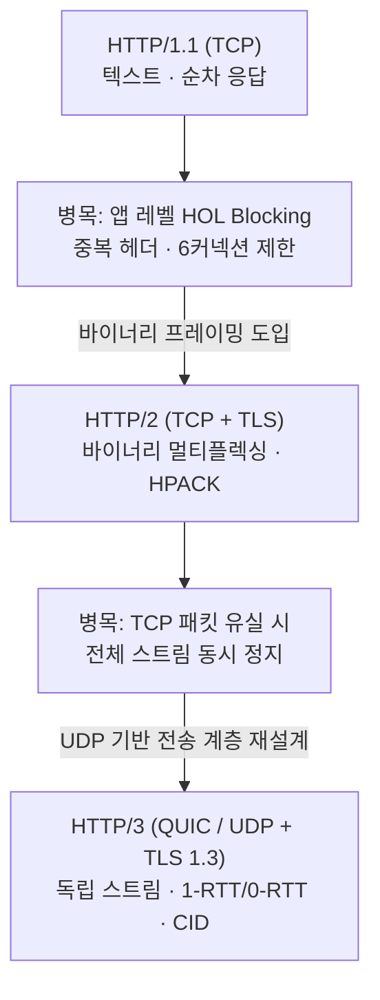

> 웹 리소스가 늘어나고 모바일 네트워크가 주류가 되면서, HTTP는 텍스트 순차 전송에서 바이너리 멀티플렉싱을 거쳐 UDP 기반 QUIC으로 진화했습니다. 이 글에서는 HTTP/1.1, HTTP/2, HTTP/3가 각각 어떤 HOL Blocking을 해소하고 어떤 운영 트레이드오프를 남겼는지 RFC 스펙과 실무 진단 명령으로 정리합니다.

> 기준 환경: RFC 9110~9114(HTTP/1.1~3), RFC 9000(QUIC), Nginx 1.25+ / curl 8.x
{: .prompt-info }

## HTTP/1.1의 Keep-Alive와 앱 레벨 HOL Blocking

HTTP/1.1은 기본 지속 연결(`Keep-Alive`)로 매 요청마다 TCP 연결을 여는 비용을 줄였습니다. 그러나 텍스트 메시지에는 요청과 응답을 구분할 식별자가 없어, 반드시 **요청 순서대로 응답해야 하는 제약**이 남았습니다.

연속 요청을 보내는 파이프라이닝(Pipelining)이 도입되었지만, 첫 번째 느린 응답 하나가 뒤따르는 모든 응답을 막는 **Application-level HOL(Head-of-Line) Blocking**과 프록시 호환성 문제로 브라우저에서 비활성화되었습니다. 결국 이를 우회하려 도메인당 6개 병렬 커넥션 제한, **도메인 샤딩(Domain Sharding)**에 따른 DNS·핸드셰이크 증가, 그리고 매 요청마다 `Cookie`·`User-Agent` 평문 텍스트 헤더를 반복 전송하는 비효율이 고착되었습니다.

## HTTP/2의 바이너리 프레이밍과 TCP 레벨 한계

HTTP/2(RFC 9113)는 **바이너리 프레이밍 계층**을 도입해 메시지를 `HEADERS`, `DATA` 프레임으로 쪼개고 고유 **Stream ID**를 부여했습니다. 덕분에 단일 TCP 커넥션 위에서 여러 요청과 응답 프레임을 비동기적으로 뒤섞어 보내는 **멀티플렉싱(Multiplexing)**이 가능해졌습니다.

중복 헤더는 **HPACK** 압축으로 해결했습니다. 표준 헤더 61개는 정적 테이블 인덱스로 치환하고, 커스텀 헤더나 인증 토큰은 커넥션별 동적 테이블에 캐싱하며 허프만 인코딩을 적용해 전송량을 크게 줄였습니다.

하지만 전송 계층을 들여다보면 HTTP/2에도 한계가 남습니다. 하부가 여전히 **단일 TCP 바이트 스트림**이기 때문입니다. 패킷 손실이 1~2%만 발생해 스트림 1의 TCP 패킷 1개가 유실되면, 커널은 재전송이 완료될 때까지 뒤따라 정상 도착한 스트림 3·5의 데이터도 애플리케이션으로 넘기지 못합니다. 앱 레벨 병목을 풀었더니 **TCP 레벨 HOL Blocking**이 전체 스트림을 멈추는 구조입니다.

## HTTP/3와 QUIC의 전송 계층 재설계

중간 라우터와 방화벽이 새로운 TCP 옵션을 차단하는 경직화(Ossification) 때문에, IETF는 **UDP 위 사용자 공간에 자체 신뢰성·혼잡제어·암호화를 구현한 QUIC(RFC 9000)**과 HTTP/3(RFC 9114)를 설계했습니다.



QUIC의 핵심 개선은 세 가지입니다.

1. **TLS 1.3 통합 핸드셰이크**: TCP와 TLS 핸드셰이크를 결합해 최초 연결을 **1-RTT**, 세션 티켓 재사용 시 **0-RTT**로 단축했습니다.
2. **독립 스트림과 QPACK**: 스트림마다 독립적으로 손실을 복구해 한 스트림의 패킷 유실이 다른 스트림을 막지 않으며, 헤더 압축도 순서 의존성을 없앤 **QPACK**으로 교체했습니다.
3. **Connection ID 기반 연결 유지**: TCP는 4-Tuple `(IP, Port)`에 묶여 Wi-Fi↔LTE 전환 시 연결이 끊기지만, QUIC은 **Connection ID(CID)**로 세션을 식별해 IP가 바뀌어도 통신을 유지합니다.

| 비교 항목 | HTTP/1.1 | HTTP/2 | HTTP/3 (QUIC) |
| :--- | :--- | :--- | :--- |
| 전송 계층 | TCP | TCP | UDP (QUIC 신뢰성 내장) |
| 멀티플렉싱 | 미지원 (다중 연결) | 단일 TCP 멀티플렉싱 | 독립 QUIC 스트림 |
| 헤더 압축 | 없음 | HPACK | QPACK |
| 연결 수립(HTTPS) | TCP 1 + TLS 1~2-RTT | TCP 1 + TLS 1~2-RTT | 최초 1-RTT / 재연결 0-RTT |
| HOL Blocking | 앱 + TCP 계층 | TCP 계층 잔존 | 전송 계층 HOL 해소 |
| 네트워크 전환 | 연결 끊김 | 연결 끊김 | Connection ID로 유지 |

## 프로토콜 협상 확인과 CLI 진단

HTTP/2는 TLS 확장 **ALPN**으로 협상하고, HTTP/3는 서버가 응답 헤더에 내려주는 `Alt-Svc`를 통해 다음 요청부터 UDP 443으로 업그레이드합니다. Nginx 1.25+에서는 기본 모듈로 두 프로토콜을 함께 열 수 있습니다.

```nginx
# /etc/nginx/conf.d/api.conf
server {
    listen 443 quic reuseport;
    listen 443 ssl;
    http2 on;

    server_name api.example.com;
    ssl_certificate     /etc/letsencrypt/live/api.example.com/fullchain.pem;
    ssl_certificate_key /etc/letsencrypt/live/api.example.com/privkey.pem;
    ssl_protocols       TLSv1.3;

    add_header Alt-Svc 'h3=":$server_port"; ma=86400' always;
}
```

실제 협상 프로토콜과 연결 구간별 지연 시간은 `curl`로 직접 검증합니다.

```bash
# 1. HTTP/2 응답 및 Alt-Svc 헤더 확인
curl -sI --http2 https://cloudflare.com | grep -iE "^HTTP/|alt-svc"

# 2. HTTP/3 전용 요청 및 연결/TLS/TTFB 시간 측정
curl -sS -o /dev/null --http3-only \
  -w "proto=%{http_version} connect=%{time_connect}s tls=%{time_appconnect}s ttfb=%{time_starttransfer}s\n" \
  https://cloudflare.com
```

## 실무 도입 시 운영 함정과 정리

프로덕션에 HTTP/2와 HTTP/3를 적용할 때는 프로토콜 스펙 밖의 인프라 제약을 반드시 고려해야 합니다.

> 주의: 사내망·공공 Wi-Fi 방화벽이 UDP 443을 차단하거나 속도를 제한하는 환경이 많으므로, HTTP/3를 단독 강제하지 말고 반드시 TCP 443(HTTP/2)과 `Alt-Svc` 기반 자동 폴백(Fallback)을 병행해야 합니다.
{: .prompt-warning }

- **0-RTT Replay Attack 주의**: 0-RTT 초기 데이터는 핸드셰이크 완료 전 전송되어 공격자가 패킷을 복제·재전송할 수 있습니다. 결제나 주문 생성 같은 비멱등 `POST` 요청에는 0-RTT를 금지하고 `GET`/`HEAD`에만 제한 허용해야 합니다.
- **내부 마이크로서비스 HTTP/2와 L4 로드밸런싱 불균형**: HTTP/2는 단일 장기 TCP 커넥션에 모든 요청을 태우므로 커넥션 단위로 분배하는 L4 로드밸런서(AWS NLB, kube-proxy) 뒤에서 오토스케일링이 일어나도 기존 트래픽이 새 Pod로 분산되지 않습니다. 내부 HTTP/2·gRPC 통신에는 Envoy 같은 L7 프록시나 클라이언트 사이드 로드밸런싱이 필수입니다.

결국 엣지 구간은 HTTP/3 + HTTP/2 폴백으로 모바일 지연을 줄이고, 내부 서비스 구간은 L7 로드밸런싱을 전제로 HTTP/2를 적용하는 분리 전략이 가장 안정적입니다.

- [RFC 9113 - HTTP/2](https://datatracker.ietf.org/doc/html/rfc9113)
- [RFC 9114 - HTTP/3](https://datatracker.ietf.org/doc/html/rfc9114)
- [RFC 9000 - QUIC](https://datatracker.ietf.org/doc/html/rfc9000)
