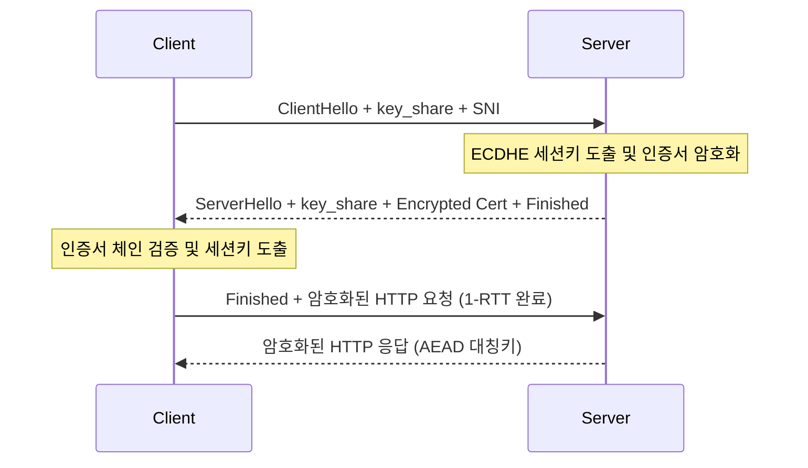

> HTTPS는 키 배송 문제, 서버 신원 검증, 대용량 처리 성능을 모두 해결하기 위해 비대칭키와 대칭키를 결합한 보안 계층입니다. 이 글에서는 TLS 1.3의 1-RTT 핸드셰이크와 PFS 개선, X.509 인증서 체인 및 SNI 동작 원리, 그리고 `openssl` 진단과 실무 인증서 장애 대응을 정리합니다.

> 기준 환경: RFC 8446(TLS 1.3), RFC 5280(X.509 PKI), OpenSSL 3.x / Java 21
{: .prompt-info }

## HTTPS가 비대칭키와 대칭키를 결합하는 이유

송수신자가 같은 비밀키를 쓰는 **대칭키 암호화**(AES-GCM, ChaCha20-Poly1305)는 하드웨어 가속으로 대용량 데이터를 고속 암호화합니다. 하지만 도청 가능한 인터넷에서 처음 만나는 두 호스트가 **비밀키를 안전하게 전달할 수 없는 키 배송 문제**가 남습니다.

반면 공개키·개인키 쌍을 쓰는 **비대칭키 암호화**(RSA, ECDSA, ECDHE)는 키 배송과 신원 검증을 해결하지만, 연산 비용이 수십~수백 배 무거워 HTTP 본문 전체에 쓰기 어렵습니다. 따라서 HTTPS는 핸드셰이크에서만 비대칭키로 신원 검증과 세션키 합의를 마치고, 이후 본문은 암호화와 무결성을 함께 보장하는 AEAD 대칭키로 처리하는 **하이브리드 구조**를 채택합니다.

## TLS 1.2와 TLS 1.3 핸드셰이크 비교

TLS 1.2는 암호 스위트 협상과 키 교환이 분리되어 **2-RTT**가 필요했고, 정적 **RSA 키 교환**을 허용했습니다. RSA 키 교환 방식에서는 공격자가 암호화된 트래픽을 저장해 두었다가 추후 서버 개인키를 탈취하면 과거 통신까지 모두 복호화되는 **PFS 미보장 위험**이 남습니다. CBC 모드, SHA-1, RC4 같은 취약 알고리즘도 레거시로 잔존했습니다.

TLS 1.3(RFC 8446)은 이를 근본적으로 재설계했습니다.



- **1-RTT 핸드셰이크**: 클라이언트가 첫 `ClientHello`에 `x25519` 등의 임시 공개키(`key_share`)를 미리 담아 보내므로, 서버는 `ServerHello` 응답 시점에 세션키를 도출하고 암호화된 인증서와 `Finished`까지 한 번에 반환합니다.
- **완벽 순방향 비밀성(PFS) 강제**: 정적 RSA 키 교환을 제거하고 매 세션마다 일회성 키를 생성·폐기하는 **ECDHE / DHE**만 허용해, 장기 서버 개인키가 유출돼도 과거 통신을 보호합니다.
- **취약 스위트 제거**: 검증된 5개의 AEAD 스위트(`TLS_AES_256_GCM_SHA384`, `TLS_CHACHA20_POLY1305_SHA256` 등)로 축소하고 인증서 구간까지 암호화합니다.

| 비교 항목 | TLS 1.2 | TLS 1.3 (RFC 8446) |
| :--- | :--- | :--- |
| 최초 핸드셰이크 | 2-RTT | 1-RTT (`key_share` 동봉) |
| 세션 재개 | 1-RTT | 0-RTT (PSK Early Data) |
| 키 교환 방식 | RSA / DHE / ECDHE | ECDHE / DHE 강제 |
| PFS 보장 | 선택적 (RSA 시 미보장) | 필수 강제 |
| 암호 스위트 | 수십 개 (취약 알고리즘 포함) | AEAD 5개 표준 스위트 |
| 인증서 전송 구간 | 평문 전송 | `ServerHello` 이후 암호화 |

## X.509 인증서 체인과 SNI 동작 원리

클라이언트가 접속한 서버가 진짜 도메인 소유자인지 검증하는 구조가 **X.509 PKI 신뢰의 사슬(Chain of Trust)**입니다. OS·브라우저·JDK에는 소수의 **Root CA** 인증서가 신뢰 앵커로 내장되어 있으며, 서버는 **Root CA → Intermediate CA → Leaf(서버) 인증서** 계층으로 서명된 체인을 제시합니다. 클라이언트는 Leaf 서명을 Intermediate CA 공개키로, Intermediate 서명을 로컬 Root CA 공개키로 거슬러 검증하고, 도메인 일치 여부(SAN)와 유효기간을 확인합니다.

Root CA가 직접 Leaf에 서명하지 않고 **Intermediate CA**를 두는 이유는 피해 격리 때문입니다. Root CA 개인키는 오프라인 HSM에 보관하고 실제 발급은 Intermediate CA가 담당해야, 유출 사고 시 전 세계 OS 트러스트스토어를 바꾸지 않고 중간 인증서만 폐기할 수 있습니다.

한편 단일 공용 IP의 443 포트 뒤에 여러 도메인을 호스팅할 때, HTTP `Host` 헤더는 TLS 핸드셰이크가 끝나야 복호화되므로 서버가 어떤 인증서를 꺼낼지 알 수 없습니다. 이를 해결하기 위해 클라이언트가 `ClientHello` 평문 확장 필드에 접속할 호스트명을 미리 담아 보내는 기능이 **SNI(Server Name Indication)**입니다.

## OpenSSL로 TLS 1.3과 인증서 체인 진단하기

서버가 TLS 1.3을 정상 협상하고 인증서 체인을 빠짐없이 내려주는지는 `openssl s_client`로 확인합니다. 멀티 도메인 환경에서는 반드시 `-servername`으로 SNI를 지정해야 합니다.

```bash
# 1. TLS 1.3 협상 및 전체 인증서 체인 출력
openssl s_client -connect api.example.com:443 \
  -servername api.example.com -tls1_3 -showcerts < /dev/null

# 2. 인증서 주체, 발급자, 만료일, SAN 빠른 확인
openssl s_client -connect api.example.com:443 \
  -servername api.example.com < /dev/null 2>/dev/null \
  | openssl x509 -noout -subject -issuer -dates -ext subjectAltName
```

출력에서 `Certificate chain`의 깊이 `0`(Leaf)과 `1`(Intermediate CA) 존재 여부, `Protocol : TLSv1.3`, 그리고 하단의 **`Verify return code: 0 (ok)`**를 반드시 확인합니다.

## 실무 인증서 운영 함정과 정리

운영 환경의 TLS 장애는 암호화 알고리즘보다 인증서 체인과 트러스트스토어 관리 실수에서 발생합니다.

> 주의: 웹 서버에 Leaf 인증서(`cert.pem`)만 넣고 중간 인증서가 포함된 `fullchain.pem`을 누락하면, 데스크톱 브라우저는 AIA 확장으로 중간 인증서를 자동 다운로드해 정상처럼 보이지만 `curl`·Java `HttpClient`·모바일 앱은 즉시 `unable to verify the first certificate` 또는 `PKIX path building failed` 오류로 실패합니다.
{: .prompt-warning }

- **Java `cacerts`와 사설 CA 오류**: OS 저장소(`/etc/ssl/certs`)에 사내 Root CA를 등록해 `curl`이 통과해도, JVM은 자체 `$JAVA_HOME/lib/security/cacerts`만 참조해 `SunCertPathBuilderException`을 던집니다. 검증을 끄는 `TrustAllCerts` 우회는 절대 피하고 `keytool`로 커스텀 트러스트스토어에 CA를 등록해야 합니다.

```bash
keytool -importcert -noprompt \
  -alias internal-root-ca \
  -file /etc/ssl/certs/internal-root-ca.crt \
  -keystore /app/certs/custom-truststore.jks \
  -storepass "${TRUSTSTORE_PASSWORD}"
```

- **인증서 만료와 리로드 모니터링**: Let's Encrypt(90일) 등 단기 인증서는 Certbot·`cert-manager` 자동 갱신에 더해, 파일만 갱신되고 웹 서버 리로드가 누락되는 사고를 막기 위해 실제 HTTPS 엔드포인트 기준 만료 D-30/D-14/D-7 알람(Blackbox Exporter 등)을 연동해야 합니다.

비대칭키와 대칭키의 역할 분담, TLS 1.3의 1-RTT·PFS, 그리고 `fullchain.pem`·`cacerts`·만료 모니터링을 챙겨야 안정적인 HTTPS 운영이 가능합니다.

- [RFC 8446 - TLS 1.3](https://datatracker.ietf.org/doc/html/rfc8446)
- [RFC 5280 - X.509 PKI](https://datatracker.ietf.org/doc/html/rfc5280)
