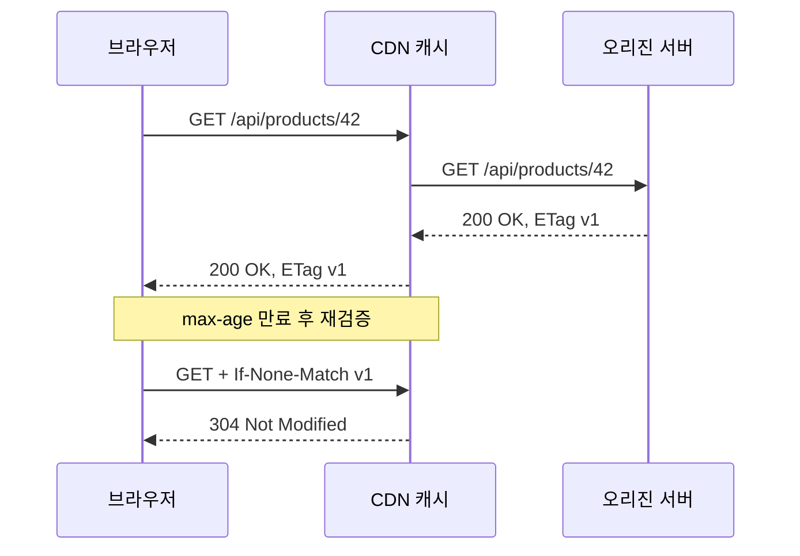

> HTTP 캐싱은 브라우저와 CDN에 응답을 재사용해 지연 시간과 오리진 부하를 줄이는 표준 메커니즘입니다. RFC 9111 기준 `Cache-Control` 디렉티브, `ETag` 조건부 요청, Spring Boot 적용 시 트레이드오프와 운영 함정을 정리합니다.

> 기준 환경: **RFC 9111 (HTTP Caching)**, **Spring Boot 3.x / Kotlin 1.9 / Java 21**
{: .prompt-info }

## 브라우저 캐시와 CDN 공유 캐시의 2단 계층

HTTP 캐시는 저장 범위 기준으로 **사설 캐시(Private Cache)**와 **공유 캐시(Shared Cache)** 두 계층으로 동작합니다. 사설 캐시는 사용자 브라우저에 위치해 개인 응답을 단독 보관하며, 공유 캐시는 CDN 엣지나 리버스 프록시에 위치해 다수 사용자가 동일 리소스의 캐시 사본을 함께 사용합니다.

브라우저 캐시가 적중하면 네트워크 요청 자체가 생략되고, 만료되더라도 CDN이 응답하면 오리진 서버와 DB까지 트래픽이 도달하지 않습니다. 다만 캐시에는 **신선도(Freshness)와 성능 간 트레이드오프**가 따릅니다. TTL이 길면 오리진 부하는 줄지만 갱신 반영이 늦어지고, 짧으면 적중률이 떨어집니다. 따라서 리소스의 변경 주기와 개인화 여부에 따라 계층별 정책을 분리해야 합니다.

## Cache-Control 핵심 디렉티브 비교

`Cache-Control`은 시계 오차에 취약한 구 `Expires` 헤더를 대체하며, 상대 시간·저장 범위·재검증 규칙을 조합해 표현합니다.

| 디렉티브 | 대상 | 핵심 동작 | 주요 사용처 |
| :--- | :--- | :--- | :--- |
| `max-age=N` | 전체 | `N`초간 신선한 사본 재사용 | 정적 자산, 단기 조회 API |
| `s-maxage=N` | 공유 캐시 | CDN에서 `max-age` 덮어쓰기 | CDN 장기·브라우저 단기 캐싱 |
| `no-cache` | 전체 | **저장 후 매번 오리진 재검증** | `index.html`, 동적 API |
| `no-store` | 전체 | **어디에도 저장 금지** | 결제·토큰·개인 민감 응답 |
| `public` | 공유 캐시 | 공유 캐시 저장 명시 허용 | 공용 카탈로그·정적 파일 |
| `private` | 브라우저 | 공유 캐시 금지, 브라우저만 허용 | 마이페이지·개인화 API |
| `immutable` | 브라우저 | 유효 기간 내 새로고침 재검증 생략 | 해시 포함 JS/CSS 번들 |
| `stale-while-revalidate=N` | 전체 | 만료 후 `N`초간 구버전 반환+비동기 갱신 | 지연 허용 피드·목록 |

가장 자주 오해하는 지시자는 **`no-cache`와 `no-store`**입니다. RFC 9111에서 `no-cache`는 캐시 금지 뜻이 아니라, 사본을 저장하되 재사용 전 반드시 오리진에 조건부 재검증을 거치라는 지시자입니다. 민감 데이터를 캐시에 남기지 않으려면 반드시 `no-store`를 써야 합니다. 한편 `s-maxage`는 공유 캐시에서 `max-age`를 우선 덮어쓰므로, `max-age=10, s-maxage=300`처럼 조합하면 브라우저 반영 속도와 CDN 오리진 보호를 함께 챙길 수 있습니다.

## ETag와 조건부 요청의 304 동작 원리

캐시가 만료(Stale)돼도 원본이 그대로라면 바디를 다시 내려받을 필요가 없습니다. 이때 `ETag`(`If-None-Match`)나 `Last-Modified`(`If-Modified-Since`) 검증자로 조건부 요청을 보내고, 변경이 없으면 서버가 바디 없는 **`304 Not Modified`**를 반환합니다. `Last-Modified`는 1초 해상도 한계와 재배포 시 타임스탬프 변경 문제가 있어 RFC 9111에서도 `ETag`를 우선 검증 기준으로 둡니다.



- **Strong ETag (`"v42-9f86d08"`)**: 바이트 단위 완전 일치를 보장하며 `Range` 부분 요청이나 `If-Match` 낙관적 락에 사용합니다.
- **Weak ETag (`W/"v42"`)**: 압축 차이 등으로 바이트는 달라도 의미론적으로 동등함을 뜻하며, `If-None-Match` 캐시 재검증에 충분히 활용할 수 있습니다.

## Spring Boot 적용과 ShallowEtagHeaderFilter 내부 동작

Spring Boot에서는 `ResponseEntity`에 `CacheControl`과 `eTag`를 명시하고, `WebRequest.checkNotModified()`로 변경 없을 때 직렬화를 생략하는 패턴이 가장 효율적입니다.

```kotlin
// src/main/kotlin/com/example/catalog/ProductController.kt
package com.example.catalog

import java.util.concurrent.TimeUnit
import org.springframework.http.CacheControl
import org.springframework.http.ResponseEntity
import org.springframework.web.bind.annotation.GetMapping
import org.springframework.web.bind.annotation.PathVariable
import org.springframework.web.bind.annotation.RequestMapping
import org.springframework.web.bind.annotation.RestController
import org.springframework.web.context.request.WebRequest

@RestController
@RequestMapping("/api/products")
class ProductController(
    private val productQueryService: ProductQueryService,
) {
    @GetMapping("/{id}")
    fun getProduct(@PathVariable id: Long, webRequest: WebRequest): ResponseEntity<ProductResponse> {
        val etag = "\"product-$id-v${productQueryService.findVersion(id)}\""
        val cacheControl = CacheControl.maxAge(10, TimeUnit.SECONDS)
            .cachePublic()
            .sMaxAge(60, TimeUnit.SECONDS)

        if (webRequest.checkNotModified(etag)) {
            return ResponseEntity.status(304)
                .cacheControl(cacheControl)
                .eTag(etag)
                .build()
        }

        return ResponseEntity.ok()
            .cacheControl(cacheControl)
            .eTag(etag)
            .body(productQueryService.findDetail(id))
    }
}
```

편의상 `ShallowEtagHeaderFilter`를 전역 등록하기도 하지만 내부 동작을 이해하고 써야 합니다. 이 필터는 `ContentCachingResponseWrapper`로 응답을 감싸 컨트롤러 실행 후 바디 전체를 메모리에 버퍼링하고, MD5 해시로 ETag를 계산해 `If-None-Match`와 비교한 뒤 일치하면 `304`로 덮어씁니다. 즉 **네트워크 대역폭은 아끼지만 서버의 DB 조회·CPU 직렬화·메모리 버퍼링 비용은 그대로 발생**합니다. 오리진 부하 절감이 목적이라면 필터에 의존하기보다 버전 기반 명시적 ETag나 CDN·Redis 캐싱을 조합해야 합니다.

```bash
# 1. 최초 조회 (200 OK + ETag 수신)
curl -i http://localhost:8080/api/products/42

# 2. 조건부 재검증 (바디 없이 304 Not Modified 반환)
curl -i -H 'If-None-Match: "product-42-v3"' http://localhost:8080/api/products/42
```

## 운영 환경에서 자주 발생하는 HTTP 캐싱 함정

> **주의**: 인증된 사용자의 개인화 응답에 `public`이나 `s-maxage`를 설정하면, CDN 공유 캐시가 A 사용자의 응답을 B 사용자에게 반환하는 심각한 개인정보 유출 사고로 이어집니다.
{: .prompt-warning }

1. **개인화 응답에 공유 캐시 오설정**: 세션 쿠키나 `Authorization` 기반 응답(`/api/me` 등)에는 반드시 `private, no-cache`를, 결제·토큰 등 민감 데이터에는 `no-store`를 명시해야 합니다.
2. **`Vary` 헤더 누락**: `Accept-Encoding`(gzip/br), `Accept-Language`, `Origin`에 따라 응답이 달라지는데 `Vary`가 빠지면 공유 캐시가 잘못된 압축 바디나 타 출처 CORS 헤더를 서빙합니다.
3. **해시 없는 정적 파일의 장기 `max-age`**: 이름이 고정된 `app.js`에 1년 캐시와 `immutable`을 걸면 배포 후에도 구버전이 실행됩니다. 장기 캐시는 콘텐츠 해시 파일명(`app.8f3a2c.js`)에만 쓰고, `index.html`은 `no-cache`로 분리해야 합니다.

## 참고 자료

- [RFC 9111 - HTTP Caching](https://httpwg.org/specs/rfc9111.html)
- [Spring Framework - HTTP Caching](https://docs.spring.io/spring-framework/reference/web/webmvc/mvc-caching.html)
