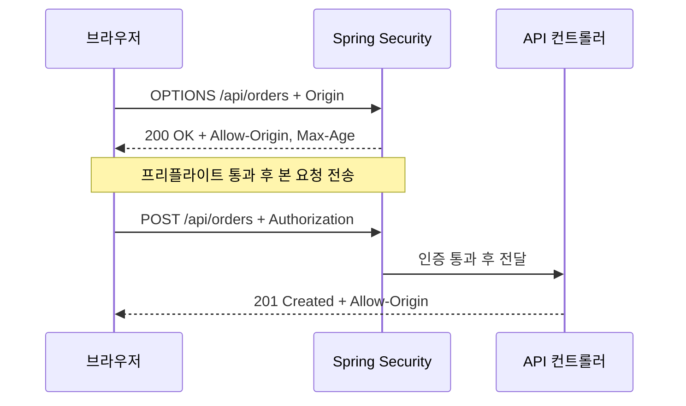

> 안전한 API 재시도 전략을 세우려면 HTTP 메서드의 안전성과 멱등성을 구분해야 하며, 웹 클라이언트 연동 시 브라우저 SOP와 CORS 프리플라이트를 정확히 이해해야 합니다. RFC 9110과 Fetch Standard 기준 동작 원리와 Spring Security 6 적용 시 주의사항을 정리합니다.

> 기준 환경: **RFC 9110 (HTTP Semantics)**, **Fetch Standard (CORS)**, **Spring Boot 3.x / Spring Security 6 / Kotlin 1.9**
{: .prompt-info }

## 안전성(Safe)과 멱등성(Idempotent)의 정확한 구분

RFC 9110 Section 9.2는 **안전성(Safe)**을 "서버 리소스 상태를 변경하지 않는 읽기 전용 의미"로, **멱등성(Idempotent)**을 "같은 요청을 1번 보내나 N번 반복해 보내나 **서버의 최종 결과 상태가 동일함**"으로 정의합니다.

주의할 점은 멱등성이 **"응답 상태 코드나 바디가 매번 같음"을 뜻하지 않는다**는 것입니다. `DELETE /api/orders/10`을 처음 호출하면 `204 No Content`, 재호출하면 `404 Not Found`가 반환되어도 주문 10번이 삭제된 최종 상태는 동일하므로 멱등합니다.

| 메서드 | 안전성(Safe) | 멱등성(Idempotent) | 실무 설계 비고 |
| :--- | :---: | :---: | :--- |
| `GET` | O | O | 조회 전용, 상태 변경 로직 금지 |
| `HEAD` | O | O | 바디 없이 메타데이터 헤더만 조회 |
| `PUT` | X | O | 리소스 전체를 지정한 상태로 덮어쓰기 |
| `DELETE` | X | O | 리소스 제거(재호출 시 404여도 상태 동일) |
| `POST` | X | X | 생성·결제 등 반복 호출 시 중복 발생 |
| `PATCH` | X | X | 부분 수정, 증감 연산(`+1000`) 가능해 스펙상 비멱등 |

## 타임아웃 재시도와 Idempotency-Key 패턴

클라이언트에서 읽기 타임아웃(`ReadTimeout`)이 발생하면 서버가 이미 트랜잭션을 커밋했는지 알 수 없습니다. `GET`·`PUT`·`DELETE`는 멱등하므로 지수 백오프로 안전하게 재시도할 수 있지만, `POST` 결제·주문 요청을 무작정 재시도하면 중복 결제가 발생합니다.

이를 막기 위해 클라이언트가 요청 단위 고유 UUID를 **`Idempotency-Key` 헤더**로 보내고, 서버가 DB 유니크 제약이나 Redis에 처리 결과를 기록하는 패턴을 사용합니다.

```bash
curl -i -X POST https://api.example.com/api/payments \
  -H "Content-Type: application/json" \
  -H "Authorization: Bearer <ACCESS_TOKEN>" \
  -H "Idempotency-Key: 9b1deb4d-3b7d-4bad-9bdd-2b0d7b3dcb6d" \
  -d '{"orderId": "ORD-20240729-01", "amount": 25000}'
```

서버는 동일 키가 이미 완료됐다면 비즈니스 로직을 건너뛰고 최초 응답을 재반환하며, 동시 진입 중인 키는 `409 Conflict`로 막습니다. 저장소 비대화를 막기 위해 보통 24시간~7일 TTL 만료를 두고, 같은 키에 다른 페이로드가 들어오면 `422`로 거부합니다.

## 동일 출처 정책(SOP)과 CORS 프리플라이트 동작 원리

브라우저의 **동일 출처 정책(SOP)**은 **Scheme + Host + Port** 세 요소가 모두 일치할 때만 동일 출처로 인정하며, 다른 출처의 응답 읽기를 차단합니다. **CORS**는 서버가 응답 헤더로 교차 출처 접근을 명시적으로 허가하는 표준이며 두 경로로 동작합니다.

- **단순 요청(Simple Request)**: `GET`/`HEAD`/`POST` 메서드, 안전 헤더, `Content-Type`이 `application/x-www-form-urlencoded`·`multipart/form-data`·`text/plain` 중 하나일 때 사전 요청 없이 바로 본 요청을 전송합니다.
- **프리플라이트 요청(Preflight Request)**: `application/json`, `Authorization` 헤더, `PUT`/`DELETE` 메서드를 쓰는 대부분 REST API는 본 요청 전 브라우저가 `OPTIONS` 예비 요청으로 서버 허가를 먼저 확인합니다.



프리플라이트가 유발하는 추가 RTT는 서버가 `Access-Control-Max-Age` 헤더를 내려 브라우저에 캐시해 줄일 수 있습니다(브라우저 상한: Chromium 7,200초, Firefox 86,400초).

## Spring Security 6 필터 체인과 CORS 설정 구현

Spring MVC의 `@CrossOrigin`이나 `WebMvcConfigurer`만 설정했을 때 프리플라이트 `OPTIONS` 요청이 `401`/`403`으로 막히는 이유는 필터 실행 순서 때문입니다. 프리플라이트에는 `Authorization` 헤더와 쿠키가 빠지는데, 요청이 `DispatcherServlet`에 도달하기 전 `SecurityFilterChain`의 인증·인가 필터가 먼저 미인증 `OPTIONS`를 거부합니다.

`http.cors {}`와 `CorsConfigurationSource`를 등록하면 `CorsFilter`가 인증 필터보다 **앞선 순서**에 배치되어 `DefaultCorsProcessor`가 프리플라이트를 먼저 검증·응답합니다.

```kotlin
// src/main/kotlin/com/example/security/SecurityConfig.kt
package com.example.security

import org.springframework.context.annotation.Bean
import org.springframework.context.annotation.Configuration
import org.springframework.security.config.annotation.web.builders.HttpSecurity
import org.springframework.security.config.annotation.web.configuration.EnableWebSecurity
import org.springframework.security.web.SecurityFilterChain
import org.springframework.web.cors.CorsConfiguration
import org.springframework.web.cors.CorsConfigurationSource
import org.springframework.web.cors.UrlBasedCorsConfigurationSource

@Configuration
@EnableWebSecurity
class SecurityConfig {

    @Bean
    fun securityFilterChain(http: HttpSecurity): SecurityFilterChain {
        http
            .cors { it.configurationSource(corsConfigurationSource()) }
            .csrf { it.disable() } // 순수 Bearer 토큰 기반 Stateless API 기준
            .authorizeHttpRequests { auth ->
                auth.requestMatchers("/api/public/**").permitAll()
                    .anyRequest().authenticated()
            }
        return http.build()
    }

    @Bean
    fun corsConfigurationSource(): CorsConfigurationSource {
        val config = CorsConfiguration().apply {
            allowedOrigins = listOf("https://app.example.com")
            allowedMethods = listOf("GET", "POST", "PUT", "DELETE", "OPTIONS")
            allowedHeaders = listOf("Authorization", "Content-Type", "Idempotency-Key")
            allowCredentials = true
            maxAge = 3600L
        }
        return UrlBasedCorsConfigurationSource().apply {
            registerCorsConfiguration("/api/**", config)
        }
    }
}
```

```bash
curl -i -X OPTIONS http://localhost:8080/api/orders \
  -H "Origin: https://app.example.com" \
  -H "Access-Control-Request-Method: POST" \
  -H "Access-Control-Request-Headers: Authorization, Content-Type, Idempotency-Key"
```

## 실무에서 자주 겪는 CORS 보안 및 운영 함정

> **주의**: CORS는 **브라우저 보호 정책**이지 서버 방화벽이 아닙니다. `curl`, Postman, 서버 간 호출에는 적용되지 않으므로 인증·인가나 CSRF 방어를 CORS로 대체할 수 없습니다.
{: .prompt-warning }

1. **`Access-Control-Allow-Origin: *`와 `Allow-Credentials: true` 동시 설정 불가**: 쿠키·인증 헤더를 포함한 요청에 와일드카드 `*`는 브라우저가 스펙상 강제 차단합니다. `allowedOrigins`에 명시적 출처를 적거나 `allowedOriginPatterns`로 요청 `Origin`을 동적 에코해야 합니다.
2. **쿠키 인증과 CSRF 방어 혼동**: `POST` 단순 요청은 프리플라이트 없이 서버에 도달할 수 있습니다. 쿠키 세션 인증이라면 `SameSite` 속성과 CSRF 토큰 검증을 반드시 병행해야 합니다.
3. **리버스 프록시와 백엔드의 중복 CORS 헤더**: Nginx와 Spring Boot 양쪽에서 모두 `Access-Control-Allow-Origin`을 추가하면 값이 중복되어 브라우저가 즉시 차단합니다. CORS 헤더 부여는 게이트웨이나 백엔드 중 **단일 계층**으로 일원화해야 합니다.

## 참고 자료

- [RFC 9110 - HTTP Semantics](https://httpwg.org/specs/rfc9110.html#common.method.properties)
- [WHATWG Fetch Standard - CORS](https://fetch.spec.whatwg.org/#http-cors-protocol)
- [Spring Security Reference - CORS](https://docs.spring.io/spring-security/reference/servlet/integrations/cors.html)
