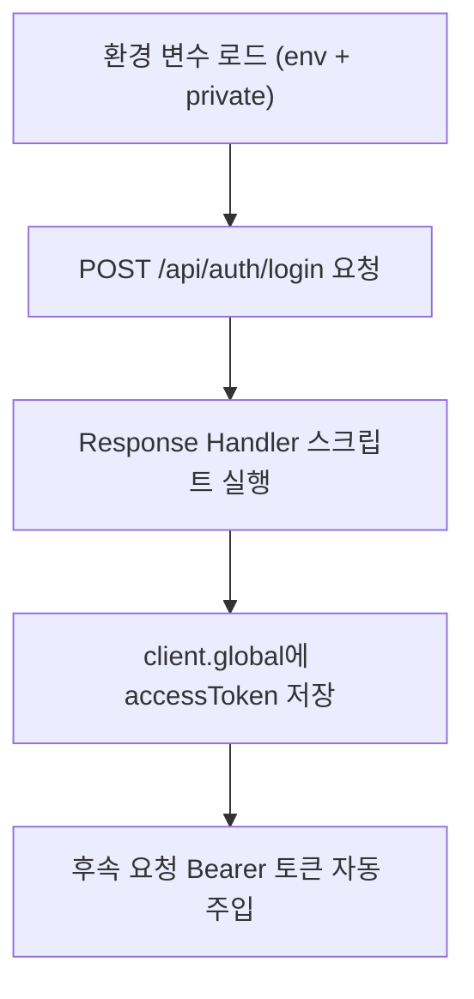

> API 개발 중 Postman 창을 오가며 JWT를 복사·붙여넣기하는 번거로움을 줄이기 위해, IntelliJ IDEA 내장 HTTP Client로 요청을 Git 관리하고 토큰 주입과 응답 검증을 자동화하는 방법을 정리합니다.

> 본 문서는 **IntelliJ IDEA Ultimate 2024.1** 및 **IntelliJ HTTP Client CLI(`ijhttp`)** 기준으로 작성되었습니다.
{: .prompt-info }

## Postman에서 IntelliJ HTTP Client로 넘어온 이유

백엔드 API를 수정하고 바로 호출해 확인하는 작업은 하루에도 수십 번씩 반복됩니다. 기존에 Postman을 쓸 때 가장 불편했던 점은 **요청 명세와 소스 코드의 분리**였습니다. 엔드포인트나 요청 필드가 바뀔 때마다 컬렉션을 별도로 동기화해야 했고, 로그인 응답에서 JWT를 복사해 헤더에 붙여 넣는 과정이 개발 흐름을 자주 끊었습니다.

IntelliJ HTTP Client는 텍스트 기반 `.http` 파일로 요청을 관리하므로 소스 코드와 같은 저장소에서 Git으로 버전 관리를 할 수 있습니다. PR에 API 코드와 `.http` 시나리오를 함께 올리면 리뷰어가 IDE에서 곧바로 실행해 볼 수 있습니다. 다만 모든 상황에 정답은 아니므로 트레이드오프를 먼저 짚어둘 필요가 있습니다.

| 비교 항목 | IntelliJ HTTP Client (`.http`) | Postman |
| :--- | :--- | :--- |
| 버전 관리 | Git으로 코드와 함께 diff·PR 리뷰 | 클라우드 동기화 또는 JSON 내보내기 |
| 라이선스·접근성 | Ultimate(유료) 내장, `ijhttp` 무료 | 무료 플랜 제공, 비개발자·QA 친화적 |
| 환경 변수 보안 | 공개·비공개 JSON 파일 분리 | 워크스페이스 변수·Vault 지원 |
| 부가 기능 | JS 검증 스크립트, CI CLI 실행 | Mock Server, 공개 문서 포털 내장 |

백엔드 팀 내부에서 코드와 함께 API 시나리오를 유지하고 CI까지 연결할 때는 HTTP Client가 가볍고 일관적입니다. 반면 IDE를 쓰지 않는 기획·QA 직군과 협업하거나 Mock Server가 필요하다면 Postman이 더 적합합니다.

## 환경 변수 파일 분리와 Git 보안 관리

`.http` 파일을 Git으로 관리할 때 핵심은 **환경별 호스트와 민감한 인증 정보의 분리**입니다. IntelliJ HTTP Client는 공유용 `http-client.env.json`과 비공개용 `http-client.private.env.json`을 공식적으로 구분해 지원합니다.

```json
// http/http-client.env.json (Git 추적 대상)
{
  "local": {
    "baseUrl": "http://localhost:8080",
    "testEmail": "dev@example.com"
  },
  "dev": {
    "baseUrl": "https://dev-api.example.com",
    "testEmail": "dev@example.com"
  }
}
```

```json
// http/http-client.private.env.json (반드시 .gitignore 등록)
{
  "local": {
    "testPassword": "local-dev-password"
  },
  "dev": {
    "testPassword": "dev-server-password"
  }
}
```

내부적으로 HTTP Client는 요청 실행 시 `http-client.env.json`을 먼저 로드한 뒤 `http-client.private.env.json`을 읽어 **같은 환경 키 아래의 속성을 병합**합니다. 동일한 키가 존재하면 `private` 파일 값이 우선 적용(override)되므로, 공개 파일에는 공통 URL을 두고 비밀번호·API 키만 비공개 파일로 안전하게 덮어쓸 수 있습니다.

```gitignore
# .gitignore
**/http-client.private.env.json
.idea/httpRequests/
```

> 주의: `.idea/httpRequests/`에는 토큰과 응답 본문이 포함된 실행 이력이 저장됩니다. `http-client.private.env.json`과 함께 반드시 `.gitignore`에 등록해야 민감 정보 유출을 막을 수 있습니다.
{: .prompt-warning }

## 로그인 응답에서 JWT 자동 추출 및 후속 요청 주입

요청 하단에 `> ` 블록으로 JavaScript **Response Handler 스크립트**를 작성하면 로그인 응답에서 토큰을 꺼내 다음 요청 헤더에 자동으로 주입할 수 있습니다.



요청 구분자 `###`를 사용해 로그인과 인증 API 호출을 이어 둔 예제는 다음과 같습니다.


```http
### 1. 로그인 및 JWT 전역 변수 저장
POST {{baseUrl}}/api/auth/login
Content-Type: application/json

{
  "email": "{{testEmail}}",
  "password": "{{testPassword}}"
}

> 

### 2. 저장된 JWT로 내 정보 조회
GET {{baseUrl}}/api/members/me
Authorization: Bearer {{accessToken}}
Accept: application/json
```


응답 헤더의 `Content-Type`이 `application/json`이면 HTTP Client가 `response.body`를 자동으로 JavaScript 객체로 파싱합니다. `JSON.parse()` 없이 중첩 필드에 바로 접근할 수 있으며, `client.global.set()`으로 저장한 값은 IDE 세션 메모리에 유지되어 **다른 `.http` 파일의 요청에서도** `{{accessToken}}`으로 재사용됩니다.

## 응답 자동 검증과 multipart/form-data 파일 업로드

`client.test()`와 `client.assert()`로 상태 코드와 응답 필드를 검증하면 IDE 하단 **Services** 창의 `Tests` 탭에서 JUnit처럼 통과 여부를 확인할 수 있습니다. 파일 업로드가 필요한 `multipart/form-data` 요청도 `< ./경로` 문법으로 로컬 바이너리를 첨부할 수 있습니다.


```http
### 프로필 이미지 및 메타데이터 업로드
POST {{baseUrl}}/api/members/me/profile-image
Authorization: Bearer {{accessToken}}
Content-Type: multipart/form-data; boundary=WebAppBoundary

--WebAppBoundary
Content-Disposition: form-data; name="metadata"
Content-Type: application/json

{
  "displayName": "김남주",
  "isPublic": true
}
--WebAppBoundary
Content-Disposition: form-data; name="file"; filename="avatar.png"
Content-Type: image/png

< ./fixtures/avatar.png
--WebAppBoundary--

> 
```


파일 경로는 현재 `.http` 파일 위치 기준 상대 경로로 해석되며, 프로젝트 루트 기준이 필요하면 `< {{$projectRoot}}/http/fixtures/avatar.png`를 사용합니다. Spring MVC `@RequestPart`로 JSON DTO와 파일을 함께 받을 때 메타데이터 파트에 `Content-Type: application/json`을 명시하면 415 오류 없이 정상 바인딩됩니다.

## ijhttp CLI 실행과 실무 운영 시 주의사항

작성한 `.http` 시나리오는 JetBrains 공식 CLI인 **`ijhttp`**로 터미널이나 CI 파이프라인에서도 그대로 실행할 수 있습니다.

```bash
# Homebrew 설치 후 실행
brew install ijhttp

ijhttp --env-file http/http-client.env.json \
       --private-env-file http/http-client.private.env.json \
       --env dev \
       http/auth-and-profile.http
```

```bash
# CI 환경에서 Docker 이미지로 실행 및 JUnit 리포트 출력
docker run --rm -i \
  -v "$PWD:/workdir" \
  jetbrains/intellij-http-client \
  --env-file http/http-client.env.json \
  --private-env-file http/http-client.private.env.json \
  --env dev \
  --report \
  http/auth-and-profile.http
```

`--report` 옵션을 주면 `reports/report.xml`에 JUnit 형식 결과가 생성되어 테스트 실패 시 CI 빌드를 즉시 중단할 수 있습니다. 실무 도입 시 아래 세 가지 함정만 주의하면 안정적으로 운영할 수 있습니다.

1. **`private` 파일 커밋 사고**: 저장소 초기 세팅 때 `.gitignore`를 먼저 등록하고, 팀 공유용으로 빈 값만 채운 `http-client.private.env.json.example`을 두는 편이 안전합니다. 실수로 푸시했다면 히스토리 삭제와 함께 해당 키·비밀번호를 즉시 재발급해야 합니다.
2. **`client.global`의 휘발성과 실행 순서**: 전역 변수는 IDE 재시작이나 `ijhttp` 종료 시 사라지므로, 시나리오 파일 상단에 로그인 요청을 배치해 실행 순서 의존성을 명확히 두어야 합니다.
3. **`multipart/form-data` 빈 줄과 종료 경계선**: 파트 헤더와 본문 사이에는 반드시 **빈 줄 하나**가 있어야 하며, 마지막 경계선은 `--WebAppBoundary--`처럼 하이픈 두 개로 닫아야 400 오류를 피할 수 있습니다.

### 참고 자료


