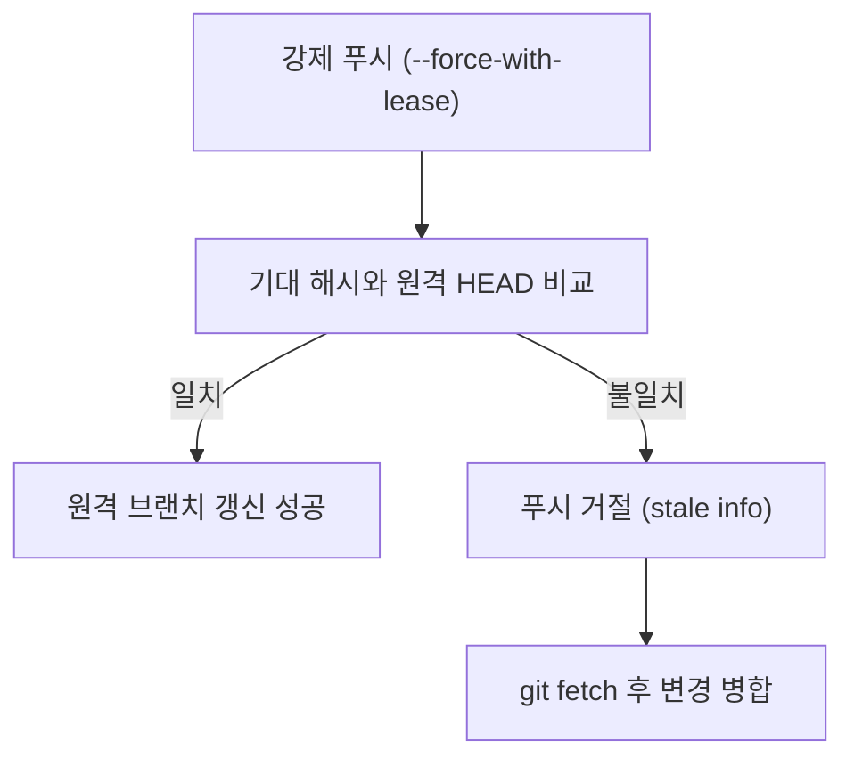

> 기능 개발 중 쌓인 임시 커밋을 리뷰하기 좋은 단위로 재구성하고, 원격 반영과 실수 복구까지 안전하게 처리하는 Git 명령어와 동작 원리를 정리합니다.

> 본 글은 Git 2.30 이상 환경을 기준으로 작성되었습니다. (`--force-if-includes` 옵션은 Git 2.30부터 지원합니다.)
{: .prompt-info }

## 커밋 히스토리를 정리하는 이유와 reset 세 가지 모드

기능을 구현하다 보면 `"wip"`, `"오타 수정"`, `"다시 수정"` 같은 임시 커밋이 쌓입니다. 그대로 PR을 올리면 변경 의도가 흩어져 리뷰 비용이 커지고, 빌드가 깨진 중간 커밋 때문에 `git bisect` 장애 추적이나 `git revert` 선택적 롤백도 어려워집니다.

물론 Squash Merge를 쓰는 작은 PR이라면 로컬 정리가 과할 수 있습니다. 반면 리팩토링과 기능 추가가 섞인 중대형 PR은 논리적 기능 단위로 정리해 두는 편이 유지보수에 유리합니다.

정리의 출발점은 `git reset`의 세 모드를 구분하는 것입니다. Git은 **HEAD**, **Staging Area(Index)**, **Working Directory** 세 영역으로 상태를 관리합니다.

| 옵션 | HEAD 이동 | Staging Area | Working Directory | 주요 용도 |
| :--- | :---: | :---: | :---: | :--- |
| `--soft` | 이동 | 유지 | 유지 | 커밋 합치기, 커밋 메시지 재작성 |
| `--mixed` (기본값) | 이동 | 초기화 | 유지 | 파일·청크 단위로 다시 나눠 커밋 |
| `--hard` | 이동 | 초기화 | 초기화 (변경 삭제) | 로컬 변경 폐기 후 특정 시점 복귀 |

`--soft`와 `--mixed`는 작업 트리를 건드리지 않아 부담 없이 쓸 수 있지만, `--hard`는 추적 파일의 수정본을 즉시 덮어쓰므로 실행 전 `git status` 확인이 필수입니다.

## 직전 커밋 수정과 여러 커밋을 기능별로 다시 나누기

### 직전 커밋 다듬기 (`git commit --amend`)

방금 만든 커밋에 파일을 빠뜨렸거나 메시지 오타가 있다면 `--amend`로 직전 커밋을 교체합니다.

```bash
# 누락 파일을 스테이징한 뒤 직전 메시지 유지하며 합치기
git add src/main/kotlin/com/example/auth/TokenValidator.kt
git commit --amend --no-edit

# 직전 커밋 메시지만 수정하기
git commit --amend -m "feat: JWT 만료 시간 검증 로직 추가"
```

`--amend`는 기존 커밋을 수정하는 것이 아니라 **새 SHA-1 해시를 가진 커밋 객체를 생성해 브랜치 포인터를 옮기는 동작**입니다. 이미 원격에 푸시한 커밋이라면 일반 `git push`가 거절됩니다.

### 여러 WIP 커밋을 한 번에 풀고 재구성하기 (`git reset --soft`)

임시 커밋이 5~6개 이상 뒤섞였을 때 제가 가장 자주 쓰는 패턴은 기준 브랜치(`main`)까지 `--soft`로 되돌린 뒤 기능 단위로 다시 나누는 방식입니다.

```bash
# 1. main 기준으로 되돌리되 모든 변경을 스테이징 상태로 유지
git reset --soft main

# 2. 언스테이징 후 기능 단위로 분할 커밋
git reset
git add src/main/kotlin/com/example/auth/
git commit -m "feat: 인증 토큰 발급 및 검증 구현"

# 3. 한 파일에 여러 작업이 섞였다면 hunk 단위 선택 스테이징
git add -p src/main/kotlin/com/example/user/UserService.kt
git commit -m "refactor: 사용자 조회 서비스 의존성 정리"
```

### 특정 커밋만 골라 수정하기 (`git rebase -i`)

중간 커밋 몇 개만 합치거나 메시지를 고칠 때는 대화형 리베이스가 적합합니다.

```bash
git rebase -i HEAD~4
```

에디터에서 각 줄 앞의 명령어를 `pick`(유지), `reword`(메시지 수정), `squash`(합치고 메시지 편집), `fixup`(합치고 메시지 버림), `drop`(제거) 중 하나로 바꾼 뒤 저장하면 순서대로 재적용됩니다. 충돌이 반복될 것 같으면 `reset --soft`로 펼쳐 다시 커밋하는 편이 간결합니다.

## 원격 반영 시 --force 대신 --force-with-lease를 써야 하는 이유

히스토리를 재작성하면 원격 브랜치와 이력이 갈라져 강제 푸시가 필요합니다. 이때 `git push --force`는 원격 브랜치 상태를 확인하지 않고 무조건 덮어쓰므로, 동료가 먼저 푸시한 커밋을 흔적 없이 날릴 수 있습니다.

`--force-with-lease`는 **Compare-And-Swap(CAS)** 방식으로 이 사고를 막습니다. 로컬의 원격 추적 브랜치(`refs/remotes/origin/<branch>`)에 기록된 기대 해시값을 서버에 함께 보내, 실제 원격 HEAD와 일치할 때만 덮어쓰기를 허용합니다.



동료가 원격 `feat/auth`에 새 커밋을 올린 상태라면 아래와 같이 안전하게 차단됩니다.

```bash
$ git push --force-with-lease origin feat/auth
To github.com:example/backend-api.git
 ! [rejected]        feat/auth -> feat/auth (stale info)
error: failed to push some refs to 'github.com:example/backend-api.git'
```

> 주의: IDE가 백그라운드에서 자동으로 `git fetch`를 실행하면 `refs/remotes/origin/<branch>`가 나도 모르게 갱신되어 보호가 우회될 수 있습니다. `--force-if-includes` 옵션을 함께 사용하면 해당 커밋이 로컬 reflog에 실제로 통합되었는지까지 검증합니다.
{: .prompt-warning }

```bash
git config --global alias.pushf "push --force-with-lease --force-if-includes"
```

## 실수로 커밋을 날렸을 때 git reflog로 복구하기

`git reset --hard`나 잘못된 리베이스로 커밋이 로그에서 사라져도 Git은 객체를 즉시 삭제하지 않습니다. `HEAD`의 모든 이동 이력은 로컬 `reflog`에 남으며, 기본 설정 기준 도달 가능한 항목은 **90일**(`gc.reflogExpire`), 도달 불가능한 항목은 30일(`gc.reflogExpireUnreachable`) 동안 보관됩니다.

```bash
$ git reflog -n 5
3ec7167 (HEAD -> feat/login) HEAD@{0}: commit: feat: add login flow
4e692b9 (main) HEAD@{1}: reset: moving to main
2b09b38 HEAD@{2}: commit (amend): fix typo
2b09b38 HEAD@{3}: commit: fix typo
acf8597 HEAD@{4}: commit: wip
```

되돌릴 시점(`HEAD@{2}`)을 찾았다면 바로 복구하거나 복구용 브랜치를 분기해 안전하게 비교할 수 있습니다.

```bash
# 방법 1: 실수 직전 시점으로 즉시 복구
git reset --hard HEAD@{2}

# 방법 2: 새 브랜치로 분기해 안전하게 확인
git switch -c recovery/login HEAD@{2}
```

단, 한 번도 `git add`나 `git commit`하지 않은 Working Directory 변경분은 `reflog`로 복구할 수 없으므로 작업 전 임시 커밋이나 `git stash`를 습관화하는 편이 안전합니다.

## 공유 브랜치에서 히스토리 재작성 시 주의사항과 정리

히스토리 재작성은 **혼자 작업 중인 피처 브랜치**에서만 수행해야 합니다. `main`이나 `develop`처럼 여러 팀원이 기반으로 삼는 공유 브랜치의 커밋 해시를 바꾸면, 팀원들의 로컬 브랜치와 그래프가 분기되어 중복 커밋과 대규모 병합 충돌이 연쇄 발생합니다.

이미 공유 브랜치에 올라간 커밋을 취소할 때는 히스토리를 지우지 말고 반대 변경 커밋을 추가하는 `git revert`를 사용합니다.

```bash
git revert <되돌릴_커밋_해시>
# 머지 커밋은 기준 부모 번호(-m 1: main 쪽) 지정
git revert -m 1 <머지_커밋_해시>
```

저장소 설정에서 주요 브랜치의 Force Push를 차단해 두고, 로컬 피처 브랜치에서는 `reset --soft`·`rebase -i` → `--force-with-lease --force-if-includes` → 실수 시 `reflog` 복구 흐름을 익혀 두면 안전하게 깔끔한 히스토리를 유지할 수 있습니다.




