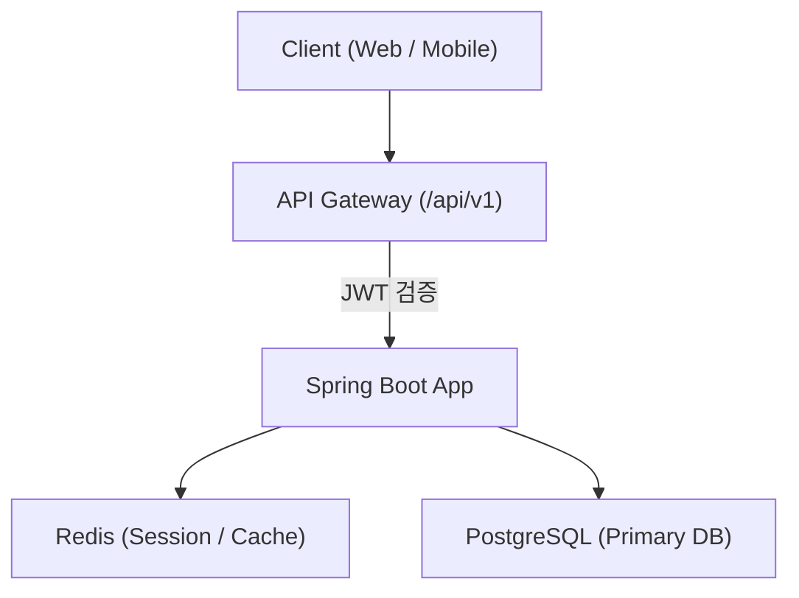

> 프로젝트 저장소에서 개발자가 가장 먼저 읽는 문서는 `README.md`입니다. Shields.io 배지, GitHub Markdown Alert 5종, Mermaid 다이어그램을 조합해 가독성과 유지보수성을 높이는 실무 패턴을 정리합니다.

> 본 문서는 2024년 12월 기준 GitHub Flavored Markdown과 Shields.io v1 API를 기준으로 작성되었습니다.
{: .prompt-info }

## 좋은 README를 구성하는 3가지 요소

줄글 위주의 `README.md`는 핵심 정보를 파악하기 어렵고 코드 변경에 따라 금세 낡습니다. 읽기 좋은 README는 세 요소를 균형 있게 갖춥니다.

1. **상태 한눈에 파악(배지)**: 런타임 버전, 라이선스, CI 빌드 상태를 최상단에서 확인합니다.
2. **핵심 주의사항 강조(Alert)**: 환경 변수 누락이나 데이터 삭제 위험을 일반 문단과 분리합니다.
3. **구조 시각화(Mermaid)**: 요청 흐름과 모듈 구조를 텍스트로 관리해 코드와 함께 최신화합니다.

장식용 배지를 과도하게 나열하거나 노드가 많은 다이어그램을 넣으면 오히려 스캔 속도가 떨어지므로 꼭 필요한 요소만 절제해 배치합니다.

## Shields.io 정적 배지와 동적 배지 활용

### 정적 배지 문법과 이스케이프 규칙

정적 배지는 `https://img.shields.io/badge/<LABEL>-<MESSAGE>-<COLOR>` 형식을 따르며, 쿼리 파라미터로 `style`(`flat`, `flat-square`, `for-the-badge`)과 Simple Icons 기반 `logo`, `logoColor`를 지정합니다.


```markdown


```

경로 방식에서는 하이픈(`-`)이 필드 구분자로, 언더스코어(`_`)가 공백으로 해석됩니다. 리터럴 기호를 넣으려면 `--`(하이픈), `__`(언더스코어)로 겹쳐 써야 하며, 특수문자가 많으면 `/static/v1` 쿼리 방식을 쓰는 편이 안전합니다.

```markdown
<!-- 하이픈(--)과 언더스코어(__) 이스케이프 -->


<!-- 특수문자가 많을 때 사용하는 쿼리 방식 -->

```

### 동적 배지 비교와 선택 기준

런타임 버전이나 라이선스는 정적 배지가 적합하지만, 빌드·품질 게이트·컨테이너 태그처럼 수시로 바뀌는 지표는 동적 배지로 연결해야 문서와 실제 상태가 일치합니다.

| 종류 | 제공처 / 경로 | 갱신 방식 | 적합한 용도 | 주의점 |
| :--- | :--- | :--- | :--- | :--- |
| 정적 배지 | Shields.io `/badge/` | 수동 | 스택, 라이선스 | 업그레이드 시 수동 갱신 필요 |
| GitHub Actions | 저장소 `/workflows/<FILE>/badge.svg` | 실행 시 자동 | CI 빌드·테스트 | 브랜치 지정 시 `?branch=` 추가 |
| SonarCloud | `/api/project_badges/measure` | 분석 시 자동 | Quality Gate | `project`, `metric` 키 명시 |
| Docker Hub | Shields.io `/docker/v/` | API 캐시 | 최신 태그·용량 | 캐시로 반영까지 수 분 지연 |

```markdown
<!-- GitHub Actions 워크플로 배지 -->
[](https://github.com/OWNER/REPO/actions/workflows/ci.yml)

<!-- SonarCloud Quality Gate 배지 -->
[](https://sonarcloud.io/summary/new_code?id=PROJECT_KEY)

<!-- Docker Hub 최신 버전 및 용량 배지 -->


```

> Private 저장소에서는 외부 Shields.io 서버가 인증 없이 접근할 수 없어 동적 배지가 깨집니다. 비공개 저장소의 CI 상태는 GitHub Actions 네이티브 `badge.svg` URL을 사용해야 권한 있는 팀원에게 정상 표시됩니다.
{: .prompt-warning }

## GitHub Markdown Alert 5종 활용

GitHub은 설치 전제 조건이나 위험 경고를 본문과 구분하는 5종의 공식 Markdown Alert 문법을 제공합니다.

| 문법 | 성격 | 권장 사용처 | README 적용 예 |
| :--- | :--- | :--- | :--- |
| `[!NOTE]` | 참고 | 훑어볼 때 유용한 배경 정보 | 지원 OS, 호환 런타임 |
| `[!TIP]` | 조언 | 작업을 돕는 선택적 팁 | Docker Compose 단축 명령 |
| `[!IMPORTANT]` | 필수 | 반드시 알아야 할 선행 조건 | 필수 JDK 버전, `.env` 설정 |
| `[!WARNING]` | 주의 | 잠재적 문제 예방 경고 | Deprecated 옵션, 프로파일 주의 |
| `[!CAUTION]` | 위험 | 데이터 손실·보안 사고 경고 | DB 초기화 스크립트, 시크릿 주의 |

```markdown
> [!NOTE]
> Java 21 가상 스레드 활성화 환경에서 검증되었습니다.

> [!TIP]
> `docker compose up -d`로 PostgreSQL과 Redis를 한 번에 기동할 수 있습니다.

> [!IMPORTANT]
> 실행 전 `.env.example`을 `.env`로 복사해 필수 환경 변수를 채워야 합니다.

> [!WARNING]
> `ddl-auto=create` 옵션은 로컬 전용이며 운영 프로파일에 적용하면 안 됩니다.

> [!CAUTION]
> `scripts/reset-db.sh` 실행 시 기존 볼륨 데이터가 모두 삭제됩니다.
```

Alert 사용 시 두 가지 제약에 주의해야 합니다. 첫째, **Alert 블록은 중첩할 수 없습니다.** Alert 안에 다른 Alert을 넣으면 파싱이 깨져 일반 인용구로 출력됩니다. 둘째, GitHub 웹 전용 확장 문법이므로 npm 패키지 페이지나 일반 마크다운 렌더러에서는 `[!NOTE]` 텍스트가 그대로 노출될 수 있습니다.

## README 내 Mermaid 다이어그램 활용

아키텍처 그림을 PNG 이미지로 관리하면 구조가 바뀔 때마다 원본 툴에서 다시 내보내야 하고, 바이너리 파일이라 `git diff`로 변경점을 리뷰하기 어렵습니다. GitHub은 `mermaid` 코드 블록을 샌드박스 iframe에서 직접 렌더링하므로 이미지 관리 없이 텍스트만으로 버전 관리할 수 있고, 다크 모드에도 자동 대응합니다.

모바일과 좁은 뷰포트에서도 글자가 작아지지 않도록 세로 방향(`flowchart TD`)과 4~6개 핵심 노드로 간결하게 작성합니다.



Mermaid 작성 시 가장 흔한 오류는 **특수문자 인용 누락**입니다. 노드 라벨에 `()`, `[]`, `/`, `:`, `&` 등이 포함되면 파서가 문법 기호로 오인하므로 반드시 `Gateway["API Gateway (/api/v1)"]`처럼 큰따옴표로 감싸야 합니다. 또한 GitHub 내장 Mermaid 버전은 최신 릴리즈보다 다소 늦을 수 있어 PR의 Preview 탭에서 렌더링을 미리 확인하는 편이 안전합니다.

## 정리 및 참고 자료

실무 README는 상단 핵심 배지 3~5개, 필수 주의사항 Alert 1~2개, 세로형 Mermaid 구조도 1개만 조합해도 충분한 가독성을 얻습니다. 온보딩 중 반복 질문이 나오는 지점부터 구조화하면 코드와 함께 살아 있는 문서를 유지할 수 있습니다.

- [Shields.io 공식 문서](https://shields.io/badges)
- [GitHub Docs - Alerts](https://docs.github.com/en/get-started/writing-on-github/getting-started-with-writing-and-formatting-on-github/basic-writing-and-formatting-syntax#alerts)
- [GitHub Docs - Mermaid](https://docs.github.com/en/get-started/writing-on-github/working-with-advanced-formatting/creating-diagrams)
