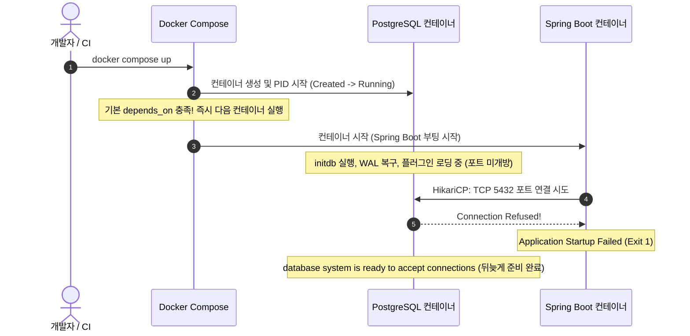
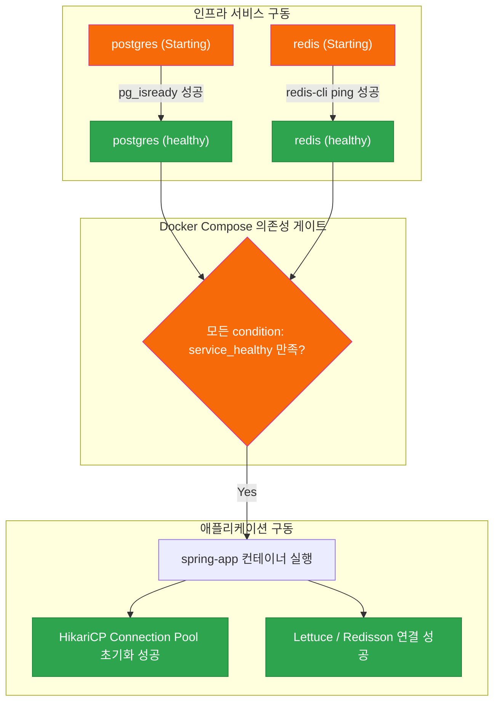
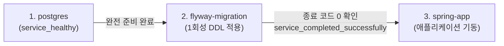

> 로컬 개발 환경이나 CI 파이프라인에서 `docker compose up`을 실행했을 때, 분명 `depends_on`을 걸어두었는데도 Spring Boot가 DB 연결 실패(`Connection refused`)로 비정상 종료되는 현상의 원인을 짚어보고, `healthcheck`와 `condition: service_healthy` 및 Flyway 마이그레이션 체이닝으로 완벽한 기동 순서를 확립하는 실무 해법을 공유합니다.

---

## 1. 문제 상황: `depends_on`을 걸었는데 왜 Spring Boot가 죽을까?

로컬 개발 환경이나 CI/CD 통합 테스트 환경을 구축하면서 누구나 한 번쯤 마주치는 당혹스러운 에러가 있습니다. Docker Compose 파일에 분명 다음과 같이 의존 관계를 명시해 두었습니다.

```yaml
services:
  postgres:
    image: postgres:17-alpine
    # ... 설정 생략 ...

  app:
    build: .
    depends_on:
      - postgres
```

그리고 호기롭게 `docker compose up -d`를 실행하면, 불과 몇 초 뒤 `app` 컨테이너가 조용히 `Exit 1` 상태로 죽어버립니다. 로그를 열어보면 어김없이 다음과 같은 익숙한 스택 트레이스가 찍혀 있습니다.

```text
org.postgresql.util.PSQLException: Connection to localhost:5432 refused. 
Check that the hostname and port are correct and that the postmaster is accepting TCP/IP connections.
	at org.postgresql.core.v3.ConnectionFactoryImpl.openConnectionImpl(ConnectionFactoryImpl.java:342)
	at com.zaxxer.hikari.pool.HikariPool.checkException(HikariPool.java:448)
	at com.zaxxer.hikari.pool.HikariPool.createPoolEntry(HikariPool.java:464)
...
Caused by: java.net.ConnectException: Connection refused (Connection refused)
```

"분명 `depends_on`에 `postgres`를 적어두었는데, 왜 DB가 뜨기도 전에 앱이 연결을 시도하다가 죽는 걸까?"라는 의문이 생길 수밖에 없습니다.

결론부터 말씀드리면, **Docker 엔진 관점에서의 '컨테이너 시작(Started)'과 애플리케이션 관점에서의 '서비스 준비 완료(Ready)'는 완전히 다른 개념**이기 때문입니다.



---

## 2. 원인 분석: Docker 레벨의 Start와 서비스의 Ready 간극

Docker Compose 명세에서 아무런 옵션 없이 `depends_on: [postgres]`라고만 적으면, 이는 기본값인 `condition: service_started`로 동작합니다.

즉, Docker 데몬이 대상 컨테이너의 프로세스(PID)를 포크(fork)하여 컨테이너 상태가 `Created`에서 `Running`으로 전환되는 순간, 의존성이 충족되었다고 판단하고 곧바로 다음 컨테이너를 구동합니다.

하지만 데이터베이스와 같은 무거운 미들웨어는 프로세스가 시작된 직후 다음과 같은 초기화 과정을 거칩니다.

1. 내부 환경 변수 검증 및 디렉터리 권한 확인
2. 데이터 파일 무결성 검사 및 WAL(Write-Ahead Logging) 복구
3. 필수 시스템 카탈로그 및 프로세스 스폰
4. 최종적으로 TCP 소켓 바인딩 및 클라이언트 접속 허용 (`ready to accept connections`)

이 작업에는 짧게는 1~2초, 초기화 스크립트(DDL/DML)가 포함되어 있다면 5~10초 이상이 소요됩니다. 반면 최신 JVM이나 경량화된 컨테이너 환경의 Spring Boot는 기동 즉시 DataSource를 빈으로 등록하며 HikariCP 커넥션 풀을 초기화하려 듭니다. 이때 PostgreSQL의 5432 포트가 아직 열리지 않았으므로 운영체제 레벨에서 `RST` 패킷을 반환하고, 결국 `Connection refused` 예외와 함께 프로세스가 즉사하게 됩니다.

> **과거의 안티패턴들:**  
> 과거 Docker Compose v1 시절에는 이 문제를 해결하기 위해 `wait-for-it.sh`나 `dockerize` 같은 서드파티 쉘 스크립트를 애플리케이션 Dockerfile의 `ENTRYPOINT`에 억지로 집어넣거나, 넷캣(`nc -z`)으로 포트가 열릴 때까지 루프를 돌리는 방식을 자주 사용했습니다.  
> 하지만 이는 애플리케이션 컨테이너 이미지에 불필요한 네트워크 진단 도구를 강제로 설치해야 하고, 멀티 아키텍처 환경에서 스크립트 의존성이 깨지는 문제를 야기했습니다.
{: .prompt-warning }

이제는 모던 Docker Compose(Compose v2)의 네이티브 기능인 **`healthcheck`**와 **`condition: service_healthy`**를 통해 호스트나 앱 이미지의 수정 없이 우아하게 제어할 수 있습니다.

---

## 3. PostgreSQL & Redis 헬스체크(healthcheck) 정의

컨테이너가 단순히 살아있는지(Liveness)를 넘어, 실제로 클라이언트 요청을 처리할 준비가 되었는지(Readiness)를 Docker 엔진에 알려주려면 `healthcheck` 블록을 정의해야 합니다.

### 3.1. PostgreSQL: `pg_isready` 활용

PostgreSQL 공식 이미지에는 서버의 연결 수락 상태를 비파괴적으로 점검할 수 있는 표준 유틸리티인 `pg_isready`가 내장되어 있습니다.

```yaml
services:
  postgres:
    image: postgres:17-alpine
    container_name: app-postgres
    environment:
      POSTGRES_DB: myapp
      POSTGRES_USER: myuser
      POSTGRES_PASSWORD: mysecretpassword
    ports:
      - "5432:5432"
    volumes:
      - pgdata:/var/lib/postgresql/data
    healthcheck:
      test: ["CMD-SHELL", "pg_isready -U myuser -d myapp"]
      interval: 3s
      timeout: 3s
      retries: 5
      start_period: 5s
```

각 옵션의 의미와 실무 튜닝 포인트는 다음과 같습니다.

- **`test`**: 헬스체크를 수행할 명령어입니다. `pg_isready -U <USER> -d <DB>`를 호출하여 PostgreSQL 서버가 정상적으로 쿼리를 수락할 수 있는 상태면 종료 코드 `0`을 반환합니다.
- **`interval`**: 헬스체크 실행 주기입니다. 로컬 기동 시 불필요한 대기 시간을 줄이기 위해 기본값(30s)보다 짧은 `3s~5s`로 설정하는 것이 좋습니다.
- **`timeout`**: 명령어 응답 대기 제한 시간입니다. 이 시간 내에 응답이 없으면 실패로 간주합니다.
- **`retries`**: 연속으로 실패했을 때 컨테이너를 `unhealthy`로 판정할 횟수입니다.
- **`start_period`**: **매우 중요한 옵션**입니다. 컨테이너 초기 기동 시 데이터베이스 초기화나 볼륨 마운트로 인해 소요되는 시간 동안의 실패는 재시도 카운트(`retries`)에 누적하지 않는 유예 기간(Grace period)입니다.

> **`CMD` vs `CMD-SHELL` 차이점:**  
> `test: ["CMD", "curl", "-f", "http://localhost"]` 형식은 쉘 없이 바이너리를 직접 실행합니다.  
> 반면 환경 변수 치환이나 파이프(`|`), 세미콜론이 필요한 복합 명령어는 `test: ["CMD-SHELL", "pg_isready -U $$POSTGRES_USER -d $$POSTGRES_DB"]`처럼 `CMD-SHELL` 형식을 사용해야 합니다.
{: .prompt-info }

### 3.2. Redis: `redis-cli ping` 활용

인메모리 캐시/세션 스토리지로 널리 쓰이는 Redis 역시 클라이언트 명령어를 수신할 준비가 되었는지 점검해야 합니다. Redis 이미지에 내장된 `redis-cli ping`을 사용하면 완벽합니다.

```yaml
services:
  redis:
    image: redis:7-alpine
    container_name: app-redis
    ports:
      - "6379:6379"
    healthcheck:
      test: ["CMD", "redis-cli", "ping"]
      interval: 3s
      timeout: 2s
      retries: 3
      start_period: 2s
```

Redis 서버가 정상이면 `PONG` 문자열과 함께 종료 코드 `0`을 반환하므로 즉시 `healthy` 상태로 전환됩니다.

---

## 4. `condition: service_healthy`를 통한 무결점 기동 제어

미들웨어 컨테이너들에 `healthcheck`를 정의했다면, 이제 Spring Boot 애플리케이션 컨테이너의 `depends_on`에 기동 조건(`condition`)을 명시합니다.

```yaml
services:
  app:
    build:
      context: .
      dockerfile: Dockerfile
    container_name: spring-app
    ports:
      - "8080:8080"
    environment:
      SPRING_DATASOURCE_URL: jdbc:postgresql://postgres:5432/myapp
      SPRING_DATASOURCE_USERNAME: myuser
      SPRING_DATASOURCE_PASSWORD: mysecretpassword
      SPRING_DATA_REDIS_HOST: redis
      SPRING_DATA_REDIS_PORT: 6379
    depends_on:
      postgres:
        condition: service_healthy
      redis:
        condition: service_healthy
```



이렇게 구성하고 `docker compose up`을 실행하면, 터미널에서 Compose 엔진이 다음과 같이 대기하는 모습을 명확하게 확인할 수 있습니다.

```text
[+] Running 3/3
 ✔ Container app-postgres  Healthy                                        4.2s
 ✔ Container app-redis     Healthy                                        1.8s
 ✔ Container spring-app    Created                                        0.0s
Attaching to spring-app
```

`postgres`와 `redis`가 각각 헬스체크를 통과하여 `Healthy` 판정을 받을 때까지 `spring-app` 컨테이너의 기동 자체를 지연시키므로, HikariCP 커넥션 풀 연결 실패는 원천적으로 차단됩니다.

---

## 5. 실무 심화: Flyway DB 마이그레이션 1회성 체이닝

실무 프로젝트에서는 데이터베이스가 정상 기동된 후, 애플리케이션이 뜨기 전에 **DB 스키마 마이그레이션(DDL/DML)**이 먼저 완료되어야 하는 요구사항이 자주 발생합니다.

Spring Boot 내부에서 Flyway를 실행할 수도 있지만, 다음과 같은 문제가 발생할 수 있습니다.
- 애플리케이션을 수평 확장(Multi-instance)할 때 여러 컨테이너가 동시에 마이그레이션 락(`flyway_schema_history` lock)을 획득하려다 레이스 컨디션 발생
- 마이그레이션 오류 시 스프링 부트 컨테이너가 복잡한 에러 상태로 남게 됨

이를 방지하기 위해 공식 `flyway/flyway` 컨테이너를 1회성 잡(`restart: "no"`)으로 분리하고, **`condition: service_completed_successfully`**를 사용해 마이그레이션이 성공(`exit code 0`)한 직후에만 Spring Boot를 기동시키는 체이닝 아키텍처를 구축합니다.



### 5.1. 완성형 `compose.yaml` 아키텍처

아래는 PostgreSQL, Redis, Flyway 마이그레이션, Spring Boot 애플리케이션을 유기적으로 결합한 프로덕션 레벨의 실무 템플릿입니다.

```yaml
services:
  postgres:
    image: postgres:17-alpine
    container_name: app-postgres
    restart: unless-stopped
    environment:
      POSTGRES_DB: myapp
      POSTGRES_USER: myuser
      POSTGRES_PASSWORD: mysecretpassword
    ports:
      - "5432:5432"
    volumes:
      - postgres_data:/var/lib/postgresql/data
    healthcheck:
      test: ["CMD-SHELL", "pg_isready -U myuser -d myapp"]
      interval: 3s
      timeout: 3s
      retries: 5
      start_period: 5s

  redis:
    image: redis:7-alpine
    container_name: app-redis
    restart: unless-stopped
    ports:
      - "6379:6379"
    volumes:
      - redis_data:/data
    healthcheck:
      test: ["CMD", "redis-cli", "ping"]
      interval: 3s
      timeout: 2s
      retries: 3
      start_period: 2s

  flyway:
    image: flyway/flyway:10-alpine
    container_name: app-flyway-migration
    restart: "no" # 1회성 마이그레이션 작업이므로 재시작 비활성화
    command: -connectRetries=10 migrate
    volumes:
      - ./src/main/resources/db/migration:/flyway/sql:ro
    environment:
      FLYWAY_URL: jdbc:postgresql://postgres:5432/myapp
      FLYWAY_USER: myuser
      FLYWAY_PASSWORD: mysecretpassword
    depends_on:
      postgres:
        condition: service_healthy

  app:
    build:
      context: .
      dockerfile: Dockerfile
    container_name: spring-app
    restart: unless-stopped
    ports:
      - "8080:8080"
    environment:
      SPRING_DATASOURCE_URL: jdbc:postgresql://postgres:5432/myapp
      SPRING_DATASOURCE_USERNAME: myuser
      SPRING_DATASOURCE_PASSWORD: mysecretpassword
      SPRING_DATA_REDIS_HOST: redis
      SPRING_DATA_REDIS_PORT: 6379
      # Flyway는 전용 컨테이너에서 끝마쳤으므로 앱 내부 실행은 비활성화
      SPRING_FLYWAY_ENABLED: "false"
    depends_on:
      postgres:
        condition: service_healthy
      redis:
        condition: service_healthy
      flyway:
        condition: service_completed_successfully

volumes:
  postgres_data:
  redis_data:
```

### 5.2. 실행 결과 검증

위 설정으로 `docker compose up`을 실행하면 다음과 같은 정교한 오케스트레이션이 순차적으로 펼쳐집니다.

1. `postgres`와 `redis` 컨테이너가 동시에 구동됩니다.
2. 약 3~4초 후 두 서비스 모두 `pg_isready`와 `redis-cli ping` 헬스체크를 통과하여 `Healthy` 상태가 됩니다.
3. PostgreSQL이 준비되자마자 `flyway` 컨테이너가 기동되어 마이그레이션 스크립트를 적용하고 `Exited (0)`으로 정상 종료됩니다.
4. Flyway가 종료 코드 `0`을 뱉은 것을 감지한 Docker Compose 엔진이 최종적으로 `spring-app` 컨테이너를 구동합니다.
5. Spring Boot는 최신 스키마가 완벽히 적용된 DB와 안정적인 Redis 캐시에 즉시 접속하여 단 한 번의 커넥션 에러 없이 부팅을 완료합니다.

---

## 6. 실무 적용 시 주의사항 및 베스트 프랙티스

1. **`start_period`를 반드시 지정하세요.**  
   DB 볼륨에 데이터가 수십 기가바이트 이상 누적되어 있거나 초기 기동 시 인덱스를 복구해야 하는 경우, 헬스체크 초기 몇 회는 필연적으로 실패할 수 있습니다. `start_period`를 주지 않으면 일시적인 부하로 인해 컨테이너가 `unhealthy`로 낙인찍혀 오케스트레이션이 멈출 수 있습니다.

2. **파일명은 `compose.yaml`을 우선 권장합니다.**  
   Docker Compose Specification 최신 표준에서는 기존의 `docker-compose.yml` 대신 `compose.yaml`을 표준 파일명으로 권장하고 있습니다.

3. **CI/CD 파이프라인에서의 타임아웃 방어:**  
   네트워크 장애나 외부 요인으로 인해 헬스체크가 무한 대기하지 않도록, `retries`와 `timeout`의 곱이 30초~1분을 넘지 않도록 상한선을 명확히 두는 것이 파이프라인 격리에 유리합니다.

---

## 마치며

단순히 `depends_on`을 나열하는 것만으로는 분산 환경과 컨테이너 아키텍처의 비동기적 기동 순서를 보장할 수 없습니다. 

컨테이너 데몬의 상태(`service_started`)와 실제 서비스의 준비 상태(`service_healthy`), 그리고 배치성 태스크의 성공 종료(`service_completed_successfully`)를 적재적소에 조합하면, 로컬 개발 환경뿐 아니라 복잡한 CI/CD 파이프라인에서도 흔들림 없는 안정적인 인프라 환경을 완성할 수 있습니다.
