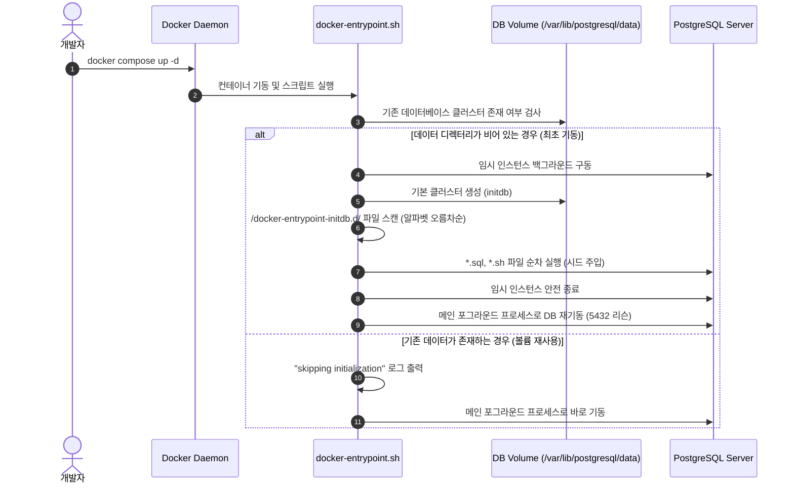
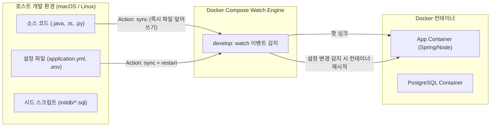

> 로컬 개발 환경을 세팅할 때마다 매번 수동으로 테스트 계정을 생성하고 더미 데이터를 INSERT하느라 시간을 낭비하셨나요? 공식 DB 이미지의 `/docker-entrypoint-initdb.d/` 디렉터리 동작 원리와 멱등성 보장 패턴, 그리고 Docker Compose Watch(`develop.watch`)를 통해 코드와 데이터를 재빌드 없이 실시간 핫 리로드하는 실무 아키텍처를 정리합니다.

---

## 1. 로컬 개발 환경의 고질병: "DB에 테스트 데이터가 없는데요?"

백엔드 프로젝트를 새로 클론받은 신규 팀원이 로컬 서버를 띄우자마자 마주하는 첫 장벽은 대부분 **"테스트할 데이터가 없다"**는 점입니다. 로그인할 테스트 유저(`test@example.com`), 기본 권한 테이블, 상품 카테고리 등 최소한의 마스터 데이터가 비어 있으면 API 호출조차 제대로 검증할 수 없습니다.

실무에서 이를 해결하기 위해 종종 다음과 같은 방식을 선택하지만, 각각 뚜렷한 한계가 존재합니다.

1. **애플리케이션 구동 시점의 `CommandLineRunner` / `@PostConstruct` 주입:**
   - Spring Boot나 NestJS 등의 앱 코드 내에서 조건부로 데이터를 INSERT하는 방식입니다.
   - 로컬 전용 더미 로직이 프로덕션 코드베이스를 오염시키며, 엔티티 검증 로직 변경 시 애플리케이션 부팅 자체가 실패하는 부작용이 있습니다.
2. **개발자 개개인이 슬랙에 공유된 SQL 스크립트를 수동 실행:**
   - 실행 순서가 꼬이거나 최신 스키마가 반영되지 않아 "제 로컬에서는 되는데요" 문제가 반복됩니다.
3. **ORM의 `ddl-auto: create-drop` 의존:**
   - 애플리케이션 재시작마다 기존 작업 데이터가 통째로 증발하여 상태 기반의 디버깅이 불가능해집니다.

가장 깔끔하고 견고한 접근법은 **데이터베이스 컨테이너 레이어에서 인프라 수준으로 시드 데이터를 통제**하는 것입니다.

---

## 2. `/docker-entrypoint-initdb.d/` 동작 원리와 라이프사이클

PostgreSQL, MySQL, MariaDB 등 Docker 공식 데이터베이스 이미지는 최초 기동 시 데이터베이스를 초기화할 수 있는 강력한 훅(Hook) 메커니즘인 `/docker-entrypoint-initdb.d/` 경로를 기본 제공합니다.

### 2.1 엔트리포인트 내부 동작 흐름

컨테이너가 기동되면 `docker-entrypoint.sh` 스크립트가 실행되며, 데이터 디렉터리(`PGDATA` 또는 `/var/lib/mysql`)의 상태에 따라 실행 분기가 나뉩니다.



핵심은 **데이터 디렉터리가 비어 있을 때 단 한 번만 실행된다**는 점입니다. 이미 한 번 초기화된 영속 볼륨이 마운트되어 있다면, 이 디렉터리에 아무리 새로운 SQL을 추가해도 엔트리포인트는 이를 건너뜁니다.

### 2.2 스크립트 파일 네이밍 및 순서 제어

엔트리포인트는 디렉터리 내 파일들을 **알파벳 사전 순(Ascending Lexicographical Order)**으로 정렬하여 실행합니다. 따라서 외래 키(FK) 제약조건과 확장 모듈 의존성을 고려해 숫자 접두사를 명확히 부여해야 합니다.

```
infra/docker/initdb/
├── 01_init_extensions.sql    # uuid-ossp, pg_trgm 등 확장 모듈 활성화
├── 02_create_tables.sql       # DDL: 테이블 및 인덱스 정의
└── 03_seed_master_data.sql    # DML: 테스트 계정, 롤, 마스터 코드 주입
```

---

## 3. 멱등성(Idempotency) 보장 패턴: ON CONFLICT와 시퀀스 보정

로컬 개발 중에는 볼륨을 리셋하지 않고 특정 시드 스크립트만 수동으로 재실행하거나, 마이그레이션 도구(Flyway/Liquibase)와 결합하여 실행해야 하는 상황이 빈번합니다. 스크립트가 여러 번 실행되어도 항상 일관된 상태를 보장하도록 **멱등성(Idempotency)**을 반드시 갖추어야 합니다.

### 3.1 `ON CONFLICT DO NOTHING` / `DO UPDATE`

PostgreSQL 9.5+부터 지원되는 UPSERT 문법을 적극 활용합니다.

```sql
-- 03_seed_master_data.sql

-- 1. 고정 UUID를 가진 기본 관리자 및 테스트 유저 주입
INSERT INTO users (id, email, name, role, created_at, updated_at)
VALUES 
    ('11111111-1111-1111-1111-111111111111', 'admin@example.com', 'Admin User', 'ROLE_ADMIN', NOW(), NOW()),
    ('22222222-2222-2222-2222-222222222222', 'developer@example.com', 'Dev User', 'ROLE_USER', NOW(), NOW())
ON CONFLICT (email) DO UPDATE 
SET 
    name = EXCLUDED.name,
    role = EXCLUDED.role,
    updated_at = NOW();

-- 2. 시스템 기본 설정값 (중복 시 무시)
INSERT INTO system_configs (config_key, config_value, description)
VALUES 
    ('FEATURE_FLAG_BETA', 'true', '베타 기능 활성화 여부'),
    ('MAX_LOGIN_ATTEMPTS', '5', '로그인 최대 시도 횟수')
ON CONFLICT (config_key) DO NOTHING;
```

### 3.2 자동 증가 PK(Sequence) 불일치 함정 방지

정수형 `SERIAL` 또는 `BIGINT GENERATED ALWAYS AS IDENTITY`를 사용하는 테이블에 수동으로 ID 번호를 지정하여 시드 데이터를 넣으면 치명적인 문제가 발생합니다.

> "시드 데이터는 1~10번까지 들어갔는데, 애플리케이션에서 새 데이터를 INSERT하려니 `duplicate key value violates unique constraint` 에러가 납니다!"
{: .prompt-warning }

수동 INSERT는 내부 시퀀스 카운터를 증가시키지 않기 때문입니다. 따라서 스크립트 말미에 반드시 시퀀스를 최대 ID 값으로 동기화하는 로직을 포함해야 합니다.

```sql
-- 정수 ID를 수동 삽입한 경우 시퀀스 보정 (PostgreSQL 전용)
SELECT setval(
    pg_get_serial_sequence('categories', 'id'),
    COALESCE((SELECT MAX(id) FROM categories), 1),
    true
);
```

---

## 4. 볼륨 라이프사이클과 초기화 레시피 (Makefile 패턴)

앞서 언급했듯이 볼륨이 이미 존재하면 `initdb.d`는 재실행되지 않습니다. 테이블 구조를 바꾸거나 시드 데이터를 대폭 수정했을 때, 어떻게 안전하고 빠르게 DB를 리셋할 수 있을까요?

### 4.1 위험한 `docker compose down -v`

흔히 사용하는 `docker compose down -v`는 Compose 파일에 정의된 **모든 명명된 볼륨(Redis, Kafka, DB 등)을 전부 삭제**합니다. Redis 캐시나 로컬 S3 에뮬레이터(MinIO) 데이터까지 날아가 원치 않는 개발 중단이 발생할 수 있습니다.

### 4.2 실무 권장: 정밀 리셋 스크립트

프로젝트 루트의 `Makefile` 또는 `package.json`에 DB 볼륨만 타깃하여 재생성하는 레시피를 만들어두면 팀 전체의 생산성이 비약적으로 상승합니다.

```makefile
# Makefile
.PHONY: db-up db-down db-reset db-seed-only

# DB 컨테이너만 백그라운드 기동
db-up:
	docker compose up -d postgres

# DB 컨테이너 중지
db-down:
	docker compose stop postgres

# DB 볼륨만 완전히 날리고 클린 상태로 재초기화
db-reset:
	@echo "==> PostgreSQL 컨테이너 및 볼륨 초기화 시작..."
	docker compose rm -s -f -v postgres
	docker volume rm -f myproject_postgres_data
	docker compose up -d postgres
	@echo "==> 최신 시드 데이터로 DB가 재구성되었습니다."

# 실행 중인 DB에 시드 스크립트만 강제로 재적용 (멱등 SQL 덕분에 안전)
db-reseed:
	@echo "==> 시드 데이터 수동 재주입..."
	docker compose exec -T postgres psql -U app_user -d app_db < infra/docker/initdb/03_seed_master_data.sql
```

{: .prompt-tip }
> `docker compose rm -s -f -v <서비스명>`을 사용하면 해당 컨테이너를 강제 정지(-s, -f)하고 익명 볼륨(-v)까지 한 번에 정리할 수 있습니다. 명명된 볼륨(Named Volume)은 `docker volume rm`으로 명시 삭제합니다.

---

## 5. Docker Compose Watch: 이미지 재빌드 없는 실시간 핫 리로드

시드 데이터와 DB 환경을 정비했더라도 백엔드 앱 개발 중에 사소한 설정 변경이나 정적 파일 수정이 발생할 때마다 `docker compose build && docker compose up`을 반복하는 것은 막대한 시간 낭비입니다.

Docker Compose v2.22부터 정식 도입된 **Compose Watch (`develop: watch`)**는 로컬 파일시스템의 변경 이벤트를 감지하여 컨테이너 내부로 즉각적인 동기화(Sync) 또는 프로세스 재시작(Restart)을 트리거합니다.

### 5.1 바인드 마운트(Bind Mount) vs Compose Watch

기존 로컬 개발에서 흔히 쓰던 볼륨 바인드 마운트(`volumes: - .:/app`)는 macOS/Windows 환경에서 VirtioFS/gRPC-FUSE 레이어로 인한 **느린 파일 I/O 속도**와 **컨테이너 내부와 호스트 간 파일 권한(UID/GID) 불일치** 문제를 야기했습니다.

Compose Watch는 파일 감시 이벤트를 Compose 데몬이 중계하여 필요한 파일만 컨테이너 가상 파일시스템에 네이티브 속도로 주입합니다.



### 5.2 3가지 Watch Action 완벽 비교

| Action | 동작 설명 | 주 사용 케이스 |
| :--- | :--- | :--- |
| **`sync`** | 변경된 호스트 파일을 컨테이너의 지정 경로로 1:1 즉각 덮어씁니다. | 프론트엔드 정적 리소스, 핫 리로딩 지원 언어 소스, 템플릿 |
| **`sync+restart`** | 파일을 동기화한 뒤 컨테이너 프로세스를 자동으로 안전하게 재시작합니다. | `application.yml`, `.env`, 서버 설정 파일 변경 시 |
| **`rebuild`** | 변경 감지 시 이미지를 백그라운드에서 다시 빌드하고 컨테이너를 교체합니다. | `package.json`, `build.gradle`, `pom.xml`, `Dockerfile` |

### 5.3 실무 표준 `compose.yaml` 통합 설정

다음은 PostgreSQL 시드 데이터 자동 주입과 백엔드 애플리케이션의 Compose Watch를 결합한 프로덕션급 로컬 개발 템플릿입니다.

```yaml
# compose.yaml
services:
  postgres:
    image: postgres:17-alpine
    container_name: local-postgres
    restart: unless-stopped
    environment:
      POSTGRES_DB: app_db
      POSTGRES_USER: app_user
      POSTGRES_PASSWORD: app_secure_password
      PGDATA: /var/lib/postgresql/data/pgdata
    ports:
      - "5432:5432"
    volumes:
      - postgres_data:/var/lib/postgresql/data
      - ./infra/docker/initdb:/docker-entrypoint-initdb.d:ro
    healthcheck:
      test: ["CMD-SHELL", "pg_isready -U app_user -d app_db"]
      interval: 5s
      timeout: 5s
      retries: 5

  backend:
    build:
      context: .
      dockerfile: Dockerfile.dev
    container_name: local-backend
    ports:
      - "8080:8080"
      - "5005:5005" # 원격 디버깅 포트
    environment:
      SPRING_PROFILES_ACTIVE: local
      SPRING_DATASOURCE_URL: jdbc:postgresql://postgres:5432/app_db
      SPRING_DATASOURCE_USERNAME: app_user
      SPRING_DATASOURCE_PASSWORD: app_secure_password
    depends_on:
      postgres:
        condition: service_healthy
    develop:
      watch:
        # 1. 의존성 파일 변경 시 이미지 자동 재빌드
        - action: rebuild
          path: ./build.gradle
        - action: rebuild
          path: ./settings.gradle

        # 2. 설정 파일 변경 시 동기화 후 컨테이너 재시작
        - action: sync+restart
          path: ./src/main/resources/application-local.yml
          target: /app/src/main/resources/application-local.yml

        # 3. 소스 코드 수정 시 즉시 동기화 (앱 내 Spring DevTools 등이 핫스왑 처리)
        - action: sync
          path: ./src/main/java
          target: /app/src/main/java
          ignore:
            - "**/.*"
            - "**/*.class"

volumes:
  postgres_data:
```

### 5.4 실행 및 개발 루프 확인

이제 터미널에서 다음 단 한 줄의 명령어로 개발 환경을 기동합니다.

```bash
docker compose watch
```

```text
[+] Running 3/3
 ✔ Network myproject_default     Created
 ✔ Container local-postgres       Healthy
 ✔ Container local-backend        Started
Watch enabled for service "backend"
Syncing src/main/java to /app/src/main/java...
[backend] Reloading application due to file changes...
```

소스를 수정하고 저장(`Cmd + S`)하는 즉시 별도의 `docker build` 없이 코드가 컨테이너 내부로 전송되어 1~2초 내에 변경 사항이 반영됩니다.

---

## 6. 시드 데이터 관리 시 주의해야 할 3가지 원칙

1. **실 운영 데이터 덤프 직접 사용 금지:**
   - 마이그레이션 테스트라는 명목으로 프로덕션 DB 덤프를 로컬 시드에 넣으면 개인정보보호법 위반 및 보안 유출 사고로 이어집니다.
   - 반드시 Faker 라이브러리나 스크립트를 통해 생성된 가명/익명 더미 데이터만 버전 관리(`git`) 대상에 포함해야 합니다.
2. **시드 데이터 파일의 읽기 전용(`:ro`) 마운트:**
   - Compose 설정에서 `./infra/docker/initdb:/docker-entrypoint-initdb.d:ro`와 같이 반드시 읽기 전용 플래그를 붙여 컨테이너 내부 프로세스가 호스트의 원본 SQL을 오염시키는 사고를 차단합니다.
3. **최소 유효 시드 세트(Minimal Viable Seed) 유지:**
   - 로컬 부팅 속도를 위해 시드 데이터는 수십만 건의 빅데이터가 아닌, 핵심 비즈니스 플로우(가입, 결제, 상품 조회)를 온전히 테스트할 수 있는 최소 단위(수십~수백 건)로 경량화하여 유지해야 합니다.

---

## 7. 마치며

로컬 개발 환경의 성숙도는 팀의 전체 개발 속도와 온보딩 비용을 결정하는 중요한 척도입니다. 

`/docker-entrypoint-initdb.d/`를 통한 인프라 레벨의 멱등 시드 주입과 Docker Compose Watch의 핫 리로드를 결합하면, 신규 입사자도 `git clone` 후 명령어 한 줄로 완벽히 격리되고 실시간 반응하는 개발 환경을 손에 쥐게 됩니다. 아직도 수동 INSERT와 이미지 전체 재빌드로 시간을 소모하고 있다면, 오늘 소개한 구성을 여러분의 팀 프로젝트에 즉시 적용해 보시길 권장합니다.
