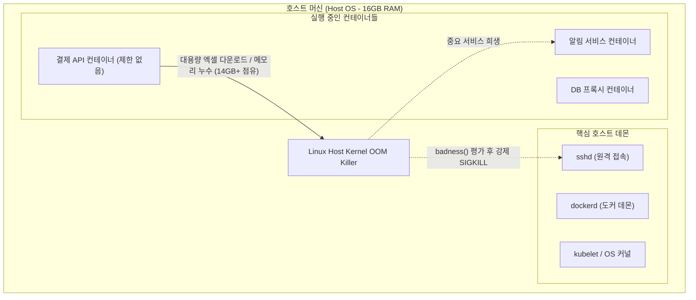
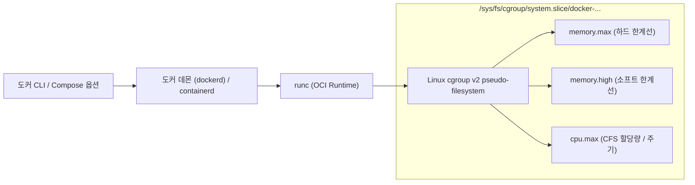
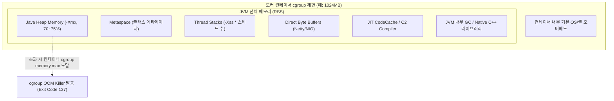

> 컨테이너에 리소스 상한을 지정하지 않아 발생할 수 있는 호스트 OS 마비 현상을 방지하고, 리눅스 cgroup v2 기반의 CPU·메모리 제어 원리와 JVM 런타임 최적화, 그리고 OOMKilled(Exit Code 137) 추적 및 대응법을 상세히 정리합니다.

---

## 1. 메모리 제한 없는 컨테이너의 위험성: Noisy Neighbor와 호스트 마비

도커(Docker)를 처음 실무에 도입할 때 흔히 저지르는 실수 중 하나는 `docker run`이나 `compose.yaml`에 별도의 리소스 제약 조건을 명시하지 않는 것입니다.

기본적으로 도커 컨테이너는 호스트 OS의 커널과 하드웨어 리소스를 아무런 제약 없이 공유합니다. 즉, 컨테이너 내부의 프로세스는 호스트 머신이 보유한 전체 CPU 코어와 물리 메모리(RAM)를 제한 없이 요청할 수 있습니다.



### Noisy Neighbor와 호스트 OOM Killer의 동작

컨테이너 중 하나에서 메모리 누수(Memory Leak)가 발생하거나, 대용량 트래픽 급증으로 인해 대량의 메모리를 순간적으로 할당받기 시작하면 다음과 같은 재앙이 발생합니다:

1. **호스트 여유 메모리 고갈**: 문제 컨테이너가 호스트의 가용 메모리를 모두 점유합니다.
2. **리눅스 호스트 커널 OOM Killer 발동**: 커널은 시스템 붕괴를 막기 위해 프로세스별 메모리 점유율과 `oom_score`를 계산하여 가장 희생시키기 적합한 대상을 선정합니다.
3. **무차별 SIGKILL 발생**: OOM Killer는 문제의 컨테이너 내부 프로세스뿐만 아니라, 시스템 운영에 필수적인 `sshd`, `dockerd`, 데이터베이스 데몬 등을 종료시켜 버릴 수 있습니다.
4. **호스트 응답 불가(Hang)**: 원격 SSH 접속조차 불가능해져 결국 물리 서버 리셋 버튼을 누르거나 인스턴스를 강제 재부팅해야 하는 장애로 이어집니다.

이러한 이웃 간섭(Noisy Neighbor) 문제를 원천 차단하려면, 컨테이너가 사용할 수 있는 최대 리소스 상한선을 반드시 격리된 단위로 지정해야 합니다.

---

## 2. Linux cgroup v2 기반 Docker 리소스 제어 메커니즘

도커의 리소스 제한은 리눅스 커널의 핵심 기능인 **cgroups (Control Groups)**를 통해 구현됩니다. 최신 리눅스 배포판(Ubuntu 22.04+, Debian 11+, RHEL 9+)과 최신 도커 엔진은 단일 계층 구조와 일관된 인터페이스를 제공하는 **cgroup v2**를 기본으로 사용합니다.



### 1) 메모리 제한: `--memory`, `--memory-swap`, `--memory-reservation`

도커 실행 시 부여하는 메모리 플래그들은 cgroup v2 가상 파일 시스템의 속성과 직접 대응됩니다:

| 도커 CLI 플래그 | cgroup v2 매핑 파일 | 설명 및 권장 설정 |
| :--- | :--- | :--- |
| `--memory`, `-m` | `memory.max` | 컨테이너가 사용할 수 있는 **최대 물리 메모리(Hard Limit)**입니다. 이 값을 초과하면 cgroup OOM Killer가 동작합니다. |
| `--memory-reservation` | `memory.low` / `memory.high` | 평상시 보장받는 최소/경고 메모리(Soft Limit)입니다. 호스트 메모리가 부족할 때 이 기준선 이하의 컨테이너는 회수 대상에서 보호됩니다. |
| `--memory-swap` | `memory.swap.max` + `memory.max` | 물리 메모리와 스왑 메모리의 **총합**입니다. |

> `--memory`와 `--memory-swap` 설정 시 주의점  
> `--memory-swap`의 값은 물리 메모리를 포함한 **전체 크기(RAM + Swap)**를 의미합니다. 예를 들어 `--memory="1g" --memory-swap="2g"`로 지정하면 물리 RAM은 1GB, 스왑은 1GB(총 2GB)까지 허용됩니다.
{: .prompt-info }

> 스왑 메모리를 완전히 비활성화하려면 `--memory-swap`을 `--memory`와 **동일한 크기**로 지정해야 합니다. 만약 스왑을 무제한 허용하면 메모리 초과 시 디스크 I/O 트래싱(Thrashing)이 발생하여 컨테이너 응답 속도가 급격히 저하됩니다.
{: .prompt-warning }

```bash
# 물리 메모리 1GB 제한 및 스왑 완전 차단 (추천 실무 설정)
docker run -d \
  --name order-api \
  --memory="1g" \
  --memory-swap="1g" \
  --memory-reservation="768m" \
  my-order-api:latest
```

### 2) CPU 제한: `--cpus`와 CFS(Completely Fair Scheduler)

CPU 제한은 메모리와 달리 초과 시 프로세스가 강제 종료되지 않고 **스로틀링(CPU Throttling)**이 발생합니다. 도커는 리눅스 커널의 CFS 스케줄러를 기반으로 CPU 타임 슬라이스를 분배합니다.

* `--cpus="1.5"`: 호스트가 몇 개의 CPU 코어를 가지고 있든, 해당 컨테이너에 매 스케줄링 주기(`cpu.cfs_period_us`, 기본 100,000µs = 100ms)마다 최대 150,000µs(`cpu.cfs_quota_us`) 분량의 연산 시간을 보장 및 상한선으로 둡니다.

cgroup v2에서는 이 값이 단일 파일인 `cpu.max`에 기록됩니다:
```bash
# cgroup v2 내부 확인 예시
$ cat /sys/fs/cgroup/system.slice/docker-<CONTAINER_ID>.scope/cpu.max
150000 100000
# [quota] [period] 순서로 표기됨
```

```bash
# CPU 1.5 코어 할당 예시
docker run -d \
  --name payment-worker \
  --cpus="1.5" \
  my-worker:latest
```

---

## 3. JVM과 컨테이너의 불협화음: 1GB 컨테이너에 1GB 힙을 주면 터지는 이유

스프링 부트(Spring Boot) 등 Java 기반 백엔드 애플리케이션을 도커에 올릴 때 가장 빈번하게 발생하는 장애 패턴이 있습니다.

> "컨테이너 메모리를 1GB(`--memory=1g`)로 주고, 자바 힙 옵션을 `-Xmx1024m`로 줬는데 트래픽이 몰리면 컨테이너가 죽어버립니다."

그 이유는 **JVM의 전체 프로세스 메모리는 Java Heap이 전부가 아니기 때문**입니다.



### JVM 메모리 오버헤드 구조

컨테이너가 소모하는 실제 물리 메모리(Resident Set Size, RSS)는 아래 요소의 총합입니다:

$$\text{Total Memory} = \text{Heap} + \text{Metaspace} + (\text{Thread 수} \times \text{Stack 크기}) + \text{Direct Memory} + \text{CodeCache} + \text{Native Overhead}$$

* **Metaspace**: 로딩된 클래스와 메서드 메타데이터가 저장되는 네이티브 메모리 영역 (보통 128MB ~ 256MB 소모)
* **Thread Stack**: 기본 스레드당 1MB (`-Xss1m`). 톰캣 기본 워커 스레드가 200개라면 스레드 스택만으로 **200MB**를 소비할 수 있습니다.
* **Direct Memory**: Netty, Spring WebFlux, gRPC 등 고성능 비동기 I/O를 사용하는 라이브러리가 OS 소켓 통신을 위해 다이렉트 버퍼를 할당합니다.
* **JIT CodeCache**: 바이트코드를 컴파일한 네이티브 코드가 보관되는 영역 (보통 64MB ~ 128MB)

따라서 1GB 컨테이너에 `-Xmx1024m`를 부여하면, 힙이 가득 차기도 전에 네이티브 메모리가 200~400MB를 추가로 소비하면서 즉시 cgroup `memory.max` 한계선에 부딪혀 OOMKilled가 발생합니다.

### 실무 권장 JVM 옵션: ContainerSupport와 RAMPercentage

현대 Java (JDK 8u191+, JDK 10+)부터는 컨테이너 리소스를 감지하는 `-XX:+UseContainerSupport`가 기본 활성화되어 있습니다. 따라서 절대적인 고정값(`-Xmx`) 대신 **비율 기반 옵션**을 사용하는 것이 훨씬 안전합니다.

```dockerfile
# 권장 Dockerfile 실행 엔트리포인트
FROM eclipse-temurin:21-jre-alpine

WORKDIR /app
COPY app.jar app.jar

ENV JAVA_OPTS="-XX:+UseContainerSupport \
               -XX:MaxRAMPercentage=70.0 \
               -XX:InitialRAMPercentage=70.0 \
               -XX:+ExitOnOutOfMemoryError \
               -Djava.security.egd=file:/dev/./urandom"

ENTRYPOINT ["sh", "-c", "java $JAVA_OPTS -jar app.jar"]
```

* `-XX:MaxRAMPercentage=70.0`: 컨테이너에 할당된 전체 메모리의 **70%**만을 힙 메모리 최댓값으로 사용합니다. 남은 30%는 Metaspace, Netty Direct Memory, Thread Stack 등 네이티브 메모리 영역을 위해 남겨둡니다. (메모리가 2GB 이상으로 여유가 있다면 75%까지 상향 가능)
* `-XX:+ExitOnOutOfMemoryError`: 자바 힙 OOM 발생 시 프로세스를 즉시 종료하여 컨테이너 오케스트레이터(Docker Swarm, Kubernetes)가 즉시 재시작할 수 있도록 유도합니다.

---

## 4. Exit Code 137과 OOMKilled 실전 트러블슈팅

운영 환경에서 컨테이너가 갑자기 사라졌거나 재시작을 반복할 때, 가장 먼저 프로세스 종료 코드를 확인해야 합니다.

### Exit Code 137의 수학적 의미

리눅스 표준 규격에 따라 쉘의 Exit Code는 `128 + Signal Number`로 계산됩니다:

$$\text{Exit Code } 137 = 128 + 9 \ (\text{SIGKILL})$$

즉, 프로세스가 애플리케이션 차원의 예외나 정상적인 `SIGTERM`(143 = 128 + 15)으로 우아하게 종료된 것이 아니라, **OS 커널에 의해 강제로 즉사(SIGKILL)**당했음을 의미합니다.

### 1단계: `docker inspect`로 OOM 여부 확인

```bash
docker inspect <컨테이너_이름_또는_ID> --format '{{json .State}}' | jq
```

출력 결과 중 `OOMKilled` 필드를 확인합니다:
```json
{
  "Status": "exited",
  "Running": false,
  "Paused": false,
  "Restarting": false,
  "OOMKilled": true,
  "Dead": false,
  "Pid": 0,
  "ExitCode": 137,
  "Error": ""
}
```

`"OOMKilled": true`로 표시된다면 해당 컨테이너는 자신이 속한 cgroup의 메모리 한계선(`memory.max`)을 초과하여 종료된 것입니다.

### 2단계: 호스트 커널 로그 (`dmesg`) 확인

커널 레벨에서 구체적으로 어떤 프로세스가 메모리를 얼마나 들고 죽었는지 확인하려면 호스트 머신에서 `dmesg`를 확인해야 합니다:

```bash
# dmesg 타임스탬프와 함께 OOM 이벤트 검색
sudo dmesg -T | grep -i -E "oom|killed process"
```

실제 커널 로그 예시:
```text
[Mon Jun  2 14:22:15 2026] Memory cgroup out of memory: Killed process 349121 (java) total-vm:2841924kB, anon-rss:1042312kB, file-rss:32140kB, shmem-rss:0kB, UID:1000 pgtables:2412kB oom_score_adj:0
[Mon Jun  2 14:22:15 2026] oom_reaper: reaped process 349121 (java), now anon-rss:0kB, file-rss:0kB, shmem-rss:0kB
```

* `Memory cgroup out of memory`: 호스트 전체 메모리 부족이 아닌, 해당 **컨테이너의 cgroup 메모리 부족**으로 격리 종료되었음을 알 수 있습니다.
* `anon-rss:1042312kB`: 익명 메모리(실제 할당된 힙/스택 등)가 약 1,017MB에 도달하여 1GB 제한에 걸렸음을 확인할 수 있습니다.

### 3단계: cgroup v2 메모리 압박 이벤트 모니터링

cgroup v2 환경에서는 컨테이너 밖에서 메모리 압박 상태를 파일로 직접 관찰할 수 있습니다:

```bash
cat /sys/fs/cgroup/system.slice/docker-<CONTAINER_ID>.scope/memory.events
```

출력 항목:
* `low`: memory.low를 넘어서 회수 작업이 발생한 횟수
* `high`: memory.high를 넘어서 프로세스가 스로틀링된 횟수
* `max`: memory.max에 도달하여 OOM Killer 직전까지 간 횟수
* `oom`: OOM Killer가 호출된 횟수
* `oom_kill`: 실제 프로세스가 사살된 횟수

---

## 5. 실전 모범 규격: Compose 기반 완벽 가이드

실무 배포 환경에서는 단일 CLI 명령어보다 `compose.yaml`을 사용하는 경우가 대부분입니다. 프로덕션 환경에 바로 적용할 수 있는 권장 리소스 제어 템플릿은 다음과 같습니다.

```yaml
services:
  payment-api:
    image: mycompany/payment-api:1.0.0
    container_name: payment-api
    restart: on-failure:5
    environment:
      - JAVA_OPTS=-XX:+UseContainerSupport -XX:MaxRAMPercentage=70.0 -XX:+ExitOnOutOfMemoryError
    ports:
      - "8080:8080"
    deploy:
      resources:
        limits:
          cpus: '2.0'             # 최대 2개 코어 상당의 연산량 허용
          memory: 1536M           # 최대 메모리 하드 리밋 (1.5GB)
        reservations:
          cpus: '0.5'             # 최소 0.5 코어는 항상 보장
          memory: 1024M           # 1GB 메모리는 보장 예약
    # 스왑 메모리를 물리 메모리와 동일하게 고정하여 스왑 차단
    memswap_limit: 1536M
    labels:
      logging.monitor: "true"
```

> `compose.yaml`에서 Compose V2 스펙  
> `deploy.resources.limits`와 `reservations`는 Compose V2 및 Docker Compose v2.0+ 버전에서 `docker compose up` 실행 시 단일 노드 로컬/서버 환경에서도 기본적으로 반영됩니다.
{: .prompt-tip }

---

## 마치며: 운영 환경 리소스 설계 체크리스트

컨테이너 환경에서 안정적인 백엔드 시스템을 운영하기 위해 배포 전 반드시 점검해야 할 4가지 원칙입니다:

1. **모든 컨테이너에 상한선(`limits.memory`)을 명시했는가?**  
   상한선이 없는 컨테이너는 언젠가 호스트 OS 전체를 다운시키는 시한폭탄이 됩니다.
2. **스왑 메모리를 의도적으로 통제하고 있는가?**  
   예측 불가능한 디스크 지연을 막으려면 `--memory-swap`을 `--memory`와 동일하게 지정하거나 적절한 상한을 두어야 합니다.
3. **런타임(JVM/Node.js/Go)의 네이티브 오버헤드를 고려했는가?**  
   자바 애플리케이션의 경우 힙 크기(`MaxRAMPercentage`)를 컨테이너 상한의 70% 수준으로 맞추고 비힙 영역을 여유 있게 확보하십시오.
4. **Exit Code 137 발생 시 `dmesg`와 `docker inspect`로 원인을 증명했는가?**  
   단순한 애플리케이션 비정상 종료와 cgroup OOMKilled를 명확히 구분하여 메트릭을 추적해야 합니다.
