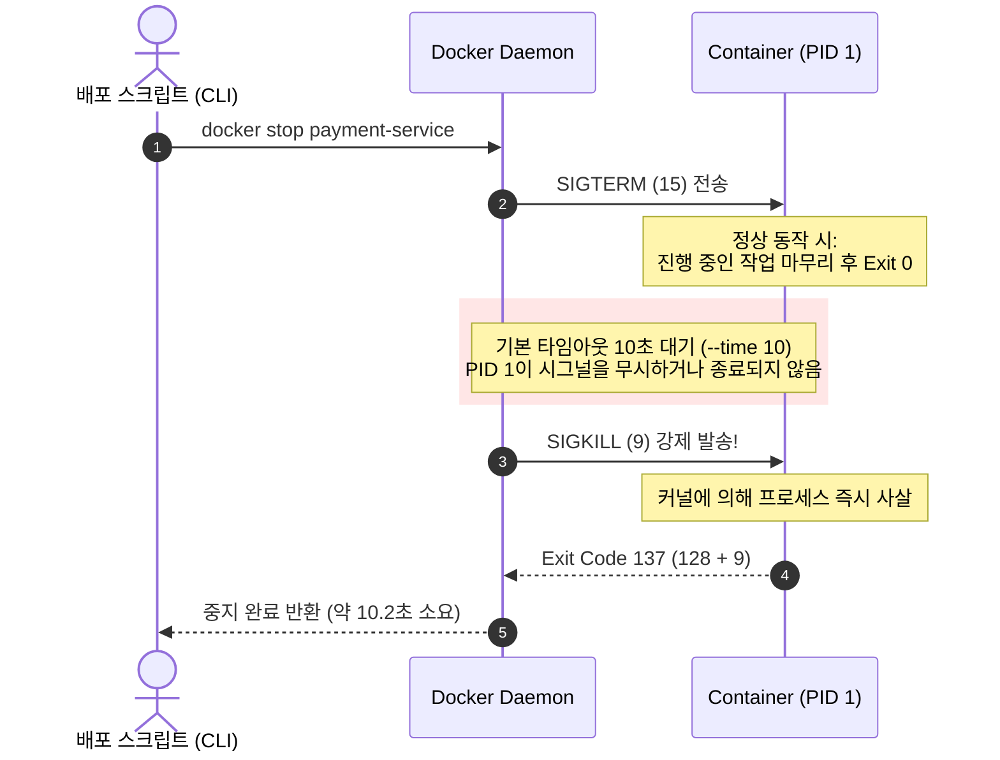
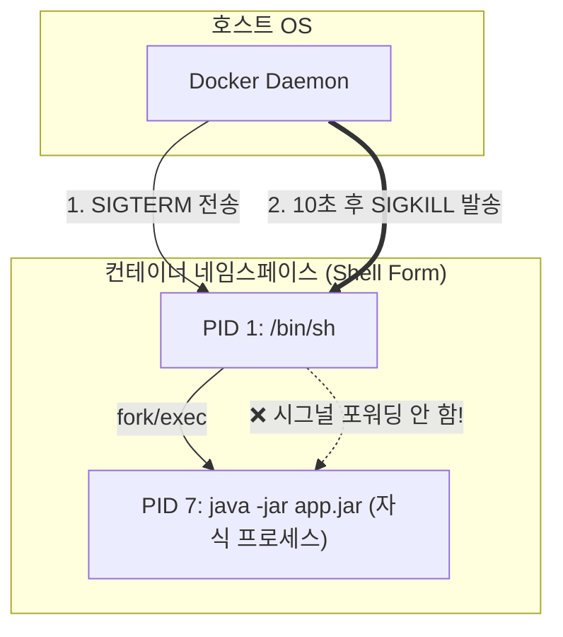
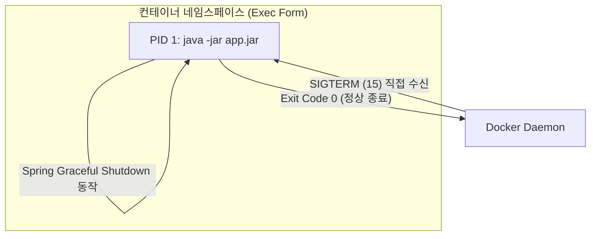
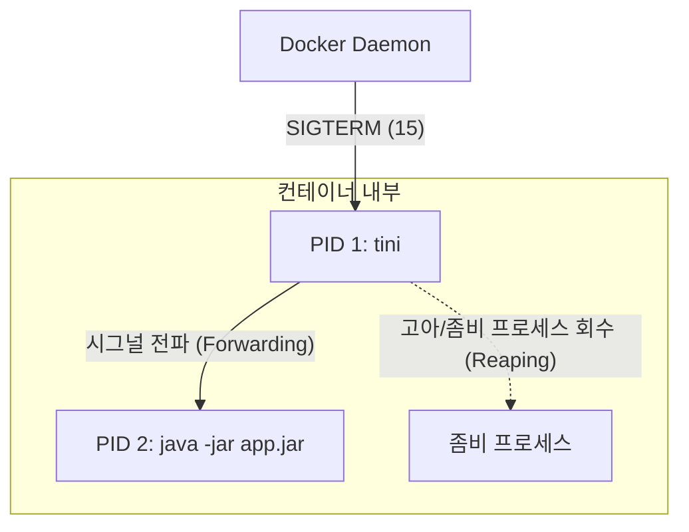

> 컨테이너 환경에서 `docker stop`을 호출했을 때 애플리케이션이 즉시 종료되지 않고 정확히 10초 동안 멈춰 있다가 강제 종료되는 현상의 원인을 짚어봅니다. 리눅스 PID 1의 특수성과 Dockerfile 쉘 폼(Shell form)의 시그널 차단 문제를 규명하고, 초경량 init 시스템 `tini`와 프레임워크 Graceful Shutdown을 연계해 안전한 종료 라이프사이클을 구축하는 실무 가이드입니다.

---

## 1. 실무에서 마주친 '정확히 10초의 지연'과 트래픽 유실

쿠버네티스 롤링 배포나 Docker Compose 기반 배포 파이프라인을 운영하다 보면 간혹 기이한 현상을 목격합니다. 배포 스크립트에서 컨테이너를 중지할 때 즉각 내려가지 않고 **정확히 10초 동안 블로킹**된 후 종료되는 현상입니다.


```bash
$ time docker stop payment-service
payment-service

real    0m10.284s
user    0m0.031s
sys     0m0.024s

$ docker inspect payment-service --format='{{.State.ExitCode}}'
137
```


컨테이너의 종료 코드를 확인해보면 `137`이 반환됩니다. 리눅스에서 128보다 큰 종료 코드는 시그널에 의해 프로세스가 사망했음을 뜻하며, `137 = 128 + 9(SIGKILL)`이므로 **정상 종료가 아니라 호스트 커널에 의해 강제로 도륙당했음**을 명백히 보여줍니다.

이 상태에서는 다음과 같은 치명적인 실무 장애가 유발됩니다.
- 배포 시점에 처리 중이던 결제/주문 HTTP 요청이 클라이언트에게 `502 Bad Gateway`나 커넥션 리셋으로 끊어짐
- 진행 중이던 DB 트랜잭션이 롤백되거나 커넥션 풀(HikariCP 등) 리소스가 정상 해제되지 않고 유실됨
- Kafka, RabbitMQ 등의 메시지 컨슈머가 오프셋 커밋을 수행하지 못해 메시지 중복 처리 발생

왜 우리 애플리케이션은 컨테이너 종료 요청을 우아하게 처리하지 못하고 10초 후 강제 종료를 맞이하는 것일까요?

---

## 2. `docker stop`의 라이프사이클: 10초 타임아웃의 비밀

`docker stop` 명령은 컨테이너를 즉시 강제 종료하는 명령이 아닙니다. 기본적으로 **Graceful Shutdown**을 시도하도록 설계되어 있습니다.



1. 도커 데몬은 컨테이너의 최상위 프로세스인 **PID 1**에게 정상적인 종료를 권고하는 `SIGTERM (시그널 15)`을 보냅니다.
2. 데몬은 컨테이너가 스스로 정리 작업을 마치고 종료할 때까지 대기합니다. 이때 기본 유예 기간(Grace Period)이 바로 **10초**(`-t, --time` 옵션의 기본값)입니다.
3. 10초가 지나도 컨테이너 프로세스가 살아있다면, 프로세스가 먹통이 되었다고 판단하여 가차 없이 차단 불가능한 `SIGKILL (시그널 9)`을 날려 프로세스를 강제 사살합니다.

결국 "정확히 10초 뒤 종료"라는 것은 **컨테이너 내부의 프로세스가 10초 동안 `SIGTERM`을 완전히 수신하지 못했거나 무시했다는 명백한 증거**입니다.

---

## 3. 근본 원인 분석: Dockerfile 쉘 폼(Shell Form)과 리눅스 PID 1의 특수성

원인은 크게 두 가지 계층에서 발생합니다.

### 3-1. 쉘 폼(Shell Form)의 시그널 차단

가장 흔하게 저지르는 실수는 `Dockerfile`에서 애플리케이션 실행 명령을 **쉘 폼(Shell Form)** 형태로 작성하는 것입니다.

```dockerfile
# ❌ 잘못된 방식: Shell Form
ENTRYPOINT java -jar /app/payment-service.jar
```

Dockerfile에서 문자열 형태로 작성하면, 도커는 이를 쉘을 통해 실행하도록 변환합니다:
```bash
/bin/sh -c "java -jar /app/payment-service.jar"
```

그 결과 컨테이너 내부의 프로세스 트리는 다음과 같이 구성됩니다:



도커 데몬이 보낸 `SIGTERM`은 오직 **PID 1**인 `/bin/sh`에게만 도달합니다. 그런데 전통적인 리눅스 쉘(`/bin/sh`, `/bin/bash` 등)은 **자신이 받은 시스템 시그널을 자식 프로세스에게 자동으로 포워딩하지 않습니다.** 

따라서 실제 애플리케이션인 Java 프로세스는 `SIGTERM`이 왔는지조차 알지 못한 채 평화롭게 요청을 처리하고 있다가, 10초 후 호스트로부터 날아온 `SIGKILL`에 의해 컨테이너 전체가 단칼에 날아가는 것입니다.

### 3-2. 리눅스 PID 1의 특별한 커널 규칙

"그렇다면 Exec 폼으로 Java를 PID 1로 직접 띄우면 모든 문제가 완전히 해결될까?"라는 의문이 생깁니다. 여기에는 리눅스 커널 레벨의 또 다른 비밀이 숨겨져 있습니다.

> **리눅스 커널의 PID 1 프로세스 보호 규칙**  
> 일반적인 리눅스 프로세스는 시그널 핸들러를 등록하지 않아도 `SIGTERM`을 받으면 커널의 기본 동작(Default Action)에 의해 즉시 종료됩니다.  
> 하지만 **PID 1(init 프로세스)**은 시스템 전체의 부모이므로 특별 대우를 받습니다. 커널은 **PID 1 프로세스가 명시적으로 시그널 핸들러를 등록하지 않은 시그널을 전부 무시(Ignore)**합니다.
{: .prompt-warning }

즉, 애플리케이션이 `SIGTERM` 핸들러를 구현하지 않았거나 런타임 초기화 과정 중에 시그널이 도달하면 시그널 자체가 버려집니다. 또한 PID 1은 **고아(Orphan) 프로세스가 발생했을 때 이를 입양하여 자식의 종료 상태를 회수(Reaping)하는 책무**를 지닙니다. 이 책무를 다하지 못하면 시스템에 좀비 프로세스(Zombie Process)가 누적됩니다.

---

## 4. 해결 단계 1: Exec 폼(JSON Array) 전환

첫 번째 필수 조치는 Dockerfile을 **Exec 폼(Exec Form)**으로 변경하여 Java 애플리케이션이 컨테이너의 메인 프로세스(PID 1)를 직접 차지하도록 만드는 것입니다.

```dockerfile
# ⭕ 올바른 방식: Exec Form (JSON 배열 문법)
ENTRYPOINT ["java", "-jar", "/app/payment-service.jar"]
```

이렇게 구성하면 `/bin/sh` 래퍼 없이 Java 프로세스가 PID 1이 되므로, Docker 데몬이 쏘아 올린 `SIGTERM`을 Spring Boot 런타임이 온전히 직접 수신할 수 있게 됩니다.



---

## 5. 해결 단계 2: 초경량 init 프로세스 `tini` 도입

Java나 Node.js, Python 같은 범용 런타임을 컨테이너의 PID 1로 두는 것은 시그널을 받을 수 있게 해주지만, 시스템 소프트웨어 관점에서는 여전히 불완전합니다.
1. 애플리케이션 내부에서 서브프로세스를 생성했다가 비정상 종료되었을 때, 이를 거두어줄 init 프로세스가 없어 **좀비 프로세스 누수**가 발생할 수 있습니다.
2. 예기치 않은 예외 상황에서 자식 프로세스들에게 시그널을 일괄 전파(Signal Forwarding)하지 못합니다.

이 문제를 해결하기 위해 고안된 표준 솔루션이 바로 초경량 init 시스템인 **`tini`**입니다.



`tini`는 다음 두 가지 핵심 역할을 아주 작은 오버헤드(단 몇 십 KB)로 수행합니다:
1. **시그널 포워딩**: 자신이 수신한 모든 시그널을 하위 프로세스 그룹 전체에 정확히 전달합니다.
2. **좀비 프로세스 회수(Reaper)**: 죽은 자식 프로세스의 `wait()`을 호출하여 시스템 자원을 반환합니다.

### 5-1. Docker `--init` 플래그 사용 (가장 간단한 방법)

도커 엔진(1.13+)은 내부에 `tini`를 기본 탑재하고 있습니다. 컨테이너를 실행할 때 `--init` 플래그 하나만 붙여주면 끝납니다.

```bash
docker run -d --name payment-service --init -p 8080:8080 payment-service:latest
```

Docker Compose 환경이라면 `init: true` 속성을 명시합니다:

```yaml
# compose.yaml
services:
  payment-service:
    image: payment-service:latest
    init: true # 컨테이너 내부 PID 1로 tini 자동 삽입
    stop_grace_period: 30s # 기본 10초 대신 애플리케이션 작업 처리를 위해 30초 부여
    ports:
      - "8080:8080"
```

### 5-2. Dockerfile에 직접 tini 내장하기

만약 쿠버네티스(k8s)처럼 `--init` 플래그를 직접 지원하지 않는 컨테이너 런타임 환경이라면, 이미지 빌드 시 Dockerfile에 `tini`를 직접 포함시키는 것이 베스트 프랙티스입니다.

```dockerfile
# Eclipse Temurin 기반 최적화 Dockerfile
FROM eclipse-temurin:21-jre-alpine

# Alpine 패키지 매니저로 tini 설치
RUN apk add --no-cache tini

WORKDIR /app
COPY target/payment-service.jar app.jar

# tini를 엔트리포인트로 지정하고, 애플리케이션을 인자로 넘김
ENTRYPOINT ["/sbin/tini", "--", "java", "-jar", "app.jar"]
```

> **Alpine 이외의 베이스 이미지(Ubuntu/Debian)인 경우**  
> `apt-get install -y tini`를 사용하거나, 공식 GitHub 릴리즈에서 정적 바이너리를 다운로드하여 `/tini`로 배치한 뒤 `ENTRYPOINT ["/tini", "--", "..."]` 형태로 지정할 수 있습니다.
{: .prompt-tip }

---

## 6. 실무 적용 및 검증: Spring Boot Graceful Shutdown 연계

컨테이너가 시그널을 프로세스에 온전히 전달하게 만들었다면, 이제 애플리케이션이 `SIGTERM`을 받았을 때 인플라이트 요청을 안전하게 소화하도록 설정해야 합니다.

### 6-1. Spring Boot 설정 (`application.yml`)

Spring Boot 2.3+ 버전부터는 내장 웹 서버(Tomcat, Jetty, Reactor Netty)의 우아한 종료를 네이티브로 지원합니다.

```yaml
server:
  port: 8080
  shutdown: graceful # 기본값: immediate (즉시 종료)

spring:
  lifecycle:
    timeout-per-shutdown-phase: 20s # 진행 중인 요청의 최대 완료 대기 시간
```

- `server.shutdown: graceful`: 새로운 HTTP 요청의 진입을 즉시 차단(Keep-Alive 커넥션 종료 유도)하고, 이미 들어와서 처리 중인 요청은 최대 유예 시간까지 기다려줍니다.
- `timeout-per-shutdown-phase: 20s`: 진행 중인 요청이 20초 이내에 완료되면 즉시 프로세스를 정상 종료(Exit 0)합니다.

> **타임아웃 설정 시 주의점**  
> 프레임워크의 셧다운 타임아웃(`20s`)은 반드시 도커의 `stop_grace_period`(또는 쿠버네티스의 `terminationGracePeriodSeconds`, 예: `30s`)보다 작아야 합니다! 만약 스프링 대기 시간이 도커 타임아웃보다 길면 애플리케이션이 마무리하기 전에 도커가 먼저 `SIGKILL`을 때려버립니다.
{: .prompt-warning }

### 6-2. 실제 환경에서의 Graceful Shutdown 검증

실제로 5초가 걸리는 지연 결제 API(`/api/v1/payments/process`)를 실행하고, 요청이 진행 중인 도중에 `docker stop`을 전송하여 결과를 검증해보겠습니다.

#### 테스트 시나리오
1. 클라이언트가 5초 소요되는 API 요청 전송
2. 1초 뒤 배포 스크립트가 `docker stop payment-service` 호출
3. 요청이 `502/Connection Reset` 없이 `200 OK`로 완료되는지 확인
4. 컨테이너가 10초 타임아웃 없이 정상 종료(`Exit 0` 또는 `143`)되는지 확인

#### 터미널 실행 로그

```bash
# 1번 터미널: 장기 실행 API 호출
$ curl -i http://localhost:8080/api/v1/payments/process
HTTP/1.1 200 OK
Content-Type: application/json
Transfer-Encoding: chunked

{"status":"SUCCESS","message":"결제가 정상적으로 완료되었습니다."}
```


```bash
# 2번 터미널: API 호출 직후 컨테이너 중지 명령
$ time docker stop payment-service
payment-service

real    0m4.892s
user    0m0.028s
sys     0m0.019s

$ docker inspect payment-service --format='{{.State.ExitCode}}'
0
```


```text
# 컨테이너 애플리케이션 로그 (docker logs payment-service)
2026-06-06 12:05:01.120  INFO [payment-service] : Commencing graceful shutdown. Waiting for active requests to complete
2026-06-06 12:05:01.125  INFO [payment-service] : Web server will stop accepting new connections
2026-06-06 12:05:05.890  INFO [payment-service] : Active request processed successfully: /api/v1/payments/process
2026-06-06 12:05:05.895  INFO [payment-service] : Graceful shutdown complete
2026-06-06 12:05:06.012  INFO [payment-service] : HikariPool-1 - Shutdown initiated...
2026-06-06 12:05:06.025  INFO [payment-service] : HikariPool-1 - Shutdown completed.
```

- `real 0m4.892s`: 10초 타임아웃까지 헛되이 대기하지 않고, 인플라이트 요청이 끝나자마자 즉시 약 4.9초 만에 컨테이너가 종료되었습니다.
- `ExitCode: 0`: 강제 사살(`SIGKILL`, 137)이 아닌 정상적인 우아한 종료가 이루어졌습니다.
- 커넥션 풀(HikariCP) 및 내부 스프링 빈 라이프사이클이 순서대로 안전하게 정리되었습니다.

---

## 7. 핵심 체크리스트 요약

안전하고 유실 없는 컨테이너 무중단 배포를 달성하기 위해 점검해야 할 4가지 수칙입니다.

| 점검 항목 | 권장 설정 | 주의 사항 |
| :--- | :--- | :--- |
| **Dockerfile 문법** | Exec 폼 사용 (`ENTRYPOINT ["cmd", "arg"]`) | 문자열 형태의 쉘 폼(`ENTRYPOINT cmd`)은 `/bin/sh`가 시그널을 차단함 |
| **Init 프로세스** | `tini` 도입 (`--init`, `init: true` 또는 Dockerfile 내장) | 좀비 프로세스 누수 방지 및 서브프로세스 시그널 안전 전파 보장 |
| **타임아웃 역전 방지** | App Timeout < Container Grace Period | 스프링 대기 시간(예: 20s) < 도커 유예 시간(예: 30s) 원칙 준수 |
| **웹 서버 셧다운 설정** | `server.shutdown=graceful` | 기본 설정(immediate)은 진행 중인 트래픽을 즉시 끊어버림 |

컨테이너 환경에서 애플리케이션의 시작(Warm-up)만큼이나 중요한 것이 바로 **마침표(Shutdown)를 어떻게 찍는가**입니다. PID 1의 동작 원리를 올바르게 이해하고 `tini`와 프레임워크 설정을 적절히 구성해 두면, 예기치 않은 트래픽 유실과 배포 지연 없는 견고한 백엔드 시스템을 유지할 수 있습니다.
