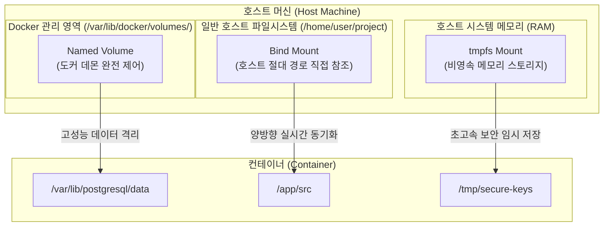
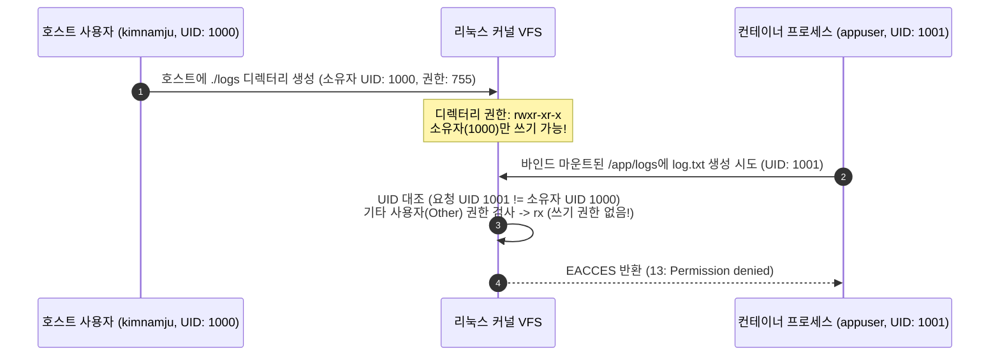
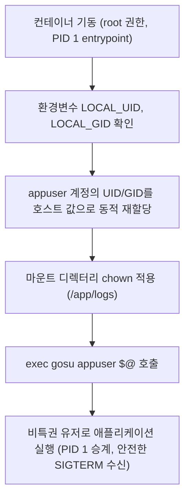

> 로컬 개발 환경에서 도커 컨테이너를 띄우고 호스트 디렉터리를 마운트했을 때 맞닥뜨리는 `Permission Denied` 에러의 리눅스 커널 수준 원인을 분석하고, 런타임 UID 매핑부터 `gosu` 기반 동적 권한 인계, 그리고 데이터베이스 영속성을 위한 Named Volume 백업 전략까지 실무 해결책을 완벽히 정리합니다.

---

## 1. 들어가며: 로컬 개발 환경의 영원한 악몽, Permission Denied

도커(Docker) 기반으로 로컬 개발 환경을 구성해 본 엔지니어라면 누구나 한 번쯤 다음과 같은 당혹스러운 상황을 겪어보셨을 것입니다.

```text
[ERROR] 2026-06-10 12:15:30 - java.io.FileNotFoundException: /app/logs/application.log (Permission denied)
npm ERR! Error: EACCES: permission denied, mkdir '/app/node_modules/.cache'
```

호스트 머신에 로그를 남기거나 소스 코드를 실시간으로 핫 리로딩(Hot-reloading)하기 위해 `-v $(pwd):/app` 혹은 `-v $(pwd)/logs:/app/logs` 형태로 바인드 마운트(Bind Mount)를 걸자마자 애플리케이션이 파일 쓰기 권한 부족으로 기동에 실패합니다. 

더 심각한 경우도 있습니다. 컨테이너 내부에서 root 권한으로 생성해 버린 파일이 호스트 파일시스템에 그대로 남아, 개발자가 로컬 IDE에서 파일을 열람하거나 `rm -rf`로 정리하려 할 때 호스트 OS에서도 `Permission denied`가 뜨며 결국 `sudo rm`을 쳐야만 하는 지저분한 상황이 발생합니다.

이 문제는 도커 스토리지의 동작 특성과 리눅스 커널의 권한 검증 메커니즘을 정확히 이해하지 못하면 `chmod 777`이라는 보안상 극도로 위험한 미봉책으로 이어지기 쉽습니다. 본 포스트에서는 도커 스토리지의 3대 축을 체계적으로 분류하고, 권한 충돌의 기술적 근본 원인과 실무 표준 해결 패턴을 상세히 살펴보겠습니다.

---

## 2. 도커 스토리지의 3대 축: 무엇을 언제 써야 하는가?

도커 컨테이너 내부의 기본 파일시스템은 UFS(Union File System) 기반의 쓰기 가능 레이어(Writable Container Layer)입니다. 이 레이어는 컨테이너 수명 주기와 함께 소멸하므로, 데이터를 보존하거나 호스트와 교환하려면 외부 스토리지를 마운트해야 합니다. 도커는 이를 위해 세 가지 방식을 제공합니다.



### 스토리지 유형별 특성 비교

| 구분 | 명명된 볼륨 (Named Volume) | 바인드 마운트 (Bind Mount) | tmpfs 마운트 (tmpfs Mount) |
| :--- | :--- | :--- | :--- |
| **저장 위치** | 호스트 내 Docker 관리 영역 (`/var/lib/docker/volumes/`) | 호스트 파일시스템의 임의 절대 경로 | 호스트 시스템 메모리 (RAM) |
| **도커 의존성** | Docker CLI와 데몬을 통해서만 관리 가능 | 호스트 OS 프로세스가 직접 파일 제어 가능 | Docker 데몬을 통해 생성/할당 |
| **권한 관리** | Docker가 볼륨 디렉터리 소유권 및 퍼미션 보존 | 호스트 디렉터리의 UID/GID가 그대로 강제됨 | 메모리 내 임시 파일시스템 권한 따름 |
| **I/O 성능** | 네이티브 리눅스 최상, macOS/WSL2 가상화 오버헤드 최소화 | OS 가상화 파일 공유 계층으로 인한 오버헤드 존재 가능 | 메모리 직결로 가장 빠른 처리 속도 |
| **주요 사용 사례** | **DB 데이터 영속화**, 영구 상태 저장, 백업 | **로컬 소스 코드 동기화**, 빌드 산출물 추출 | **민감 정보(API 키, 세션 토큰)**, 임시 캐시 |

{: .prompt-info }
> **실무 권장 원칙**: 로컬 소스 코드 실시간 반영 및 설정 파일 주입에는 **바인드 마운트**를 사용하고, 데이터베이스나 메시지 큐 등 데이터 무결성과 I/O 성능이 핵심인 영속 계층에는 무조건 **Named Volume**을 채택해야 합니다.

---

## 3. Permission Denied의 기술적 본질: 호스트와 컨테이너의 UID 불일치

바인드 마운트 시 권한 에러가 발생하는 원인을 이해하려면 컨테이너가 '독립된 가상 머신(VM)'이 아니라는 사실을 상기해야 합니다. 컨테이너는 호스트 리눅스 커널 위에서 네임스페이스(Namespace)와 cgroups로 격리된 일반 호스트 프로세스에 불과합니다.

### 텍스트 사용자 이름이 아닌 숫자 UID/GID로만 검증하는 리눅스 커널

리눅스 커널의 VFS(Virtual File System) 계층은 파일 권한을 검사할 때 `kimnamju`나 `node`, `spring` 같은 **문자열 사용자 계정명을 보지 않습니다.** 오직 프로세스의 실효 사용자 ID(Effective UID)와 파일 inode에 기록된 소유자 UID(Owner UID) 숫자만을 대조합니다.



이 메커니즘에서 발생하는 두 가지 전형적인 파탄 시나리오가 있습니다.

1. **컨테이너 내부가 비특권 사용자(Non-root, e.g. UID 1001)로 실행되는 경우**:
   - 호스트 디렉터리는 호스트 유저(UID 1000) 소유입니다 (`drwxr-xr-x`).
   - 컨테이너 내부 프로세스는 UID 1001이므로 'Other' 그룹으로 분류됩니다.
   - 쓰기(`w`) 권한이 없으므로 즉시 `java.io.FileNotFoundException (Permission denied)` 또는 `EACCES`가 발생합니다.

2. **컨테이너 내부가 기본값인 root(UID 0)로 실행되는 경우**:
   - 컨테이너 프로세스는 root이므로 호스트 디렉터리에 아무 제약 없이 파일을 생성합니다.
   - 하지만 생성된 파일의 소유자는 호스트 파일시스템 관점에서도 **UID 0 (`root`)**이 됩니다.
   - 컨테이너 밖의 호스트 개발자(UID 1000)는 이 파일을 수정하거나 `git clean`, `rm`으로 삭제할 수 없게 됩니다.

---

## 4. 실무 해결책 3가지 완벽 비교 및 구현 가이드

이 문제를 해결하기 위해 실무에서 적용할 수 있는 전략은 세 가지가 있습니다. 상황에 맞는 최선의 패턴을 선택해야 합니다.

### 전략 1: 런타임 호스트 UID 매핑 (`--user` 플래그)

가장 빠르고 간단한 방법은 컨테이너를 기동할 때 호스트 사용자의 현재 UID와 GID를 그대로 컨테이너 프로세스에 주입하는 것입니다.

```bash
# docker run 단일 명령 실행 시
docker run -d \
  --name backend-api \
  --user "$(id -u):$(id -g)" \
  -v "$(pwd)/logs:/app/logs" \
  my-backend-image:latest
```

`compose.yaml`에서는 환경 변수를 통해 다음과 같이 선언합니다.

```yaml
services:
  backend-api:
    image: my-backend-image:latest
    user: "${UID:-1000}:${GID:-1000}"
    volumes:
      - ./logs:/app/logs
```

{: .prompt-warning }
> **전략 1의 한계점**:
> 컨테이너 이미지 내부의 `/etc/passwd`에 호스트의 UID(예: 1000)가 등록되어 있지 않은 경우, 프로세스가 홈 디렉터리(`~`)를 조회하지 못해 `I have no name!` 에러가 발생하거나 npm/pip 캐시 디렉터리(`/home/.../.cache`) 생성 실패로 빌드 도구가 비정상 종료될 수 있습니다. 또한 80, 443 등 Well-known Privileged Port를 컨테이너 내부에서 바인딩해야 하는 경우에는 권한 부족으로 실패합니다.

---

### 전략 2: Dockerfile 빌드 타임 사용자 생성 (ARG 매개변수화)

이미지를 빌드하는 시점에 호스트의 UID/GID를 빌드 인자(`ARG`)로 넘겨 동일한 ID의 유저를 컨테이너 내부에 생성하는 방식입니다.

```dockerfile
FROM node:20-alpine

# 빌드 시점에 호스트의 UID와 GID를 주입받음 (기본값: 1000)
ARG USER_ID=1000
ARG GROUP_ID=1000

# 기존 node 그룹/유저의 UID/GID가 1000과 겹치면 변경하거나 신규 생성
RUN if getent group ${GROUP_ID} ; then \
        groupmod -g ${GROUP_ID} node ; \
    else \
        groupadd -g ${GROUP_ID} appgroup ; \
    fi && \
    if getent passwd ${USER_ID} ; then \
        usermod -u ${USER_ID} -g ${GROUP_ID} node ; \
    else \
        useradd -m -u ${USER_ID} -g ${GROUP_ID} appuser ; \
    fi

WORKDIR /app
COPY package*.json ./
RUN npm ci

COPY . .

# 소유권을 생성한 유저에게 위임하고 유저 전환
USER ${USER_ID}:${GROUP_ID}

CMD ["node", "server.js"]
```

- **장점**: `/etc/passwd`에 정식 유저가 등록되므로 환경 변수 및 홈 디렉터리가 완벽히 보장됩니다.
- **단점**: 팀원마다 머신의 UID가 다르면(예: macOS 기본 계정은 501, Linux 데스크톱은 1000), 개발자마다 이미지를 따로 빌드해야 하므로 Docker 이미지 레이어 캐시 공유가 깨집니다.

---

### 전략 3: 엔터프라이즈 권장 패턴 — entrypoint.sh + gosu 동적 권한 인계

실무 엔터프라이즈 환경 및 공식 오픈소스 도커 이미지(PostgreSQL, Redis 등)에서 가장 널리 채택하는 표준 해결책입니다. 

컨테이너가 시작될 때는 초기화 작업을 위해 일시적으로 `root`로 기동한 뒤, 마운트된 디렉터리의 소유권을 런타임에 전달받은 UID로 맞춘 다음, 실제 프로세스를 실행하는 순간 **비특권 사용자(appuser)**로 권한을 영구 강등하여 실행합니다.



#### 왜 `sudo`나 `su` 대신 `gosu`인가?

`su`나 `sudo`는 서브 프로세스를 포크(Fork)하여 실행하므로 TTY 시그널(Signal) 전달 체계를 왜곡하고 자식 프로세스의 좀비 프로세스화를 초래할 수 있습니다. 반면 `gosu`는 Go 언어로 작성된 경량 바이너리로, `execve` 시스템 콜을 직접 호출하여 본인(PID 1) 프로세스의 주소 공간을 대상 유저의 애플리케이션으로 완전히 대체합니다. 이로 인해 `SIGTERM` 등의 종료 시그널이 백엔드 프로세스에 누락 없이 다이렉트로 전달됩니다.

#### 1) Dockerfile 구현

```dockerfile
FROM ubuntu:24.04

# 필수 유틸리티 및 gosu 설치
RUN apt-get update && apt-get install -y --no-install-recommends \
    gosu \
    ca-certificates \
    && rm -rf /var/lib/apt/lists/*

# 기본 애플리케이션 유저 생성
RUN groupadd -g 1000 appgroup && \
    useradd -u 1000 -g appgroup -m -s /bin/bash appuser

WORKDIR /app

# 엔트리포인트 스크립트 복사 및 실행 권한 부여
COPY docker-entrypoint.sh /usr/local/bin/docker-entrypoint.sh
RUN chmod +x /usr/local/bin/docker-entrypoint.sh

COPY . /app

ENTRYPOINT ["/usr/local/bin/docker-entrypoint.sh"]
CMD ["python3", "-m", "http.server", "8080"]
```

#### 2) docker-entrypoint.sh 작성

```bash
#!/bin/bash
set -e

# 호스트에서 주입된 UID/GID 확인 (지정되지 않은 경우 기본값 1000)
USER_ID=${LOCAL_UID:-1000}
GROUP_ID=${LOCAL_GID:-1000}

# 1. appgroup의 GID를 런타임 호스트 GID와 일치화
CURRENT_GID=$(getent group appgroup | cut -d: -f3)
if [ "$CURRENT_GID" != "$GROUP_ID" ]; then
    groupmod -o -g "$GROUP_ID" appgroup
fi

# 2. appuser의 UID를 런타임 호스트 UID와 일치화
CURRENT_UID=$(id -u appuser)
if [ "$CURRENT_UID" != "$USER_ID" ]; then
    usermod -o -u "$USER_ID" appuser
fi

# 3. 마운트된 디렉터리의 쓰기 권한 보정 (필요한 경로만 선별 적용)
if [ -d "/app/logs" ]; then
    chown -R appuser:appgroup /app/logs
fi

# 4. gosu를 통해 비특권 appuser로 프로세스 대체 실행 (PID 1 유지)
exec gosu appuser "$@"
```

#### 3) compose.yaml 연동

```yaml
services:
  backend-service:
    build: .
    environment:
      # 호스트 쉘의 id -u, id -g 값을 컨테이너 환경변수로 자동 투입
      LOCAL_UID: ${UID:-1000}
      LOCAL_GID: ${GID:-1000}
    volumes:
      - ./logs:/app/logs
    ports:
      - "8080:8080"
```

이 방식을 사용하면 호스트 머신이 macOS(UID 501)이든 리눅스(UID 1000, 1001)이든 상관없이, 동일한 단일 도커 이미지만으로 모든 개발자 머신에서 `Permission Denied` 없이 완벽한 파일 권한 호환성을 누릴 수 있습니다.

---

## 5. 데이터베이스 영속성에는 왜 반드시 Named Volume을 써야 하는가?

간혹 로컬이나 스테이징 환경에서 PostgreSQL이나 MySQL을 띄울 때 편의상 다음과 같이 호스트 디렉터리를 바인드 마운트하는 설정을 보게 됩니다.

```yaml
# ❌ 실무에서 절대 피해야 할 안티 패턴 (DB 데이터 경로 바인드 마운트)
services:
  postgres:
    image: postgres:16-alpine
    volumes:
      - ./pgdata:/var/lib/postgresql/data  # 위험!
```

이 설정은 개발과 운영 모두에서 치명적인 문제를 일으킵니다.

### 바인드 마운트가 DB에 초래하는 3대 위험 요소

1. **macOS / Windows 가상화 파일시스템 병목**:
   - Docker Desktop 환경에서 호스트 파일시스템은 VirtioFS나 gRPC-FUSE 같은 가상 공유 계층을 거칩니다.
   - 트랜잭션마다 빈번한 `fsync()`와 WAL(Write-Ahead Logging) 디스크 쓰기를 수행하는 RDBMS의 특성상, 바인드 마운트를 사용하면 I/O 처리량이 네이티브 리눅스 대비 **수배에서 수십 배까지 폭락**합니다.
2. **PostgreSQL의 엄격한 0700 퍼미션 검증 실패**:
   - PostgreSQL 엔진은 데이터 디렉터리(`PGDATA`)의 파일 권한이 `0700`(소유자 외 접근 완전 차단)이 아니면 보안을 이유로 데몬 시작 자체를 거부(`FATAL: data directory has wrong ownership or permissions`)하고 크래시됩니다. 호스트 파일시스템 권한이 섞이는 바인드 마운트 환경에서는 이 권한 유지가 매우 취약합니다.
3. **OS 간 파일시스템 메타데이터 비호환**:
   - 호스트 OS(NTFS, APFS)와 리눅스 커널 간의 inode 락킹(locking) 및 대소문자 구분 방식 차이로 인해 대량 트랜잭션 시 DB 파일이 손상(Data Corruption)될 위험이 있습니다.

### 정석 솔루션: Named Volume 선언

```yaml
# ✅ 권장되는 표준 설정 (Named Volume 채택)
services:
  postgres:
    image: postgres:16-alpine
    environment:
      POSTGRES_DB: myapp
      POSTGRES_USER: myuser
      POSTGRES_PASSWORD: secretpassword
    volumes:
      - postgres_data:/var/lib/postgresql/data
    ports:
      - "5432:5432"

volumes:
  postgres_data:
    driver: local
```

Named Volume은 도커가 관리하는 네이티브 리눅스 파일시스템 영역에 배치되므로 가상화 변환 계층 없이 최고 수준의 디스크 I/O 처리량을 제공하며, 권한과 무결성을 안전하게 보장합니다.

---

## 6. 실무 필수 테크닉: Named Volume 백업 및 복구 원라이너

Named Volume을 사용할 때 유일한 의문점은 "호스트 폴더처럼 눈에 보이지 않는데, 백업과 복구는 어떻게 처리하는가?"입니다. 도커에서는 임시 일회용 컨테이너(`--rm`)와 볼륨 마운트를 조합하여 매우 우아하고 안전하게 아카이브 백업을 수행할 수 있습니다.

### 1) Named Volume을 tar 압축 파일로 호스트에 백업

```bash
# postgres_data 볼륨의 내용을 호스트의 현재 디렉터리에 pg_backup.tar.gz로 추출
docker run --rm \
  -v postgres_data:/volume-data \
  -v "$(pwd)":/backup \
  alpine \
  tar -czvf /backup/pg_backup.tar.gz -C /volume-data .
```

- `-v postgres_data:/volume-data`: 백업 대상 Named Volume을 읽기 전용으로 마운트합니다.
- `-v "$(pwd)":/backup`: 결과 압축 파일을 저장할 호스트 디렉터리를 바인드 마운트합니다.
- 컨테이너가 압축을 마치는 즉시 `--rm` 옵션에 의해 자동으로 흔적 없이 제거됩니다.

### 2) 백업 tar 파일을 새로운 Named Volume으로 복구

```bash
# 1. 데이터를 복원할 새로운 Named Volume 생성
docker volume create postgres_data_restored

# 2. tar 아카이브를 대상 볼륨에 압축 해제
docker run --rm \
  -v postgres_data_restored:/volume-data \
  -v "$(pwd)":/backup \
  alpine \
  tar -xzvf /backup/pg_backup.tar.gz -C /volume-data
```

{: .prompt-tip }
> **운영 팁**: 데이터베이스가 활발히 쓰기 작업을 수행 중일 때 백업 컨테이너를 돌리면 WAL 불일치가 발생할 수 있습니다. 운영 중인 DB는 `pg_dump`나 `mysqldump`를 우선 사용하시고, 볼륨 레벨의 물리 스냅샷 복사가 필요할 때는 잠시 컨테이너를 중지(`docker compose stop postgres`)한 뒤 위 스크립트를 수행하십시오.

---

## 7. 마치며: 스토리지 아키텍처 의사결정 체크리스트

도커 스토리지와 권한 제어는 컨테이너 기술을 '그냥 띄우는 것'을 넘어 '안정적으로 운영하는 단계'로 진입할 때 반드시 마스터해야 하는 필수 관문입니다. 다음 체크리스트를 바탕으로 현재 프로젝트의 마운트 구조를 점검해 보시길 권장합니다.

1. **핫 리로딩이 필요한 애플리케이션 코드나 호스트 로그 디렉터리인가?**  
   👉 **바인드 마운트(Bind Mount)**를 적용하고, 권한 충돌 방지를 위해 `LOCAL_UID/LOCAL_GID` 환경변수와 `gosu` 기반 `entrypoint.sh` 패턴을 도입하십시오.
2. **PostgreSQL, MySQL, Redis, Kafka 등 데이터 무결성이 핵심인 상태 기반 시스템인가?**  
   👉 절대 로컬 디렉터리를 바인드 마운트하지 말고, 도커 엔진이 직접 관리하는 **Named Volume**을 사용하십시오.
3. **빌드 캐시나 인증용 임시 토큰처럼 컨테이너 종료 즉시 삭제되어야 하는 데이터인가?**  
   👉 디스크 I/O를 유발하지 않고 메모리에만 상주하는 **tmpfs Mount**를 사용하십시오.
4. **`chmod 777`로 문제를 덮어두고 있지 않은가?**  
   👉 호스트와 컨테이너 프로세스의 숫자 UID를 일치시키는 구조적 설계를 통해 보안 홀을 원천 차단하십시오.
