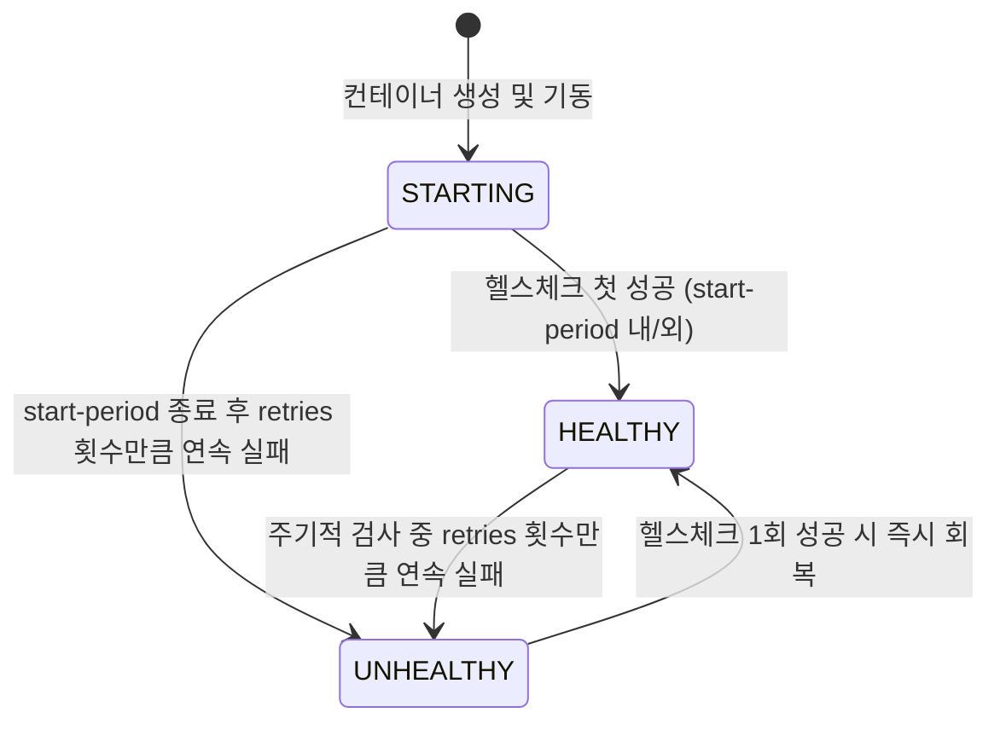
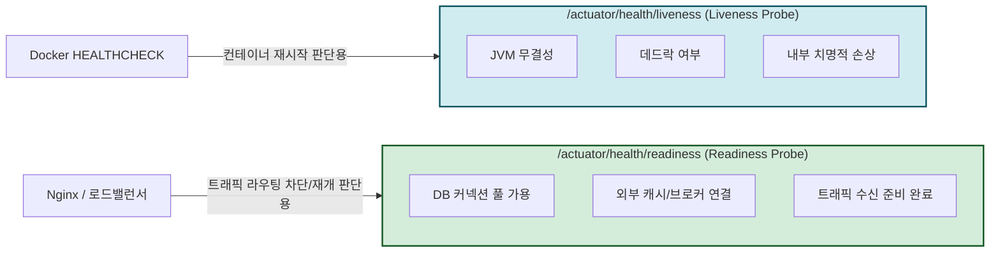
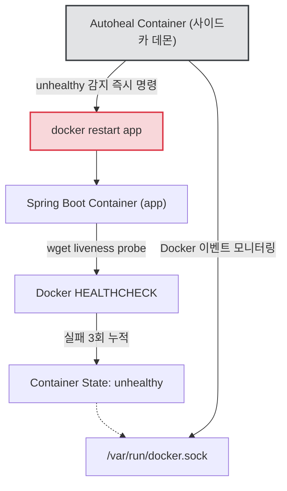

> 프로세스(PID 1)는 살아있어 `docker ps`에는 멀쩡히 `Up`으로 표기되지만, 실제로는 모든 HTTP 요청에 타임아웃을 뿜어내는 '좀비 컨테이너'를 어떻게 감지하고 복구할 수 있을까요? Spring Boot Actuator의 프로브와 Docker HEALTHCHECK, 그리고 자동 재기동 데몬을 연동해 무중단 운영을 위한 완결형 자가 치유(Self-Healing) 아키텍처를 구축해 봅니다.

---

## 1. 프로세스는 살아있는데 서비스는 죽었다? 좀비 컨테이너의 위험

백엔드 운영 환경에서 가장 까다로운 장애 중 하나는 **"서버가 완전히 죽지도 않고, 그렇다고 정상 동작하지도 않는 상태"**입니다. 

실무에서 대규모 트래픽이 몰리거나 외부 서드파티 연동 구간에 지연이 발생할 때, JVM 기반 애플리케이션은 종종 다음과 같은 비정상 상태에 빠집니다.

* **HikariCP 커넥션 풀 고갈**: 느린 쿼리나 커넥션 누수로 인해 유휴 커넥션이 0개가 되어 모든 비즈니스 요청이 블로킹됩니다.
* **톰캣 워커 스레드 고갈 (Thread Starvation)**: 수백 개의 요청이 동기식 I/O를 대기하며 스레드 풀 상한선(`max-threads`)에 도달해 신규 TCP 연결 처리를 거부합니다.
* **스레드 데드락(Deadlock) 및 극심한 GC 오버헤드**: 공유 자원 경합으로 데드락이 발생했거나, 힙 메모리 한계 직전에서 끝없는 Stop-The-World(Full GC)가 반복되어 사실상 무응답 상태가 됩니다.

```mermaid
flowchart TD
    Client["클라이언트 / API Gateway"] -->|HTTP GET /api/v1/orders| DockerHost["Docker Host (Port: 8080)"]
    DockerHost --> Container["Container (PID 1: java -jar)"]
    
    subgraph InsideContainer["컨테이너 내부"]
        JVM["JVM Process (정상 실행 중)"]
        Pool["HikariCP / Thread Pool (완전 고갈 / Deadlock)"]
        JVM --- Pool
    end

    Container -.->|응답 지연 / 무응답 (Hang)| DockerHost
    DockerHost --x|504 Gateway Timeout| Client

    DockerDaemon["Docker Daemon"] -.->|PID 1 생존 여부만 확인| Container
    DockerDaemon --> Status["docker ps: Up 5 hours (정상으로 오판!)"]

    style Status fill:#f8d7da,stroke:#dc3545,stroke-width:2px
    style Pool fill:#fff3cd,stroke:#ffc107,stroke-width:2px
```

문제는 **도커 데몬(Docker Daemon)의 기본 헬스체크 기준이 오직 'PID 1번 프로세스의 생존 여부'**라는 점입니다.

컨테이너 내부의 톰캣 스레드가 전부 멈춰 서서 사용자는 `504 Gateway Timeout`을 겪고 있는데도, 도커 엔진은 `java -jar` 프로세스가 살아있으므로 `docker ps`에 당당히 `Up 5 hours`라는 거짓 상태를 출력합니다. 

외부 로드밸런서나 오케스트레이터 역시 컨테이너가 정상 구동 중인 줄 알고 트래픽을 계속해서 밀어 넣으며, 결국 장애가 시스템 전체로 전파됩니다.

---

## 2. Docker `HEALTHCHECK` 메커니즘과 4대 파라미터

도커는 이러한 좀비 컨테이너 문제를 해결하기 위해 Dockerfile과 Compose 수준에서 컨테이너 내부의 실제 서비스 동작 여부를 검증할 수 있는 `HEALTHCHECK` 인스트럭션을 제공합니다.

### 헬스체크 라이프사이클

헬스체크가 정의된 컨테이너는 단순한 `Up` 상태 대신 다음 세 가지 상태를 순환합니다.



### 핵심 옵션 정밀 분석

헬스체크 명령은 다음 4가지 핵심 파라미터로 세밀하게 제어됩니다.

| 옵션 | 기본값 | 실무 권장값 | 역할 및 실무 고려사항 |
| :--- | :--- | :--- | :--- |
| `--interval` | `30s` | `10s ~ 15s` | 헬스체크 명령을 실행하는 주기입니다. 너무 짧으면 애플리케이션 부하가 커지고, 너무 길면 장애 감지가 지연됩니다. |
| `--timeout` | `30s` | `3s ~ 5s` | 검사 명령의 타임아웃입니다. 정상적인 애플리케이션의 헬스체크 엔드포인트는 수 밀리초 내에 응답해야 하므로 5초 이내로 타이트하게 잡아야 합니다. |
| `--start-period` | `0s` | `30s ~ 60s` | **JVM 환경에서 가장 중요한 옵션**입니다. 컨테이너가 부팅된 후 초기화에 필요한 유예 시간을 제공합니다. |
| `--retries` | `3` | `3` | 비정상(`unhealthy`)으로 판정하기 위한 연속 실패 횟수입니다. 일시적인 GC Pause 등으로 인한 오탐(Flapping)을 방지합니다. |

```markdown
{: .prompt-warning }
> **`--start-period`를 생략했을 때 발생하는 대형 참사**  
> 스프링 부트는 기동 시 컴포넌트 스캔, DB 커넥션 풀 초기화, 캐시 워밍업 등으로 인해 수십 초의 부팅 시간이 소요됩니다. `--start-period`를 설정하지 않으면(기본값 0s), 스프링 컨텍스트가 로딩 중인 상태에서 즉시 헬스체크가 실패하고, 3회 연속 실패 후 애플리케이션이 뜨기도 전에 `unhealthy` 판정을 받아 강제 재시작 루프에 빠질 수 있습니다.
```

### Dockerfile 인스트럭션 구문

```dockerfile
# Dockerfile
HEALTHCHECK --interval=10s --timeout=3s --start-period=45s --retries=3 \
  CMD wget --no-verbose --tries=1 --spider http://localhost:8080/actuator/health/liveness || exit 1
```

헬스체크 명령(`CMD`)의 종료 코드(Exit Code)에 따라 도커는 상태를 판정합니다.
* `0`: 성공 (`healthy`)
* `1`: 실패 (`unhealthy`)
* `2`: 예약됨 (사용하지 않음)

```markdown
{: .prompt-tip }
> **경량 베이스 이미지(Alpine/Distroless)에서의 CLI 도구 선택**  
> `curl`은 무겁다는 이유로 슬림한 프로덕션 이미지에서 제외되는 경우가 많습니다. Alpine Linux 기반 이미지라면 내장된 경량 `wget`의 `--spider`(실제 본문 다운로드 없이 HTTP 상태 코드만 확인) 옵션을 사용하는 것이 표준적입니다. 만약 둘 다 없다면 스프링 액추에이터 포트에 소켓 연결을 테스트하는 경량 스크립트나 `nc(netcat)`를 활용할 수 있습니다.
```

---

## 3. Spring Boot Actuator 연동: Liveness vs Readiness

헬스체크 대상 URL로 단순히 메인 페이지(`/`)나 비즈니스 API를 지정하는 것은 안티패턴입니다. 그렇다고 기본 `/actuator/health` 엔드포인트를 무턱대고 도커 헬스체크에 연결하는 것 역시 치명적인 운영 사고를 유발할 수 있습니다.

### 왜 `/actuator/health` 전체를 연결하면 안 되는가?

Spring Boot Actuator의 기본 `/actuator/health`는 애플리케이션에 연결된 모든 컴포넌트(PostgreSQL, Redis, RabbitMQ, Disk Space 등)의 상태를 합산(`aggregate`)하여 표시합니다.

만약 외부 데이터베이스 서버가 잠시 네트워크 단절을 겪으면 `/actuator/health`는 `503 DOWN`을 반환합니다. 이때 도커 헬스체크가 이를 감지하여 스프링 부트 컨테이너를 강제 재부팅한다면 어떻게 될까요?

1. DB 장애 발생 → 스프링 부트 컨테이너 재시작
2. 부팅 중 DB 연결 실패 → 또다시 기동 실패 및 무한 재시작 루프
3. DB가 복구되었을 때, 수많은 컨테이너가 동시에 재부팅되며 DB에 연결 스톰(Connection Storm) 유발

외부 의존성 장애 때문에 멀쩡한 애플리케이션 컨테이너를 죽이고 다시 띄우는 것은 문제를 악화시킬 뿐입니다.

### 쿠버네티스 프로브 개념의 적용: Liveness vs Readiness

Spring Boot 2.3+ 버전부터는 컨테이너 환경을 위해 상태를 두 가지로 명확히 분리하는 프로브(Probe) 기능을 제공합니다.



* **Liveness (생존 여부)**: 애플리케이션 내부 상태가 정상인가? 복구 불가능한 교착 상태나 내부 크래시가 났다면 **컨테이너를 즉시 재부팅**해야 합니다.
* **Readiness (준비 여부)**: 지금 당장 외부 요청을 처리할 준비가 되었는가? 외부 DB 지연 등으로 일시적 장애가 났다면 **트래픽 유입만 중단**하고 대기해야 하며, 재부팅해서는 안 됩니다.

따라서 **Docker의 `HEALTHCHECK`에는 외부 의존성을 배제하고 애플리케이션 자체의 생존 여부만 판단하는 `/actuator/health/liveness` 엔드포인트를 바인딩**해야 합니다.

### 스프링 부트 설정 (`application.yaml`)

```yaml
management:
  endpoints:
    web:
      exposure:
        include: health, info
  endpoint:
    health:
      # 프로브 엔드포인트(/liveness, /readiness) 활성화
      probes:
        enabled: true
      show-details: always
  health:
    livenessstate:
      enabled: true
    readinessstate:
      enabled: true
```

설정 후 애플리케이션을 실행하고 다음 엔드포인트를 호출하면 독립된 헬스 상태를 확인할 수 있습니다.

```bash
$ curl -s http://localhost:8080/actuator/health/liveness
{"status":"UP"}
```

---

## 4. 도커의 함정과 완전한 자가 치유(Self-Healing) 파이프라인

여기서 실무 개발자들이 가장 흔히 겪는 **도커 데몬의 거대한 함정**이 드러납니다.

```markdown
{: .prompt-warning }
> **도커는 컨테이너가 `unhealthy` 상태가 되어도 자동으로 재시작해주지 않습니다!**  
> `docker-compose.yml`에 `restart: unless-stopped`나 `restart: always`를 걸어두었더라도, 이 옵션들은 오직 컨테이너 프로세스가 **종료(Exit)**되었을 때만 트리거됩니다. 프로세스가 살아있는 채로 `unhealthy` 상태가 된 컨테이너는 도커 데몬이 그냥 방치합니다.
```

### 자가 치유(Self-Healing)의 완성: `autoheal` 사이드카 데몬

도커 스웜(Swarm)이나 쿠버네티스(K8s) 같은 복잡한 오케스트레이터를 도입하지 않는 단일 호스트 또는 로컬 개발 환경에서, `unhealthy` 상태의 컨테이너를 자동으로 재시작하려면 도커 소켓 이벤트를 감시하는 경량 데몬인 `willfarrell/autoheal`을 연동해야 합니다.



### 완성된 `compose.yaml` 아키텍처

다음은 Spring Boot 애플리케이션, PostgreSQL 데이터베이스, 그리고 자동 복구를 담당하는 `autoheal` 컨테이너가 유기적으로 엮인 실무 프로덕션급 구성입니다.

```yaml
services:
  app:
    build:
      context: .
      dockerfile: Dockerfile
    container_name: order-service
    ports:
      - "8080:8080"
    environment:
      SPRING_DATASOURCE_URL: jdbc:postgresql://db:5432/orderdb
      SPRING_DATASOURCE_USERNAME: orderuser
      SPRING_DATASOURCE_PASSWORD: orderpassword
    labels:
      # autoheal 데몬이 이 컨테이너를 모니터링하도록 지정
      autoheal: "true"
    healthcheck:
      test: ["CMD-SHELL", "wget --no-verbose --tries=1 --spider http://localhost:8080/actuator/health/liveness || exit 1"]
      interval: 10s
      timeout: 3s
      start_period: 40s
      retries: 3
    depends_on:
      db:
        condition: service_healthy
    restart: unless-stopped

  db:
    image: postgres:17-alpine
    container_name: order-db
    environment:
      POSTGRES_DB: orderdb
      POSTGRES_USER: orderuser
      POSTGRES_PASSWORD: orderpassword
    volumes:
      - db_data:/var/lib/postgresql/data
    healthcheck:
      test: ["CMD-SHELL", "pg_isready -U orderuser -d orderdb"]
      interval: 5s
      timeout: 3s
      start_period: 10s
      retries: 5
    restart: unless-stopped

  autoheal:
    image: willfarrell/autoheal:latest
    container_name: autoheal-daemon
    environment:
      # labels에 autoheal=true가 선언된 컨테이너만 감시
      AUTOHEAL_CONTAINER_LABEL: "autoheal"
      AUTOHEAL_INTERVAL: "5"
      AUTOHEAL_START_PERIOD: "30"
    volumes:
      # 호스트의 도커 데몬을 제어하기 위해 도커 소켓 마운트
      - /var/run/docker.sock:/var/run/docker.sock
    restart: always

volumes:
  db_data:
```

위 설정의 핵심 포인트는 다음과 같습니다.

1. **상호 의존성 제어 (`depends_on.condition: service_healthy`)**: DB 컨테이너가 단순 구동된 시점이 아니라, `pg_isready` 헬스체크를 통과하여 실제 SQL 쿼리를 받을 수 있는 상태가 되었을 때만 Spring Boot를 기동시킵니다.
2. **`autoheal` 레이블 바인딩**: `autoheal: "true"` 레이블이 부착된 컨테이너만 선별적으로 감시하므로 원치 않는 시스템 컨테이너의 오작동 재시작을 방지합니다.
3. **도커 소켓 공유**: `/var/run/docker.sock`을 마운트하여 컨테이너 내부에서 호스트 도커 데몬의 `docker restart` API를 호출할 수 있는 권한을 부여합니다.

---

## 5. 장애 주입 및 자가 치유 검증

구축된 시스템이 실제로 좀비 상태를 감지하고 스스로 복구하는지 검증해 보겠습니다.

### Liveness 파괴 테스트용 컨트롤러

스프링 부트 코드에 테스트 목적으로 Liveness 상태를 강제로 파괴할 수 있는 디버그 엔드포인트를 임시 생성합니다.

```java
package com.example.demo.controller;

import org.springframework.boot.availability.AvailabilityChangeEvent;
import org.springframework.boot.availability.LivenessState;
import org.springframework.context.ApplicationEventPublisher;
import org.springframework.web.bind.annotation.PostMapping;
import org.springframework.web.bind.annotation.RequestMapping;
import org.springframework.web.bind.annotation.RestController;

@RestController
@RequestMapping("/internal/test")
public class HealthTestController {

    private final ApplicationEventPublisher eventPublisher;

    public HealthTestController(ApplicationEventPublisher eventPublisher) {
        this.eventPublisher = eventPublisher;
    }

    /**
     * 의도적으로 Liveness 상태를 BROKEN(내부 결함)으로 전이시킵니다.
     */
    @PostMapping("/break-liveness")
    public String breakLiveness() {
        AvailabilityChangeEvent.publish(eventPublisher, this, LivenessState.BROKEN);
        return "Liveness state changed to BROKEN";
    }
}
```

### 테스트 실행 및 로그 관찰

컨테이너 환경을 띄우고 강제로 Liveness 상태를 깨뜨려 봅니다.


```bash
# 1. 컨테이너 기동
$ docker compose up -d

# 2. 초기 헬스체크 상태 확인 (정상)
$ docker ps --format "table {{.Names}}\t{{.Status}}"
NAMES               STATUS
autoheal-daemon     Up 20 seconds
order-service       Up 20 seconds (healthy)
order-db            Up 20 seconds (healthy)

# 3. 인위적 장애 주입 (Liveness 파괴)
$ curl -X POST http://localhost:8080/internal/test/break-liveness
Liveness state changed to BROKEN
```


장애 주입 직후 `actuator/health/liveness` 엔드포인트는 즉시 `503 Service Unavailable`을 반환하기 시작합니다.

```bash
$ curl -i http://localhost:8080/actuator/health/liveness
HTTP/1.1 503 Service Unavailable
Content-Type: application/vnd.spring-boot.actuator.v3+json
{"status":"DOWN"}
```

이후 `docker ps`를 관찰하면 10초 간격으로 검사가 3회 실패한 후 상태가 `(unhealthy)`로 변합니다.


```bash
$ docker ps --format "table {{.Names}}\t{{.Status}}"
NAMES               STATUS
order-service       Up About a minute (unhealthy)
```


그 즉시 `autoheal-daemon` 컨테이너 로그에 다음과 같은 복구 이벤트가 찍히며 컨테이너가 자동으로 재시작됩니다.

```text
2026-06-14 12:05:12 Monitoring containers...
2026-06-14 12:05:17 Container order-service (d9f1a23e5bc8) found to be 'unhealthy'
2026-06-14 12:05:17 Restarting container order-service (d9f1a23e5bc8)...
2026-06-14 12:05:22 Container order-service restarted successfully!
```

재시작된 `order-service`는 `--start-period` 동안 `(health: starting)` 상태를 거쳐 다시 깨끗한 `(healthy)` 상태로 스스로 복구됩니다. 사람이 새벽에 알람을 받고 개입하지 않아도 시스템이 스스로 좀비 컨테이너를 처단하고 살아난 것입니다.

```markdown
{: .prompt-tip }
> **실무 디버깅 팁: 헬스체크 실패 상세 로그 확인**  
> 컨테이너가 왜 `unhealthy`로 바뀌었는지 직전 실행 명령의 표준 출력과 에러를 보려면 다음 명령어를 사용하십시오.  
> ```bash
> docker inspect --format='{{json .State.Health}}' order-service | jq
> ```
> 최근 5회의 헬스체크 실행 시각, 종료 코드, 그리고 `Output` 문자열이 고스란히 남아 있어 타임아웃인지 엔드포인트 에러인지 정확하게 분석할 수 있습니다.
```

---

## 6. 마치며: 컨테이너 헬스체크 설계 원칙

컨테이너 환경에서 헬스체크는 단순한 모니터링 옵션이 아닌, 서비스의 생사여탈권을 쥐고 있는 핵심 인프라 스펙입니다. 실무에서 헬스체크를 설계할 때는 다음 세 가지 원칙을 반드시 기억해야 합니다.

1. **헬스체크 엔드포인트는 극도로 가벼워야 합니다**: 헬스체크가 불필요하게 복잡한 DB 쿼리나 외부 HTTP 통신을 수행하면, 헬스체크 자체가 애플리케이션의 리소스를 갉아먹는 주범이 됩니다.
2. **Liveness와 Readiness의 책임을 혼용하지 마십시오**: 재부팅해야 할 문제(JVM 내부 결함)와 트래픽만 차단해야 할 문제(외부 인프라 일시 지연)를 철저히 분리하십시오.
3. **Start Period를 인색하게 설정하지 마십시오**: 운영 환경에서는 로컬보다 컨텍스트 로딩이 느릴 수 있습니다. 충분한 부팅 유예 시간을 두어 부팅 도중 헬스체크 실패로 무한 루프를 도는 참사를 예방해야 합니다.

스프링 액추에이터의 정교한 프로브와 도커의 인프라 레벨 헬스체크를 결합해, 장애 상황에서도 스스로 치유되는 견고한 백엔드 시스템을 구축해 보시기 바랍니다.
