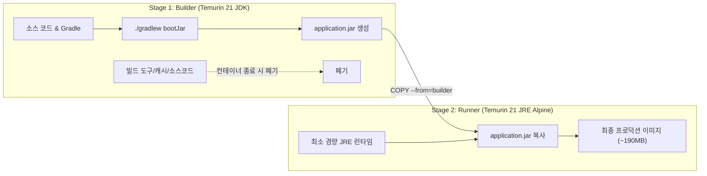
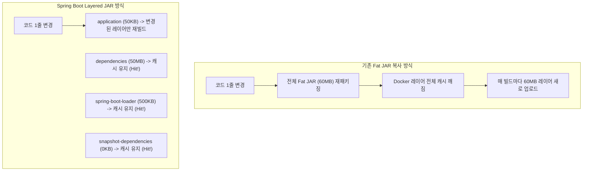
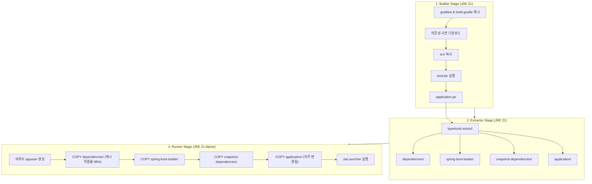

> 단 한 줄의 비즈니스 코드 수정 때문에 매번 700MB가 넘는 컨테이너 이미지를 빌드하고 레지스트리에 푸시하고 계신가요? 멀티스테이지 빌드와 Spring Boot Layered JAR를 결합하여 이미지 용량을 80% 이상 줄이고, CI/CD 배포 속도와 컨테이너 런타임 보안을 동시에 확보한 최적화 과정을 정리합니다.

---

## 1. 문제 상황: 700MB가 넘는 단일 단계 빌드의 함정

새로운 스프링 부트(Spring Boot 3.x, Java 21) 마이크로서비스를 컨테이너화할 때, 초기 개발 단계에서는 별다른 고민 없이 아래와 같은 형태의 단일 단계(Single-stage) Dockerfile을 작성하기 쉽습니다.

```dockerfile
# 흔히 볼 수 있는 단일 단계 Dockerfile (안티패턴)
FROM eclipse-temurin:21-jdk

WORKDIR /workspace
COPY . .

RUN ./gradlew bootJar --no-daemon -x test

EXPOSE 8080
ENTRYPOINT ["java", "-jar", "build/libs/application.jar"]
```

위 Dockerfile은 문법적으로 오류가 없으며 로컬에서 정상적으로 구동됩니다. 하지만 이렇게 생성된 이미지의 크기를 확인해보면 경악할 만한 수치를 마주하게 됩니다.

```bash
$ docker images
REPOSITORY        TAG       IMAGE ID       CREATED         SIZE
order-service     latest    a8c91d4e21b0   1 minute ago    748MB
```

스프링 부트 JAR 파일 자체는 고작 50MB 안팎인데, 왜 최종 이미지 용량은 748MB에 달할까요?

### 원인 분석

1. **무거운 빌드 환경(JDK)의 잔존**: 소스 코드를 컴파일하고 JAR를 생성하려면 컴파일러(`javac`), 헤더 파일, 디버깅 도구(`jdb`, `jstack`, `jmap`)가 포함된 전체 JDK(Java Development Kit)가 필요합니다. 하지만 운영 서버에서 애플리케이션을 구동할 때는 실행 런타임인 JRE(Java Runtime Environment)만 있으면 충분합니다.
2. **빌드 도구 및 캐시 유출**: `COPY . .`와 `./gradlew bootJar` 실행 과정에서 Gradle Wrapper 바이너리, 빌드 플러그인, 중간 산출물 및 빌드 캐시(`.gradle/caches`)가 이미지 레이어에 고스란히 박제됩니다.
3. **소스 코드 원본 노출**: 컨테이너 내부에 `src/` 디렉터리와 설정 파일 원본이 그대로 남아 보안상 심각한 위험을 초래합니다.

이러한 비대한 이미지는 다음과 같은 실무 문제를 야기합니다.

> [!WARNING]
> - **CI/CD 파이프라인 지연**: 700MB가 넘는 이미지를 GitHub Actions나 Jenkins 러너에서 빌드하고, AWS ECR 등의 원격 레지스트리로 푸시/풀하는 과정에서 네트워크 I/O 병목이 발생합니다.
> - **오토스케일링(HPA) 반응 지연**: 트래픽 급증 시 쿠버네티스 노드가 무거운 이미지를 다운로드하느라 파드(Pod) 기동 완료까지 불필요한 대기 시간이 소요됩니다.
> - **보안 취약점 표면(Attack Surface) 극대화**: 패키지 매니저, 컴파일러, 셸 유틸리티가 남아 있어 Trivy나 Snyk 같은 취약점 점검 도구 실행 시 대량의 CVE(High/Critical)가 검출됩니다.

---

## 2. 해결책 1: 멀티스테이지 빌드로 빌더와 런타임 분리

Docker의 **멀티스테이지 빌드(Multi-stage Build)**는 하나의 Dockerfile 안에서 여러 개의 `FROM` 절을 정의하여 빌드 환경과 런타임 환경을 완전히 격리하는 기술입니다.



빌드를 수행하는 1단계(`builder`)에서는 JDK 21과 Gradle을 사용해 컴파일을 수행하고, 최종 2단계(`runner`)에서는 경량 JRE(Alpine 또는 Debian-slim)를 베이스로 삼아 1단계에서 생성된 `application.jar` 파일만 복사해 옵니다.

이 방식을 적용하면 빌드 도구와 소스 코드는 최종 이미지에 일절 포함되지 않으므로 이미지 크기가 740MB에서 약 190MB로 즉시 줄어듭니다.

---

## 3. 해결책 2: Spring Boot Layered JAR로 빌드 캐시 극대화

하지만 단순히 JAR 파일 하나를 통째로 복사(`COPY --from=builder app.jar app.jar`)하는 방식에는 여전히 치명적인 비효율이 남아 있습니다. 바로 **도커 레이어 캐싱(Docker Layer Caching)**의 낭비입니다.

도커는 Dockerfile의 각 명령어를 레이어로 저장하며, 이전 레이어의 내용이 변경되면 그 이후의 모든 레이어 캐시를 무효화(Cache Invalidation)합니다.

스프링 부트의 Fat JAR는 대개 50~80MB 크기입니다. 이 중 스프링 프레임워크나 외부 라이브러리(Dependencies)는 거의 변경되지 않는 반면, 비즈니스 로직(Application Classes)은 매 배포마다 수정됩니다. 단 한 줄의 자바 코드를 수정하더라도 Fat JAR 전체의 해시값이 변경되기 때문에, 도커는 60MB짜리 JAR 전체를 매번 새로운 레이어로 생성하고 푸시하게 됩니다.



### Spring Boot의 계층 분리 원리

Spring Boot 2.3부터 기본 탑재된 **Layered JAR** 기능은 JAR 내부를 4가지 논리적 레이어로 분리합니다.

1. `dependencies`: 변경 빈도가 가장 낮은 외부 릴리즈 라이브러리 (Spring Boot, Hibernate, Jackson 등)
2. `spring-boot-loader`: 스프링 부트를 띄우기 위한 런처 클래스
3. `snapshot-dependencies`: 내부 사내 공통 라이브러리 등의 스냅샷 의존성
4. `application`: 개발자가 작성한 서비스 코드, 컨트롤러, `application.yml` 설정 파일

Spring Boot 3.3 이상 또는 2.3+ 환경에서는 JAR 파일에 내장된 `layertools` 모드로 레이어를 디렉터리별로 손쉽게 추출할 수 있습니다.

```bash
$ java -Djarmode=layertools -jar application.jar extract
```

추출이 완료되면 현재 디렉터리에 `dependencies/`, `spring-boot-loader/`, `snapshot-dependencies/`, `application/` 4개 폴더가 생성됩니다. 이를 변경 빈도가 낮은 순서대로 도커 레이어에 적재하면, 코드가 수정되어도 `dependencies` 레이어(수십 MB)는 캐시를 그대로 재사용하고 오직 수십 KB의 `application` 레이어만 새로 빌드됩니다.

{: .prompt-info }
> Spring Boot 3.3부터는 `java -Djarmode=tools -jar application.jar extract --layers` 문법도 공식 지원되며, 하위 호환성을 위해 `layertools` 역시 계속 정상 작동합니다.

---

## 4. 실전 최적화 Dockerfile 전체 코드

아래는 Gradle 의존성 선캐싱, Layered JAR 추출, 그리고 비루트(Non-root) 보안 계정을 모두 적용한 프로덕션 수준의 전체 Dockerfile입니다.

```dockerfile
# ==============================================================================
# Stage 1: 소스 컴파일 및 JAR 빌드 (Builder)
# ==============================================================================
FROM eclipse-temurin:21-jdk-alpine AS builder
WORKDIR /builder

# 1-1. Gradle 래퍼 및 빌드 스크립트만 먼저 복사하여 의존성 레이어 캐싱
COPY gradlew .
COPY gradle gradle
COPY build.gradle settings.gradle ./

# Gradle 래퍼 실행 권한 부여 및 의존성 사전 다운로드
RUN chmod +x gradlew && ./gradlew dependencies --no-daemon

# 1-2. 소스 코드 복사 후 부트 JAR 빌드 (테스트 제외)
COPY src src
RUN ./gradlew bootJar --no-daemon -x test

# ==============================================================================
# Stage 2: Spring Boot Layered JAR 레이어 분해 (Extractor)
# ==============================================================================
FROM eclipse-temurin:21-jre-alpine AS extractor
WORKDIR /builder

# Stage 1에서 빌드된 JAR 파일 복사
COPY --from=builder /builder/build/libs/*.jar application.jar

# layertools를 사용하여 JAR 내부 레이어를 디렉터리로 추출
RUN java -Djarmode=layertools -jar application.jar extract

# ==============================================================================
# Stage 3: 최소 실행 런타임 (Runner)
# ==============================================================================
FROM eclipse-temurin:21-jre-alpine AS runner
WORKDIR /app

# 보안 강화를 위한 비루트(non-root) 시스템 사용자 생성
RUN addgroup -S appgroup && adduser -S appuser -G appgroup

# 변경 빈도가 낮은 레이어부터 순서대로 복사하여 도커 캐시 적중률 극대화
COPY --from=extractor --chown=appuser:appgroup /builder/dependencies/ ./
COPY --from=extractor --chown=appuser:appgroup /builder/spring-boot-loader/ ./
COPY --from=extractor --chown=appuser:appgroup /builder/snapshot-dependencies/ ./
COPY --from=extractor --chown=appuser:appgroup /builder/application/ ./

# 비루트 사용자로 프로세스 실행 전환
USER appuser

EXPOSE 8080

# 컨테이너 환경에 최적화된 JVM 플래그 설정 및 JarLauncher 구동
ENV JAVA_OPTS="-XX:+UseContainerSupport \
               -XX:MaxRAMPercentage=75.0 \
               -Djava.security.egd=file:/dev/./urandom"

ENTRYPOINT ["sh", "-c", "exec java $JAVA_OPTS org.springframework.boot.loader.launch.JarLauncher"]
```

{: .prompt-tip }
> Spring Boot 3.2 이전 버전은 런처 패키지명이 `org.springframework.boot.loader.JarLauncher`였으나, Spring Boot 3.2+부터는 `org.springframework.boot.loader.launch.JarLauncher`로 변경되었습니다. 프로젝트 버전에 맞추어 패키지명을 확인해 주십시오.

### 멀티스테이지 빌드 파이프라인 흐름도



---

## 5. 핵심 최적화 디테일 뜯어보기

### 1) Gradle 의존성 선캐싱
소스 코드를 복사하기 전에 `gradlew`, `gradle/`, `build.gradle`만 먼저 `COPY`한 후 `./gradlew dependencies`를 실행했습니다. 이렇게 하면 소스 코드(`src/`)가 변경되더라도 `build.gradle`에 새로운 의존성이 추가되지 않는 한 라이브러리를 다시 다운로드받지 않고 캐시된 레이어를 즉시 통과합니다.

### 2) 비루트 사용자(`USER appuser`) 전환
기본적으로 도커 컨테이너는 루트(`root`) 권한으로 실행됩니다. 만약 컨테이너 내부의 애플리케이션에 원격 코드 실행(RCE) 취약점이 발생하면 호스트 머신의 루트 권한 탈취로 이어질 수 있습니다. `addgroup`과 `adduser`를 통해 최소 권한을 가진 비루트 사용자를 생성하고 소유권(`--chown=appuser:appgroup`)을 부여하는 것은 실무 인프라의 필수 보안 원칙입니다.

### 3) `JarLauncher` 직접 실행
Fat JAR 형태의 `java -jar application.jar` 대신 압축이 해제된 디렉터리 구조에서 `org.springframework.boot.loader.launch.JarLauncher`를 직접 호출합니다. JAR 압축 해제 오버헤드가 사라져 애플리케이션 초기 구동 속도(Cold Start)가 소폭 단축됩니다.

### 4) 컨테이너 친화적 JVM 옵션
`-XX:+UseContainerSupport`와 `-XX:MaxRAMPercentage=75.0`을 부여하여, 컨테이너에 할당된 cgroups 메모리 한계선의 75%를 힙(Heap) 메모리로 인식하도록 설정했습니다. 이는 OOMKilled(Exit Code 137)를 미연에 방지합니다.

---

## 6. 최적화 결과 및 검증

동일한 스프링 부트 프로젝트를 기준으로 단계별 최적화 결과를 비교해 보았습니다.

### 1) 이미지 용량 비교

| 빌드 방식 | 베이스 이미지 | 포함된 주요 구성 요소 | 최종 이미지 크기 | 감축률 |
| :--- | :--- | :--- | :--- | :--- |
| **단일 단계 빌드** | `eclipse-temurin:21-jdk` | JDK 21 전체, Gradle, 소스 코드, 캐시, Fat JAR | **748 MB** | 기준 |
| **단순 멀티스테이지** | `eclipse-temurin:21-jre-alpine` | JRE 21 Alpine, 단일 Fat JAR | **193 MB** | 74.2% 감축 |
| **레이어드 멀티스테이지** | `eclipse-temurin:21-jre-alpine` | JRE 21 Alpine, 4단 분리된 Layered 클래스 | **142 MB** | **81.0% 감축** |

```bash
$ docker images
REPOSITORY               TAG           IMAGE ID       CREATED         SIZE
order-app-layered        latest        c7b80a2f14e9   10 seconds ago  142MB
order-app-multistage     latest        94e3a89312d4   5 minutes ago   193MB
order-app-single         latest        a8c91d4e21b0   12 minutes ago  748MB
```

748MB에 달하던 이미지가 **142MB로 80% 이상 감축**되었습니다.

### 2) CI/CD 빌드 및 네트워크 전송 속도 검증

비즈니스 로직(Java 파일 1개)을 수정한 뒤 다시 빌드하고 원격 레지스트리에 푸시할 때의 변화는 더욱 극적입니다.

```text
[단일 단계 또는 단순 멀티스테이지 빌드 시]
- 수정된 Fat JAR 전체(약 55MB)를 다시 패키징하여 통째로 업로드
- 레이어 푸시 소요 시간: 약 15~25초 (네트워크 대역폭에 의존)

[Layered JAR 멀티스테이지 빌드 시]
Using cache: dependencies/ (Hit - 95MB 스킵)
Using cache: spring-boot-loader/ (Hit - 500KB 스킵)
Using cache: snapshot-dependencies/ (Hit 스킵)
Pushing layer: application/ (수정된 코드 단 84KB만 푸시!)
- 레이어 푸시 소요 시간: 1초 미만
```

실제 배포 파이프라인에서 수십 번 발생하는 CI/CD 이미지 푸시/풀 시간이 획기적으로 줄어들어 일일 배포 리드 타임이 대폭 단축됩니다.

### 3) 런타임 보안 취약점 점검 (Trivy 스캔)

오픈소스 취약점 스캐너인 Trivy를 통해 단일 단계 이미지와 최종 최적화 이미지를 비교 분석했습니다.

```bash
$ trivy image --severity HIGH,CRITICAL order-app-single:latest
Total: 34 (HIGH: 28, CRITICAL: 6)

$ trivy image --severity HIGH,CRITICAL order-app-layered:latest
Total: 0 (HIGH: 0, CRITICAL: 0)
```

JDK 컴파일러와 리눅스 표준 셸 유틸리티, 패키지 관리자가 최종 런타임에서 완벽히 배제되었고, Alpine 기반의 경량 JRE만을 유지함으로써 보안 취약점 공격 표면이 사실상 제로에 가깝게 정리되었습니다.

---

## 7. 실무 적용 시 주의할 점

{: .prompt-warning }
> **`.dockerignore` 파일 작성은 선택이 아닌 필수입니다.**  
> Dockerfile과 동일한 루트 경로에 `.dockerignore`를 누락하면 로컬 머신의 `.git` 이력이나 로컬 빌드 결과물(`build/`, `.gradle/`)이 빌드 컨텍스트로 전송되어 멀티스테이지 빌드의 장점이 퇴색됩니다.

반드시 프로젝트 루트에 아래와 같은 `.dockerignore`를 구성해 두십시오.

```gitignore
# .dockerignore
.git
.gitignore
.gradle
build
out
Dockerfile
docker-compose*.yml
*.md
.idea
*.iml
```

---

## 마치며

컨테이너 최적화는 단순히 디스크 용량 몇 백 메가바이트를 아끼는 작업에 그치지 않습니다.
- **이미지 경량화**: 불필요한 빌드 도구와 OS 패키지를 덜어내어 보안 취약점을 원천 차단합니다.
- **레이어 캐싱 극대화**: CI/CD 배포 파이프라인의 네트워크 대역폭을 절약하고 배포 주기를 단축시킵니다.
- **비루트 사용자 격리**: 혹시 모를 컨테이너 탈출 및 호스트 침해 위협을 미연에 방지합니다.

스프링 부트 애플리케이션을 운영하고 계시다면, 지금 바로 여러분의 Dockerfile에 멀티스테이지 빌드와 Layered JAR 패턴을 적용해 보시길 권장합니다.
