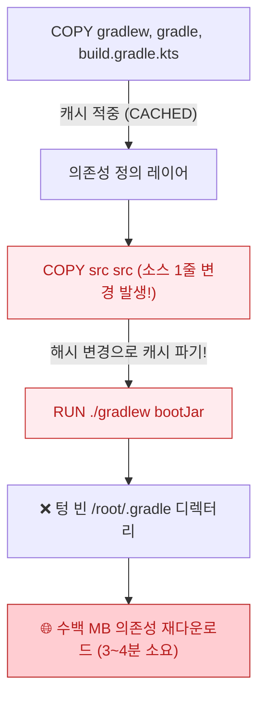
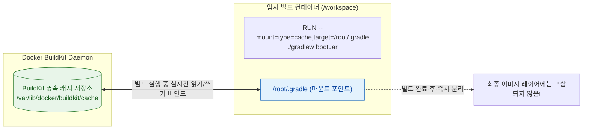

> 소스 코드 단 한 줄을 수정했을 뿐인데 매번 수백 메가바이트의 Gradle 의존성을 처음부터 다시 내려받느라 CI 파이프라인과 로컬 빌드가 늘어지던 문제를, Docker BuildKit의 캐시 마운트(`--mount=type=cache`)와 GitHub Actions Cache 백엔드 연동으로 20초대에 끝내도록 최적화한 실무 경험을 정리합니다.
{: .prompt-info }

---

## 1. 소스 코드 한 줄 고쳤는데... 매번 반복되는 의존성 재다운로드의 고통

스프링 부트(Spring Boot) 기반의 백엔드 서비스를 개발하다 보면, 로컬 환경에서 Docker 이미지를 직접 빌드해 컨테이너 동작을 검증하거나 사내 CI/CD 파이프라인에서 컨테이너 이미지를 빌드해 레지스트리로 푸시하는 과정을 수없이 반복하게 됩니다.

그런데 비즈니스 로직의 오타 하나, 컨트롤러의 주석 한 줄을 수정한 뒤 `docker build`를 실행했을 때, 콘솔 화면에 다음과 같은 로그가 끝없이 흘러나오는 광경을 누구나 한 번쯤 목격하셨을 것입니다.

```bash
# ...
> [builder 6/7] RUN ./gradlew bootJar --no-daemon -x test:
0.842 Downloading https://services.gradle.org/distributions/gradle-8.12-bin.zip
14.21 Downloading https://repo1.maven.org/maven2/org/springframework/boot/spring-boot-starter-web/...
28.53 Downloading https://repo1.maven.org/maven2/org/hibernate/orm/hibernate-core/...
# ... 수십 초에서 수 분간 수백 개의 .jar 라이브러리 다운로드 반복 ...
```

분명 로컬 개발 머신이나 CI 러너의 대역폭은 충분한데도, 빌드는 매번 3~4분씩 멈춰 서서 개발자의 집중력을 흐트러뜨립니다.

### 1.1 도커 레이어 캐시(Layer Cache)의 무효화 메커니즘

도커의 고전적인 빌드 엔진은 **명령어 단위의 레이어 스냅샷 캐싱** 방식으로 동작합니다. Dockerfile의 각 인스트럭션(`COPY`, `RUN`, `ADD` 등)은 이전 레이어의 체크섬과 현재 명령어의 파라미터/파일 해시값을 조합해 캐시 유효 여부를 판단합니다.

문제는 소스 코드를 복사하는 시점입니다. 일반적인 멀티스테이지 Dockerfile은 다음과 같이 작성되곤 합니다.

```dockerfile
FROM eclipse-temurin:25-jdk-alpine AS builder
WORKDIR /workspace

COPY gradlew .
COPY gradle gradle
COPY build.gradle.kts settings.gradle.kts ./
COPY src src

# 소스 코드가 바뀌면 이전 COPY 레이어 해시가 달라져 아래 RUN은 무조건 캐시 무효화!
RUN ./gradlew bootJar --no-daemon -x test
```

`src/` 디렉터리 내부의 자바 파일 단 하나만 변경되어도 `COPY src src` 레이어의 해시값이 완전히 달라집니다. 그리고 도커 캐시 메커니즘의 대원칙에 따라, **상위 레이어의 캐시가 무효화(Invalidated)되면 그 뒤에 따르는 모든 하위 레이어는 무조건 처음부터 다시 실행**됩니다.

결과적으로 새롭게 생성된 임시 컨테이너 내부의 `/root/.gradle` 디렉터리는 완전히 텅 빈 백지 상태가 되며, Gradle은 필요한 모든 의존성 JAR 파일을 Maven Central이나 사내 사설 Nexus에서 다시 내려받게 됩니다.



### 1.2 `COPY build.gradle` 편법과 그 명확한 한계

많은 개발팀이 이 문제를 회피하기 위해 빌드 스크립트를 먼저 복사하고 의존성을 미리 받아두는 트릭을 도입합니다.

```dockerfile
# 흔히 시도하는 레이어 분리 트릭
COPY gradlew .
COPY gradle gradle
COPY build.gradle.kts settings.gradle.kts ./
RUN ./gradlew dependencies --no-daemon

COPY src src
RUN ./gradlew bootJar --no-daemon -x test
```

겉보기에는 그럴듯해 보이지만, 실무 프로젝트에 적용해 보면 곧바로 몇 가지 심각한 한계에 부딪힙니다.

1. **불완전한 의존성 캐싱**: `./gradlew dependencies` 태스크는 설정된 모든 Configuration(예: `compileClasspath`, `runtimeClasspath`, `annotationProcessor`)의 전이 의존성(Transitive Dependencies)과 플러그인 아티팩트를 100% 온전히 내려받지 못합니다. 결국 뒤따르는 `bootJar` 단계에서 여전히 추가 다운로드가 발생합니다.
2. **멀티 모듈 프로젝트에서의 재앙**: 현대 엔터프라이즈 환경은 대부분 수십 개의 서브모듈로 구성됩니다. 서브모듈 간 의존 관계가 얽혀 있는 경우, 모든 서브모듈의 `build.gradle.kts`와 디렉터리 구조를 일일이 모사해서 복사해야 하므로 Dockerfile이 기괴하게 비대해지고 유지보수가 불가능해집니다.
3. **불필요한 이미지 레이어 용량 낭비**: 빌드 스테이지에서 `RUN ./gradlew dependencies`가 생성한 수백 MB의 임시 레이어가 빌드 컨텍스트에 영구적으로 누적됩니다.

우리가 진정으로 원했던 것은 **"소스 코드가 바뀌어 컴파일 태스크가 다시 실행되더라도, 이미 내려받았던 패키지 캐시 디렉터리만큼은 로컬 개발 환경의 `~/.gradle`처럼 온전히 유지되는 것"**이었습니다.

이를 완벽하게 해결해 주는 기술이 바로 **Docker BuildKit의 캐시 마운트(`--mount=type=cache`)**입니다.

---

## 2. Docker BuildKit과 캐시 마운트(`--mount=type=cache`)의 원리

### 2.1 BuildKit이란 무엇이며 왜 캐시 마운트인가?

**BuildKit**은 도커 20.10 버전부터 기본 빌드 엔진으로 탑재된 차세대 컨테이너 이미지 빌더입니다. 기존 레거시 빌더와 달리 LLB(Low-Level Builder)라는 중간 표현식을 기반으로 동작하며, 다음과 같은 강력한 기능을 제공합니다.

- 독립된 빌드 스테이지 간 자동 병렬 실행
- 사용되지 않는 빌드 단계의 자동 가지치기(Dead Code Elimination)
- 빌드 시크릿 마운트(`--mount=type=secret`)
- **호스트 및 빌더 레벨의 영속 캐시 마운트(`--mount=type=cache`)**

여기서 핵심인 **캐시 마운트**는 도커의 불변 레이어 파일시스템과 완전히 분리된 **외부 영속 볼륨(Persistent Cache Volume)**을 특정 `RUN` 명령어 실행 시점에만 컨테이너 내부 경로로 바인드 마운트해 주는 기능입니다.



명령어가 실행되는 동안에는 `/root/.gradle` 경로에 기존 캐시가 고스란히 남아 있으므로 Gradle은 네트워크를 전혀 타지 않고 로컬 디스크 캐시에서 라이브러리를 즉시 로딩합니다. 또한 새로 추가된 라이브러리가 있다면 마운트된 캐시 저장소에 즉시 기록됩니다.

빌드 명령어가 끝나면 캐시 마운트는 컨테이너에서 깔끔하게 떨어져 나가므로, **최종 생성되는 도커 이미지 레이어에 무거운 캐시 파일이 포함되어 이미지 크기가 비대해지는 일도 원천 차단**됩니다.

### 2.2 최적화된 스프링 부트 멀티스테이지 Dockerfile

실무에서 바로 활용할 수 있는 완성형 멀티스테이지 Dockerfile 예시입니다. Gradle 배포판 자체(Gradle Wrapper)와 다운로드된 아티팩트 라이브러리 전체를 보존하기 위해 `/root/.gradle`을 캐시 마운트로 지정합니다.

```dockerfile
# syntax=docker/dockerfile:1.7
# Stage 1: Build stage (Gradle + JDK 25)
FROM eclipse-temurin:25-jdk-alpine AS builder
WORKDIR /workspace

# 1. 빌드에 필요한 소스 코드와 설정 파일 전체 복사
COPY . .

# 2. BuildKit 캐시 마운트를 적용하여 빌드 실행
#    - target: 컨테이너 내부의 Gradle 캐시 경로
#    - id: 동일 캐시를 공유/식별하기 위한 고유 키
#    - sharing=locked: 동시 빌드 시 파일 락 충돌 방지
RUN --mount=type=cache,id=gradle-cache,target=/root/.gradle \
    chmod +x gradlew && \
    ./gradlew bootJar --no-daemon -x test

# Stage 2: Production runtime stage (경량 JRE 25)
FROM eclipse-temurin:25-jre-alpine AS runner
WORKDIR /app

# 보안을 위한 비특권(Non-root) 전용 시스템 계정 생성
RUN addgroup -S springgroup && adduser -S springuser -G springgroup
USER springuser

# Builder 스테이지에서 최종 패키징된 실행 가능한 fat-jar만 추출
COPY --from=builder /workspace/build/libs/*.jar app.jar

EXPOSE 8080
ENTRYPOINT ["java", "-jar", "-Djava.security.egd=file:/dev/./urandom", "app.jar"]
```

Dockerfile 맨 첫 줄의 `# syntax=docker/dockerfile:1.7`은 최신 BuildKit 문법을 파서가 인식하도록 선언하는 디렉티브입니다.

{: .prompt-tip }
> **Maven 프로젝트인 경우**:
> Maven을 사용하는 프로젝트라면 target 경로만 `target=/root/.m2`로 변경해 주시면 동일한 효과를 누릴 수 있습니다.
> ```dockerfile
> RUN --mount=type=cache,id=maven-cache,target=/root/.m2 \
>     ./mvnw clean package -DskipTests
> ```

---

## 3. CI/CD 파이프라인(GitHub Actions)에서 BuildKit 캐시 연동하기

### 3.1 로컬에서는 빠른데 CI에서는 왜 다시 느려질까?

로컬 개발 장비에서는 도커 데몬이 계속 켜져 있으므로 BuildKit 캐시가 호스트 머신의 도커 스토리지 풀에 자연스럽게 보존됩니다.

하지만 GitHub Actions의 기본 `ubuntu-latest` 러너와 같은 클라우드 CI 환경은 매 잡(Job)마다 깨끗한 가상머신이 새로 프로비저닝되는 **에페메럴(Ephemeral) 환경**입니다. 빌드가 끝나면 가상머신 디스크가 통째로 삭제되므로, 아무런 추가 설정을 하지 않으면 다음 커밋 빌드 시 BuildKit 캐시 마운트 역시 빈 상태로 시작합니다.

이를 해결하려면 빌드가 끝난 후 BuildKit의 캐시 상태를 원격 스토리지(GitHub Actions Cache API 또는 컨테이너 레지스트리)로 **내보내고(export)**, 다음 빌드 시작 시 이를 다시 **불러오는(import)** 파이프라인 구성이 필수적입니다.

### 3.2 GitHub Actions Cache 백엔드(`type=gha`) 연동

공식 `docker/setup-buildx-action`과 `docker/build-push-action`은 GitHub Actions 캐시 스토리지와 직결되는 `type=gha` 캐시 백엔드를 완벽하게 지원합니다.

다음은 실제 운영 환경에 바로 적용 가능한 `.github/workflows/docker-build.yml` 예제입니다.


```yaml
name: Production Docker Build & Push

on:
  push:
    branches: [ "main" ]
  pull_request:
    branches: [ "main" ]

jobs:
  build:
    runs-on: ubuntu-latest
    steps:
      - name: Checkout Source Code
        uses: actions/checkout@v4

      # 1. Docker Buildx 빌더 인스턴스 생성 (BuildKit 활성화 필수)
      - name: Set up Docker Buildx
        uses: docker/setup-buildx-action@v3

      # 2. 사내 컨테이너 레지스트리 또는 GHCR 로그인
      - name: Log in to GitHub Container Registry
        uses: docker/login-action@v3
        with:
          registry: ghcr.io
          username: ${{ github.actor }}
          password: ${{ secrets.GITHUB_TOKEN }}

      # 3. BuildKit 캐시 마운트 + GitHub Actions Cache 백엔드 연동 빌드
      - name: Build and Push Docker Image
        uses: docker/build-push-action@v6
        with:
          context: .
          file: ./Dockerfile
          push: ${{ github.event_name == 'push' && github.ref == 'refs/heads/main' }}
          tags: ghcr.io/${{ github.repository }}/backend:latest
          # GitHub Actions Cache API 연동 핵심 설정
          cache-from: type=gha
          cache-to: type=gha,mode=max
```


여기서 가장 중요한 옵션은 **`cache-to: type=gha,mode=max`**입니다.

기본값인 `mode=min`을 사용할 경우 최종 결과물 이미지에 포함된 레이어만 캐시로 저장되므로, `builder` 스테이지의 캐시 마운트(`--mount=type=cache`)나 중간 컴파일 산출물이 GitHub 캐시에 업로드되지 않습니다. 반드시 **`mode=max`**를 명시해야 멀티스테이지의 모든 캐시 레이어가 완벽하게 저장됩니다.

{: .prompt-info }
> **GitHub Actions의 캐시 용량 한도 주의**:
> GitHub Actions Cache는 리포지토리당 기본 10GB의 무료 용량 제한을 가집니다. 프로젝트 규모가 크거나 여러 브랜치가 병렬로 동작한다면, 컨테이너 레지스트리를 캐시 스토리지로 활용하는 `type=registry` 백엔드(예: `cache-from: type=registry,ref=ghcr.io/my-org/backend:buildcache`)를 고려하는 것이 좋습니다.

---

## 4. 실전 벤치마크 및 캐시 오염 방지 노하우

### 4.1 실전 빌드 속도 벤치마크: 3분 40초에서 22초로

스프링 부트 3.4 기반, 의존성 라이브러리 78개가 포함된 실무 백엔드 프로젝트에서 소스 코드 컨트롤러 1줄을 수정한 뒤 도커 빌드를 수행하며 소요 시간을 측정했습니다.

| 빌드 방식 | 의존성 처리 상태 | 빌드 소요 시간 | 네트워크 트래픽 |
| :--- | :--- | :--- | :--- |
| **기존 기본 빌드** (캐시 없음) | 전체 의존성 재다운로드 발생 | **3분 42초** | 약 420 MB 수신 |
| **`dependencies` 복사 편법** | 부분 재다운로드 + 중복 빌드 | **1분 58초** | 약 110 MB 수신 |
| **BuildKit 캐시 마운트 적용** | **네트워크 다운로드 0% (로컬 캐시 적중)** | **22초** | **0 MB (네트워크 무관)** |

```text
[Benchmark Result]
기존 레이어 캐시 방식: ▇▇▇▇▇▇▇▇▇▇▇▇▇▇▇▇▇▇▇▇ 222s
BuildKit 캐시 마운트: ▇█ 22s  (약 90.1% 빌드 타임 단축!)
```

BuildKit 캐시 마운트를 적용하자, 소스 코드 수정 후 빌드 시 Gradle은 이미 캐시된 JAR 파일을 로컬 디스크에서 즉시 참조하여 증분 컴파일(Incremental Compilation) 및 최종 `bootJar` 패키징만 수행하고 끝납니다. 네트워크 레이턴시와 대역폭 제약이 완벽하게 제거되었습니다.

### 4.2 캐시 오염 방지와 안정성을 위한 실무 체크리스트

캐시 마운트를 실무에 도입할 때 간과하기 쉬운 4가지 핵심 주의사항을 정리합니다.

#### 1) Gradle 데몬 종료 플래그 (`--no-daemon`) 필수 지정
도커 빌드 컨테이너 환경에서는 반드시 `--no-daemon` 옵션을 주어야 합니다. Gradle 데몬은 백그라운드 상주 프로세스로 동작하도록 설계되어 있어, 컨테이너 프로세스가 종료될 때 캐시 디렉터리에 락(Lock) 파일을 남겨두거나 비정상 종료되어 다음 빌드 시 캐시 파일이 손상(Corrupted cache)될 위험이 있습니다.

#### 2) `sharing=locked` 옵션으로 동시 빌드 파일 락 충돌 방지
동일한 도커 데몬을 공유하는 CI 러너에서 여러 워커가 동시에 동일한 캐시 ID로 빌드를 수행할 경우, Gradle 캐시 파일에 동시 쓰기(Concurrent Write)가 일어나 빌드가 깨질 수 있습니다.

```dockerfile
RUN --mount=type=cache,id=gradle-cache,target=/root/.gradle,sharing=locked \
    ./gradlew bootJar --no-daemon -x test
```

`sharing=locked`를 지정하면, 앞선 빌드가 캐시 마운트를 점유하고 있을 때 뒤이은 빌드가 안전하게 대기한 뒤 순차적으로 캐시를 마운트합니다.

#### 3) 마운트 대상 경로와 사용자 권한 일치
Dockerfile에서 빌드 전용 비특권 계정을 별도로 생성해 사용할 경우, 캐시 타깃 경로가 맞지 않아 캐시를 읽지 못하는 실수가 자주 발생합니다.

- `root` 사용자로 빌드 시: `target=/root/.gradle`
- `gradle` 전용 사용자(`USER gradle`)로 빌드 시: `target=/home/gradle/.gradle`

캐시 마운트 시 `uid`와 `gid` 옵션을 지정해 권한 불일치(`Permission Denied`) 오류를 사전에 방지할 수 있습니다.
```dockerfile
RUN --mount=type=cache,id=gradle-cache,target=/home/gradle/.gradle,uid=1000,gid=1000 ...
```

#### 4) 디스크 고갈 방지를 위한 정기 캐시 Prune
캐시 마운트는 호스트 데몬에 영구 저장되므로, 스프링 부트 버전 업그레이드 등으로 더 이상 참조되지 않는 구버전 라이브러리가 장기간 방치되면 디스크 용량을 잠식할 수 있습니다.

CI 서버나 개발 서버의 크론탭(Crontab) 등에 주기적인 빌더 캐시 정리 스크립트를 배치하는 것을 권장합니다.

```bash
# BuildKit 캐시 마운트 전용 데이터만 안전하게 정리 (일반 이미지 캐시 보존)
docker builder prune --filter type=exec.cachemount --force
```

{: .prompt-warning }
> `docker system prune -a`를 무심코 실행하면 모든 이미지와 BuildKit 캐시 마운트 데이터가 완전히 날아가 다음 빌드가 다시 느려집니다. 캐시 마운트만 선택적으로 회수하고 싶을 때는 반드시 위와 같이 `--filter type=exec.cachemount` 필터를 적용하십시오.

---

## 5. 마치며: 빌드 타임 최적화가 주는 개발자 생산성의 복리 효과

백엔드 개발에서 CI/CD 파이프라인의 속도는 단순한 인프라 효율성을 넘어 **팀 전체의 개발 생산성과 릴리즈 민첩성**을 결정짓는 핵심 지표입니다.

빌드 한 번에 4분이 걸리던 환경에서는 개발자가 코드를 푸시한 뒤 다른 업무로 컨텍스트 스위칭을 하게 되지만, 빌드가 20초 만에 끝나면 즉각적인 피드백 루프 안에서 높은 몰입도를 유지할 수 있습니다.

지금 운영 중인 Dockerfile에 불필요한 `COPY build.gradle` 편법이나 매번 반복되는 의존성 다운로드가 남아 있다면, 오늘 소개한 **Docker BuildKit 캐시 마운트(`--mount=type=cache`)**와 **GitHub Actions Cache(`type=gha`)**를 적용해 보시길 강력히 권장합니다.
