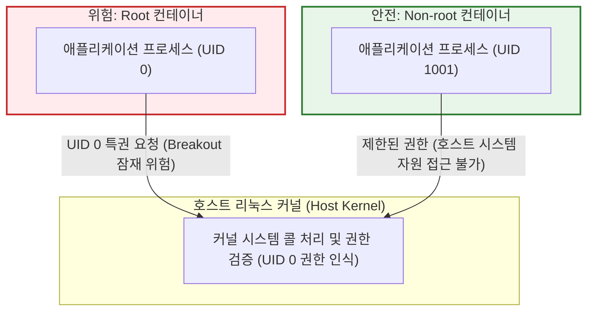
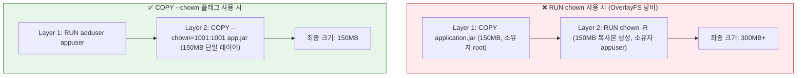
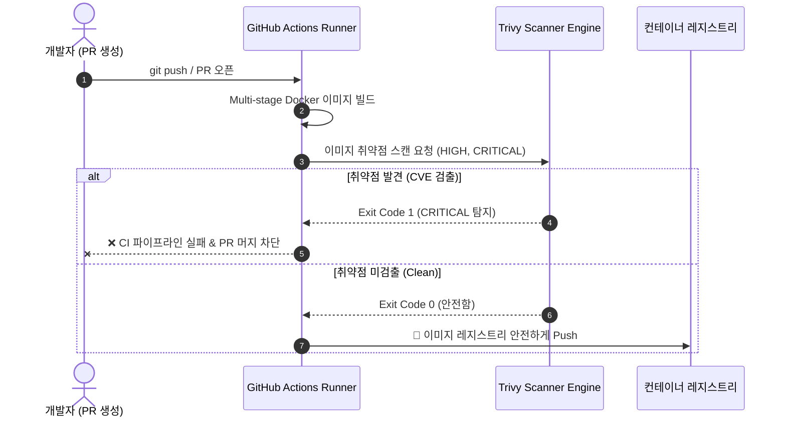

> 컨테이너 내부의 root는 호스트 OS 커널에서도 UID 0(root)으로 인식됩니다. 본 글에서는 컨테이너 이스케이프 위험을 원천 차단하는 Non-root 사용자 구성, `RUN chown`으로 인한 이미지 용량 뻥튀기 방지 기법, 그리고 Trivy 기반의 CI 빌드 보안 게이트웨이 구축 실무를 다룹니다.

---

## 1. 왜 "컨테이너 격리"를 맹신하면 안 되는가?

도커(Docker)를 처음 접할 때 흔히 하는 오해 중 하나는 "컨테이너는 가상 머신(VM)처럼 완전한 하이퍼바이저 격리 공간에서 돌아가므로 안전하다"는 믿음입니다. 그러나 컨테이너는 별도의 독립된 OS 커널을 띄우는 것이 아니라, **호스트 리눅스 커널의 네임스페이스(Namespace)와 cgroups를 공유하는 단일 프로세스 집합**에 불과합니다.

### 1.1 컨테이너 내부 root(UID 0)의 실체

Dockerfile에서 별도의 사용자 지정을 하지 않고 빌드한 컨테이너는 기본적으로 `root`(UID 0) 권한으로 프로세스를 실행합니다. 컨테이너 셸 안에서 `id` 명령어를 입력해 보면 아래와 같이 출력됩니다.

```bash
# 컨테이너 내부
$ whoami
root
$ id
uid=0(root) gid=0(root) groups=0(root)
```

이 프로세스를 호스트 머신에서 `ps -ef`나 `ps aux`로 확인하면, 놀랍게도 호스트 커널 역시 해당 컨테이너 프로세스를 **호스트의 실제 root(UID 0)** 권한으로 구동하고 있음을 알 수 있습니다.

```bash
# 호스트 OS 터미널
$ ps -eo pid,user,args | grep java
19420 root    java -jar app.jar
```

컨테이너의 리눅스 네임스페이스는 프로세스 ID(PID), 네트워크(NET), 마운트(MNT) 등을 논리적으로 분리해 줄 뿐, 커널 수준의 권한 매핑(User Namespace)을 강제하지 않는 한 컨테이너 내부의 root는 호스트 커널에서도 강력한 특권을 가진 UID 0 프로세스입니다.



### 1.2 컨테이너 이스케이프(Container Breakout) 시나리오

만약 웹 애플리케이션에 원격 코드 실행(RCE) 취약점이나 스프링 프레임워크의 치명적인 제로데이 취약점이 존재하여 해커가 셸을 획득했다고 가정해 보겠습니다. 

- **Non-root 사용자인 경우**: 권한 상승(Privilege Escalation) 공격을 연쇄적으로 시도해야 하며, 호스트 마운트 볼륨 쓰기나 패키지 설치(`apt`, `apk`)가 제한되어 피해 반경이 컨테이너 내부의 격리된 샌드박스 영역으로 한정됩니다.
- **Root 사용자인 경우**: 해커는 즉시 컨테이너 내부의 최고 관리자가 됩니다. 호스트의 소켓 파일(예: `/var/run/docker.sock`), 민감한 호스트 마운트 경로, 커널 취약점(runC 취약점 CVE-2019-5736, Dirty COW 등), 혹은 과도하게 부여된 리눅스 기능(Linux Capabilities)을 악용하여 **컨테이너를 탈출(Container Breakout)하고 호스트 OS 전체를 장악**할 수 있습니다.

> 컨테이너가 뚫리더라도 호스트 시스템과 인프라 전체로 피해가 확산되는 것을 막는 첫 번째 방어선(Defense-in-Depth)이 바로 **Non-root 사용자 격리**입니다.
{: .prompt-warning }

---

## 2. Non-root 사용자 격리: Dockerfile 모범 규격

컨테이너 프로세스를 일반 사용자 권한으로 격리하려면 베이스 이미지 배포판에 맞는 전용 시스템 계정과 그룹을 생성하고 `USER` 지시어를 선언해야 합니다.

### 2.1 OS 배포판별 시스템 계정 생성 문법

리눅스 배포판에 따라 시스템 계정을 생성하는 CLI 도구가 다릅니다.

#### Debian / Ubuntu 기반 이미지 (glibc)
`groupadd`와 `useradd` 명령어를 사용합니다. 홈 디렉토리 생성 여부와 셸 제한 옵션을 명시합니다.

```dockerfile
# 시스템 그룹 및 사용자 생성 (UID/GID 고정, 로그인 셸 비활성화)
RUN groupadd -r -g 1001 appgroup && \
    useradd -r -u 1001 -g appgroup -s /usr/sbin/nologin -d /app appuser
```

#### Alpine Linux 기반 이미지 (musl libc)
BusyBox 도구 세트를 사용하는 Alpine 계열에서는 `addgroup`과 `adduser`를 사용합니다.

```dockerfile
# Alpine 전용 시스템 그룹 및 사용자 생성
RUN addgroup -g 1001 -S appgroup && \
    adduser -u 1001 -S -G appgroup -s /sbin/nologin appuser
```

### 2.2 UID/GID를 명시적으로 고정해야 하는 이유

사용자 이름을 `appuser`로만 지정하고 UID를 자동 할당받도록 방치하면 배포판 버전에 따라 UID가 100, 101, 1000 등으로 제각각 부여될 수 있습니다. 

1. **쿠버네티스(Kubernetes) Pod Security Standards 연계**: 보안 정책(PodSecurityAdmission)에서 `runAsNonRoot: true` 및 `runAsUser: 1001`처럼 명시적인 숫자 UID를 요구할 때 정합성을 보장합니다.
2. **호스트 볼륨 마운트 권한 일치**: 호스트의 특정 디렉토리를 마운트할 때 호스트 파일 시스템의 권한(`chmod`/`chown`)과 컨테이너 사용자의 UID가 일치해야 파일 읽기/쓰기 오류(Permission Denied)가 발생하지 않습니다.

---

## 3. Non-root 전환 시 자주 겪는 함정과 해결책

실무에서 Non-root 사용자로 전환할 때 가장 흔히 겪는 두 가지 문제는 **이미지 용량 폭증(뻥튀기)**과 **런타임 디렉토리 쓰기 권한 부족**입니다.

### 3.1 안티패턴: `RUN chown -R`이 유발하는 이미지 뻥튀기

컨테이너에 파일을 복사한 뒤 권한을 변경하기 위해 흔히 다음과 같이 작성하는 실수를 저지릅니다.

```dockerfile
# ❌ [안티패턴] 레이어가 중복 복제되어 용량이 폭증함
FROM eclipse-temurin:25-jre-alpine
WORKDIR /app

# 1. Root 권한으로 파일 복사 (Layer A: 약 150MB)
COPY target/application.jar /app/app.jar

# 2. 계정 생성 후 소유권 재지정 (Layer B: 약 150MB 복제본 발생)
RUN addgroup -g 1001 -S appgroup && \
    adduser -u 1001 -S -G appgroup appuser && \
    chown -R appuser:appgroup /app

USER appuser
ENTRYPOINT ["java", "-jar", "app.jar"]
```

도커의 Union File System(OverlayFS)은 레이어별로 불변(Immutable) 상태를 유지합니다. Layer A에서 생성된 파일을 Layer B에서 `chown`으로 메타데이터만 변경하더라도, 도커 스토리지 드라이버는 Copy-on-Write 동작에 의해 **파일 전체를 새로운 레이어에 복사**합니다. 그 결과 최종 도커 이미지의 크기가 원본 JAR 크기만큼 중복 저장되어 뻥튀기됩니다.



### 3.2 올바른 패턴: `COPY --chown` 플래그 및 사전 권한 정렬

이 문제는 Docker 17.09부터 지원하는 `COPY --chown` 옵션과 사전 디렉토리 생성을 통해 완벽히 해결할 수 있습니다.

```dockerfile
# ✅ [모범 패턴] 용량 낭비 없이 완벽히 Non-root 사용자로 격리된 멀티스테이지 Dockerfile
# Stage 1: Build stage
FROM eclipse-temurin:25-jdk-alpine AS builder
WORKDIR /build

COPY gradlew .
COPY gradle gradle
COPY build.gradle.kts settings.gradle.kts ./
RUN chmod +x gradlew && ./gradlew dependencies --no-daemon

COPY src src
RUN ./gradlew bootJar --no-daemon -x test

# Stage 2: Production runtime stage
FROM eclipse-temurin:25-jre-alpine AS runner
WORKDIR /app

# 1. 런타임 사용자 및 그룹 생성
RUN addgroup -g 1001 -S appgroup && \
    adduser -u 1001 -S -G appgroup -h /app appuser

# 2. 애플리케이션 구동에 필요한 런타임 쓰기 디렉토리 사전 생성 및 권한 설정
# (로그 디렉토리, 힙덤프 디렉토리, 톰캣 임시 디렉토리 등)
RUN mkdir -p /app/logs /app/tmp && \
    chown -R appuser:appgroup /app/logs /app/tmp

# 3. 빌드 결과물을 복사하면서 소유권을 원자적으로(Atomically) 지정
COPY --chown=appuser:appgroup --from=builder /build/build/libs/*.jar /app/app.jar

# 4. 프로세스 실행 사용자 전환
USER appuser:appgroup

EXPOSE 8080
ENTRYPOINT ["java", "-Djava.io.tmpdir=/app/tmp", "-jar", "app.jar"]
```

> **핵심 팁**: `COPY --chown=appuser:appgroup`을 활용하면 레이어가 생성되는 시점에 파일의 소유권(UID/GID)이 즉시 지정되므로 별도의 `chown` 레이어가 생성되지 않습니다.
{: .prompt-tip }

---

## 4. Trivy를 활용한 CVE 스캔 및 CI 보안 게이트웨이 구축

Non-root 격리가 **런타임 침해 확산 방지**를 담당한다면, Base Image와 의존성 라이브러리에 존재하는 알려진 취약점(CVE)을 사전에 차단하는 것은 **공급망 보안(Supply Chain Security)**의 핵심입니다.

### 4.1 왜 Trivy인가?

[Trivy](https://aquasecurity.github.io/trivy/)(Aqua Security 개발)는 컨테이너 이미지, 파일 시스템, Git 리포지토리의 보안 취약점을 초고속으로 검사하는 오픈소스 정적 분석 도구입니다.
- **OS 패키지 취약점**: Alpine, Debian, RedHat 등 OS 배포판 패키지의 CVE 검출
- **애플리케이션 의존성 취약점**: Maven/Gradle, npm, pip, go.mod 등의 취약한 라이브러리 검출
- **간편한 CI 통합**: 로컬 CLI 실행뿐 아니라 GitHub Actions, GitLab CI 등에서 손쉽게 품질 게이트(Quality Gate)로 구성 가능

### 4.2 Trivy CLI 핵심 명령어

로컬 터미널에서 방금 빌드한 이미지를 스캔하는 기본 명령어는 다음과 같습니다.

```bash
# 기본 이미지 취약점 스캔
$ trivy image myapp:latest
```

실무 배포 파이프라인에서 보안 게이트웨이로 활용하려면 아래의 필수 플래그들을 조합해야 합니다.

```bash
$ trivy image \
    --severity HIGH,CRITICAL \
    --ignore-unfixed \
    --exit-code 1 \
    myapp:latest
```

- `--severity HIGH,CRITICAL`: 경미한 Low/Medium 경고는 배포를 막지 않고, 즉각적인 조치가 필요한 심각한 취약점만 필터링합니다.
- `--ignore-unfixed`: 패키지 벤더사에서 아직 패치 버전을 내놓지 않은(해결 불가능한) CVE는 제외하여 빌드 파이프라인의 불필요한 차단을 방지합니다.
- `--exit-code 1`: 조건에 부합하는 취약점이 1개라도 발견되면 종료 코드 `1`을 반환하여 CI/CD 파이프라인을 즉시 중단(Fail)시킵니다.

#### 실제 스캔 결과 터미널 예시
```text
2026-06-09T14:32:00Z  INFO  Vulnerability scanning is enabled
2026-06-09T14:32:01Z  INFO  Detected OS: alpine (3.20.0)
2026-06-09T14:32:02Z  INFO  Number of language-specific files: 1
2026-06-09T14:32:02Z  INFO  Detecting jar vulnerabilities...

myapp:latest (alpine 3.20.0)
============================
Total: 0 (HIGH: 0, CRITICAL: 0)

app.jar (java-pkg)
==================
Total: 2 (HIGH: 1, CRITICAL: 1)

┌───────────────┬────────────────┬──────────┬────────┬───────────────────┬───────────────┬────────────────────────────────────────────┐
│    Library    │ Vulnerability  │ Severity │ Status │ Installed Version │ Fixed Version │                   Title                    │
├───────────────┼────────────────┼──────────┼────────┼───────────────────┼───────────────┼────────────────────────────────────────────┤
│ log4j-core    │ CVE-2021-44228 │ CRITICAL │ fixed  │ 2.14.1            │ 2.17.1        │ Remote Code Execution in Log4j             │
│ spring-core   │ CVE-2022-22965 │ HIGH     │ fixed  │ 5.3.17            │ 5.3.18        │ Spring Framework RCE via Data Binding      │
└───────────────┴────────────────┴──────────┴────────┴───────────────────┴───────────────┴────────────────────────────────────────────┘
```

위와 같이 취약점이 검출되면 Trivy는 `Exit Code 1`을 던지며 프로세스를 종료합니다.

### 4.3 GitHub Actions 파이프라인 통합 (CI Security Gate)

취약점이 포함된 이미지가 레지스트리에 푸시되거나 운영 환경에 배포되지 않도록 차단하는 GitHub Actions 워크플로 예제입니다.

```yaml
name: "Build and Security Scan"

on:
  push:
    branches: [ "main" ]
  pull_request:
    branches: [ "main" ]

jobs:
  build-and-scan:
    name: "Docker Build & Trivy Scan"
    runs-on: ubuntu-latest

    steps:
      - name: "체크아웃 리포지토리"
        uses: actions/checkout@v4

      - name: "Docker Buildx 설정"
        uses: docker/setup-buildx-action@v3

      - name: "컨테이너 이미지 빌드 (로컬 캐시)"
        uses: docker/build-push-action@v6
        with:
          context: .
          load: true
          tags: myorg/backend-service:${{ github.sha }}
          cache-from: type=gha
          cache-to: type=gha,mode=max

      - name: "Trivy CVE 스캔 실행"
        uses: aquasecurity/trivy-action@master
        with:
          image-ref: 'myorg/backend-service:${{ github.sha }}'
          format: 'table'
          exit-code: '1'
          ignore-unfixed: true
          vuln-type: 'os,library'
          severity: 'CRITICAL,HIGH'

      - name: "Docker Hub 레지스트리 푸시"
        if: success()
        run: |
          echo "취약점 검증 통과 완료. 프로덕션 이미지 푸시 진행..."
          # docker push myorg/backend-service:${{ github.sha }}
```



---

## 5. 실무 체크리스트: 프로덕션 도커 보안 5계명

마지막으로 실무 배포 전 점검해야 할 핵심 보안 체크리스트를 정리합니다.

1. **`USER` 지시어 유무 확인**: 빌드된 최종 이미지의 유저가 root가 아닌지 확인합니다. (`docker inspect --format='{{ .Config.User }}' <이미지>` 실행 시 명시된 유저가 출력되어야 함)
2. **`COPY --chown` 사용 여부 점검**: `RUN chown` 대신 `COPY --chown`을 사용하여 불필요한 이미지 레이어 용량 증가를 막았는지 확인합니다.
3. **불필요한 셸/패키지 제거**: 런타임 단계에서는 `curl`, `wget`, `netcat`, 패키지 관리자(`apk`, `apt`) 등 해커의 도구가 될 수 있는 유틸리티를 최소화합니다. (필요 시 Google Distroless 이미지 도입 고려)
4. **특권 모드 금지**: 프로덕션 환경의 `compose.yaml`이나 K8s 매니페스트에서 `privileged: true` 플래그는 절대 부여하지 않습니다.
5. **CI 파이프라인의 취약점 자동 차단**: Trivy와 같은 정적 스캐너를 CI/CD 단계에 필수 품질 게이트로 구성하여 고위험 CVE가 포함된 아티팩트의 배포를 원천 차단합니다.

보안은 인프라 배포가 끝난 뒤 덧붙이는 것이 아니라, Dockerfile의 첫 줄을 작성하는 개발 시점부터 함께 설계되어야 합니다. 오늘 살펴본 Non-root 계정 설정과 Trivy 파이프라인을 프로젝트에 즉시 적용해 보시길 권장합니다.
