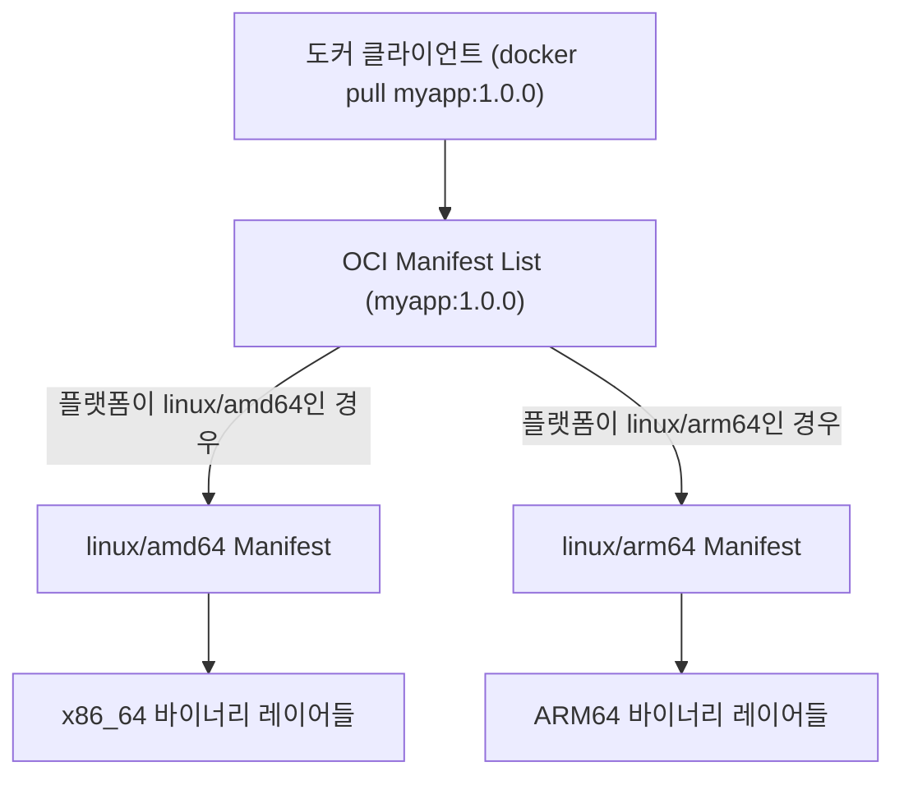

> Mac M1/M2/M3(ARM64) 로컬 환경에서 정상 작동하던 도커 이미지가 x86_64 리눅스 서버에만 올라가면 `exec format error`를 뿜으며 즉사하는 현상의 원인을 짚어보고, `docker buildx`를 통해 단일 이미지 태그로 두 아키텍처를 모두 지원하는 멀티 아키텍처 빌드 파이프라인을 구축하는 방법을 다룹니다.

---

## 1. "내 맥북에선 잘 되는데?": 서버에 배포하자마자 터진 에러

Apple Silicon 칩셋이 탑재된 Mac(M1/M2/M3)이 개발 머신의 표준으로 자리 잡으면서, 로컬 개발 환경과 배포 서버 환경 간의 CPU 아키텍처 불일치로 인한 장애를 겪는 개발자가 급증했습니다.

가장 흔한 실수는 로컬 맥북 터미널에서 애플리케이션을 도커 이미지로 빌드한 뒤 레지스트리에 푸시하고, 이를 x86_64 기반의 온프레미스 리눅스 서버나 AWS EC2 인스턴스에서 실행할 때 발생합니다.

```bash
# 로컬 Mac(Apple Silicon)에서 평소처럼 빌드 및 푸시
$ docker build -t myregistry.com/backend/api:1.0.0 .
$ docker push myregistry.com/backend/api:1.0.0
```

그리고 x86_64 서버에서 해당 이미지를 받아 실행하는 순간, 컨테이너는 1초도 버티지 못하고 비정상 종료(CrashLoopBackOff)됩니다.

```text
standard_init_linux.go:228: exec user process caused: exec format error
```

컨테이너 로그에는 위와 같은 짧고 당혹스러운 에러 메시지만 남습니다. 셸 스크립트나 진입점(Entrypoint) 바이너리를 찾지 못하는 것도 아니고 문법 오류도 아닌데, 왜 `exec format error`가 발생할까요?

{: .prompt-warning }
> 컨테이너는 가상머신(VM)처럼 하드웨어 전체를 에뮬레이션하는 기술이 아닙니다. 호스트 OS 커널의 네임스페이스와 cgroups를 빌려 프로세스를 격리할 뿐이므로, 컨테이너 내부의 컴파일된 바이너리는 **호스트 CPU의 명령어 집합(ISA, Instruction Set Architecture)**을 직접 실행해야 합니다.

---

## 2. 원인 분석: CPU ISA 차이와 OCI Manifest List

### 2.1 aarch64(ARM64)와 x86_64(AMD64)의 바이너리 구조

리눅스 환경에서 실행 파일은 ELF(Executable and Linkable Format) 규격을 따릅니다. ELF 바이너리 헤더에는 이 파일이 어떤 CPU 아키텍처를 위해 컴파일되었는지를 나타내는 `e_machine` 필드가 존재합니다.

- **Apple Silicon Mac**: ARM64(`aarch64`, Machine ID: `0xB7`) 명령어 체계로 컴파일된 바이너리 생성
- **일반 x86_64 서버**: Intel/AMD 64비트(`x86_64`, Machine ID: `0x3E`) 명령어 체계를 요구

x86_64 리눅스 커널의 로더(ELF Loader)가 ARM64 명령어로 구성된 바이너리를 로드하려고 하면, 첫 머신 코드 해석 단계에서 인식할 수 없는 기계어 패턴을 만나 커널 레벨에서 즉시 `ENOEXEC (8, Exec format error)` 시스템 콜 에러를 반환합니다. 이것이 바로 도커 런타임이 뱉어낸 `exec format error`의 실체입니다.

### 2.2 해결의 열쇠: OCI Image Index (Fat Manifest)

그렇다면 공식 이미지인 `nginx`나 `ubuntu`, `eclipse-temurin`은 어떻게 `docker run nginx` 한 줄로 맥북(ARM64)과 클라우드 서버(x86_64) 양쪽에서 아무런 에러 없이 실행되는 것일까요?

비결은 OCI(Open Container Initiative) 이미지 규격의 **Image Index (Manifest List, 일명 Fat Manifest)**에 있습니다.



하나의 이미지 태그(`myapp:1.0.0`) 뒤에는 단일 레이어 목록이 아니라, 여러 플랫폼용 매니페스트들의 참조 목록을 담고 있는 상위 매니페스트(`application/vnd.oci.image.index.v1+json`)가 존재합니다. 

클라이언트가 도커 레지스트리에 이미지를 요청하면 도커 데몬은 자신의 호스트 아키텍처를 전달하고, 레지스트리는 그에 맞는 서브 매니페스트와 실제 레이어 바이너리를 매칭하여 내려줍니다.

실제 공식 이미지의 매니페스트를 확인해보면 이를 명확히 볼 수 있습니다.

```bash
$ docker manifest inspect eclipse-temurin:21-jre-alpine
```

```json
{
  "schemaVersion": 2,
  "mediaType": "application/vnd.docker.distribution.manifest.list.v2+json",
  "manifests": [
    {
      "mediaType": "application/vnd.docker.distribution.manifest.v2+json",
      "size": 947,
      "digest": "sha256:4a123...",
      "platform": {
        "architecture": "amd64",
        "os": "linux"
      }
    },
    {
      "mediaType": "application/vnd.docker.distribution.manifest.v2+json",
      "size": 947,
      "digest": "sha256:9b874...",
      "platform": {
        "architecture": "arm64",
        "os": "linux"
      }
    }
  ]
}
```

---

## 3. 실전 구축: docker buildx로 멀티 아키텍처 이미지 만들기

기본 도커 CLI의 `docker build` 명령어는 호스트 머신의 단일 아키텍처 빌드만 지원하며 로컬 도커 데몬의 전통적인 스토리지 엔진을 사용합니다. 멀티 아키텍처 매니페스트 리스트를 생성하려면 Moby 프로젝트의 차세대 빌드 엔진인 **BuildKit** 기반의 `docker buildx`를 사용해야 합니다.

### 3.1 Buildx 빌더 인스턴스 생성 및 활성화

기본 빌더(`default`)는 컨테이너 격리 드라이버가 아니므로 멀티 플랫폼 빌드에 제약이 있습니다. `docker-container` 드라이버를 사용하는 새로운 빌더 인스턴스를 생성합니다.

```bash
# 1. 멀티 플랫폼 지원용 컨테이너 빌더 생성
$ docker buildx create --name multi-builder --driver docker-container --use

# 2. 빌더 부트스트랩 및 지원 플랫폼 확인
$ docker buildx inspect --bootstrap
```

정상적으로 부트스트랩되면 지원 플랫폼 목록(`Platforms: linux/amd64, linux/arm64, linux/riscv64, linux/ppc64le, ...`)이 터미널에 출력됩니다. 이는 BuildKit 컨테이너 내부에서 QEMU 바이너리 에뮬레이션 등록을 마쳤음을 의미합니다.

### 3.2 멀티 플랫폼 동시 빌드 및 레지스트리 푸시

이제 `--platform` 옵션에 쉼표로 구분하여 빌드할 타깃 플랫폼들을 명시합니다.

```bash
$ docker buildx build \
  --platform linux/amd64,linux/arm64 \
  -t myregistry.com/backend/api:1.0.0 \
  --push \
  .
```

{: .prompt-info }
> **왜 `--push` 옵션이 필수일까요?**  
> 현재 로컬 도커 엔진의 기본 이미지 저장소(Docker daemon engine)는 단일 태그에 여러 아키텍처 레이어가 묶인 Manifest List 구조를 로컬 캐시로 직접 적재(`--load`)하지 못합니다. 따라서 멀티 아키텍처 빌드를 수행할 때는 빌드 완료 즉시 원격 레지스트리로 푸시(`--push`)하거나, 파일 형태의 OCI tarball로 내보내야 합니다.

### 3.3 빌드 결과 검증

푸시된 이미지가 두 아키텍처를 온전히 포함하고 있는지 CLI 도구로 검증합니다.

```bash
$ docker buildx imagetools inspect myregistry.com/backend/api:1.0.0
```

출력 결과에 `linux/amd64`와 `linux/arm64`가 모두 나열된다면, 이제 개발자의 M1/M2 맥북에서도, 회사의 x86_64 온프레미스 쿠버네티스 노드에서도 동일한 이미지 태그로 무중단 기동이 가능해집니다.

---

## 4. QEMU 에뮬레이션 속도 저하와 실무 최적화 팁

`docker buildx`로 멀티 아키텍처 빌드가 가능해졌지만, 실무에서 곧바로 맞닥뜨리는 또 다른 병목은 **극단적인 빌드 속도 저하**입니다.

Apple Silicon(ARM64) 머신에서 `linux/amd64`용 이미지를 빌드할 때, BuildKit은 QEMU(유저 공간 에뮬레이터)를 통해 x86_64 명령어를 한 땀 한 땀 변환하여 실행합니다. 컴파일 언어(Java, Go, Rust, C++)나 무거운 패키지 설치(`apt-get`, `npm build`)가 포함된 프로젝트의 경우, 네이티브 대비 빌드 시간이 **5배에서 10배 이상** 치솟습니다.

이 속도 문제를 실무 파이프라인에서 해결하는 3가지 최적화 기법을 소개합니다.

### 4.1 Cross-Compilation: BUILDPLATFORM과 TARGETPLATFORM 분리

컴파일러 자체가 크로스 컴파일을 지원하는 언어(Go, Rust, Swift 등)나 바이트코드 기반 언어는 무거운 컴파일 과정을 네이티브 CPU에서 돌리는 것이 훨씬 유리합니다.

BuildKit은 빌드 시점에 자동으로 주입되는 사전 정의 변수(`BUILDPLATFORM`, `TARGETPLATFORM`, `TARGETARCH` 등)를 제공합니다.

```dockerfile
# syntax=docker/dockerfile:1.4

# 1. 컴파일러는 호스트의 빠른 네이티브 CPU(--platform=$BUILDPLATFORM)에서 실행
FROM --platform=$BUILDPLATFORM golang:1.24-alpine AS builder
WORKDIR /workspace

COPY go.mod go.sum ./
RUN go mod download

COPY . .

# 2. 타깃 아키텍처 인수를 받아 Go 크로스 컴파일 수행 (QEMU 에뮬레이션 불필요!)
ARG TARGETOS
ARG TARGETARCH
RUN CGO_ENABLED=0 GOOS=${TARGETOS} GOARCH=${TARGETARCH} \
    go build -ldflags="-w -s" -o /workspace/server ./cmd/server

# 3. 최종 러너는 각 타깃 아키텍처의 베이스 이미지 사용
FROM alpine:3.21
WORKDIR /app
COPY --from=builder /workspace/server /app/server

EXPOSE 8080
ENTRYPOINT ["/app/server"]
```

이 방식을 사용하면 ARM64 맥북에서 x86_64용 바이너리를 생성할 때도 QEMU를 거치지 않고 ARM64 CPU 코어 전체를 100% 활용해 순식간에 컴파일을 끝낼 수 있습니다.

### 4.2 CI/CD 파이프라인 최적화 (GitHub Actions)

로컬에서 매번 멀티 아키텍처를 빌드하기보다는 CI 파이프라인(GitHub Actions)에 위임하고, 원격 캐시를 적극 활용하는 구성을 권장합니다.

```yaml
name: Build and Push Multi-Arch Image

on:
  push:
    branches: [ main ]

jobs:
  build:
    runs-on: ubuntu-latest
    steps:
      - name: Checkout repository
        uses: actions/checkout@v4

      - name: Set up QEMU
        uses: docker/setup-qemu-action@v3

      - name: Set up Docker Buildx
        uses: docker/setup-buildx-action@v3

      - name: Log in to Registry
        uses: docker/login-action@v3
        with:
          registry: myregistry.com
          username: ${{ secrets.REGISTRY_USER }}
          password: ${{ secrets.REGISTRY_TOKEN }}

      - name: Build and push
        uses: docker/build-push-action@v6
        with:
          context: .
          platforms: linux/amd64,linux/arm64
          push: true
          tags: myregistry.com/backend/api:${{ github.sha }}
          cache-from: type=gha
          cache-to: type=gha,mode=max
```

{: .prompt-tip }
> `cache-to: type=gha,mode=max`를 지정하면 최종 산출물 레이어뿐 아니라 멀티스테이지의 중간 캐시 레이어까지 GitHub Actions 캐시 스토리지에 보관되어 이후 빌드 시간을 대폭 줄일 수 있습니다.

### 4.3 Native Node 원격 빌더 연결 (대규모 클러스터)

QEMU 에뮬레이션의 한계를 완전히 벗어나고 싶다면, 실제 ARM64 노드(예: AWS Graviton)와 x86_64 노드를 각각 프로비저닝한 뒤 Buildx 빌더 하나로 묶는 **하이브리드 빌더 노드**를 구성할 수 있습니다.

```bash
# 1. 기본 amd64 노드를 마스터 빌더로 생성
$ docker buildx create --name hybrid-builder --node amd64-builder --platform linux/amd64 --driver-opt network=host

# 2. SSH를 통해 원격 arm64 서버 노드를 동일 빌더에 추가
$ docker buildx create --name hybrid-builder --append --node arm64-builder --platform linux/arm64 ssh://ubuntu@arm64-runner.internal

# 3. 빌더 활성화
$ docker buildx use hybrid-builder
```

이 설정을 마치면 `buildx`는 `linux/amd64` 레이어는 x86_64 머신에서, `linux/arm64` 레이어는 실제 ARM64 머신에서 각각 네이티브 성능으로 분산 빌드한 뒤 매니페스트만 최종 결합하여 레지스트리에 푸시합니다.

---

## 5. 실무 체크리스트 및 정리

현대 클라우드 인프라는 가성비가 높은 AWS Graviton(ARM64) 인스턴스와 전통적인 x86_64 인스턴스가 공존하는 복합 환경으로 빠르게 재편되고 있습니다. 여기에 개발자들의 Apple Silicon Mac까지 더해지면서 멀티 아키텍처 이미지 관리는 선택이 아닌 필수 역량이 되었습니다.

| 점검 항목 | 권장 조치 |
| :--- | :--- |
| **로컬 긴급 테스트** | 개발자 맥북에서 단일 amd64 이미지가 급히 필요하다면 `docker build --platform linux/amd64` 사용 |
| **정식 배포 이미지** | `docker buildx build --platform linux/amd64,linux/arm64 --push`로 OCI Fat Manifest 발행 |
| **빌드 속도 개선** | 컴파일 언어는 Dockerfile의 `$BUILDPLATFORM` 교차 컴파일 적극 활용 |
| **CI/CD 파이프라인** | GitHub Actions 캐시(`type=gha`) 및 BuildKit Buildx 액션 통합 |

"내 컴퓨터에서는 잘 도는데 서버에서만 죽는다"는 컨테이너 환경에서 가장 허탈한 디버깅 경험 중 하나입니다. 이번 글에서 다룬 OCI 매니페스트 리스트의 원리와 `buildx` 도구를 실무 파이프라인에 적용해 보시기 바랍니다.
