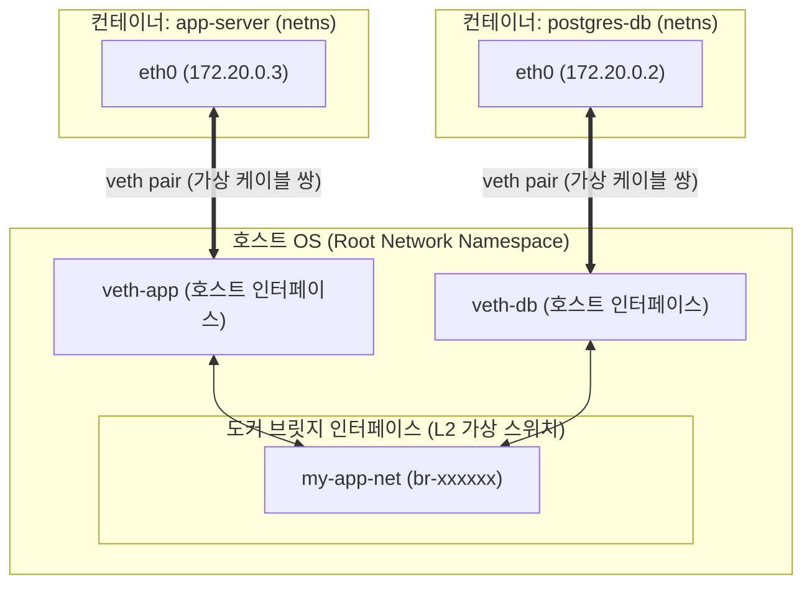
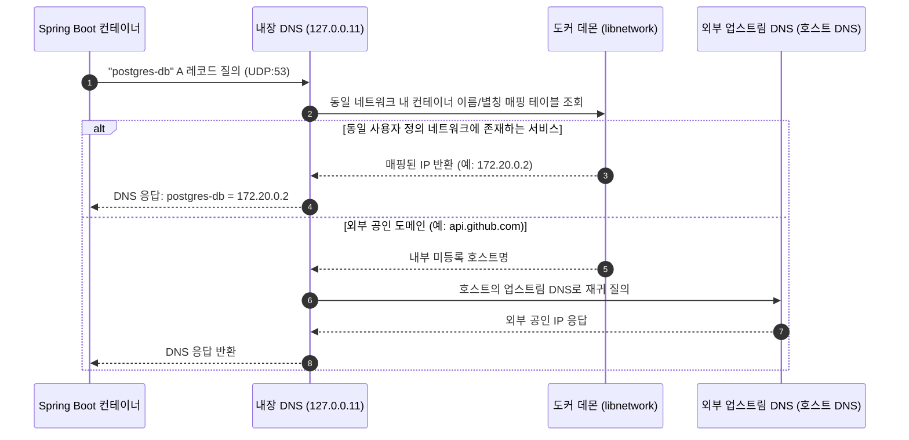

> 로컬 및 실무 환경에서 컨테이너 간 통신 시 `UnknownHostException`을 만나는 원인을 추적합니다. 기본 브릿지(`docker0`)와 사용자 정의 브릿지의 아키텍처 차이, veth pair와 리눅스 네트워크 네임스페이스 격리, 그리고 도커 내장 DNS(`127.0.0.11`)가 제공하는 서비스 디스커버리(Service Discovery) 메커니즘을 실제 Spring Boot와 PostgreSQL 실습을 통해 깊이 있게 파헤칩니다.

---

## 1. 컨테이너 간 통신의 첫 장벽: "분명 이름을 맞췄는데 왜 통신이 안 될까?"

로컬 개발 환경이나 테스트 서버에서 도커 컨테이너를 직접 띄우다 보면 흔히 마주치는 에러가 있습니다. 데이터베이스 컨테이너를 띄우고, 스프링 부트 컨테이너를 띄워 연결하려는데 애플리케이션 시작 단계에서 다음과 같은 예외가 발생하며 컨테이너가 비정상 종료되는 상황입니다.

```text
Caused by: java.net.UnknownHostException: postgres-db
    at java.base/sun.nio.ch.NioSocketImpl.connect(UnknownSocketImpl.java:567)
    at org.postgresql.core.v3.ConnectionFactoryImpl.openConnectionImpl(ConnectionFactoryImpl.java:318)
    ... 18 common frames omitted
```

많은 초급 엔지니어들이 이 상황에서 `docker inspect postgres-db` 명령을 내려 컨테이너에 할당된 IP(예: `172.17.0.2`)를 확인한 뒤, 데이터베이스 연결 URL을 `jdbc:postgresql://172.17.0.2:5432/mydb`로 하드코딩하여 문제를 '임시 해결'하곤 합니다.

하지만 이는 심각한 안티패턴입니다. 컨테이너는 언제든 재시작될 수 있고, 재시작 순서나 호스트 리부팅에 따라 IP는 얼마든지 동적으로 변경되기 때문입니다.

그렇다면 왜 `docker run --name postgres-db ...`와 같이 컨테이너 이름을 명시적으로 지정했음에도 불구하고, 애플리케이션 컨테이너에서는 `postgres-db`라는 호스트명을 찾지 못하는 것일까요?

> 기본 `docker0` 브릿지 네트워크는 레거시 호환성을 위해 유지되며, 컨테이너 이름 기반의 자동 DNS 해석을 지원하지 않습니다. 컨테이너 간 안정적인 서비스 디스커버리를 구축하려면 도커의 네트워크 서브시스템 동작 원리를 먼저 이해해야 합니다.
{: .prompt-warning }

---

## 2. 리눅스 네트워크 네임스페이스와 veth pair 동작 원리

도커의 네트워크 모델을 이해하기 위한 첫걸음은 리눅스 커널의 네트워크 가상화 기술을 이해하는 것입니다.

도커 컨테이너는 독립된 리눅스 네트워크 네임스페이스(`netns`)를 가집니다. 컨테이너 내부를 열어보면 자신만의 고유한 루프백(`lo`), 독립된 라우팅 테이블, 독립된 iptables 규칙 체인, 그리고 독립된 네트워크 인터페이스(`eth0`)를 보유하고 있습니다. 호스트 운영체제와 완전히 격리된 별도의 네트워크 공간에 갇혀 있는 셈입니다.

그렇다면 이 격리된 공간 속의 컨테이너가 어떻게 다른 컨테이너 및 호스트 네트워크와 패킷을 주고받을 수 있을까요? 핵심 연결 고리가 바로 **veth pair(Virtual Ethernet Pair)**입니다.



### veth pair란?
- **가상 이더넷 케이블 쌍**: veth pair는 항상 쌍(pair)으로 생성되는 리눅스 가상 네트워크 인터페이스입니다. 긴 랜선의 양쪽 끝단과 같아서 한쪽 끝으로 들어간 패킷은 즉시 반대쪽 끝으로 튀어나옵니다.
- **네임스페이스 경계 관통**: 도커 데몬은 veth pair를 생성한 후, 한쪽 끝(`eth0`)을 컨테이너의 네트워크 네임스페이스 내부로 밀어 넣고, 다른 쪽 끝(`vethXXXXXX`)은 호스트의 루트 네임스페이스에 남겨둡니다.
- **소프트웨어 브릿지 연결**: 호스트에 남겨진 `vethXXXXXX` 인터페이스는 소프트웨어 L2 스위치 역할을 하는 도커 브릿지 인터페이스에 바인딩됩니다.

패킷이 `app-server`(`172.20.0.3`)에서 `postgres-db`(`172.20.0.2`)로 이동할 때의 흐름은 다음과 같습니다.

1. `app-server` 프로세스가 소켓을 통해 `172.20.0.2`로 TCP SYN 패킷을 전송합니다.
2. 컨테이너 내부 라우팅 테이블에 의해 기본 인터페이스인 `eth0`로 패킷이 전달됩니다.
3. veth pair의 터널링 특성에 의해 패킷은 호스트 측 인터페이스인 `veth-app`으로 즉시 도달합니다.
4. 브릿지(`br-xxxxxx`)는 패킷의 목적지 MAC 주소를 분석하여 자신의 L2 포워딩 데이터베이스(FDB)를 조회한 뒤, 목적지 인터페이스인 `veth-db`로 패킷을 스위칭합니다.
5. `veth-db`와 연결된 veth pair의 반대쪽 끝인 `postgres-db`의 `eth0`로 패킷이 수신됩니다.

---

## 3. 기본 브릿지(`docker0`) vs 사용자 정의 브릿지(User-Defined Bridge)

도커를 설치하면 기본적으로 `docker0`라는 브릿지 네트워크가 생성됩니다. 사용자가 `--network` 옵션을 주지 않고 컨테이너를 실행하면 모두 이 기본 브릿지에 연결됩니다.

하지만 도커의 네트워크에는 두 가지 뚜렷하게 구별되는 브릿지 유형이 존재합니다.

| 구분 | 기본 브릿지 (`docker0`) | 사용자 정의 브릿지 (`docker network create`) |
| :--- | :--- | :--- |
| **자동 DNS 해석 (서비스 디스커버리)** | ❌ 미지원 (IP로만 직접 통신 가능) |  **완전 지원 (컨테이너 이름/별칭 해석)** |
| **네트워크 패킷 격리** | ❌ 모든 기본 컨테이너가 망 공유 |  네트워크 단위로 L2/L3 패킷 완전 격리 |
| **런타임 동적 연결/분리** | ❌ 컨테이너 중지 및 재생성 필요 |  무중단 `connect`/`disconnect` 지원 |
| **IP 대역 및 MTU 설정** | 데몬 전역 설정(`/etc/docker/daemon.json`) 의존 | 네트워크 생성 시 서브넷, 게이트웨이 개별 지정 |
| **레거시 의존성** | 레거시 `--link` 플래그 지원 | `--link` 대신 DNS 기반 서비스 디스커버리 사용 |

### 왜 기본 브릿지에서는 컨테이너 이름 DNS가 동작하지 않는가?
도커 초창기(Docker 1.9 이전 버전)에는 컨테이너 간 이름을 해석하기 위해 `--link` 옵션을 사용했습니다. 이 옵션은 대상 컨테이너의 IP와 이름을 호출하는 컨테이너의 `/etc/hosts` 파일에 정적으로 하드코딩해 주입하는 원시적인 방식이었습니다.

도커 진영은 하위 호환성(Backward Compatibility)을 보장하기 위해 기본 브릿지(`docker0`)의 동작 방식을 변경하지 않고 그대로 유지했습니다. 대신 진보된 임베디드 DNS 서버와 서비스 디스커버리 기능은 **사용자 정의 브릿지(User-Defined Bridge)**에서만 동작하도록 분리하여 설계했습니다.

> 실무에서는 프로덕션 환경이든 로컬 개발 환경이든 절대 기본 `docker0` 네트워크를 직접 사용하지 않고, 도메인이나 애플리케이션 스택별로 사용자 정의 네트워크(User-defined bridge)를 별도로 생성하여 격리하는 것이 표준입니다.
{: .prompt-info }

---

## 4. 도커 내장 DNS 서버(`127.0.0.11`)와 서비스 디스커버리 메커니즘

사용자 정의 브릿지에 연결된 컨테이너 내부로 들어가 `/etc/resolv.conf`를 확인해 보면 흥미로운 설정을 발견할 수 있습니다.

```bash
$ docker exec -it app-server cat /etc/resolv.conf
nameserver 127.0.0.11
options ndots:0
```

모든 네임서버 질의가 `127.0.0.11`이라는 특수한 루프백 주소로 향하도록 구성되어 있습니다.

### 127.0.0.11의 정체: 도커 임베디드 DNS 리졸버
`127.0.0.11`은 도커 엔진이 컨테이너의 네트워크 네임스페이스 내부에 프로비저닝한 **내장 임베디드 DNS 서버(Embedded DNS Server)**입니다.

컨테이너 내부에서 외부 DNS나 다른 컨테이너 이름을 질의하면 다음과 같은 단계로 처리됩니다.



### 루프백 주소인데 어떻게 데몬과 통신할까?
컨테이너 내부에는 커널 레벨의 iptables(또는 nftables) NAT 규칙이 자동으로 설정됩니다. 컨테이너 내부 프로세스가 `127.0.0.11:53`으로 패킷을 쏘면, PREROUTING 규칙에 의해 이 패킷이 도커 데몬의 `libnetwork` DNS 리스너 소켓으로 리다이렉트되어 처리됩니다.

### 네트워크 별칭(Network Alias)과 DNS 라운드 로빈 로드밸런싱
도커 내장 DNS는 단일 컨테이너 이름 해석뿐만 아니라 동일한 별칭을 공유하는 다중 컨테이너에 대해 **DNS Round-robin**을 지원합니다.

```bash
docker run -d --network backend-net --network-alias api api-service:v1
docker run -d --network backend-net --network-alias api api-service:v2
```

다른 컨테이너에서 `api`라는 도메인으로 DNS 질의를 던지면, `127.0.0.11`은 응답할 때마다 두 컨테이너의 IP 순서를 순환(Shuffle)시켜 반환하므로 간단한 L4 클라이언트 사이드 로드밸런싱을 즉시 구현할 수 있습니다.

---

## 5. 실무 실습: Spring Boot와 PostgreSQL의 무결점 연결

이제 이론을 바탕으로 IP 하드코딩 없이 서비스 이름으로 완벽하게 연동되는 백엔드 인프라를 구축해 보겠습니다.

### 실습 1: Docker CLI를 이용한 수동 네트워크 구축

```bash
# 1. 독립된 사용자 정의 브릿지 네트워크 생성
docker network create --driver bridge backend-net

# 2. PostgreSQL 컨테이너 실행 (네트워크 지정)
docker run -d \
  --name postgres-db \
  --network backend-net \
  -e POSTGRES_DB=appdb \
  -e POSTGRES_USER=appuser \
  -e POSTGRES_PASSWORD=secret \
  postgres:17-alpine

# 3. 도커 내장 DNS 동작 검증 (일회용 alpine 컨테이너로 테스트)
docker run --rm --network backend-net alpine nslookup postgres-db
```

DNS 조회 결과 터미널에 다음과 같이 출력됩니다.

```text
Server:		127.0.0.11
Address:	127.0.0.11:53

Name:	postgres-db
Address: 172.18.0.2
```

이제 스프링 부트 애플리케이션을 동일한 네트워크로 실행하면 IP 주소를 전혀 알 필요 없이 호스트명 `postgres-db`만으로 안전하게 연결됩니다.

```bash
# 4. Spring Boot 애플리케이션 실행
docker run -d \
  --name app-server \
  --network backend-net \
  -p 8080:8080 \
  -e SPRING_DATASOURCE_URL=jdbc:postgresql://postgres-db:5432/appdb \
  -e SPRING_DATASOURCE_USERNAME=appuser \
  -e SPRING_DATASOURCE_PASSWORD=secret \
  my-spring-app:latest
```

---

### 실습 2: Docker Compose를 통한 선언적 네트워크 구성

실무에서는 개별 `docker run` 명령 대신 `compose.yaml`을 사용합니다. Docker Compose는 파일에 명시된 서비스들을 위해 **프로젝트 단위의 사용자 정의 브릿지 네트워크를 자동으로 생성**하므로, 서비스 이름이 곧 DNS 호스트명이 됩니다.

```yaml
services:
  postgres-db:
    image: postgres:17-alpine
    container_name: postgres-db
    environment:
      POSTGRES_DB: appdb
      POSTGRES_USER: appuser
      POSTGRES_PASSWORD: secret
    volumes:
      - pgdata:/var/lib/postgresql/data
    networks:
      - backend-net
    healthcheck:
      test: ["CMD-SHELL", "pg_isready -U appuser -d appdb"]
      interval: 5s
      timeout: 5s
      retries: 5

  app-server:
    image: my-spring-app:latest
    container_name: app-server
    depends_on:
      postgres-db:
        condition: service_healthy
    environment:
      SPRING_DATASOURCE_URL: jdbc:postgresql://postgres-db:5432/appdb
      SPRING_DATASOURCE_USERNAME: appuser
      SPRING_DATASOURCE_PASSWORD: secret
    ports:
      - "8080:8080"
    networks:
      - backend-net

networks:
  backend-net:
    driver: bridge
    ipam:
      config:
        - subnet: 172.28.0.0/16

volumes:
  pgdata:
```

---

## 6. 백엔드 엔지니어가 반드시 알아야 할 실무 트러블슈팅

### 1) JVM의 DNS 캐싱 정책 (TTL 이슈)
자바 애플리케이션을 컨테이너 환경에서 운영할 때 흔히 겪는 함정 중 하나가 JVM의 DNS 캐싱 정책입니다.

기본적으로 보안 매니저(Security Manager)가 설정된 경우 JVM은 성공한 DNS 조회를 영구 캐싱(`networkaddress.cache.ttl = -1`)합니다. 컨테이너가 무중단 배포나 장애로 인해 재시작되어 새 IP를 부여받았을 때, 스프링 부트 애플리케이션이 구 IP를 계속 캐싱하고 있어 영구적인 `Connection Refused`가 발생할 수 있습니다.

> 컨테이너 기반 Java 애플리케이션을 실행할 때는 반드시 JVM 시작 옵션으로 `-Dnetworkaddress.cache.ttl=5` (또는 `$JAVA_HOME/conf/security/java.security` 내 `networkaddress.cache.ttl=10`)를 주입하여 도커 내장 DNS의 변경 사항이 즉시 반영되도록 조치해야 합니다.
{: .prompt-tip }

### 2) `network_mode: host` 사용 시 주의점
네트워크 가상화 오버헤드를 줄이기 위해 `network_mode: host`를 사용하는 경우가 있습니다. 
- 이 모드에서는 컨테이너가 호스트의 네트워크 네임스페이스를 그대로 공유합니다.
- 따라서 veth pair나 브릿지 스위칭을 거치지 않으므로 성능은 가장 뛰어납니다.
- 하지만 **도커 내장 DNS(`127.0.0.11`) 서비스 디스커버리가 완전히 비활성화**되며, 포트 격리가 되지 않아 호스트의 다른 프로세스와 포트 충돌이 발생할 수 있습니다.

### 3) 실무 네트워크 디버깅 명령어 치트시트

```bash
# 1. 생성된 네트워크의 서브넷 및 연결된 모든 컨테이너 IP/MAC 확인
docker network inspect backend-net

# 2. 실행 중인 컨테이너를 다른 네트워크에 실시간 추가 연결
docker network connect frontend-net app-server

# 3. 컨테이너 내부에서 DNS 해석 디버깅
docker exec -it app-server getent hosts postgres-db
```

---

## 7. 마치며

도커 컨테이너 간의 통신은 단순한 포트 포워딩 수준을 넘어 리눅스 커널의 네트워크 네임스페이스, 가상 이더넷 인터페이스 쌍(veth pair), L2 소프트웨어 브릿지, 그리고 iptables 기반의 임베디드 DNS 리졸버가 유기적으로 맞물려 동작합니다.

1. **기본 브릿지(`docker0`)**는 레거시 `--link` 호환성을 위한 망이므로 컨테이너 이름 해석이 불가능합니다.
2. 컨테이너 간 상호 참조가 필요한 모든 환경에서는 반드시 **사용자 정의 브릿지(User-defined bridge)**를 명시적으로 생성해야 합니다.
3. 도커 내장 DNS(`127.0.0.11`)를 통해 IP 하드코딩 없는 진정한 **서비스 디스커버리(Service Discovery)**와 서비스 분리 격리를 달성할 수 있습니다.
